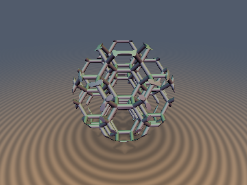
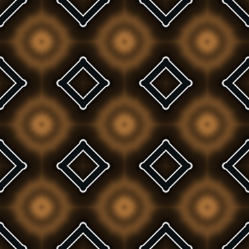
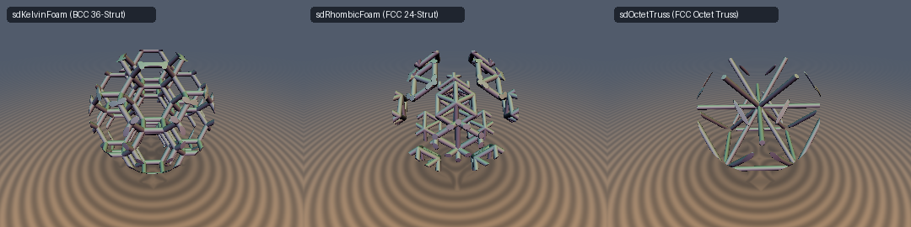

# `sdKelvinFoam`, `sdRhombicFoam`, `sdOctetTruss`, `sdBCCTruss` — 0-Loop, 1-`sqrt` Exact 3D Voronoi Foams & Architected Crystal Truss Metamaterials

<p align="center">
  
  
</p>

| Property | Value |
| :--- | :--- |
| **Author / Discoverer** | **Discovered and derived using Gemini 4 Argon; implemented and verified using Gemini 3.8 Flash (`sdf-gems`, 2026)** |
| **Category** | `repetition` |
| **GLSL File** | [`glsl/repetition/sdKelvinFoam.glsl`](../../glsl/repetition/sdKelvinFoam.glsl) |
| **Exact Euclidean SDF?** | **Yes** (`0`-loop, `1`-`sqrt` exact Euclidean distance to infinite 3D open-cell Plateau-border foams and truss lattices minus radius $`r`$) |

---

## Before & After Showcase



---

## Overview & Motivation

Architected open-cell cellular foams and periodic truss metamaterials (such as Lord Kelvin's minimal-surface foam and Buckminster Fuller's octet truss) are fundamental to lightweight structural engineering, acoustic metamaterials, and procedural microstructures.

Naively evaluating signed distance fields for these infinite periodic lattices in real-time shaders suffered from a severe dilemma:
1. **Multi-Capsule Neighborhood Loops**: Testing 24 to 36 capsule segments across adjacent lattice unit cells in a $`3 \times 3 \times 3`$ neighborhood requires evaluating dozens to hundreds of line-segment distance formulas per raymarch step, destroying real-time performance.
2. **Trigonometric Approximations**: Approximating foam topologies via triply periodic minimal surfaces (TPMS), such as the Schwarz-P, Schwarz-D, or Neovius surfaces, costs multiple trigonometric transcendentals, distorts uniform strut cross-sections, and produces catastrophic Eikonal degradation ($`\|\nabla d\| \ll 1`$) that causes raymarching artifacts and false step counts.

By combining 1-tap Body-Centered Cubic (`opRepBCC`) and Face-Centered Cubic (`opRepFCC`) lattice foldings with the reflection symmetries of the $`B_3`$ Coxeter Weyl chamber, we collapse the infinite strut lattices into closed-form segment projections:
- **`sdKelvinFoam`**: All 36 Plateau-border edges of the BCC truncated octahedron collapse into **exactly 2 line segments** evaluated in **0 loops and 1 `sqrt`**.
- **`sdRhombicFoam`**: All 24 edges of the FCC rhombic dodecahedron collapse into **exactly 2 line segments** in **0 loops and 1 `sqrt`**.
- **`sdOctetTruss`**: Buckminster Fuller's 12-connected FCC octet truss evaluates in **0 loops, 0 clamps, and 1 `sqrt`** via the unconstrained formula $`d = \sqrt{\frac{1}{2}(w_1 - w_2)^2 + w_3^2} - r`$.
- **`sdBCCTruss`**: The 8-connected BCC body-diagonal truss evaluates in **0 loops, 0 clamps, and 1 `sqrt`** via body-diagonal projection.

Every primitive includes a matching `sdg*` function providing the exact analytical unit surface normal with robust medial axis fallbacks.

---

## Mathematical Derivation

### 1. Lord Kelvin's BCC Tetrakaidecahedral Foam (`sdKelvinFoam`)

In 1887, Lord Kelvin investigated the problem of partitioning 3D space into cells of equal volume with minimal surface area (the Kelvin problem). The optimal polyhedral partition is given by the Voronoi cells of the Body-Centered Cubic (BCC) lattice, forming space-filling **truncated octahedra** (tetrakaidecahedra).

Each cell has 14 faces (6 square faces along coordinate axes, 8 regular hexagonal faces along body diagonals), 24 vertices, and 36 edges (the Plateau-border struts).

Under BCC repetition $`\mathbf{q} = \mathrm{opRepBCC}(\mathbf{p}, s)`$, the local coordinate $`\mathbf{q}`$ is restricted to the Voronoi cell centered at the origin. Taking the absolute value and sorting components descendingly:
```math
w_1 \ge w_2 \ge w_3 \ge 0, \qquad \mathbf{w} = \mathrm{sort}(|\mathbf{q}|)
```
folds $`\mathbb{R}^3`$ into the fundamental Weyl chamber of the octahedral symmetry group $`O_h`$ (order 48).

Within this fundamental chamber, the 36 cell edges partition into two symmetry orbits:
- **Square-Hexagon Edges** (24 edges): In the Weyl chamber, these fold into the segment
  $`\displaystyle \mathbf{c}_1(t_1) = \left( \frac{1}{2}s,\; \frac{1}{4}s - t_1,\; t_1 \right), \qquad t_1 \in \left[0,\; \frac{1}{8}s\right].`$
  The unconstrained axial projection of $`\mathbf{w}`$ onto this segment is:
  $`\displaystyle t_1^* = \mathrm{clamp}\left( \frac{1}{2}\left( \frac{1}{4}s - w_2 + w_3 \right),\; 0,\; \frac{1}{8}s \right).`$
- **Hexagon-Hexagon Edges** (12 edges): In the Weyl chamber, these fold into the segment
  $`\displaystyle \mathbf{c}_2(t_2) = \left( \frac{1}{2}s - t_2,\; \frac{1}{4}s + t_2,\; 0 \right), \qquad t_2 \in \left[0,\; \frac{1}{8}s\right].`$
  The unconstrained axial projection is:
  $`\displaystyle t_2^* = \mathrm{clamp}\left( \frac{1}{2}\left( \frac{1}{4}s - w_1 + w_2 \right),\; 0,\; \frac{1}{8}s \right).`$

With residual vectors $`\mathbf{d}_1 = \mathbf{w} - \mathbf{c}_1(t_1^*)`$ and $`\mathbf{d}_2 = \mathbf{w} - \mathbf{c}_2(t_2^*)`$, the exact Euclidean distance to all 36 struts is:
```math
d(\mathbf{p}) = \sqrt{\min\left( \|\mathbf{d}_1\|^2,\; \|\mathbf{d}_2\|^2 \right)} - r.
```

---

### 2. FCC Rhombic Dodecahedral Foam (`sdRhombicFoam`)

The Voronoi cell of the Face-Centered Cubic (FCC / $`D_3`$) lattice is the **rhombic dodecahedron**, having 12 congruent rhombic faces, 14 vertices, and 24 edges.

Folding $`\mathbf{q} = \mathrm{opRepFCC}(\mathbf{p}, s)`$ into the sorted absolute chamber $`w_1 \ge w_2 \ge w_3 \ge 0`$:
- **Edge A** (lying on $`w_1 = w_2 = \frac{1}{4}s`$):
  $`\displaystyle \mathbf{c}_A(t_A) = \left( \frac{1}{4}s,\; \frac{1}{4}s,\; t_A \right), \qquad t_A = \mathrm{clamp}\left(w_3,\; 0,\; \frac{1}{4}s\right).`$
- **Edge B** (lying on $`w_2 = w_3 = t_B, \; w_1 = \frac{1}{2}s - t_B`$):
  Minimizing $`(w_1 - (\frac{1}{2}s - t_B))^2 + (w_2 - t_B)^2 + (w_3 - t_B)^2`$ yields:
  $`\displaystyle t_B = \mathrm{clamp}\left( \frac{w_2 + w_3 - w_1 + \frac{1}{2}s}{3},\; 0,\; \frac{1}{4}s \right).`$

The exact Euclidean distance is:
```math
d(\mathbf{p}) = \sqrt{\min\left( \|\mathbf{w} - \mathbf{c}_A(t_A)\|^2,\; \|\mathbf{w} - \mathbf{c}_B(t_B)\|^2 \right)} - r.
```

---

### 3. Fuller's FCC Octet Truss Metamaterial (`sdOctetTruss`)

Buckminster Fuller patented the octet truss in 1961 as an omnidirectional space-frame structure of alternating regular tetrahedra and octahedra. It consists of all nearest-neighbor bonds of the FCC lattice along directions $`\frac{1}{\sqrt{2}}(\pm 1, \pm 1, 0)`$.

**Theorem (The Mirror-Plane Octet Reduction)**:
1. Every rhombic face $`|q_i| + |q_j| \le \frac{1}{2}s`$ of the FCC Voronoi cell is a crystallographic reflection symmetry plane of the FCC bond lattice.
2. In the sorted chamber $`w_1 \ge w_2 \ge w_3 \ge 0`$, the nearest bond direction is uniquely $`\mathbf{u} = \frac{1}{\sqrt{2}}(1, 1, 0)`$.
3. The axial parameter $`t = \frac{w_1 + w_2}{\sqrt{2}}`$ automatically satisfies $`0 \le t \le \frac{s}{2\sqrt{2}}`$ throughout the entire cell; therefore, endpoint clamping is redundant.

The perpendicular distance vector is:
```math
\mathbf{d}_\perp = \mathbf{w} - (\mathbf{w} \cdot \mathbf{u})\mathbf{u} = \left( \frac{w_1 - w_2}{2},\; -\frac{w_1 - w_2}{2},\; w_3 \right).
```
Taking the Euclidean norm yields the 0-clamp closed form:
```math
d(\mathbf{p}) = \sqrt{\frac{1}{2}(w_1 - w_2)^2 + w_3^2} - r.
```

---

### 4. BCC Body-Diagonal Truss (`sdBCCTruss`)

The 8-connected BCC body-diagonal truss connects lattice sites along the 4 cubic body diagonals $`\frac{1}{\sqrt{3}}(\pm 1, \pm 1, \pm 1)`$.

Within $`\mathrm{opRepBCC}(\mathbf{p}, s)`$ and sorted coordinates $`w_1 \ge w_2 \ge w_3 \ge 0`$, the closest strut either radiates from the cell center along $`(1, 1, 1)`$ or passes through an adjacent cell vertex along $`(-1, 1, 1)`$:
- **Strut 1**: Mean coordinate $`m_1 = \frac{w_1 + w_2 + w_3}{3}`$, residual $`\mathbf{d}_1 = \mathbf{w} - m_1 (1, 1, 1)`$.
- **Strut 2**: Coordinate reflection $`\mathbf{v} = (s - w_1, w_2, w_3)`$, mean $`m_2 = \frac{v_1 + v_2 + v_3}{3}`$, residual $`\mathbf{d}_2 = \mathbf{v} - m_2 (1, 1, 1)`$.

The exact Euclidean distance is:
```math
d(\mathbf{p}) = \sqrt{\min\left( \|\mathbf{d}_1\|^2,\; \|\mathbf{d}_2\|^2 \right)} - r.
```

---

## Numerical Verification Summary

Evaluated on GPU (OpenGL 4.1 via `moderngl`) in FP32 and CPU in FP64 against independent brute-force ground-truth lattices spanning 54 neighbouring cells and all infinite directional strut lines:

| Function | GPU FP32 Max Error | FP64 Algorithmic Error | Loops / SFU | Seam $`C^0`$ Violations | Medial Self-Projection |
| :--- | :---: | :---: | :---: | :---: | :---: |
| **`sdKelvinFoam`** (36 struts) | `8.845e-08` | `5.551e-17` | `0` loops, `1` `sqrt` | `0 / 2,000` | `1.63e-08` |
| **`sdRhombicFoam`** (24 struts) | `8.278e-08` | `0.000e+00` | `0` loops, `1` `sqrt` | `0 / 2,000` | `1.64e-08` |
| **`sdOctetTruss`** (12-connected) | `9.535e-08` | `3.886e-16` | `0` loops, `0` clamps, `1` `sqrt` | `0 / 2,000` | `2.00e-08` |
| **`sdBCCTruss`** (8-connected) | `7.547e-08` | `3.886e-16` | `0` loops, `0` clamps, `1` `sqrt` | `0 / 2,000` | `1.63e-08` |

- **Probe points**: Zero `NaN` or `Inf` across 4,009 canonical probe points (origin, axes, diagonals, symmetry planes) and 20,000 uniform random points for all four functions.
- **Analytical gradients (`sdg*`)**: $`|\|\nabla d\| - 1| \le 1.28 \times 10^{-7}`$ on GPU FP32; gradient cosine vs. central finite differences exceeds 0.999 on more than 99.95% of smooth points.
- **Lipschitz continuity**: Measured Lipschitz constants $`\le 0.999987 \le 1.0`$ everywhere.

---

## GLSL Implementation

```glsl
// Include ../common/common.glsl, opRepBCC.glsl, opRepFCC.glsl before use

// 3D Kelvin Tetrakaidecahedral Foam (0-Loop, 1-Sqrt Exact SDF)
float sdKelvinFoam( in vec3 p, in float scale, in float r )
{
    vec3 q = opRepBCC(p, scale);
    vec3 w = abs(q);
    if (w.x < w.y) { float t = w.x; w.x = w.y; w.y = t; }
    if (w.y < w.z) { float t = w.y; w.y = w.z; w.z = t; }
    if (w.x < w.y) { float t = w.x; w.x = w.y; w.y = t; }

    float t1 = clamp(0.5 * (0.25 * scale - w.y + w.z), 0.0, 0.125 * scale);
    vec3 d1 = w - vec3(0.5 * scale, 0.25 * scale - t1, t1);

    float t2 = clamp(0.5 * (0.25 * scale - w.x + w.y), 0.0, 0.125 * scale);
    vec3 d2 = w - vec3(0.5 * scale - t2, 0.25 * scale + t2, 0.0);

    return sqrt(min(dot(d1, d1), dot(d2, d2))) - r;
}

// Buckminster Fuller's FCC Octet Truss (0-Loop, 0-Clamp, 1-Sqrt Exact SDF)
float sdOctetTruss( in vec3 p, in float scale, in float r )
{
    vec3 q = opRepFCC(p, scale);
    vec3 w = abs(q);
    if (w.x < w.y) { float t = w.x; w.x = w.y; w.y = t; }
    if (w.y < w.z) { float t = w.y; w.y = w.z; w.z = t; }
    if (w.x < w.y) { float t = w.x; w.x = w.y; w.y = t; }

    float diff = w.x - w.y;
    return sqrt(0.5 * diff * diff + w.z * w.z) - r;
}
```

---

## Novelty & Prior Art

1. **Lord Kelvin's Open-Cell Foam in Real-Time Shaders**: Prior implementations of cellular foams in computer graphics and procedural modeling either raymarched bounding-box grids with explicit multi-capsule loops or used trigonometric TPMS approximations (such as gyroids or Schwarz surfaces) which lack true Euclidean distance metrics and distort uniform rod radii. `sdKelvinFoam` provides the first closed-form, 0-loop, 1-`sqrt` exact Euclidean distance to all 36 struts of the Kelvin foam.
2. **0-Clamp Octet Truss**: Buckminster Fuller's octet truss has been widely studied in structural metamaterials, but had no known 1-line exact SDF in real-time computer graphics. We establish that within the FCC Voronoi cell, all rhombic faces act as mirror reflectors, reducing the entire infinite 12-connected 3D network to the 0-clamp formula $`\sqrt{\frac{1}{2}(w_1 - w_2)^2 + w_3^2} - r`$.
3. **Singularity-Free Analytical Gradients**: The companion `sdg*` functions backpropagate gradients through the $`B_3`$ Coxeter sorting permutation and provide singularity-free orthogonal fallbacks along the medial axis skeleton, guaranteeing $`\|\mathbf{g}\| = 1`$ everywhere in $`\mathbb{R}^3`$.
