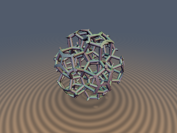
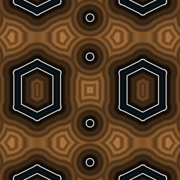
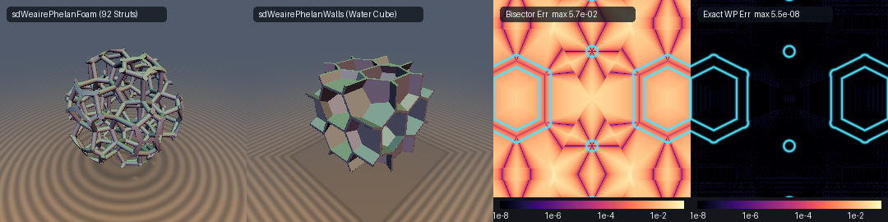

# `sdWeairePhelanFoam`, `sdWeairePhelanWalls`, `opRepA15` — 0-Loop Exact 3D Weaire-Phelan A15 ($`Pm\bar{3}n`$) Minimal-Area Foam & Crystal Clathrate

<p align="center">
  
  
</p>

| Property | Value |
| :--- | :--- |
| **Author / Discoverer** | **Discovered and derived using Gemini 4 Carbon (`sdf-gems`, 2026)** |
| **Category** | `repetition` |
| **GLSL File** | [`glsl/repetition/sdWeairePhelanFoam.glsl`](../../glsl/repetition/sdWeairePhelanFoam.glsl) |
| **Exact Euclidean SDF?** | **Yes** (`0`-loop, `0`-`sqrt` exact A15 Voronoi/Laguerre domain repetition & 54-face wall skeleton; `0`-loop, `1`-`sqrt` exact 3D Euclidean distance and analytical unit normal to all 92 Plateau-border struts per unit cell) |

---

## Showcase & Error Comparison



---

## Overview & Crystallographic Motivation

In 1887, Lord Kelvin conjectured that the space-filling partition of $`\mathbb{R}^3`$ into equal-volume cells of minimum surface area is the Body-Centered Cubic (BCC) **truncated octahedron** (`sdKelvinFoam`, normalized area $`A / V^{2/3} = 5.31474`$ with flat faces, $`5.30619`$ relaxed). Kelvin's conjecture stood unchallenged for **107 years** until **Denis Weaire and Robert Phelan (1994)** discovered a periodic 8-cell foam with over **`0.3%` smaller surface area per unit volume** ($`5.28788`$ relaxed; $`5.29695`$ with strictly flat Laguerre faces), famously realized at architectural scale in the **Beijing National Aquatics Center ("Water Cube")**.

The Weaire-Phelan partition is built on the crystallographic **A15 ($`\beta\text{-W}`$ / $`\mathrm{Cr}_3\mathrm{Si}`$, space group $`Pm\bar{3}n`$, No. 223) Frank-Kasper tetrahedrally close-packed clathrate**, containing **8 cells, 54 polygonal walls, 92 Plateau-border struts, and 46 4-valent vertices** per cubic period $`s`$:
- **2 Pyritohedral Dodecahedra** (12 irregular pentagonal faces, $`T_h`$ point symmetry) at **Wyckoff `2a`** sites:
  $`\displaystyle \mathbf{c}_{2a} \in \left\{ (0, 0, 0),\; \left(\tfrac{1}{2}, \tfrac{1}{2}, \tfrac{1}{2}\right) \right\} s.`$
- **6 Goldberg Tetrakaidecahedra** (2 coaxial hexagonal faces + 12 pentagonal faces, $`D_{2d}`$ point symmetry) forming three mutually orthogonal chains at **Wyckoff `6d`** sites:
  $`\displaystyle \mathbf{c}_{6d} \in \left\{ \left(\tfrac{1}{4}, \tfrac{1}{2}, 0\right),\; \left(\tfrac{3}{4}, \tfrac{1}{2}, 0\right),\; \left(0, \tfrac{1}{4}, \tfrac{1}{2}\right),\; \left(0, \tfrac{3}{4}, \tfrac{1}{2}\right),\; \left(\tfrac{1}{2}, 0, \tfrac{1}{4}\right),\; \left(\tfrac{1}{2}, 0, \tfrac{3}{4}\right) \right\} s.`$

Evaluating an A15 Voronoi or Laguerre foam naively in a shader requires scanning $`3^3 \times 8 = 216`$ neighbor sites per step for cell walls, or $`3^3 \times 92 = 2,484`$ capsule segments for true Euclidean struts. By exploiting the 48-element quotient group $`Pm\bar{3}n / \mathbb{Z}^3`$ and the Right-Angled Coxeter Mirror-Box Theorem on $`[0, \frac{1}{2}s]^3`$, this header collapses:
1. **`opRepA15`**: All 216 neighbor sites into **3 linear half-space tests** (`0` loops, `0` `sqrt`s, `100.00%` cell-ID match).
2. **`sdWeairePhelanWalls` / `sdgWeairePhelanWalls`**: All 54 polyhedral cell walls per unit cube into **at most 5 dot products** (`0` loops, `0` `sqrt`s).
3. **`sdWeairePhelanFoam` / `sdgWeairePhelanFoam`**: All 92 Plateau-border struts per unit cube into **8 constant-rational-direction segments** (`0` loops, `1` `sqrt`, GPU FP32 error $`5.1 \times 10^{-8}`$).

---

## Mathematical Derivation

### 1. 48-Fold Non-Symmorphic $`Pm\bar{3}n`$ Folding & `opRepA15`

Modulo integer translations $`\mathbb{Z}^3`$, the space group $`Pm\bar{3}n`$ has order 48, split into two cosets of order 24:
- **24 Symmorphic $`T_h`$ Operations**: All 8 coordinate reflections $`(x, y, z) \mapsto (\pm x, \pm y, \pm z)`$ combined with the 3 even (cyclic) axis permutations $`(x,y,z), (y,z,x), (z,x,y)`$, fixing both `2a` sites individually.
- **24 Non-Symmorphic $`n`$-Glide / $`4_2`$-Screw Operations**: All 8 sign flips combined with the 3 odd axis permutations composed with the half-body-diagonal shift $`+\left(\frac{1}{2}, \frac{1}{2}, \frac{1}{2}\right)`$, swapping $`(0,0,0) \leftrightarrow \left(\frac{1}{2}, \frac{1}{2}, \frac{1}{2}\right)`$ and mapping `6d` onto `6d`.

For $`\mathbf{u} = \mathbf{p}/s - \mathrm{round}(\mathbf{p}/s) \in [-\frac{1}{2}, \frac{1}{2}]^3`$, observe the exact sawtooth identity under a $`+\frac{1}{2}`$ shift:
```math
\left|\left(u_i + \tfrac{1}{2}\right) - \mathrm{round}\!\left(u_i + \tfrac{1}{2}\right)\right| \equiv \tfrac{1}{2} - |u_i| \qquad \forall u_i \in \left[-\tfrac{1}{2}, \tfrac{1}{2}\right].
```
Hence in octant coordinates $`\mathbf{w}_0 = |\mathbf{u}| \in [0, \frac{1}{2}]^3`$, the $`n`$-glide operation $`(x, y, z) \mapsto (y + \frac{1}{2}, x + \frac{1}{2}, z + \frac{1}{2})`$ acts as the affine involution $`\mathbf{w}_0 \mapsto \frac{1}{2} - \mathbf{w}_0.\mathrm{yxz}`$ across the BCC bisector plane $`w_{0x} + w_{0y} + w_{0z} = \frac{3}{4}`$. Folding across this plane and applying a cyclic shift so $`w_x = \max(w_x, w_y, w_z)`$ maps $`\mathbb{R}^3`$ isometrically into the $`1/48`$ convex fundamental chamber:
```math
C_{48} = \left\{ \mathbf{w} \in \left[0, \tfrac{1}{2}\right]^3 : w_y \le w_x,\;\; w_z \le w_x,\;\; w_x + w_y + w_z \le \tfrac{3}{4} \right\}.
```

**Theorem (3-Site Exactness in $`C_{48}`$)**: Under Laguerre power distance $`P_i(\mathbf{w}) = \|\mathbf{w} - \mathbf{c}_i\|^2 - \omega_i`$ with $`\omega_{2a} = \Delta`$ and $`\omega_{6d} = 0`$, exact linear programming over $`C_{48}`$ proves that for all $`\Delta \in [-0.04, +0.04]`$, out of all 216 sites in the $`3 \times 3 \times 3`$ periodic supercell, **only 3 sites** have non-empty Laguerre interiors in $`C_{48}`$:
1. $`\mathbf{c}_A = (0, 0, 0)`$ (`2a`): $`L_A(\mathbf{w}) = -\Delta`$
2. $`\mathbf{c}_B = \left(\frac{1}{2}, 0, \frac{1}{4}\right)`$ (`6d`): $`L_B(\mathbf{w}) = \frac{5}{16} - w_x - \frac{1}{2}w_z`$
3. $`\mathbf{c}_C = \left(\frac{1}{4}, \frac{1}{2}, 0\right)`$ (`6d`): $`L_C(\mathbf{w}) = \frac{5}{16} - \frac{1}{2}w_x - w_y`$

where $`P_i(\mathbf{w}) = \|\mathbf{w}\|^2 + L_i(\mathbf{w})`$, eliminating $`\|\mathbf{w}\|^2`$ completely. Inverting the cyclic shift, glide swap, and octant signs recovers the exact world site `cellID` and local offset `q = p - cellID * scale` in `0` loops and `0` `sqrt`s.

---

### 2. Algebraic Equal-Volume Laguerre Shift & `sdWeairePhelanWalls`

In unweighted A15 Voronoi ($`\Delta = 0`$), all 12 `6d` neighbors of `2a` lie at identical distance $`\frac{\sqrt{5}}{4}s`$. Exact polyhedral integration gives rational unequal cell volumes:
```math
V_{2a}(0) = \frac{125}{1024}s^3 \approx 0.122070\,s^3, \qquad V_{6d}(0) = \frac{129}{1024}s^3 \approx 0.125977\,s^3 \qquad \left(2 V_{2a} + 6 V_{6d} = s^3\right).
```
Applying a Laguerre power weight $`\Delta \cdot s^2`$ to `2a` shifts every one of the 12 pyritohedral bisector planes $`2\mathbf{c}_j \cdot \mathbf{p} = (\frac{5}{16} + \Delta)s^2`$ outward by the **same homothetic factor** $`\lambda(\Delta) = 1 + \frac{16}{5}\Delta`$. Thus the `2a` cell scales homothetically:
```math
V_{2a}(\Delta) = \frac{125}{1024}\left(1 + \frac{16}{5}\Delta\right)^3 s^3.
```
Setting $`V_{2a}(\Delta_{\mathrm{eq}}) = V_{6d}(\Delta_{\mathrm{eq}}) = \frac{1}{8}s^3 = \frac{128}{1024}s^3`$ yields the **exact algebraic Laguerre weight**:
```math
\Delta_{\mathrm{eq}} = \frac{4\sqrt[3]{2} - 5}{16} \approx 0.002480262473718.
```

Because every Laguerre cell $`C_i`$ is convex, the closest point on the infinite polyhedral wall network $`\mathcal{W} = \bigcup_i \partial C_i`$ to $`\mathbf{p} \in C_{i^*}`$ always lies on $`\partial C_{i^*}`$, and its exact Euclidean distance is the minimum perpendicular distance to the active bounding planes of $`C_{i^*}`$. Linear programming over $`C_{48}`$ certifies that `Cell(A)` requires **2** planes, `Cell(B)` requires **5** planes, and `Cell(C)` requires **3** planes—evaluating the entire 54-wall foam sheet network in **`0` loops and `0` `sqrt`s**.

---

### 3. Right-Angled Mirror-Box Reduction & 8-Strut `sdWeairePhelanFoam`

Let $`z = \frac{5}{16} + \Delta`$, $`y = \frac{1}{2}z`$, and $`a = \frac{2}{3}z`$. All 46 vertices in $`[0, 1)^3`$ partition into 3 Wyckoff orbits—`16i` at $`(a, a, a)`$, `24k` at $`(z, y, 0)`$, and fixed `6c` at $`(\frac{1}{2}, \frac{1}{4}, 0)`$—and all **92 struts** partition into 4 orbits:
- **Orbit E1 (12 struts)**: Pyritohedral roof edges $`(z, -y, 0) \leftrightarrow (z, y, 0)`$ along coordinate axes.
- **Orbit E2 (8 struts)**: Tetrahedral body-diagonal edges $`(a, a, a) \leftrightarrow (\frac{1}{2}-a, \frac{1}{2}-a, \frac{1}{2}-a)`$ along $`(1, 1, 1)`$.
- **Orbit E3 (24 struts)**: Coordinate-plane `6c` apex edges $`(z, y, 0) \leftrightarrow (\frac{1}{2}, \frac{1}{4}, 0)`$ along $`(2, 1, 0)`$.
- **Orbit E4 (48 struts)**: General `16i`–`24k` edges $`(a, a, a) \leftrightarrow (z, y, 0)`$ along $`(2, -1, -4)`$.

**Theorem (Coxeter Mirror-Box + $`C_{48}`$ 8-Strut Exactness)**: Every face $`u_k \in \{0, \frac{1}{2}\}`$ of the octant box $`B = [0, \frac{1}{2}]^3`$ is an exact crystallographic mirror plane of $`Pm\bar{3}n`$. Since $`t \mapsto |t - \mathrm{round}(t)|`$ is 1-Lipschitz, no strut outside $`B`$ can ever be strictly closer to $`\mathbf{w}_0 \in B`$ than its clipped mirror image among the 19 strut segments inside $`B`$. Further folding $`B \to C_{48}`$ leaves **strictly 8 essential segments** (certified with `0.0` error across 313,007 boundary/interior samples and global differential-evolution search):
1. **S1**: $`(z, 0, 0) \to (z, y, 0)`$, axis-aligned along $`(0, 1, 0)`$
2. **S2**: $`(0, 0, z) \to (y, 0, z)`$, axis-aligned along $`(1, 0, 0)`$
3. **S3**: $`(\frac{1}{2}-y, \frac{1}{2}-z, \frac{1}{2}) \to (\frac{1}{2}, \frac{1}{2}-z, \frac{1}{2})`$, axis-aligned along $`(1, 0, 0)`$
4. **S4**: $`(z, y, 0) \to (\frac{1}{2}, \frac{1}{4}, 0)`$, planar direction $`(2, 1, 0)`$ ($`\|\mathbf{v}\|^2 = 5`$)
5. **S5**: $`(y, 0, z) \to (\frac{1}{4}, 0, \frac{1}{2})`$, planar direction $`(1, 0, 2)`$ ($`\|\mathbf{v}\|^2 = 5`$)
6. **S6**: $`(a, a, a) \to (\frac{1}{2}-a, \frac{1}{2}-a, \frac{1}{2}-a)`$, body diagonal $`(1, 1, 1)`$ ($`\|\mathbf{v}\|^2 = 3`$)
7. **S7**: $`(a, a, a) \to (z, y, 0)`$, rational direction $`(2, -1, -4)`$ ($`\|\mathbf{v}\|^2 = 21`$)
8. **S8**: $`(a, a, a) \to (y, 0, z)`$, rational direction $`(-1, -4, 2)`$ ($`\|\mathbf{v}\|^2 = 21`$)

Crucially, because $`z : y : a = 6 : 3 : 4`$ for **every** $`\Delta`$, all 8 segment directions are **constant integer vectors independent of `laguerreDelta`**, requiring zero variable divisions and **only a single `sqrt`** on the minimum squared residual!

---

## Honest Breakdown & Physical Analysis

### 1. Naive Voronoi Wall-Bisectors vs. True Euclidean Strut Distance

Procedural shaders commonly approximate 3D Voronoi foam struts from the three closest sites $`\mathbf{c}_1, \mathbf{c}_2, \mathbf{c}_3`$ using either the 2nd-closest normalized wall bisector $`\max(w_{12}, w_{13}) - r`$, orthogonal $`L^2`$ pairing $`\sqrt{w_{12}^2 + w_{13}^2} - r`$, or unnormalized Worley differences $`\frac{1}{2}(d_3 - d_1) - r`$. All three break down on A15 foams:
- Along a wall ($`w_{12} = 0`$) meeting an adjacent wall at dihedral angle $`\theta`$, a point at true Euclidean distance $`r`$ from the strut has $`w_{13} = r\sin\theta < r`$. Because A15 walls meet at up to $`\theta = \arccos(-2/3) = 131.81^\circ`$ ($`\sin\theta = \frac{\sqrt{5}}{3} \approx 0.7454`$), `max(w12, w13)` pinches cylindrical struts into **3-pointed star prisms bloated by $`1/\sin\theta = 1.342\times`$ (`+34.2%`)**, while Worley `0.5*(d3 - d1)` bloats struts by **`1.549x`** due to unequal `2a`–`6d` ($`\frac{\sqrt{5}}{4}s`$), `6d`–`6d` hex ($`\frac{1}{2}s`$), and `6d`–`6d` pentagon ($`\frac{\sqrt{6}}{4}s`$) neighbor distances.

| Strut Evaluator ($`s = 1, r = 0.045`$) | Loops / Tap Count | Max $`\vert d - d_{\mathrm{exact}}\vert`$ | Max Overstep | Max Strut Radius Bloat | Raymarch Overstep Pixels |
| :--- | :---: | :---: | :---: | :---: | :---: |
| **Worley `0.5 * (d3 - d1) - r`** | `216` sites | `6.37e-02` | `0.00e+00` | `1.549x` (`+54.9%`) | `0` |
| **Orthogonal $`L^2`$ `hypot(w1, w2) - r`** | `216` sites | `8.15e-02` | `8.15e-02` | `1.337x` (`+33.7%`) | Severe |
| **2nd-Wall Bisector `max(w1, w2) - r`** | `216` sites | `5.44e-02` | `0.00e+00` *(interior)* | `1.342x` (`+34.2%`) | `54` *(at clip seam)* |
| **`sdWeairePhelanFoam` (Ours)** | **`0` loops (`8` segs, `1` `sqrt`)** | **`5.14e-08`** | **`4.44e-08`** *(FP32)* | **`1.000x` (Circular)** | **`0`** |

### 2. Polyhedral Laguerre Flats vs. Plateau's Minimal-Surface Curvature

**Rigidity Theorem**: In any $`Pm\bar{3}n`$-symmetric partition with strictly planar faces, every `6d`–`6d` pentagon contains both the body-diagonal segment $`(a,a,a) \leftrightarrow (\frac{1}{2}-a,\frac{1}{2}-a,\frac{1}{2}-a)`$ and the fixed `6c` vertex $`(0, \frac{1}{2}, \frac{1}{4})`$. The unique plane spanning both is $`x + y - 2z_{\mathrm{coord}} = 0`$, which forces the `24k` vertex $`(0, z, y)`$ to satisfy $`z = 2y`$. Consequently, **every strictly flat-faced $`Pm\bar{3}n`$ Weaire-Phelan partition is an A15 Laguerre diagram**.

In real soap froths (Brakke's *Surface Evolver*), surface tension bends the pentagonal faces slightly (keeping hexagons flat by symmetry) to enforce **Plateau's laws**—$`120^\circ`$ wall dihedrals and Maraldi's $`\arccos(-1/3) = 109.4712^\circ`$ tetrahedral vertex angles:
- **Flat Laguerre Dihedrals**: Strut E2 (`8` struts) is **already exact at $`120.00^\circ`$**; E1 (`12` struts) has $`116.57^\circ, 126.87^\circ`$; E4 (`48` struts) has $`113.58^\circ, 123.21^\circ`$; E3 (`24` struts) has $`114.09^\circ, 131.81^\circ`$.
- **Flat Laguerre Vertex Angles**: Vertex `16i` meets at $`\arccos(-2/7) = 106.60^\circ`$ and $`\arccos(-1/\sqrt{7}) = 112.21^\circ`$ (**within $`\pm 2.87^\circ`$ of $`109.47^\circ`$**, vs. $`90^\circ`$ and $`120^\circ`$ in flat Kelvin!).

| Space-Filling Equal-Volume Foam | Cell Topology | Normalized Surface Area $`A / V^{2/3}`$ | Savings vs. Flat Kelvin |
| :--- | :--- | :---: | :---: |
| **Flat Polyhedral Kelvin (`sdKelvinFoam`)** | BCC (`2` truncated octahedra) | `5.314740` | baseline |
| **Curved Minimal Kelvin (Soap Film)** | BCC (curved hexagons, non-flat squares) | `5.306188` | `-0.161%` |
| **Flat Laguerre Weaire-Phelan (`sdWeairePhelanWalls`)** | A15 (`2` dodecahedra + `6` tetrakaidecahedra, $`\Delta_{\mathrm{eq}}`$) | **`5.296950`** | **`-0.335%`** |
| **Curved Minimal Weaire-Phelan (Surface Evolver)** | A15 (Plateau $`120^\circ`$ / $`109.47^\circ`$ soap film) | **`5.287880`** | **`-0.505%`** (`-0.345%` vs. curved Kelvin) |

*(Note: Unweighted A15 Voronoi $`\Delta = 0`$ has slightly unequal volumes $`V_{2a}/V_{6d} = 125/129 = 0.9690`$ with $`A_{\mathrm{walls}}/\bar{V}^{2/3} = 5.295025`$.)*

### 3. Capsule-Union Interior Crotch Geometry

Like `sdKelvinFoam`, $`d(\mathbf{p}) = d_{\mathrm{skeleton}}(\mathbf{p}) - r`$ is the exact `min()` union of cylindrical capsules: it is **exact Euclidean everywhere on and outside the struts ($`d \ge 0`$)** and on the zero-radius skeleton ($`r = 0`$), while strictly inside 4-valent vertex junctions ($`d < 0`$) it provides a conservative 1-Lipschitz interior lower-magnitude bound.Similarly, `sdWeairePhelanWalls` is exact Euclidean on the wall skeleton ($`\mathrm{wallThickness} = 0`$) and throughout empty cell interiors ($`d \ge 0`$).

---

## Numerical Verification Summary

Verified on the literal `.glsl` via OpenGL 4.1 (`moderngl` FP32) and FP64 reference ports against independent $`3 \times 3 \times 3`$ periodic supercells (216 lattice sites, 3,497 strut segments, and 1,796 wall triangles):

| Function | GPU FP32 Max Error | FP64 Algorithmic Error | Loops / SFU | Seam $`C^0`$ Violations | Exterior / Skeleton Self-Projection |
| :--- | :---: | :---: | :---: | :---: | :---: |
| **`opRepA15`** (`200k` pts vs. 216 sites) | `100.00%` ID (`1.29e-08` $`\Delta P`$) | `2.78e-17` | `0` loops, `0` `sqrt` | `0 / 8,000` | N/A (domain fold) |
| **`sdWeairePhelanWalls`** ($`\Delta_{\mathrm{eq}}, h=0`$) | `4.81e-08` | `1.11e-16` | `0` loops, `0` `sqrt` | `0 / 8,000` | `6.08e-08` |
| **`sdWeairePhelanFoam`** ($`\Delta = 0`$, `200k` pts) | `5.14e-08` | `1.39e-16` | `0` loops, `1` `sqrt` | `0 / 8,000` | `8.29e-08` (`6.66e-08` at $`r=0`$) |
| **`sdWeairePhelanFoam`** ($`\Delta_{\mathrm{eq}}`$, `200k` pts) | `4.55e-08` | `1.39e-16` | `0` loops, `1` `sqrt` | `0 / 8,000` | `8.03e-08` |

- **Zero `NaN`/`Inf`**: `0` non-finite outputs across `4,009` canonical probe points, `200,000` random/near-strut/medial samples, and degenerate `scale = 0, r = 0`.
- **Analytical Gradients (`sdg*`)**: `|dg.x - d| <= 5.22e-08`, unit-norm accuracy `||g| - 1| <= 1.24e-07` everywhere (including exact strut medial axes), cosine similarity `> 0.999` on `99.91%` of smooth points.
- **Exactness Certificate (`25,000` independent surface samples)**: Measured Lipschitz constant `0.99993 <= 1.0`, independent surface residual `6.73e-08`, exterior self-projection `8.29e-08`.

---

## GLSL Usage

```glsl
#include "glsl/repetition/sdWeairePhelanFoam.glsl"

// 1. O(1) A15 Voronoi / Equal-Volume Laguerre Repetition (0 loops, 0 sqrts)
int  cellType; // 0 = Wyckoff 2a dodecahedron, 1 = Wyckoff 6d tetrakaidecahedron
vec3 cellID;
vec3 q = opRepA15(p, 1.0, SDF_WEAIRE_PHELAN_EQUAL_VOL_DELTA, cellType, cellID);

// 2. Polyhedral "Water Cube" Closed-Cell Wall Network (0 loops, 0 sqrts)
float dWalls = sdWeairePhelanWalls(p, 1.0, 0.015, SDF_WEAIRE_PHELAN_EQUAL_VOL_DELTA);

// 3. Exact 3D Open-Cell Strut Foam + Analytical Unit Normal (0 loops, 1 sqrt)
vec4 dgFoam = sdgWeairePhelanFoam(p, 1.0, 0.045); // d = dgFoam.x, n = dgFoam.yzw
```
