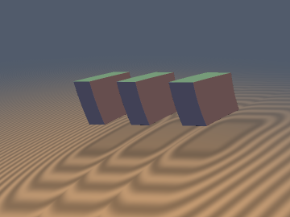
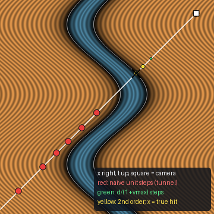
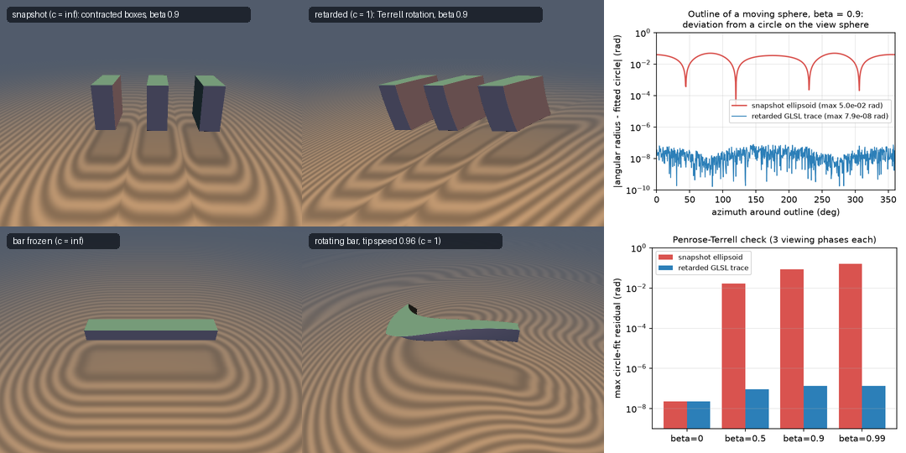

# stRetardedTrace: retarded-time sphere tracing (SDFs with a finite speed of light)

| 3D Preview (literal GLSL, $`\beta = 0.9`$) | Spacetime "slice" $`(x, t)`$ |
| :---: | :---: |
|  |  |

| Property | Value |
| :--- | :--- |
| **Author** | **Claude Fable 5.2** (`sdf-gems`, 2026) |
| **Category** | `spacetime` (experimental research category) |
| **GLSL File** | [`glsl/spacetime/stRetardedTrace.glsl`](../../glsl/spacetime/stRetardedTrace.glsl) |
| **Exactness (geometry)** | Uniform motion (`stGalileanAim`, `stLorentzToRest`): the hit equals a static unit-step trace of the exact rest SDF along a transformed straight ray (verified against closed forms). Rotation, oscillation and the generic steps: **conservative bounds** (0 overstep measured), not exact. |
| **Exactness (physics)** | Only uniform special-relativistic motion is physically exact. Galilean translation, rigid rotation and rigid oscillation are **kinematic light-delay models**. |

Left: three cubes moving to the left at $`\beta = 0.9`$, rendered by `stTraceMovingBoxLorentz`. They look rotated (the trailing face is visible),
not contracted. The ground shows isolines of the field at the event where each ground point is seen.
Right: spacetime diagram of an oscillating 1D section. The camera event (square) looks down the past null ray (white, 45 degrees).
Unit steps that ignore motion (red) jump through the body; the retarded steps (green, yellow) stop at the true first hit (cross).

---

## Overview

A camera pixel at the event $`(\mathbf{o}, t_0)`$ receives light that travelled along the past null ray (with $`c = 1`$)

```math
\mathbf{x}(l) = \mathbf{o} + l\,\mathbf{w}, \qquad t(l) = t_0 - l, \qquad l \ge 0, \quad \|\mathbf{w}\| = 1 .
```

A rigidly moving body with rest shape $`d_0`$ (an exact SDF) defines the spacetime field $`d(\mathbf{x}, t) = d_0(\mathbf{q}(\mathbf{x}, t))`$, where $`\mathbf{q}`$ is the body-frame point.
What the pixel sees is the first root of $`h(l) = d(\mathbf{x}(l), t(l))`$. This file collects the step rules that find that root safely, plus the
closed-form frame changes that remove the step penalty entirely for uniform motion.

## Derivation

### 1. One inequality for every case

Along the ray the body-frame point traces a curve $`\mathbf{q}(l)`$. Since $`d_0`$ is 1-Lipschitz,

```math
h(l + s) \;\ge\; h(l) - \int_0^s \|\mathbf{q}'(l + \sigma)\|\, d\sigma .
```

For a rigid motion $`\mathbf{q}'`$ is (a rotation of) $`\mathbf{w} + \mathbf{u}`$, where $`\mathbf{u}`$ is the velocity of the body point under the sample, taken backwards in time. Two step rules follow.

* **First order** (`stRetardedStep`): if every body point under the ray moves slower than $`v_{\max}`$, then $`\|\mathbf{q}'\| \le 1 + v_{\max}`$ and

```math
s = \frac{h}{1 + v_{\max}} .
```

* **Second order** (`stRetardedStep2`): with the current speed $`S = \|\mathbf{q}'(l)\|`$ and a bound $`A \ge \|\mathbf{q}''\|`$ ahead, $`\|\mathbf{q}'(l+\sigma)\| \le S + A\sigma`$, so the largest safe step solves $`S s + \tfrac{1}{2} A s^2 = h`$:

```math
s = \frac{2h}{S + \sqrt{S^2 + 2 A h}} .
```

The second form has no cancellation, and $`A = 0`$ gives $`h / S`$.

This is the same inequality as conservative advancement in continuous collision detection (distance divided by a bound on closing speed), with the ray parameter playing the role of time.

### 2. (a) Uniform Galilean translation: re-aim the ray

For $`d(\mathbf{x}, t) = d_0(\mathbf{x} - \mathbf{c}_0 - \mathbf{v} t)`$,

```math
\mathbf{q}(l) = (\mathbf{o} - \mathbf{c}_0 - \mathbf{v} t_0) + l\,(\mathbf{w} + \mathbf{v}),
```

a straight line. Here $`S = \|\mathbf{w} + \mathbf{v}\|`$ exactly and $`A = 0`$, so the second-order step is ordinary sphere tracing along the direction $`\mathbf{w} + \mathbf{v}`$ (classical aberration), with $`l = l_B / \|\mathbf{w} + \mathbf{v}\|`$. `stGalileanAim` returns that ray.

### 3. (b) Uniform special-relativistic motion: trace in the rest frame

With $`\gamma = (1 - \|\mathbf{v}\|^2)^{-1/2}`$ the boost into the rest frame is

```math
\mathbf{x}' = \mathbf{x} + \frac{\gamma^2}{\gamma + 1} (\mathbf{x} \cdot \mathbf{v})\,\mathbf{v} - \gamma \mathbf{v} t, \qquad t' = \gamma\,(t - \mathbf{v} \cdot \mathbf{x}).
```

A boost is linear, so the null ray stays a straight null ray. Its rest-frame direction and parameter are

```math
\mathbf{w}' = D \left( \mathbf{w} + \Big( \frac{\gamma^2}{\gamma+1}\, \mathbf{w} \cdot \mathbf{v} + \gamma \Big) \mathbf{v} \right), \qquad l' = \frac{l}{D}, \qquad D = \frac{1}{\gamma\,(1 + \mathbf{v} \cdot \mathbf{w})} .
```

$`D`$ is the Doppler factor (observed over emitted frequency). $`\mathbf{w}`$ points from the camera into the scene; with the photon propagation direction $`\mathbf{k} = -\mathbf{w}`$ this is the usual $`D = 1 / (\gamma (1 - \mathbf{v} \cdot \mathbf{k}))`$, and it also equals $`\gamma (1 - \mathbf{v} \cdot \mathbf{w}')`$.
In the rest frame the body is static, so `stTraceMovingBoxLorentz` runs plain unit-step sphere tracing there. In the camera frame this is the second-order rule with $`S = 1/D`$ exactly and $`A = 0`$.
Radiance scales as $`D^3`$ (bolometric $`D^4`$); `stDoppler` returns $`D`$ for shading. `stNormalToCamera` maps a rest normal to the normal of the contracted constant-$`t`$ surface.

### 4. (c) Rigid rotation: the ray's body-frame velocity changes at a constant rate

For $`d(\mathbf{x}, t) = d_0(R(\mathbf{n}, -W t)\,\mathbf{x} - \mathbf{c}_B)`$,

```math
\mathbf{q}'(l) = R\,\big(\mathbf{w} + W\,\mathbf{n} \times \mathbf{x}(l)\big), \qquad \frac{d}{dl}\big(\mathbf{w} + W\,\mathbf{n} \times \mathbf{x}(l)\big) = W\,\mathbf{n} \times \mathbf{w} .
```

The bracket is linear in $`l`$. Three rules of increasing tightness follow (all implemented in `stTraceRotatingBox`):

| Rule | $`S`$ | $`A`$ |
| :--- | :--- | :--- |
| global | $`1 + \lvert W \rvert\, r_B`$ ($`r_B`$ = bounding radius, ray clipped to the bounding sphere) | $`0`$ |
| local axis distance (`stRotatingLocalStep`) | $`1 + \lvert W \rvert \rho`$ | $`\lvert W \rvert \, \Vert \mathbf{n} \times \mathbf{w} \Vert`$ |
| local exact speed (`stRotatingStep`) | $`\Vert \mathbf{w} + W \mathbf{n} \times \mathbf{x} \Vert`$ | $`\lvert W \rvert \, \Vert \mathbf{n} \times \mathbf{w} \Vert`$ |

The third rule is new relative to the brief: it uses the actual speed, which drops below 1 where the ray runs against the rotation.

### 5. (d) Oscillation

For a centre $`\mathbf{A} \sin(\omega t)`$: $`\mathbf{q}' = \mathbf{w} + \mathbf{A}\,\omega \cos(\omega t)`$ and $`\|\mathbf{q}''\| \le \|\mathbf{A}\|\,\omega^2`$. The global rule uses $`v_{\max} = \|\mathbf{A}\| \omega`$.

## GLSL

```glsl
float stRetardedStep ( float d, float speedMax );             // d / (1 + speedMax)
float stRetardedStep2( float d, float speed, float accel );   // 2 d / (S + sqrt(S^2 + 2 A d))

float stGalileanAim  ( vec3 ro, float t0, vec3 rd, vec3 c0, vec3 v, out vec3 roB, out vec3 rdB );   // returns |rd + v|
vec4  stLorentzBoost ( vec4 event, vec3 v );                  // (x, t) -> rest frame; inverse: boost with -v
float stLorentzToRest( vec3 ro, float t0, vec3 rd, vec3 v, out vec3 roR, out float tR, out vec3 rdR );  // returns D
float stDoppler      ( vec3 rd, vec3 v );
vec3  stNormalToCamera( vec3 nR, vec3 v );
float stSnapshotToRest( vec3 ro, float t0, vec3 rd, vec3 v, out vec3 roR, out vec3 rdR );  // infinite-c comparison

float stRotatingLocalStep( float d, float rho, float W, float sinAxis );
float stRotatingStep     ( float d, vec3 x, vec3 rd, vec3 n, float W );

vec2 stTraceMovingBoxGalilean( ro, t0, rd, c0, v, shape, lMax );   // exact re-aimed trace
vec2 stTraceMovingBoxRetarded( ro, t0, rd, c0, v, shape, lMax );   // first-order camera-frame march
vec4 stTraceMovingBoxLorentz ( ro, t0, rd, v, cRest, shape, lMax ); // (l, steps, D, l')
vec2 stTraceMovingBoxSnapshot( ro, t0, rd, v, cRest, shape, lMax ); // contracted body frozen at t0
vec2 stTraceRotatingBox      ( ro, t0, rd, n, W, cB, shape, mode ); // mode 0 global, 1 local rho, 2 local speed
vec2 stTraceOscillatingBox   ( ro, t0, rd, A, w, shape, lMax, mode ); // mode 0 global, 1 second order
```

`shape = vec4(half extents, rounding radius)`; `vec4(0, 0, 0, R)` is a sphere. Marchers return `l < 0` for a miss. GLSL has no function pointers,
so for another rest shape copy a marcher and replace `stSdRoundBox`; the step helpers are shape-independent.

## Verification

All numbers are measured. "Brute force" means dense sampling of $`h(l)`$ (4000 to 6000 samples per ray) followed by bisection of the first sign change, using only the field definition. Hit threshold `ST_HIT_EPS = 2e-5`, 512 steps maximum.
"Overstep" counts any sample with $`h < 0`$, any hit beyond the true first root, and any miss of a true hit that still had step budget.

### Claim 1: conservativeness (FP64 prototype, 24,000 rays per row)

| Case | Rule | Overstep | Mean steps (hit rays) | Naive unit step failures |
| :--- | :--- | ---: | ---: | ---: |
| (a) translation, speed up to 0.95 | first order | 0 | 16.55 (22.95) | 2749 of 24000 |
| | re-aimed (exact) | 0 | 10.44 (12.15) | |
| (c) rotation $`W r_B = 0.84`$ | global | 0 | 12.97 (24.36) | 1211 of 15473 |
| | local axis distance | 0 | 9.94 (16.95) | |
| | local exact speed | 0 | 7.32 (11.93) | |
| (c) rotation $`W r_B = 3.36`$ | global | 0 | 26.56 (38.40) | 4849 of 15473 |
| | local axis distance | 0 | 16.21 (21.08) | |
| | local exact speed | 0 | 11.28 (13.85) | |
| (d) oscillation $`A\omega = 0.9`$ | global | 0 | 20.42 (26.98) | 2402 of 24000 |
| | second order | 0 | 15.34 (15.17) | |
| (d) oscillation $`A\omega = 1.8`$ | global | 0 | 28.79 (33.92) | 4680 of 24000 |
| | second order | 0 | 23.09 (19.66) | |

Rotation rows count only rays through the bounding sphere. Static references (same rays, body frozen): 6.0 to 6.7 steps for rotation, 6.64 for translation
(the frozen translation scene has a different hit set, so compare the per-hit column: 11.77 static).
The naive marcher is cheaper (4.7 to 9.1 steps) but lands inside the body or tunnels through it on 3.5% to 31% of rays, with hit errors up to 1.56.
Further rows ($`W r_B`$ = 0.42, 1.68, offset body; $`A\omega`$ = 0.6): 0 overstep for all retarded rules.

### Claims 1, 2, 5 on the literal GLSL (GPU FP32, 24,000 rays per row, vs FP64 brute force)

| Function | Overstep ($`l > l_{true} + 3\times10^{-5}`$) | Missed true hits | $`\max(l - l_{true})`$ | Median / max hit error |
| :--- | ---: | ---: | ---: | ---: |
| `stTraceMovingBoxGalilean` | 0 | 0 | $`+3.2\times10^{-7}`$ | $`1.8\times10^{-5}`$ / $`2.0\times10^{-3}`$ |
| `stTraceMovingBoxRetarded` | 0 | 0 | $`-4.9\times10^{-7}`$ | $`2.3\times10^{-5}`$ / $`7.0\times10^{-4}`$ |
| `stTraceRotatingBox` modes 0, 1, 2 (5 configurations) | 0 | 0 | $`+5.0\times10^{-7}`$ | $`\le 2.2\times10^{-5}`$ / $`1.7\times10^{-3}`$ |
| `stTraceOscillatingBox` modes 0, 1 (3 frequencies) | 0 | 0 | $`+2.5\times10^{-7}`$ | $`\le 2.0\times10^{-5}`$ / $`1.6\times10^{-3}`$ |
| `stTraceMovingBoxLorentz`, $`\beta`$ = 0.5, 0.9, 0.99 | 0 | 0 | $`+1.7\times10^{-6}`$ | $`\le 1.6\times10^{-5}`$ / $`1.8\times10^{-3}`$ |

The millimetre-scale maximum errors are all at grazing incidence and are the hit threshold divided by the cosine of incidence, not algorithm error:
for the sphere the ratio of error to that bound never exceeded 1.00 (see below). Up to 5 rays per 24,000 exhausted the 512-step budget on grazing paths and returned a miss.
Degenerate parameters (zero velocity, $`\mathbf{v} = -\mathbf{w}`$, $`\beta = 0.9999`$, $`W = 0`$, ray along the axis, $`\omega = 0`$, zero distance and speed): 0 NaN or Inf over 4096 points each.

### Claim 2: moving sphere vs closed-form quadratic

The retarded hit of a sphere satisfies $`\|\mathbf{m} + l(\mathbf{w} + \mathbf{v})\| = R`$ with $`\mathbf{m} = \mathbf{o} - \mathbf{c}_0 - \mathbf{v} t_0`$.

| Test | Result |
| :--- | :--- |
| FP64, re-aimed march, threshold $`10^{-12}`$ | $`\max \lvert l - l_{closed} \rvert = 1.1\times10^{-10}`$ |
| FP64, threshold $`2\times10^{-5}`$, both marchers | median $`\le 2.0\times10^{-5}`$, max $`1.7\times10^{-3}`$, error / threshold bound $`\le 1.000`$, 0 overshoots |
| GPU, both marchers (5801 common hits) | median $`\le 2.2\times10^{-5}`$, max $`2.4\times10^{-3}`$, error / (bound + $`5\times10^{-6}`$) $`\le 1.00`$ |
| GPU, re-aimed vs first-order marcher | $`\max \lvert \Delta l \rvert = 3.6\times10^{-5}`$ |

Hit-set mismatches against the closed form were 2 of 48,000 marches on the GPU (8 of 24,000 in FP64): grazing rays within the hit threshold of the surface.

### Claim 3: Penrose-Terrell invariant

Method: for a unit sphere moving along $`x`$ and a pinhole camera at distance 4 from its path, the outline is found on the GPU by bisecting hit or miss of the literal
`stTraceMovingBoxLorentz` along 720 great-circle arcs (40 bisections). A circle on the view sphere is fitted by linear least squares ($`\mathbf{u}_i \cdot \mathbf{m} = 1`$).
The same is done for `stTraceMovingBoxSnapshot` (the contracted ellipsoid frozen in time).

| $`\beta`$ | Retarded outline, max residual (rad), 3 viewing phases | Snapshot ellipsoid, max residual (rad) |
| :--- | ---: | ---: |
| 0 | $`2.3\times10^{-8}`$ | $`2.3\times10^{-8}`$ |
| 0.5 | $`9.2\times10^{-8}`$ | $`1.7\times10^{-2}`$ |
| 0.9 | $`1.4\times10^{-7}`$ | $`8.5\times10^{-2}`$ |
| 0.99 | $`1.4\times10^{-7}`$ | $`1.6\times10^{-1}`$ |

The retarded outline is a circle to FP32 precision at every speed; the snapshot outline is not (5 to 6 orders of magnitude larger residual).
Mapped to the rest frame in FP64, the same boundary directions lie on the static sphere's cone within $`1.0\times10^{-7}`$ rad.
Seen abeam (closest approach), the fitted angular radius was 0.25256 to 0.25265 rad at every speed, within $`1.2\times10^{-4}`$ of the static value $`\arcsin(1/4) = 0.25268`$.



Top: snapshot (infinite light speed) vs retarded render of the same cubes; outline deviation from a circle. Bottom: a bar frozen vs rotating with tip speed 0.96; circle-fit residual by speed.

### Claim 4: rest-frame trace cost

Independent ground truth for the Lorentz marcher uses only the event boost: brute force on $`d_0`$ of boosted events for the box, and a quadratic through two boosted events for the sphere.
GPU boost identities ($`\beta`$ = 0.5 / 0.9 / 0.99): interval change $`3.8\times10^{-6}`$ / $`6.1\times10^{-5}`$ / $`6.1\times10^{-4}`$; rest direction error $`2.0\times10^{-7}`$ / $`5.5\times10^{-7}`$ / $`9.5\times10^{-6}`$; relative $`D`$ error $`2.7\times10^{-7}`$ / $`1.1\times10^{-6}`$ / $`9.0\times10^{-6}`$.

| $`\beta`$ | Rest-frame trace (GPU) | Static scene, same rest ray | Camera frame, step $`h D`$ | Camera frame, penalty $`h / (\gamma(1+\beta))`$ | Naive camera unit step failures |
| :--- | ---: | ---: | ---: | ---: | ---: |
| 0.5 | 11.05 | 11.05 | 11.05 | 20.27 | 3055 of 24000 |
| 0.9 | 11.17 | 11.17 | 11.17 | 36.81 | 4612 of 24000 |
| 0.99 | 12.05 | 12.05 | 12.05 | 38.92 | 5431 of 24000 |

Mean steps per ray. The equality of the first three columns holds by construction (the rest-frame trace is a static trace), so it is a consistency check rather than a discovery.
The penalised march costs 1.8x to 3.3x more and still had 0 oversteps; 5 to 36 of its rays ran out of the 512-step budget, which caps the measured ratio at $`\beta = 0.99`$.

### Claim 5: rotating bar

Per-pixel check of the bar panel above (bar half extents 0.95 x 0.09 x 0.14, $`W = 1`$, 180 x 135 rays): 0 oversteps in all modes, hit mask differs from brute force on 2 of 24,300 pixels (grazing, within the threshold), max hit error $`3.8\times10^{-4}`$.
Steps per pixel through the bounding sphere: global 11.91, local axis distance 9.56, local exact speed 6.02.
The seen bar angle $`W(t_0 - l)`$ ranges from -39.0 to +11.9 degrees across the image, which is the bend.

## Findings

**What held**

1. Conservativeness: 0 oversteps for every retarded rule in every configuration tested (FP64 and literal GLSL), while unit steps that ignore motion failed on 3.5% to 31% of rays.
2. Galilean re-aiming is exact: it matches the closed-form moving sphere to $`1.1\times10^{-10}`$ (FP64) and the first-order march to $`3.6\times10^{-5}`$ (GPU, threshold-limited), at 0.53x to 0.63x the steps.
3. Penrose-Terrell: the outline produced by the literal GLSL is a circle to $`1.4\times10^{-7}`$ rad at $`\beta`$ up to 0.99; the snapshot ellipsoid misses by up to 0.16 rad.
4. The local rotation bounds are safe and cheaper than the global bound: 0.77x (axis distance) and 0.56x (exact speed) of the global step count at $`W r_B = 0.84`$; 0.61x and 0.42x at $`W r_B = 3.36`$.
5. The second-order oscillation step is safe and takes 0.75x to 0.80x the steps of the global bound.

**What failed or is weaker than hoped**

1. The retarded marchers are still slower than a static scene: the best rotation rule takes 1.07x to 1.70x the static step count, and the second-order oscillation rule takes 1.5x to 2.9x the steps of the (unsafe) unit-step march; no static reference was measured for oscillation. Only uniform motion reaches static cost.
2. Hit accuracy at grazing incidence is limited by the threshold (errors up to $`2.4\times10^{-3}`$), and a few grazing rays per 24,000 exhaust 512 steps and are reported as misses. These are under-reaches, not oversteps.
3. `sinAxis` in the axis-distance rule barely matters (9.94 vs 10.00 steps); the gain comes from using the local speed.
4. The camera-frame field $`d_0(\Lambda(\mathbf{x}, t))`$ is not a distance in the camera frame (its gradient reaches $`\gamma(1+\beta)`$ along the ray), so marching it directly needs the large penalty in the table above.
5. The Doppler expression in the brief, $`1/(\gamma(1 - \mathbf{v}\cdot\mathbf{w}'))`$, is only right if $`\mathbf{w}'`$ means the photon propagation direction in the camera frame. With the rest-frame march direction the correct form is $`\gamma(1 - \mathbf{v}\cdot\mathbf{w}')`$ (checked to $`4\times10^{-7}`$ at $`\beta = 0.5`$, $`1.2\times10^{-4}`$ at $`\beta = 0.99`$ in FP32).

**Physical validity**

* Exact physics: uniform motion through the Lorentz path (contraction, aberration, Terrell rotation, Doppler factor). Lighting is assumed to be evaluated in the rest frame; relativistic transformation of external light sources and shadows is not modelled.
* Kinematic models only: Galilean translation (no contraction; allows speeds at or above 1), rigid rotation and rigid oscillation. Born-rigid rotation does not exist beyond $`\lvert W \rvert \rho = 1`$ and rigid acceleration is not relativistically consistent. The steps stay mathematically conservative there (tested up to $`W r_B = 3.36`$ and $`A\omega = 1.8`$), but the images are not physical. The code does not clamp.
* FP32: boost round-trip error grows with $`\gamma`$ ($`1.1\times10^{-4}`$ at $`\beta = 0.99`$ for coordinates of size 3).

**Open questions**

* The body-frame path length for rotation, $`\int \|\mathbf{a} + \sigma \mathbf{b}\| d\sigma`$, has a closed form; inverting it would give the largest step this argument allows. Not attempted.
* Several independently moving bodies need one march per body (as in the preview) or a per-body minimum of safe steps; a single field with mixed frames was not studied.
* Accelerated motion with a proper relativistic model (hyperbolic motion, Born rigidity) and secondary rays (shadows, reflections between frames) are open.
* Only a rounded box and a sphere were tested as rest shapes. Any 1-Lipschitz $`d_0`$ should work for the step rules; a bound that is not 1-Lipschitz would not.

## Novelty and Prior Art

* **Appearance of moving bodies**: the circular outline of a moving sphere and the apparent rotation are due to Penrose (1959) and Terrell (1959). Nothing here is new physics; the test above only confirms that the shader reproduces it.
* **Relativistic ray tracing**: transforming camera rays into each object's rest frame, intersecting there and applying Doppler and searchlight factors is the standard method (Hsiung and Dunn, "Visualizing relativistic effects in spacetime", 1989; Hsiung, Thibadeau and Wu, 1990; Weiskopf's work on special relativistic visualization, around 2000). The game "A Slower Speed of Light" (MIT Game Lab, 2012, OpenRelativity) does a vertex-shader version. Section 3 is that method applied to sphere tracing.
* **Raymarched relativity and light delay**: the web searches returned descriptions of raymarchers that evaluate the SDF at the retarded time $`t_0 - l`$ with ordinary unit steps, and of Lorentz-boosted SDF shaders, without identifying specific shaders, so no individual prior shader is cited. The pattern itself is treated as known. None of the descriptions gave a conservative step; one suggested an ad hoc relaxation factor.
* **Step bounds**: scaling a sphere-tracing step by a Lipschitz bound goes back to Hart (1996). The first-order rule $`h/(1 + v_{\max})`$ and the global rotation bound are the conservative-advancement inequality of continuous collision detection (Mirtich, 1996, and later work) applied along a null ray.
* **What may be new** (no prior statement found in the searches, which is weak evidence): (i) the second-order retarded step in closed form; (ii) the observation that for rigid rotation the body-frame ray velocity $`\mathbf{w} + W\mathbf{n}\times\mathbf{x}`$ changes at the constant rate $`W \mathbf{n} \times \mathbf{w}`$, which makes that step rigorous with the exact local speed; (iii) packaging Galilean re-aiming, the Lorentz rest-frame trace and these bounds as one rule ($`S`$, $`A`$) with measured zero-overstep evidence.

## Reproduction

Scratch scripts (run from the repository root with `uv run python <script>`): `test1_fp64.py` (claims 1, 2, 5 in FP64), `test2_sr.py` (claims 3, 4, GPU),
`test3_gpu.py` (claims 1, 2, 5 and degenerate parameters on the literal GLSL), `test4_bar.py` (bar panel), `render.py` (images).
