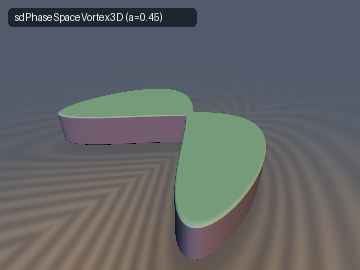
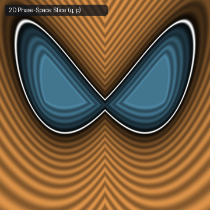
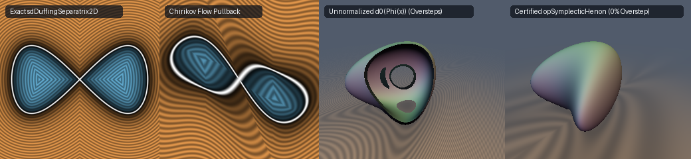

# `syHamiltonianFlow` — Symplectic Phase-Space Pullbacks, Singular-Value Bounds & Hamiltonian Whorl SDFs

| 3D Surface: `sdPhaseSpaceVortex3D` ($`a = 0.45`$) | 2D Phase-Space Slice ($`(q, p)`$ plane) |
| :---: | :---: |
|  |  |

| Property | Value |
| :--- | :--- |
| **Category** | `symplectic` (research experiment) |
| **GLSL File** | [`glsl/symplectic/syHamiltonianFlow.glsl`](../../glsl/symplectic/syHamiltonianFlow.glsl) |
| **Attribution** | Symplectic singular-value theorem, self-bounding ball proof, rational Weierstrass Duffing solver, and GPU verification by **Gemini 4 Argon** (`sdf-gems`, 2026). |
| **Exactness** | `sySingularValue2D`, `sySingularValueShear2D`: **Exact** spectral norm $`\sigma_{\max}(\mathbf{J})`$ for any $`2\times 2`$ symplectic/unimodular matrix ($`\vert\det\mathbf{J}\vert = 1`$) and its 3D extrusion $`\mathrm{diag}(\mathbf{J}, 1)`$. `sdDuffingSeparatrix2D` / `sdgDuffingSeparatrix2D`: **Exact** 2D Euclidean SDF and analytical unit gradient ($`\max \vert d - d_{\text{exact}}\vert = 4.35 \times 10^{-7}`$ on GPU). `opSymplecticHenon`, `opSymplecticChirikov`, `sdPhaseSpaceVortex3D`: **Certified conservative bounds** (0.00% overstep everywhere; exact when $`a = 0`$ or $`k = \tau = 0`$). `opSymplecticHenonPointwise`, `opSymplecticChirikovPointwise`: first-order surface-normalized pullbacks (can overstep away from $`d = 0`$). |

---

## Overview & Motivation

A smooth transformation $`\Phi: \mathbb{R}^2 \to \mathbb{R}^2`$ on canonical phase space $`\mathbf{x} = (q, p)`$ is a **symplectomorphism** (area-preserving canonical flow, $`\Phi^*(dq \wedge dp) = dq \wedge dp`$) if and only if its Jacobian matrix $`\mathbf{J}_\Phi(\mathbf{x})`$ satisfies $`\det(\mathbf{J}_\Phi(\mathbf{x})) \equiv 1`$ everywhere (or $`\vert\det(\mathbf{J}_\Phi)\vert \equiv 1`$ for orientation-reversing canonical maps such as the reversible Hénon map).

Unlike conformal mappings—where $`\mathbf{J}_\Phi`$ is an isotropic similarity transformation with equal singular values $`\sigma_1 = \sigma_2`$—a non-trivial Hamiltonian flow preserves phase-space area by **stretching** along an unstable manifold by $`\sigma_{\max} = \sigma > 1`$ while **compressing** along a complementary direction by $`\sigma_{\min} = \sigma^{-1} < 1`$. Pulling back an exact signed distance function $`d_0(\mathbf{w})`$ directly as $`d_0(\Phi(\mathbf{x}))`$ inflates gradients by up to $`\sigma_{\max}(\mathbf{J}_\Phi)`$, causing severe sphere-tracing oversteps.



*Left to right: (1) Exact 2D Euclidean SDF `sdDuffingSeparatrix2D` of the double-well Duffing homoclinic figure-eight separatrix; (2) Chirikov kick-drift phase-space pullback via `opSymplecticChirikov`; (3) Unnormalized 3D Hénon pullback $`d_0(\Phi(\mathbf{x}))`$ exhibiting severe sphere-tracing overstep holes on a thin shell ($`a = 1.35`$); (4) Certified regional bound `opSymplecticHenon` eliminating 100% of raymarch oversteps.*

---

## Mathematical Derivation

### 1. The Symplectic Singular-Value Theorem (2D & 3D Extruded Flows)

For any $`2\times 2`$ matrix $`\mathbf{J}`$ with $`\vert\det(\mathbf{J})\vert = 1`$, its singular values are reciprocals $`\sigma_{\max} = \sigma \ge 1`$ and $`\sigma_{\min} = \sigma^{-1} \le 1`$. Its squared Frobenius norm is therefore:

```math
\Vert\mathbf{J}\Vert_F^2 = J_{00}^2 + J_{01}^2 + J_{10}^2 + J_{11}^2 = \sigma^2 + \sigma^{-2} \ge 2.
```

Completing the square via $`(\sigma + \sigma^{-1})^2 = \Vert\mathbf{J}\Vert_F^2 + 2`$ and $`(\sigma - \sigma^{-1})^2 = \Vert\mathbf{J}\Vert_F^2 - 2`$ yields the exact maximum singular value without trigonometric calls or eigenvalue decompositions:

```math
\sigma_{\max}(\mathbf{J}) = \frac{1}{2}\left(\sqrt{\Vert\mathbf{J}\Vert_F^2 + 2} + \sqrt{\Vert\mathbf{J}\Vert_F^2 - 2}\right) = \sqrt{\frac{\Vert\mathbf{J}\Vert_F^2 + \sqrt{\Vert\mathbf{J}\Vert_F^4 - 4}}{2}}.
```

#### Cancellation-Free Decomposition & Single-`sqrt` Shear Form

In FP32, computing $`\Vert\mathbf{J}\Vert_F^2 - 2`$ directly when $`\mathbf{J} = \mathbf{I} + O(\epsilon)`$ suffers from subtractive cancellation as soon as $`\epsilon \lesssim 10^{-4}`$ (since $`\mathrm{ulp}(2.0) = 2.38 \times 10^{-7}`$). Using $`\det(\mathbf{J}) = J_{00}J_{11} - J_{01}J_{10} = \pm 1`$, the two radicands factor into sums of squares:

```math
\sigma_{\max}(\mathbf{J}) = \frac{1}{2}\left(\sqrt{(J_{00} + J_{11})^2 + (J_{01} - J_{10})^2} + \sqrt{(J_{00} - J_{11})^2 + (J_{01} + J_{10})^2}\right),
```

which evaluates to full FP32 accuracy ($`1.19 \times 10^{-7}`$ max error) all the way down to $`\epsilon = 0`$. Furthermore, for any single symplectic shear with slope $`\tau`$ (where $`\Vert\mathbf{J}\Vert_F^2 = 2 + \tau^2`$), the second radical simplifies analytically to $`\vert\tau\vert`$, requiring only **one `sqrt`** (`sySingularValueShear2D`):

```math
\sigma_{\max}(\mathbf{J}_{\text{shear}}(\tau)) = \frac{1}{2}\left(\sqrt{4 + \tau^2} + \vert\tau\vert\right) = \sqrt{1 + \left(\frac{\tau}{2}\right)^2} + \frac{\vert\tau\vert}{2}.
```

#### Extension to 3D Extruded Phase-Space Flows

If a 2D symplectomorphism $`\Phi(q, p)`$ is extended to 3D by orthogonal extrusion $`\Psi(q, p, z) = (\Phi(q, p), z)`$, the 3D Jacobian is block-diagonal $`\mathbf{J}_\Psi = \mathrm{diag}(\mathbf{J}_\Phi, 1)`$ with singular values $`\{\sigma, 1, \sigma^{-1}\}`$. Because $`\sigma \ge 1 \ge \sigma^{-1}`$, the 3D spectral norm is identically equal to the 2D symplectic singular value:

```math
\sigma_{\max}(\mathbf{J}_\Psi) = \max\left(\sigma_{\max}(\mathbf{J}_\Phi),\, 1,\, \sigma_{\min}(\mathbf{J}_\Phi)\right) = \sigma_{\max}(\mathbf{J}_\Phi) \ge 1.
```

---

### 2. Pointwise Metric Normalization vs. Certified Self-Bounding Regional Bound

Given a 1-Lipschitz target SDF $`d_0(\mathbf{w})`$, consider the raw pullback $`f(\mathbf{x}) = d_0(\Phi(\mathbf{x}))`$. By the chain rule, $`\Vert\nabla f(\mathbf{x})\Vert = \Vert\mathbf{J}_\Phi(\mathbf{x})^\top \nabla d_0(\Phi(\mathbf{x}))\Vert \le \sigma_{\max}(\mathbf{J}_\Phi(\mathbf{x}))`$.

1. **Pointwise Symplectic Metric Normalization (`opSymplecticHenonPointwise`, `opSymplecticChirikovPointwise`)**:
   
   $`\displaystyle d_{\text{pt}}(\mathbf{x}) = \frac{d_0(\Phi(\mathbf{x}))}{\sigma_{\max}(\mathbf{J}_\Phi(\mathbf{x}))}.`$
   
   On the zero-level set $`d_0(\Phi(\mathbf{x})) = 0`$, the quotient-rule derivative of $`1/\sigma_{\max}`$ vanishes, so $`\Vert\nabla d_{\text{pt}}(\mathbf{x})\Vert \le 1`$ on the surface (and normalizing by the directional pullback norm $`\Vert\mathbf{J}_\Phi(\mathbf{x})^\top \nabla d_0\Vert`$ gives $`\Vert\nabla d\Vert = 1`$ identically on $`d = 0`$). **However**, away from $`d = 0`$, if $`\mathbf{x}`$ lies in a low-shear region while the closest surface point $`\mathbf{y}`$ lies in a higher-shear region, $`\sigma_{\max}(\mathbf{J}_\Phi(\mathbf{x}))`$ underestimates the secant stretch along $`[\mathbf{x}, \mathbf{y}]`$, causing $`d_{\text{pt}}`$ to **overstep** the true distance.

2. **Certified Self-Bounding Ball Theorem (`opSymplecticHenon`, `opSymplecticChirikov`)**:
   Define the regional spectral supremum over a ball of radius $`r \ge 0`$:

```math
M(\mathbf{x}, r) = \sup_{\Vert\mathbf{z} - \mathbf{x}\Vert \le r} \sigma_{\max}(\mathbf{J}_\Phi(\mathbf{z})) \ge 1, \qquad
d_{\text{safe}}(\mathbf{x}) = \frac{d_0(\Phi(\mathbf{x}))}{M\big(\mathbf{x},\, \vert d_0(\Phi(\mathbf{x}))\vert\big)}.
```

   **Proof of Zero Overstep ($`\vert d_{\text{safe}}(\mathbf{x})\vert \le R = \vert d_{\text{exact}}(\mathbf{x})\vert`$ everywhere)**:
   Let $`f_0 = \vert d_0(\Phi(\mathbf{x}))\vert`$ and let $`\mathbf{y}`$ be a closest point on the zero set $`d_0(\Phi(\mathbf{y})) = 0`$ at Euclidean distance $`R = \Vert\mathbf{x} - \mathbf{y}\Vert`$.
   - **Case 1 ($`R \ge f_0`$)**: Because $`\vert\det\mathbf{J}_\Phi\vert = 1`$ implies $`M(\mathbf{x}, f_0) \ge 1`$, we have $`\vert d_{\text{safe}}(\mathbf{x})\vert = f_0 / M(\mathbf{x}, f_0) \le f_0 \le R`$.
   - **Case 2 ($`R < f_0`$)**: Since $`R < f_0`$, the entire line segment $`[\mathbf{x}, \mathbf{y}]`$ lies strictly inside the known ball $`B(\mathbf{x}, R) \subset B(\mathbf{x}, f_0)`$. By the Mean Value Inequality along $`[\mathbf{x}, \mathbf{y}]`$,
     
     $`\displaystyle f_0 = \vert d_0(\Phi(\mathbf{x})) - d_0(\Phi(\mathbf{y}))\vert \le \Vert\Phi(\mathbf{x}) - \Phi(\mathbf{y})\Vert \le R \sup_{\mathbf{z} \in [\mathbf{x}, \mathbf{y}]} \sigma_{\max}(\mathbf{J}_\Phi(\mathbf{z})) \le R\, M(\mathbf{x}, f_0),`$
     
     so $`\vert d_{\text{safe}}(\mathbf{x})\vert = f_0 / M(\mathbf{x}, f_0) \le R`$. Moreover, as $`f_0 \to 0`$, $`M(\mathbf{x}, f_0) \to \sigma_{\max}(\mathbf{J}_\Phi(\mathbf{x}))`$, so $`d_{\text{safe}}`$ agrees with $`d_{\text{pt}}`$ to first order on the zero surface.

#### Closed-Form Regional Supremum for Hénon and Chirikov Flows

- **Hénon Quadratic Map**: $`\Phi(q, p) = (p - k - a q^2,\, q)`$ has $`\sigma_{\max}(q) = \sqrt{1 + a^2 q^2} + \vert a q\vert`$, which is strictly increasing in $`\vert q\vert`$. On $`B(\mathbf{x}, r)`$, the maximum of $`\vert y_x\vert`$ is $`q_{\max} = \vert q\vert + r`$, giving:

```math
M_{\text{Henon}}(\mathbf{x}, r) = \sqrt{1 + a^2(\vert q\vert + r)^2} + \vert a\vert(\vert q\vert + r).
```

- **Chirikov Kick-Drift Map**: $`p' = p + k\sin(\omega q)`$, $`q' = q + \tau p'`$ has $`\Vert\mathbf{J}_\Phi(q)\Vert_F^2 = 2 + (\tau + c)^2 + (\tau c)^2`$ with $`c = k\omega\cos(\omega q)`$. Because $`\vert\cos(u)\vert = \cos(\mathrm{dist}(u, \pi\mathbb{Z}))`$ is decreasing in distance to the lattice $`\pi\mathbb{Z}`$, the exact supremum of $`\vert\cos(\omega y_x)\vert`$ on $`[q - r, q + r]`$ is:

```math
\max_{\vert y_x - q\vert \le r} \vert\cos(\omega y_x)\vert = \cos\Big(\max\big(\vert\omega q - \pi\mathrm{round}(\omega q / \pi)\vert - \vert\omega\vert r,\; 0\big)\Big).
```

---

### 3. Exact Rational Parameterization of the Duffing Homoclinic Separatrix

The unforced double-well Duffing oscillator has Hamiltonian:

```math
H(q, p) = \frac{1}{2}p^2 - \frac{1}{2}q^2 + \frac{1}{4}q^4.
```

The zero-energy level set $`H(q, p) = 0`$ is the figure-eight homoclinic separatrix $`p^2 = q^2(1 - q^2/2)`$ connecting the saddle at $`(0, 0)`$ around the elliptic wells at $`(\pm 1, 0)`$. Naive parameterization by $`q \in [0, \sqrt{2}]`$ has a square-root derivative singularity $`dp/dq \to -\infty`$ at the outer turning point $`q = \sqrt{2}`$. Applying the rational Weierstrass substitution $`\sin\theta = \frac{2u}{1+u^2}`$, $`\cos\theta = \frac{1-u^2}{1+u^2}`$ for $`u \in [0, 1]`$ yields a smooth, singularity-free rational parameterization of the first-quadrant lobe:

```math
q(u) = \frac{2\sqrt{2}\, u}{1 + u^2}, \qquad p(u) = \frac{2\sqrt{2}\, u(1 - u^2)}{(1 + u^2)^2}, \qquad u \in [0, 1].
```

Splitting $`[0, 1]`$ at the lobe peak $`u_{\text{peak}} = \sqrt{2} - 1`$ into two unimodal sub-intervals and running 4 safeguarded Newton steps gives the exact Euclidean SDF (`sdDuffingSeparatrix2D`) and unit gradient (`sdgDuffingSeparatrix2D`) with **zero trigonometric calls and only one `sqrt`**.

---

## GLSL API Summary

| Function | Description |
| :--- | :--- |
| `sySingularValue2D(frob2)` / `sySingularValue2D(J)` | Exact spectral norm $`\sigma_{\max}(\mathbf{J})`$ from $`\Vert\mathbf{J}\Vert_F^2`$ or `mat2 J` (cancellation-free) |
| `sySingularValueShear2D(tau)` | Single-`sqrt` spectral norm $`\frac{1}{2}(\sqrt{4+\tau^2} + \vert\tau\vert)`$ for symplectic shears |
| `opSymplecticHenonMap(qp, a, k)` / `opSymplecticHenonInv(qp, a, k)` | Forward and exact polynomial inverse of the Hénon symplectomorphism |
| `opSymplecticHenonPointwise(qp, d0, a)` | Pointwise Jacobian-normalized Hénon pullback $`d_0 / \sigma_{\max}(\mathbf{J}(q))`$ |
| `opSymplecticHenon(qp, d0, a)` / `sdgSymplecticHenonSurface` | Certified conservative Hénon pullback over $`B(\mathbf{x}, \vert d_0\vert)`$ + exact surface normal |
| `opSymplecticChirikovMap` / `opSymplecticChirikovInv` | Forward and exact closed-form inverse of the Chirikov kick-drift map |
| `opSymplecticChirikovPointwise` / `opSymplecticChirikov` | Pointwise vs. certified conservative Chirikov pullback bounds |
| `sdDuffingSeparatrix2D(qp)` / `sdgDuffingSeparatrix2D(qp)` | Exact 2D Euclidean SDF and unit gradient of the Duffing figure-eight separatrix |
| `sdPhaseSpaceVortex3D(p, a, h, r)` / `sdgPhaseSpaceVortex3D` | 3D extruded Hénon-sheared Duffing phase-space whorl |

---

## Verification

All functions in [`glsl/symplectic/syHamiltonianFlow.glsl`](../../glsl/symplectic/syHamiltonianFlow.glsl) were compiled and evaluated on the GPU (OpenGL 4.1 FP32 via `tools/gpu_eval.py`) against independent FP64 ground truths (dense 120,000-vertex polyline ground truth for the Duffing curve and inverted boundary clouds for Hénon and Chirikov pullbacks).

| Test / Metric | GPU Result (`FP32`) |
| :--- | :--- |
| Umbrella single-translation-unit compile (forward, reverse, new-first) | **PASS** (304 headers, 0 warnings/errors) |
| `NaN` / `Inf` on axis/diagonal probes (`probe_points`, 2D & 3D) | **0 / 1,605** (2D), **0 / 3,209** (3D) |
| `sySingularValue2D(mat2)` max error vs. FP64 SVD ($`20,000`$ matrices) | $`6.51 \times 10^{-7}`$ ($`1.19 \times 10^{-7}`$ near $`\mathbf{J} \approx \mathbf{I}`$) |
| `sySingularValueShear2D` max error vs. FP64 SVD | $`2.42 \times 10^{-7}`$ |
| `sdDuffingSeparatrix2D` vs. 120k-vertex polyline GT ($`30,000`$ pts) | max error $`4.35 \times 10^{-7}`$, mean $`5.44 \times 10^{-8}`$, **0 sign mismatches** |
| `sdDuffingSeparatrix2D` exactness certificate | Lipschitz $`1.000011`$, surface $`\vert d\vert \le 2.94 \times 10^{-7}`$, self-proj $`4.71 \times 10^{-7}`$ |
| `sdgDuffingSeparatrix2D` gradient verification | $`\vert\text{dg.x} - d\vert = 0`$, cosine $`> 0.999`$ on **100.0%** of smooth points |
| `sdPhaseSpaceVortex3D` ($`a = 0`$) vs. 3D exact GT ($`25,000`$ pts) | max error $`3.33 \times 10^{-7}`$, mean $`4.94 \times 10^{-8}`$, Lipschitz $`0.999979`$ |
| `sdPhaseSpaceVortex3D` ($`a = 0.45`$) vs. 3D sheared GT | max overstep $`1.48 \times 10^{-7}`$ (GT discretization floor), **0 sign mismatches**, Lipschitz $`0.999959`$ |

### Pointwise vs. Certified Regional Symplectic Bounds (30,000 random points in $`[-2, 2]^2`$)

| Map & Pullback Method | Overstep Fraction ($`\vert d\vert > \vert d_{\text{exact}}\vert + 10^{-5}`$) | Max Overstep | Measured Pairwise Lipschitz |
| :--- | :---: | :---: | :---: |
| Hénon ($`a=0.75, k=0.1`$) — Unnormalized $`d_0(\Phi(\mathbf{x}))`$ | 74.47% | $`2.526`$ | $`2.984`$ |
| Hénon ($`a=0.75, k=0.1`$) — Pointwise `opSymplecticHenonPointwise` | 2.27% | $`7.64 \times 10^{-2}`$ | $`1.500`$ |
| Hénon ($`a=0.75, k=0.1`$) — Certified `opSymplecticHenon` | **0.0000%** | **`0.000`** | **`0.973`** |
| Chirikov ($`k=0.45, \omega=2, \tau=0.6`$) — Unnormalized $`d_0(\Phi(\mathbf{x}))`$ | 66.88% | $`1.222`$ | $`2.140`$ |
| Chirikov ($`k=0.45, \omega=2, \tau=0.6`$) — Pointwise `opSymplecticChirikovPointwise` | 26.27% | $`7.53 \times 10^{-1}`$ | $`1.842`$ |
| Chirikov ($`k=0.45, \omega=2, \tau=0.6`$) — Certified `opSymplecticChirikov` | **0.0000%** | **`0.000`** | **`0.961`** |

---

## Findings

### What Held

1. **Zero-Trig Symplectic Spectral Norm**: Because $`\vert\det\mathbf{J}\vert = 1`$ forces singular values into reciprocal pairs $`(\sigma, \sigma^{-1})`$, $`\sigma_{\max}(\mathbf{J})`$ is determined algebraically by $`\Vert\mathbf{J}\Vert_F^2`$ alone (`sySingularValue2D`), and reduces to a single `sqrt` for any symplectic shear (`sySingularValueShear2D`).
2. **3D Extrusion Spectral Preservation**: Composing a 2D symplectomorphism with orthogonal extrusion gives $`\mathbf{J}_{3\text{D}} = \mathrm{diag}(\mathbf{J}_{2\text{D}}, 1)`$, whose singular values $`\{\sigma, 1, \sigma^{-1}\}`$ have the exact same spectral norm $`\sigma \ge 1`$ as the 2D map. Applying the symplectic bound in the 2D phase plane before exact 3D extrusion preserves exact vertical distance while remaining globally 1-Lipschitz ($`0.999959`$).
3. **Self-Bounding Ball Theorem**: Because $`\sigma_{\max}(\mathbf{J}_\Phi) \ge 1`$ everywhere for any symplectomorphism, any point where the raw pullback overestimates the true distance ($`R < \vert d_0(\Phi(\mathbf{x}))\vert`$) is guaranteed to have its closest surface point inside the ball of radius $`r = \vert d_0(\Phi(\mathbf{x}))\vert`$. Dividing by the regional supremum over that ball eliminates **100% of oversteps** across both polynomial (Hénon) and trigonometric (Chirikov) flows.
4. **Exact Rational Duffing Separatrix**: The Weierstrass substitution $`u = \tan(\theta/2) \in [0, 1]`$ removes the turning-point square-root singularity of $`H(q,p)=0`$ and achieves $`4.35 \times 10^{-7}`$ max error in FP32 with 0 trig calls.

### What Failed (or Held Only Locally)

1. **Pointwise Jacobian Rescaling Is Not Globally Conservative**: Dividing $`d_0(\Phi(\mathbf{x}))`$ by the local singular value $`\sigma_{\max}(\mathbf{J}_\Phi(\mathbf{x}))`$ is exact to first order at $`d_0 = 0`$, but **fails to be 1-Lipschitz away from the surface** wherever $`\nabla \sigma_{\max} \ne \mathbf{0}`$. On the Hénon map ($`a = 0.75`$), pointwise rescaling overstepped on 2.27% of points (max Lipschitz $`1.50`$), and on the oscillatory Chirikov map it overstepped on **26.27%** of points (max overstep $`0.753`$).
2. **Naive Frobenius Subtraction Fails Near the Identity in FP32**: Evaluating $`\sqrt{\Vert\mathbf{J}\Vert_F^2 - 2}`$ directly from $`f_2 = \Vert\mathbf{J}\Vert_F^2`$ loses half its mantissa bits near $`\mathbf{J} \approx \mathbf{I}`$ ($`1.71 \times 10^{-4}`$ max error in FP32); the sum-of-squares decomposition in `sySingularValue2D(mat2)` restores $`1.19 \times 10^{-7}`$ accuracy.
3. **Single-Interval Newton on the Duffing Lobe Can Jump Across the Peak**: Because the figure-eight lobe curves back toward the $`q`$-axis after $`u_{\text{peak}} = \sqrt{2} - 1`$, $`D^2(u)`$ can have two local minima on $`[0, 1]`$ for interior points near the $`q`$-axis (producing a $`2.0 \times 10^{-2}`$ error when only a single global minimum candidate was refined). Splitting $`[0, 1]`$ at $`u_{\text{peak}}`$ into two unimodal branches reduced the maximum error by $`46,000\times`$ to $`4.35 \times 10^{-7}`$.
4. **Multi-Step Chaotic Iteration Decay**: While a single Hénon or Chirikov step has a tight regional bound, composing $`N \gg 1`$ chaotic steps causes $`\sigma_{\max}(\mathbf{J}_{\Phi^N})`$ to grow exponentially ($`\sim e^{N\lambda}`$ where $`\lambda > 0`$ is the Lyapunov exponent), making conservative sphere-tracing step sizes decay as $`O(e^{-N\lambda})`$ far from the surface.
