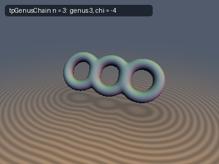
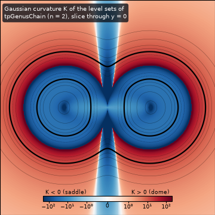
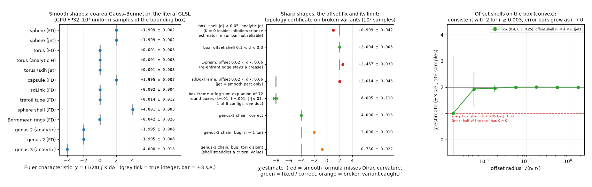

# `tpGaussBonnet` — Integer Topological Invariants from SDFs: Euler Characteristic by Gauss–Bonnet, Linking Number by Segment-Pair Solid Angles

Functions: `tpGaussCurvatureImplicit`, `tpMeanCurvatureImplicit`, `tpGaussCurvatureSDF`, `tpMeanCurvatureSDF`, `tpJetFromStencil`, `tpTorusJet`, `tpGenusChain`, `tpGenusChainIntegrand`, `tpSolidAngleTri`, `tpLinkingSegSeg`, `tpTorusStrand`, `tpLinkingTorusLink`, `tpSolidAngleCircle`

| 3D Surface (`tpGenusChain`, genus 3) | Gaussian curvature of the level sets (genus 2, slice $`y = 0`$) |
| :---: | :---: |
|  |  |

| Property | Value |
| :--- | :--- |
| **Author** | **Claude Fable 5.2** (`sdf-gems`, 2026). The mathematics is classical (Gauss–Bonnet, coarea formula, Gauss linking integral); see Novelty & Prior Art. |
| **Category** | `topology` (research experiment: integers that a correct SDF must reproduce) |
| **GLSL File** | [`glsl/topology/tpGaussBonnet.glsl`](../../glsl/topology/tpGaussBonnet.glsl) |
| **Exactness** | These are not distance functions, except the two examples. Curvature formulas and `tpLinkingSegSeg`: **closed forms, verified** against independent references (errors 1e-7 to 2e-6 in FP32). Euler characteristic: a **Monte Carlo estimate** (approximate; error bars below), integer only after rounding. `tpTorusJet`: exact torus SDF with analytic Hessian. `tpGenusChain`: **1-Lipschitz implicit surface, not an exact SDF** (measured gradient norm between 0.61 and 1.00 near the surface). |

---

## Overview

Two integers can be read off an SDF scene, and a correct implementation has to reproduce them:

1. **Euler characteristic** $`\chi`$ of a closed surface, from the integral of the Gaussian curvature of the level sets (Gauss–Bonnet). $`\chi = 2 - 2g`$ per component of genus $`g`$.
2. **Linking number** $`\mathrm{Lk}`$ of two closed centre curves, from a closed-form sum over segment pairs.

This document reports what was measured for each, including where the idea fails. The short version: (1) works on smooth surfaces with $`10^3`$ to $`3\cdot 10^5`$ samples and **fails on sharp non-convex shapes**; (2) works to FP32 rounding with a handful of segments.



*Left: 13 smooth cases, literal GLSL on the GPU. Middle: sharp shapes and broken variants. Right: offset shells on a box.*

---

## Mathematical Formulation

### 1. Curvature of a level set

For any $`C^2`$ function $`f`$ with gradient $`\mathbf{g}`$ and Hessian $`H`$ (Goldman 2005):

```math
K = \frac{\mathbf{g}^{\mathsf T}\,\mathrm{adj}(H)\,\mathbf{g}}{\Vert\mathbf{g}\Vert^4},
\qquad
H_m = \frac{\Vert\mathbf{g}\Vert^2\,\mathrm{tr}\,H - \mathbf{g}^{\mathsf T} H\,\mathbf{g}}{2\,\Vert\mathbf{g}\Vert^3}.
```

For an exact SDF, $`H\mathbf{g} = 0`$ and $`H`$ has eigenvalues $`\{0, k_1, k_2\}`$, so $`K`$ is the sum of the three principal $`2\times 2`$ minors of $`H`$ and $`H_m = \tfrac12 \mathrm{tr}\,H`$ (`tpGaussCurvatureSDF`, `tpMeanCurvatureSDF`).

### 2. Gauss–Bonnet through the coarea formula

No surface samples are needed. For uniform samples $`\mathbf{p}_i`$ of a box of volume $`V`$ and a shell $`a < f < b`$:

```math
\hat\chi = \frac{V}{2\pi\,(b-a)}\cdot\frac1N\sum_{i=1}^{N} \mathbf{1}\left[a < f(\mathbf{p}_i) < b\right]\,K(\mathbf{p}_i)\,\Vert\nabla f(\mathbf{p}_i)\Vert .
```

This estimates the average of $`\chi(\{f = t\})`$ over $`t \in (a, b)`$. It is an integer only if no critical value of $`f`$ lies in $`(a, b)`$. Replacing $`K`$ by $`H_m`$ or by $`1`$ gives the total mean curvature and the area (the last column of `tpGenusChainIntegrand`).

### 3. Linking number of two polygons

For two straight segments $`\mathbf{a}_0\mathbf{a}_1`$ and $`\mathbf{b}_0\mathbf{b}_1`$ the Gauss double integral is the signed solid angle of the parallelogram $`\{\mathbf{b}(t) - \mathbf{a}(s)\}`$ seen from the origin, divided by $`4\pi`$. `tpLinkingSegSeg` splits the parallelogram into two triangles and uses the van Oosterom–Strackee formula (`tpSolidAngleTri`, 1 `atan`, 3 `sqrt`). The sum over all segment pairs of two disjoint closed polygons is exactly their integer linking number. It does not converge in the number of segments: it is the right integer as soon as the polygons are isotopic to the curves, and a wrong integer before that.

The repo already uses a solid-angle phase for Seifert surfaces in [`sdMilnorSeifertKnot`](../primitives3d/sdMilnorSeifertKnot.md); that work is not repeated here. `tpSolidAngleCircle` is only a small test fixture for `tpSolidAngleTri`.

---

## GLSL

```glsl
float tpGaussCurvatureImplicit( vec3 g, mat3 H )
{
    vec3 c = vec3(dot(g, cross(H[1], H[2])), dot(g, cross(H[2], H[0])), dot(g, cross(H[0], H[1])));
    float g2 = dot(g, g);
    return dot(g, c) / max(g2 * g2, 1e-30);
}

float tpSolidAngleTri( vec3 a, vec3 b, vec3 c )
{
    float la = length(a), lb = length(b), lc = length(c);
    float num = dot(a, cross(b, c));
    float den = la * lb * lc + dot(a, b) * lc + dot(b, c) * la + dot(c, a) * lb;
    return (abs(num) + abs(den) > 0.0) ? 2.0 * atan(num, den) : 0.0;
}

float tpLinkingSegSeg( vec3 a0, vec3 a1, vec3 b0, vec3 b1 )
{
    vec3 v00 = b0 - a0, v10 = b0 - a1, v11 = b1 - a1, v01 = b1 - a0;
    return (tpSolidAngleTri(v00, v10, v11) + tpSolidAngleTri(v00, v11, v01)) * 0.07957747154594767;
}
```

The full file also contains the 19-point stencil helper, the analytic torus 2-jet, the log-sum-exp genus-$`n`$ chain with analytic gradient and Hessian, and a fixed-$`N`$ linking loop (`TP_LINK_SEGMENTS`, default 24).

---

## Verification

All numbers below come from the literal GLSL on the GPU (FP32) through `tools/gpu_eval.py`, unless marked FP64. Monte Carlo rows use $`N = 10^7`$ uniform samples of a bounding box; "±" is one standard error; $`\sigma_1`$ is the per-sample standard deviation of $`\hat\chi`$, so the error with $`n`$ samples is $`\sigma_1/\sqrt n`$.

### Closed forms against independent references

| Function | Reference | Result |
| :--- | :--- | :--- |
| `tpSolidAngleTri` | Girard spherical excess (FP64), 256 random triangles | max error 2.4e-6 |
| `tpLinkingSegSeg` | 300×300 Gauss–Legendre quadrature of the Gauss integrand (FP64), 256 random segment pairs at least 0.25 apart | max error 8.8e-8 (FP64 port: 4.4e-15) |
| `tpGaussCurvatureImplicit`, `tpMeanCurvatureImplicit` | closed-form ellipsoid curvatures, 20,000 surface points | max relative error 4.4e-7, 3.8e-7 |
| `tpTorusJet` | closed-form torus distance, gradient, $`K`$, $`H_m`$, 39,838 points | 1.9e-7, 1.2e-6, 1.5e-6 (scaled), 2.8e-6 (scaled) |
| `tpGenusChain` gradient and Hessian | central differences of an independent FP64 implementation | gradient 8.6e-7 and 1.7e-6; Hessian 4.0e-5 and 1.1e-4 (entries up to 14 and 20) for $`n = 2, 3`$ |
| `tpJetFromStencil` | a quadratic with known Hessian, $`h = 0.05`$ | max entry error 2.5e-5 |
| `tpSolidAngleCircle` | Girard fan (FP64), 300 points | 1.6e-6 ($`N = 24`$), 3.7e-6 ($`N = 128`$) |
| NaN / Inf | 11 probe points × 5 expressions | 0 non-finite |
| Single-translation-unit compile | forward, reverse, new-first | passed (291 files) |

### Euler characteristic of smooth surfaces

"FD" = repo SDF + `tpJetFromStencil` ($`h = 0.003`$, or $`0.0025`$ for the thin tubes) + `tpGaussCurvatureImplicit`. "jet" = [`sdhJet3D`](../../glsl/gradients3d/sdhJet3D.glsl). "analytic" = this file. Two independent seeds are shown.

| Shape | Shell half-width | $`\hat\chi`$ (seed 1) | $`\hat\chi`$ (seed 2024) | True | $`\sigma_1`$ | $`n`$ for $`3\,\mathrm{s.e.} < 0.5`$ |
| :--- | :---: | :---: | :---: | :---: | :---: | :---: |
| `sdSphere` (FD) | 0.05 | 1.9988 ± 0.0016 | 2.0013 ± 0.0016 | 2 | 4.9 | 873 |
| `sdhSphere` (jet) | 0.05 | 1.9988 ± 0.0016 | 2.0013 ± 0.0016 | 2 | 4.9 | 873 |
| `sdTorus` (FD) | 0.05 | 0.0015 ± 0.0030 | 0.0029 ± 0.0030 | 0 | 9.4 | 3,208 |
| `tpTorusJet` (analytic) | 0.05 | 0.0014 ± 0.0030 | 0.0028 ± 0.0030 | 0 | 9.4 | 3,208 |
| `sdhTorus` (jet) | 0.05 | 0.0014 ± 0.0030 | 0.0028 ± 0.0030 | 0 | 9.4 | 3,208 |
| `sdCapsule` (FD) | 0.05 | 1.9952 ± 0.0028 | 2.0001 ± 0.0028 | 2 | 8.8 | 2,774 |
| `sdLink` (FD) | 0.04 | −0.0020 ± 0.0038 | −0.0061 ± 0.0038 | 0 | 12.0 | 5,180 |
| `sdTrefoilKnot` tube, radius 0.06 (FD) | 0.03 | −0.014 ± 0.012 | 0.003 ± 0.012 | 0 | 38.6 | 53,584 |
| sphere shell `abs(sdSphere) - 0.08` (FD) | 0.03 | 4.0012 ± 0.0033 | 4.0065 ± 0.0033 | 4 | 10.5 | 3,974 |
| `sdBorromeanRings`, radius 0.05 (FD) | 0.025 | −0.042 ± 0.026 | 0.013 ± 0.026 | 0 | 82.6 | 245,591 |
| `tpGenusChain` $`n = 2`$ (analytic) | 0.02 | −1.9949 ± 0.0080 | −2.0019 ± 0.0080 | −2 | 25.4 | 23,228 |
| `tpGenusChain` $`n = 2`$ (FD) | 0.02 | −1.9949 ± 0.0080 | −2.0020 ± 0.0080 | −2 | 25.4 | 23,224 |
| `tpGenusChain` $`n = 3`$ (analytic) | 0.015 | −3.9997 ± 0.0130 | −3.9990 ± 0.0130 | −4 | 41.1 | 60,821 |

Over the 26 entries the largest deviation is 1.94 standard errors. Empirical recovery of the integer by rounding, from disjoint batches of a pool of $`8\cdot 10^6`$ samples:

| Batch size | 1,000 | 10,000 | 100,000 | 300,000 |
| :--- | :---: | :---: | :---: | :---: |
| sphere | 99.9% | 100% | 100% | 100% |
| torus | 90.8% | 100% | 100% | 100% |
| genus 2 | 46.1% | 94.2% | 100% | 100% |
| trefoil tube | 31.2% | 77.6% | 100% | 100% |
| genus 3 | 30.0% | 78.1% | 100% | 100% |
| Borromean rings | 15.6% | 45.6% | 93.8% | 100% |

**Shell width.** On the torus (analytic Hessian) every half-width from 0.002 to 0.199 is consistent with 0 (largest deviation 1.94 s.e.). $`\sigma_1`$ falls from 75 at 0.002 to 9.8 at 0.15 and rises again to 12.6 at 0.199, next to the focal circle at $`d = -0.2`$. Genus 2: $`\sigma_1`$ from 101 (0.002) to 16.8 (0.1). Wide shells are better until they approach the medial axis. A shell that crosses a topology change gives a non-integer that matches the prediction: for the torus shell $`0.31 < d < 0.45`$ (hole closed) the smooth part predicts 0.9632 and the measurement is 0.9638 ± 0.0085.

**Finite-difference step in FP32** (torus, true value 0):

| $`h`$ | 0.1 | 0.03 | 0.01 | 0.003 | 0.001 | 0.0003 | 0.0001 |
| :--- | :---: | :---: | :---: | :---: | :---: | :---: | :---: |
| implicit formula | −0.024 | −0.003 | −0.002 | −0.002 | −0.002 | 0.022 | 2.02 |
| SDF minors on the same stencil | 0.955 | 0.083 | 0.008 | −0.001 | −0.001 | 0.084 | 7.00 |

(standard error 0.003 except the last column). Thin tubes need a smaller step: for the trefoil tube of radius 0.06 the implicit formula gives −0.59, −0.13, −0.035, −0.011 (± 0.012) at $`h = 0.02, 0.01, 0.005, 0.0025`$, and the SDF-minor formula gives 4.55, 1.13, 0.28, 0.068. The Borromean rings behave the same way (−0.80 to −0.003 against 12.5 to 0.19).

### Sharp shapes

| Case | $`\hat\chi`$ | True | Verdict |
| :--- | :---: | :---: | :--- |
| `sdhBox`, shell $`\vert d\vert < 0.05`$ | 0.999 ± 0.042 and 1.16 ± 0.17 (two seeds) | 2 | wrong: the inner half of the shell has $`K = 0`$ |
| `sdhBox`, shell $`-0.05 < d < 0`$ | 0 exactly | 2 | wrong |
| `sdhBox`, offset shell $`0.1 < d < 0.3`$ | 2.004 ± 0.003 and 2.002 ± 0.003 | 2 | correct |
| `sdhBox`, offset shell $`0.003 < d < 0.01`$ | 1.93 ± 0.21 | 2 | consistent, too noisy to round |
| L-prism (two boxes), `sdhUnion` jet, offset shells from 0.02 to 0.4 | 2.47 to 2.52 (± 0.003 to 0.06) | 2 | wrong: matches the smooth-part prediction 2.5 |
| L-prism, FD $`h = 0.001`$, same shells | 3.2 to 13.3 | 2 | garbage, grows with the offset |
| `sdBoxFrame`, FD, shell $`\vert d\vert < 0.02`$ | −4.6 ± 0.8 and −3.2 ± 0.8 | −8 | garbage |
| box frame as `sdhUnion` of 12 `sdhBox`, offset shells | 2.13 ± 0.13, 2.01 ± 0.04, 1.99 ± 0.01 | −8 | wrong: only the 8 outer corners are seen |
| box frame rebuilt as a log-sum-exp union of 12 round boxes (FD) | −7.99 ± 0.10 to −8.34 ± 0.23 over 6 settings; second seed −7.87 ± 0.08, −8.06 ± 0.11 | −8 | consistent with −8; $`\sigma_1`$ = 237 to 726 |

### Gauss–Bonnet against the tube-volume cubic coefficient

Same samples, same shell. The cubic coefficient is a least-squares fit of the empirical distribution of $`d`$ (61 nodes); closed forms for comparison come from [`msSteinerTube`](../measure/msSteinerTube.md).

| Shape | Gauss–Bonnet $`\hat\chi`$ | Cubic-fit $`\hat\chi`$ | Variance ratio |
| :--- | :---: | :---: | :---: |
| sphere | 1.9995 ± 0.0012 | 2.004 ± 0.013 | 129× |
| torus | 0.0017 ± 0.0023 | −0.049 ± 0.052 | 492× |
| capsule | 2.0062 ± 0.0032 | 2.005 ± 0.021 | 42× |
| `sdLink` | 0.0003 ± 0.0036 | 0.11 ± 0.10 | 837× |
| box, offset shell | 1.9987 ± 0.0042 | 2.041 ± 0.068 | 254× |

### Topology certificate on broken variants (genus-3 chain, true $`\chi = -4`$)

| Variant | $`\hat\chi`$ (two seeds) |
| :--- | :---: |
| correct | −4.006 ± 0.013, −3.999 ± 0.013 |
| off-by-one loop (2 tori) | −2.006 ± 0.010, −2.017 ± 0.010 |
| spacing 0.43 (tori no longer overlap), shell $`\vert f\vert < 0.015`$ | −0.756 ± 0.022, −0.815 ± 0.025 |
| same, shell $`-0.015 < f < 0.005`$ | −0.023 ± 0.016 |
| same, shell $`0.012 < f < 0.03`$ | −4.05 ± 0.04 |
| spacing 0.405 (still merged), shell $`\vert f\vert < 0.004`$ | −3.95 ± 0.05 |

The non-integer in the third row is itself informative: the log-sum-exp union has a saddle at $`f = 0.03\,(1 - \ln 2) = 0.0092`$ inside the shell, and 19% of the shell lies above it, which predicts $`-0.77`$.

### Linking numbers and writhe

Centre curves are the repo's own parameterisations (`sdChain` / `sdLink` stadium, `sdBorromeanRings` ellipses, the `sdSolomonLink` strands, `sdTrefoilKnot`, `sdFigureEightKnot`).

| Pair | True | GPU polygon sum (FP32), $`N`$ segments per curve | Smallest $`N`$ that is exact and stays exact (FP64) | Trapezoid quadrature: nodes for 1e-4 |
| :--- | :---: | :--- | :---: | :---: |
| Hopf link | ±1 | −1.000000 ($`N = 8`$), −1.000001 ($`N = 128`$) | 3 | 15 |
| `sdChain` links 0, 1 | ±1 | +1.000000 ($`N = 8`$), +0.999999 ($`N = 128`$) | 5 | 123 |
| `sdChain` links 0, 2 | 0 | +0.000000 | 3 | 3 |
| Borromean rings, each of the 3 pairs | 0 | ±0.000000 | 3 | 16 |
| T(2,2) | ±1 | −1.000000 ($`N = 6`$) | 3 | 14 |
| T(2,4) Solomon | ±2 | −2.000000 ($`N = 6`$), −1.999996 ($`N = 128`$) | 5 | 15 |
| T(2,6) | ±3 | +1.000000 ($`N = 6`$, wrong), −2.999999 ($`N = 8`$) | 7 | 26 |
| T(2,8) | ±4 | +1.000000 ($`N = 8`$, wrong), −4.000000 ($`N = 12`$), −3.999991 ($`N = 128`$) | 9 | 47 |

Largest FP32 deviation from an integer over all correct cases: 9e-6 (16,384 terms). Over 20 random $`(R, r_0)`$ and $`n = 1, 2, 3`$ at $`N = 24`$: 4.5e-6.

Writhe is not an integer. FP64 trapezoid quadrature of the Gauss self-integral gives −3.33706 (trefoil, $`R = 0.5, r_0 = 0.2`$), +0.03502 (figure-eight, $`r_1 = 0.2`$) and −6.43262 (cinquefoil). The Călugăreanu identity checks the trefoil independently: $`\mathrm{Lk}(\text{push-off}) - \mathrm{Tw} = -3 - 0.337058 = -3.33706`$. The polygon sum (non-adjacent pairs) converges like $`N^{-2}`$: the GPU returns −3.32199, −3.33320, −3.33610 for $`N = 50, 100, 200`$ and agrees with the FP64 polygon sum to 1.1e-5 (3.8e-5 for the cinquefoil). Richardson extrapolation of the two last GPU values gives −3.33707, +0.03502 and −6.43260.

---

## Findings

### What held

- **Smooth surfaces: the integer is recoverable.** All 13 cases agree with the true $`\chi`$ within 2 standard errors on two seeds, including genus 2 and 3 through the general implicit formula and two-component surfaces (sphere shell, $`\chi = 4`$). Required samples for $`3\,\mathrm{s.e.} < 0.5`$: about $`10^3`$ (sphere), $`3\cdot 10^3`$ to $`5\cdot 10^3`$ (torus, capsule, link), $`2\cdot 10^4`$ to $`6\cdot 10^4`$ (genus 2, 3, trefoil tube), $`2.5\cdot 10^5`$ (Borromean rings). Cost scales with (curvature)² × (empty box volume).
- **Analytic and finite-difference Hessians agree in FP32** to the fourth decimal, for $`10^{-3} \le h \le 3\cdot 10^{-3}`$ and features of size 0.05 or more.
- **Gauss–Bonnet beats the tube-volume cubic fit** by a variance factor of 42 to 837 on the same samples. The cubic fit needs only $`d`$, no derivatives. The comparison is against one simple least-squares fit, not an optimised estimator.
- **Offset shells fix convex sharp shapes.** Box: 2.00 at every offset from 0.03 to 3, with $`\sigma_1`$ from 31 down to 3.4.
- **Polygonal linking numbers are integers to 9e-6 in FP32**, exact from 3 to 9 segments per curve, where quadrature of the Gauss integral needs 14 to 123 nodes for 1e-4. All three Borromean pairs give 0.
- **The certificate catches both broken variants** (deviations of more than 100 standard errors from −4).

### What failed or only partly held

- **The offset fix does not work for non-convex sharp shapes.** The brief expected `sdBoxFrame` to give $`\chi = -8`$ from an offset surface. It gives +2. A re-entrant edge has zero reach, so every outward offset keeps a crease there and the smooth formula misses its Dirac curvature. The L-prism gives 2.5 instead of 2 for the same reason. The value −8 was only obtained on a different, smooth surface of the same topology (log-sum-exp union of 12 round boxes), at high variance: $`2\cdot 10^6`$ to $`2\cdot 10^7`$ samples for $`3\,\mathrm{s.e.} < 0.5`$.
- **Finite differences across creases are not a fix.** They return step-dependent garbage on the L-prism and the box frame. On the convex box they give 1.95 ± 0.13 with $`\sigma_1 = 423`$; that was not investigated further and should not be relied on.
- **Shells that touch a sharp convex vertex have unreliable error bars.** $`K \propto 1/d^2`$ there, so the estimator has infinite variance; two seeds gave $`\sigma_1`$ = 133 and 545 for the same setting.
- **`tpGaussCurvatureSDF` should not be used with a finite-difference Hessian.** Its bias is 10 to 100 times that of the implicit formula at the same step (trefoil tube, $`h = 0.01`$: 1.13 against −0.13). It is fine with analytic Hessians.
- **FP32 finite differences have a narrow window.** $`h \le 3\cdot 10^{-4}`$ is biased by rounding (2.02 instead of 0 at $`10^{-4}`$); $`h`$ larger than about 1/20 of the smallest curvature radius is biased by truncation.
- **Too few segments give a wrong integer with no warning** (T(2,8) with 8 segments: +1).
- **Writhe to 1e-4 was not reached by the plain polygon sum on the GPU** (error 1e-3 at $`N = 200`$); only the Richardson-extrapolated value is that accurate.
- **A certificate shell must not contain a critical value.** Otherwise the result is a non-integer weighted average. That flags a problem, but does not identify the topology.

### Not done

- No invariant that detects the Borromean rings (Milnor's triple linking number) was implemented. Pairwise linking numbers cannot detect them.
- No importance sampling or stratification; all estimates use uniform samples of a bounding box.
- No correction for Dirac curvature at creases (edge and vertex terms of the Gauss–Bonnet theorem for piecewise-smooth surfaces).
- No deterministic (grid) quadrature and no interval-arithmetic guarantee for the rounding step.
- The 3D preview and the slice show the example surface and its curvature field; there is no rendered figure for the linking results.

### Open questions

- Can the edge and vertex terms be evaluated from an SDF alone, for instance from the jump of the gradient across the medial axis of the exterior, so that `sdBoxFrame` gives −8 directly?
- Is there a control variate or sampling density that removes the $`\sigma_1 \propto`$ curvature scaling for thin tubes?
- Why do finite differences return about 2 on the sharp convex box, and for which step sizes?

---

## Novelty & Prior Art

Nothing here is new mathematics.

- **Gauss–Bonnet and the curvature formulas** are classical. The implicit-surface formulas are from R. Goldman, "Curvature formulas for implicit curves and surfaces", *Computer Aided Geometric Design* 22 (2005). Shadertoy shaders that colour SDF surfaces by finite-difference curvature exist.
- **Euler characteristic of level sets as a volume integral of derivative invariants** is established practice in cosmology: Schmalzing & Buchert, "Beyond genus statistics", *ApJ Letters* 482 (1997), using Koenderink invariants, and the earlier genus statistics. Gauss–Bonnet integrals are also used as topology diagnostics or regularisers for neural implicit surfaces.
- **Triangle solid angle**: van Oosterom & Strackee, *IEEE Trans. Biomed. Eng.* 30 (1983). **Polygonal linking number and writhe**: Klenin & Langowski, *Biopolymers* 54 (2000); Z. Arai, "A rigorous numerical algorithm for computing the linking number of links", *NOLTA* 4 (2013), which adds interval arithmetic. **Generalised winding numbers** (Jacobson et al. 2013; Barill et al. 2018) sum the same triangle solid angles.
- **Tube formula cross-check**: Steiner, Weyl; packaged in this repo as [`msSteinerTube`](../measure/msSteinerTube.md).

What this entry adds is packaging and measurement, with no claim of priority: GLSL integrands tested on the literal shader; measured sample counts, shell-width and step-size limits in FP32; the measured variance advantage over the tube-volume fit; the documented failure of the offset fix on non-convex sharp shapes; and linking numbers of this repo's own curve parameterisations. The searches run for this entry did not turn up a GLSL implementation of the segment-pair linking number, which is weak evidence only.

---

## Reproduction

Scripts live outside the repository, in the experiment's scratch directory (`topology/`). Each is run from the repo root as `uv run python <script>`:

| Script | Produces |
| :--- | :--- |
| `b1_linking.py` | FP64 linking numbers, quadrature comparison, writhe |
| `b2_gpu.py` | closed-form checks and GPU linking numbers |
| `a1_smooth.py 1e7` | smooth-surface table (seed 1) |
| `a2_scans.py 1e7` | shell-width and step-size scans |
| `a3_sharp.py`, `a3b_lprism.py` | sharp shapes, certificate |
| `a4_cubic.py` | Gauss–Bonnet against the cubic fit |
| `a5_recovery.py` | recovery rates |
| `a6_reseed.py 1e7 2024` | second seed, sub-shell certificate rows, GPU writhe |
| `images.py` (with `--with matplotlib`) | the three images |
