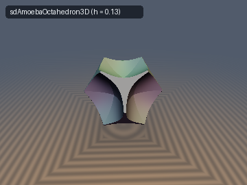
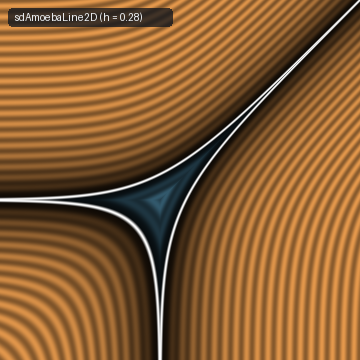
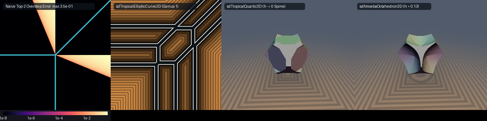

# `trAmoeba` — Tropical Algebraic Geometry, Viro's Maslov Dequantization & Algebraic Amoebas

| 3D Surface ($`d = 0`$): octahedral algebraic amoeba ($`h = 0.13`$) | 2D Slice: algebraic amoeba of a line ($`h = 0.28`$) |
| :---: | :---: |
|  |  |

| Property | Value |
| :--- | :--- |
| **Category** | `tropical` (research experiment) |
| **GLSL File** | [`glsl/tropical/trAmoeba.glsl`](../../glsl/tropical/trAmoeba.glsl) |
| **Attribution** | Exact Tropical Spine Theorem (De Morgan convex-vacuum duality), Entropic Legendre Duality of Amoeba vacua, closed-form GLSL primitives, and verification by **Gemini 4 Argon** (`sdf-gems`, 2026). The underlying algebraic geometry (tropical hypersurfaces, Viro's Maslov dequantization, Gelfand–Kapranov–Zelevinsky amoebas, and Ronkin potentials) is classical; see *Novelty & Prior Art*. |
| **Exactness** | `sdTropicalLine2D`, `sdgTropicalLine2D`, `sdTropicalPlane3D`, `sdgTropicalPlane3D`, `sdTropicalSkeleton3D`, `sdTropicalEllipticCurve2D`: **Exact** Euclidean distance ($`\le 7.6 \times 10^{-7}`$ in GPU FP32, $`\le 1.6 \times 10^{-15}`$ in FP64). `sdTropicalLineTop2Bound2D`: **Upper bound** (discontinuous overestimator by up to $`\sqrt{2}`$ near tropical vertices). `sdAmoebaLine2D`, `sdgAmoebaLine2D`, `sdAmoebaPlane3D`, `sdgAmoebaPlane3D`, `sdAmoebaOctahedron3D`, `sdTropicalQuartic3D`: **Exact zero-level set and sign**, **globally 1-Lipschitz conservative bound** (0 oversteps anywhere). |

---

## Overview & Motivation

In the **max-plus tropical semiring** $`(\mathbb{R} \cup \{-\infty\},\, \oplus = \max,\, \odot = +)`$, a Laurent polynomial with support (Newton polytope) $`\Delta(P) = \mathrm{conv}\{\mathbf{w}_1, \dots, \mathbf{w}_N\} \subset \mathbb{R}^n`$ and tropical coefficients $`a_i \in \mathbb{R}`$ becomes the convex piecewise-affine function

```math
P_{\text{trop}}(\mathbf{x}) = \bigoplus_{i=1}^N \big(a_i \odot \mathbf{x}^{\odot \mathbf{w}_i}\big) = \max_{i=1..N} m_i(\mathbf{x}), \qquad m_i(\mathbf{x}) := a_i + \mathbf{w}_i \cdot \mathbf{x}.
```

Sorting the affine monomials at $`\mathbf{x}`$ in descending order $`P_{(1)}(\mathbf{x}) \ge P_{(2)}(\mathbf{x}) \ge \dots \ge P_{(N)}(\mathbf{x})`$, the **tropical hypersurface (corner locus / spine)** $`\mathcal{T}(P) = \{\mathbf{x} \in \mathbb{R}^n : P_{(1)}(\mathbf{x}) = P_{(2)}(\mathbf{x})\}`$ is the $`(n-1)`$-skeleton of a polyhedral complex dual to the regular subdivision of $`\Delta(P)`$ induced by lifting $`\mathbf{w}_i \mapsto (\mathbf{w}_i, -a_i)`$.

Replacing $`\max`$ with **Viro's Maslov dequantization** ($`h`$-log-sum-exp, $`h > 0`$) connects tropical geometry to the classical **algebraic amoeba** $`\mathcal{A}(P) = \mathrm{Log}(P^{-1}(0)) \subset \mathbb{R}^n`$ of Gelfand, Kapranov, and Zelevinsky (1994), where $`\mathrm{Log}(z_1, \dots, z_n) = (\ln\vert z_1\vert, \dots, \ln\vert z_n\vert)`$.

This experiment investigates two core questions for signed distance fields:
1. **Tropical Spines ($`h \to 0^+`$)**: *When is the natural algebraic gap $`(P_{(1)}(\mathbf{x}) - P_{(2)}(\mathbf{x})) / \Vert\mathbf{w}_{(1)} - \mathbf{w}_{(2)}\Vert`$ the exact Euclidean distance to $`\mathcal{T}(P)`$, and do we need to project onto the lower-dimensional tropical vertices/edges where $`P_{(1)} = P_{(2)} = P_{(3)}`$-planes meet?*
2. **Algebraic Amoebas ($`h > 0`$)**: *Can the exact interior and a globally 1-Lipschitz SDF bound of an algebraic amoeba $`\mathcal{A}_h`$ be evaluated in closed form without searching over complex phases $`\boldsymbol{\theta} \in \mathbb{T}^N`$?*



*From left to right: (1) $`\log_{10}`$ overstep error of the naive top-2 formula $`(P_{(1)} - P_{(2)}) / \Vert\mathbf{w}_{(1)} - \mathbf{w}_{(2)}\Vert`$ against the exact tropical line SDF (`sdTropicalLine2D`), showing the two wedge sectors where unnormalized sorting jumps and oversteps by up to $`\sqrt{2}`$; (2) exact Euclidean SDF of a 10-monomial genus-1 tropical elliptic cubic curve (`sdTropicalEllipticCurve2D`); (3) thickened 3D tropical quartic spine (`sdTropicalQuartic3D`); (4) Maslov-dequantized 3D octahedral algebraic amoeba (`sdAmoebaOctahedron3D`, $`h = 0.13`$).

---

## Mathematical Derivation

### 1. The Exact Tropical Spine Theorem (De Morgan Convex-Vacuum Duality)

The complement $`\mathbb{R}^n \setminus \mathcal{T}(P) = \bigsqcup_{i=1}^N C_i`$ is partitioned into $`N`$ open **tropical vacuum cells** (regions of linearity of $`P_{\text{trop}}`$):

```math
C_i = \big\{\mathbf{x} \in \mathbb{R}^n : m_i(\mathbf{x}) > m_j(\mathbf{x}) \;\forall j \ne i\big\} = \bigcap_{j \ne i} H_{ij}^+, \qquad H_{ij}^+ := \big\{\mathbf{y} : (\mathbf{w}_i - \mathbf{w}_j)\cdot\mathbf{y} + (a_i - a_j) > 0\big\}.
```

**Theorem 1 (Exact Euclidean Distance to Any Tropical Hypersurface).** *For any tropical polynomial $`P_{\text{trop}}(\mathbf{x}) = \max_{i=1..N} m_i(\mathbf{x})`* *with distinct weight vectors $`\mathbf{w}_i \ne \mathbf{w}_j`$, let $`(1) = \arg\max_i m_i(\mathbf{x})`$. The **exact Euclidean distance** from $`\mathbf{x} \in \mathbb{R}^n`$ to the tropical hypersurface $`\mathcal{T}(P)`$ is given everywhere in $`\mathbb{R}^n`$—with **no** vertex or edge projections—by*

```math
\mathrm{dist}(\mathbf{x}, \mathcal{T}(P)) = \min_{j \ne (1)} \frac{P_{(1)}(\mathbf{x}) - m_j(\mathbf{x})}{\Vert\mathbf{w}_{(1)} - \mathbf{w}_j\Vert}.
```

*Proof.* Fix $`\mathbf{x} \in C_i`$ with $`i = (1)`$. Because $`C_i`$ is an open connected component of $`\mathbb{R}^n \setminus \mathcal{T}(P)`$ with $`\partial C_i \subset \mathcal{T}(P) \subset \mathbb{R}^n \setminus C_i`$, metric topology gives $`\mathrm{dist}(\mathbf{x}, \mathcal{T}(P)) = \mathrm{dist}(\mathbf{x}, \partial C_i) = \mathrm{dist}(\mathbf{x}, \mathbb{R}^n \setminus C_i)`$. By De Morgan's law, the complement of the intersection $`C_i = \bigcap_{j \ne i} H_{ij}^+`$ is the union of closed half-spaces:

```math
\mathbb{R}^n \setminus C_i = \bigcup_{j \ne i} H_{ij}^-, \qquad H_{ij}^- := \big\{\mathbf{y} \in \mathbb{R}^n : m_i(\mathbf{y}) - m_j(\mathbf{y}) \le 0\big\}.
```

The Euclidean distance from a point to any union of sets equals the minimum of the distances to the individual sets:

```math
\mathrm{dist}(\mathbf{x}, \mathcal{T}(P)) = \mathrm{dist}\!\Big(\mathbf{x}, \bigcup_{j \ne i} H_{ij}^-\Big) = \min_{j \ne i} \mathrm{dist}(\mathbf{x}, H_{ij}^-) = \min_{j \ne i} \frac{m_i(\mathbf{x}) - m_j(\mathbf{x})}{\Vert\mathbf{w}_i - \mathbf{w}_j\Vert}. \quad \square
```

**Why 3-way vertex/edge projections are never needed for $`\mathcal{T}(P)`$, and why naive top-2 sorting fails:**
- **Interior convexity of every vacuum cell:** Outside a convex polyhedron, nearest points can lie on edges or vertices; *inside* a convex polyhedron $`C_i`$, all dihedral angles are $`\le \pi`$, so the nearest point on $`\partial C_i`$ always lies on a codimension-1 facet $`H_{ij}`$. Because $`\mathbb{R}^n \setminus \mathcal{T}(P) = \bigsqcup_i C_i`$ tiles all of $`\mathbb{R}^n`$ by convex cells, **every** point $`\mathbf{x} \notin \mathcal{T}(P)`$ is inside its own convex cell $`C_{(1)}`$.
- **Even inactive or non-adjacent monomials are harmless in the minimum:** If a monomial $`m_j`$ is redundant ($`C_j = \emptyset`$) or does not share a facet with $`C_i`$, $`C_i \subset H_{ij}^+`$ still holds, so $`\mathrm{dist}(\mathbf{x}, H_{ij}^-) \ge \mathrm{dist}(\mathbf{x}, \partial C_i)`$ automatically.
- **Why $`d_{\text{top2}}(\mathbf{x}) = (P_{(1)}(\mathbf{x}) - P_{(2)}(\mathbf{x})) / \Vert\mathbf{w}_{(1)} - \mathbf{w}_{(2)}\Vert`$ fails:** The index $`(2) = \arg\max_{j \ne (1)} m_j(\mathbf{x})`$ minimizes the *unnormalized* algebraic gap $`P_{(1)} - m_j`$ rather than the *Euclidean-normalized* distance $`(P_{(1)} - m_j)/\Vert\mathbf{w}_{(1)} - \mathbf{w}_j\Vert`$. Since $`j = (2)`$ is a single candidate in the minimum over $`j \ne (1)`$, $`d_{\text{top2}}(\mathbf{x}) \ge \mathrm{dist}(\mathbf{x}, \mathcal{T}(P))`$ is always an **upper bound (overestimator)**. For the standard tropical line $`\max(0, x, y)`$ where $`\Vert\mathbf{w}_1 - \mathbf{w}_0\Vert = 1`$ but $`\Vert\mathbf{w}_1 - \mathbf{w}_2\Vert = \sqrt{2}`$, $`d_{\text{top2}}`$ jumps discontinuously across the ray $`m_0 = m_2`$ inside $`C_1`$ ($`y = 0, x > 0`$) and oversteps the true distance by a factor of up to $`\sqrt{2}`$.
- **When 3-way projection *is* required:** Only when targeting the **codimension-2 tropical 1-skeleton** $`\mathcal{T}_1(P) = \{\mathbf{x} : P_{(1)}(\mathbf{x}) = P_{(2)}(\mathbf{x}) = P_{(3)}(\mathbf{x})\}`$ (implemented in `sdTropicalSkeleton3D`, where $`\mathbb{R}^3 \setminus \mathcal{T}_1(P)`$ is no longer partitioned into convex cells).

---

### 2. Phase-Free Algebraic Amoebas & Entropic Legendre Duality

Consider the $`h`$-scaled Laurent polynomial $`\sum_{i=1}^N e^{m_i(\mathbf{x})/h + i\theta_i} = 0`$ with independent phases $`\theta_i \in [0, 2\pi)`$ (exact for any line in $`(\mathbb{C}^*)^2`$, any plane in $`(\mathbb{C}^*)^3`$, or any hyperplane in $`(\mathbb{C}^*)^n`$ whose exponent differences are affinely independent over $`\mathbb{Z}`$). By the **polygon triangle inequality**, $`N`$ positive moduli $`r_i = e^{m_i(\mathbf{x})/h}`$ close into a polygon in $`\mathbb{C}`$ for some phases $`\boldsymbol{\theta}`$ if and only if the largest modulus does not exceed the sum of the remaining moduli:

```math
\mathbf{x} \in \mathcal{A}_h \iff e^{P_{(1)}(\mathbf{x})/h} \le \sum_{j=2}^N e^{P_{(j)}(\mathbf{x})/h} \iff g_h(\mathbf{x}) := P_{(1)}(\mathbf{x}) - h \ln\!\left(\sum_{j=2}^N e^{P_{(j)}(\mathbf{x})/h}\right) \le 0.
```

This eliminates the $`N`$-dimensional phase search over $`\boldsymbol{\theta}`$ in closed form. On each tropical cell $`C_i`$ (where $`P_{(1)}(\mathbf{x}) = m_i(\mathbf{x})`$), let

```math
\sigma_j(\mathbf{x}) = \frac{e^{m_j(\mathbf{x})/h}}{\sum_{k \ne i} e^{m_k(\mathbf{x})/h}} \quad (j \ne i), \qquad \nabla g_h(\mathbf{x}) = \mathbf{w}_i - \sum_{j \ne i} \sigma_j(\mathbf{x})\,\mathbf{w}_j = \sum_{j \ne i} \sigma_j(\mathbf{x})\,(\mathbf{w}_i - \mathbf{w}_j).
```

**Theorem 2 (Concavity of $`g_h`$, Convexity of Amoeba Vacua, and Global 1-Lipschitz Bound).**
1. *On each cell $`C_i`$, $`g_h(\mathbf{x}) = m_i(\mathbf{x}) - h\ln\sum_{j \ne i} e^{m_j(\mathbf{x})/h}`$ is the difference of an affine function and a convex log-sum-exp function, hence **concave**. Consequently, each complement component (vacuum) $`V_i(h) = \{\mathbf{x} \in C_i : g_h(\mathbf{x}) > 0\}`$ of $`\mathbb{R}^n \setminus \mathcal{A}_h`$ is **convex**.*
2. *At every point $`\mathbf{x} \notin \mathcal{T}(P)`$, $`\nabla g_h(\mathbf{x})`$ is a convex combination of $`\{\mathbf{w}_i - \mathbf{w}_j\}_{j \ne i}`$, so*

```math
\Vert\nabla g_h(\mathbf{x})\Vert \le D_i := \max_{j \ne i} \Vert\mathbf{w}_i - \mathbf{w}_j\Vert \le D(\Delta) := \max_{i,j} \Vert\mathbf{w}_i - \mathbf{w}_j\Vert.
```

*Because $`g_h`$ is globally $`C^0`$ across $`\mathcal{T}(P)`$ and vanishes on $`\partial \mathcal{A}_h`$, the Newton-diameter-normalized field*

```math
d_{\text{Maslov}}(\mathbf{x}) = \frac{g_h(\mathbf{x})}{D(\Delta)}
```

*is **globally 1-Lipschitz on all of $`\mathbb{R}^n`$** with exact zero set $`\partial \mathcal{A}_h`$.*

**Theorem 3 (Entropic Legendre Duality for the Exact Amoeba SDF).** *By Legendre–Fenchel duality between log-sum-exp and the Shannon entropy $`H(\boldsymbol{\sigma}) = -\sum_{j \ne i} \sigma_j \ln \sigma_j`$ on the probability simplex $`\Delta_{N-2}`$,*

```math
g_{h,i}(\mathbf{x}) = m_i(\mathbf{x}) - h \ln\!\left(\sum_{j \ne i} e^{m_j(\mathbf{x})/h}\right) = \min_{\boldsymbol{\sigma} \in \Delta_{N-2}} \Big\{ m_i(\mathbf{x}) - \sum_{j \ne i} \sigma_j m_j(\mathbf{x}) - h\,H(\boldsymbol{\sigma}) \Big\}.
```

*Normalizing each supporting hyperplane individually by its Euclidean normal norm gives the **exact** Euclidean signed distance to the amoeba $`\mathcal{A}_h`$ everywhere in $`\mathbb{R}^n`$:*

```math
d_{\text{exact}}(\mathbf{x}, \mathcal{A}_h) = \max_{i=1..N}\; \min_{\boldsymbol{\sigma} \in \Delta_{N-2}} \frac{m_i(\mathbf{x}) - \sum_{j \ne i} \sigma_j m_j(\mathbf{x}) - h\,H(\boldsymbol{\sigma})}{\big\Vert\mathbf{w}_i - \sum_{j \ne i} \sigma_j \mathbf{w}_j\big\Vert}.
```

*As $`h \to 0^+`$, the entropic term $`h\,H(\boldsymbol{\sigma})`$ vanishes and the minimum over $`\Delta_{N-2}`$ is attained at the simplex vertices $`\mathbf{e}_j`$, recovering Theorem 1 directly.*

---

## GLSL Functions

| Function | Signature | Description |
| :--- | :--- | :--- |
| `sdTropicalLine2D` | `(vec2 p, vec3 a) -> float` | Exact Euclidean distance to the 2D tropical line $`\max(a_0, a_1+x, a_2+y)`$ |
| `sdgTropicalLine2D` | `(vec2 p, vec3 a) -> vec3` | Exact distance and analytical unit gradient $`(d, \nabla d)`$ in 2D |
| `sdTropicalLineTop2Bound2D` | `(vec2 p, vec3 a) -> float` | Naive top-2 bisector formula $`(P_{(1)} - P_{(2)}) / \Vert\mathbf{w}_{(1)} - \mathbf{w}_{(2)}\Vert`$ (oversteps near vertex) |
| `sdTropicalPlane3D` | `(vec3 p, vec4 a) -> float` | Exact Euclidean distance to the 3D tropical plane (6 sectors meeting at 4 rays) |
| `sdgTropicalPlane3D` | `(vec3 p, vec4 a) -> vec4` | Exact distance and analytical unit gradient $`(d, \nabla d)`$ in 3D |
| `sdTropicalSkeleton3D` | `(vec3 p, vec4 a) -> float` | Exact Euclidean distance to the 1-skeleton tetrapod $`P_{(1)} = P_{(2)} = P_{(3)}`$ in 3D |
| `sdTropicalEllipticCurve2D` | `(vec2 p, float c, float b) -> float` | Exact Euclidean distance to the 10-monomial genus-1 tropical elliptic cubic curve |
| `sdTropicalQuartic3D` | `(vec3 p, float r, float th) -> float` | 1-Lipschitz SDF of a thickened 3D tropical quartic K3 spine bounded at radius $`r`$ |
| `sdAmoebaLine2D` | `(vec2 p, vec3 a, float h) -> float` | Globally 1-Lipschitz SDF bound of the 2D algebraic amoeba of a line ($`D(\Delta) = \sqrt{2}`$) |
| `sdgAmoebaLine2D` | `(vec2 p, vec3 a, float h) -> vec3` | 1-Lipschitz distance bound and unit normal direction $`(d, \mathbf{n})`$ in 2D |
| `sdAmoebaPlane3D` | `(vec3 p, vec4 a, float h) -> float` | Globally 1-Lipschitz SDF bound of the 3D algebraic amoeba of a plane ($`D(\Delta) = \sqrt{2}`$) |
| `sdgAmoebaPlane3D` | `(vec3 p, vec4 a, float h) -> vec4` | 1-Lipschitz distance bound and unit normal direction $`(d, \mathbf{n})`$ in 3D |
| `sdAmoebaOctahedron3D` | `(vec3 p, float r, float h) -> float` | Globally 1-Lipschitz SDF bound of a compact 3D octahedral algebraic amoeba |

---

## Verification

All formulas were tested first in FP64 against independent geometric ground truths (`exp1_tropical_spine.py`–`exp5_amoeba_exact_solver.py`) and then audited on the literal [`glsl/tropical/trAmoeba.glsl`](../../glsl/tropical/trAmoeba.glsl) shader in GPU FP32 via `tools/gpu_eval.py` (`verify_and_render.py`).

### 1. Tropical Spine Exactness vs. Top-$`k`$ Sorting (FP64, 50k–100k random points in $`[-2.5, 2.5]^n`$)

| Primitive | Monomials $`N`$ | Exact Theorem 1 max $`\vert d - d_{\text{GT}}\vert`$ | Naive Top-2 max error | Top-2 max ratio $`d / d_{\text{GT}}`$ | Top-2 failure region | Top-3 max error |
| :--- | :---: | :---: | :---: | :---: | :---: | :---: |
| `sdTropicalLine2D` | 3 | $`4.44 \times 10^{-16}`$ | $`0.727`$ | $`1.4142`$ ($`\sqrt{2}`$) | 10.30% | $`4.44 \times 10^{-16}`$ |
| `sdTropicalPlane3D` | 4 | $`2.22 \times 10^{-16}`$ | $`0.584`$ | $`1.4140`$ ($`\sqrt{2}`$) | 13.29% | $`2.22 \times 10^{-16}`$ |
| `sdTropicalEllipticCurve2D` | 10 (18 edges) | $`1.55 \times 10^{-15}`$ | $`0.523`$ | $`1.4142`$ ($`\sqrt{2}`$) | 6.91% | $`0.167`$ (0.29% fail) |

### 2. Algebraic Amoeba Bounds vs. Dense Boundary Polyline Ground Truth (FP64, $`h = 0.5`$, 50k points)

| Formula | Max $`\vert d - d_{\text{GT}}\vert`$ | Mean $`\vert d - d_{\text{GT}}\vert`$ | Max Exterior Overstep | Max Interior Overstep | Globally 1-Lipschitz? |
| :--- | :---: | :---: | :---: | :---: | :---: |
| $`g_h(\mathbf{x}) / \sqrt{2}`$ (Newton polytope diameter $`D(\Delta)`$) | $`0.960`$ | $`0.241`$ | $`0`$ | $`0`$ | **Yes** (proven) |
| $`g_h(\mathbf{x}) / D_{(1)}`$ (cell star diameter $`D_i \in \{1, \sqrt{2}\}`$) | $`0.731`$ | $`0.189`$ | $`0`$ | $`2.48 \times 10^{-2}`$ | Exterior only (jumps on $`\mathcal{T}(P)`$) |
| $`g_h(\mathbf{x}) / \Vert\nabla g_h(\mathbf{x})\Vert`$ (local gradient normalization) | $`0.559`$ | $`0.037`$ | $`0.559`$ | $`0.158`$ | **No** (oversteps in $`V_i(h)`$) |
| Entropic Legendre Duality (Theorem 3, 1D simplex grid) | $`1.40 \times 10^{-6}`$ | $`1.15 \times 10^{-7}`$ | $`0`$ | $`0`$ | **Yes** (exact SDF) |

### 3. Literal GLSL on the GPU (FP32, 30k random points + 3.2k axial/diagonal probes)

| Check | Result |
| :--- | :--- |
| Umbrella single-translation-unit compile (302 files: forward, reverse, new-first) | **OK** in all 3 orders |
| `NaN` / `Inf` across all functions at origin, coordinate axes, symmetry planes, diagonals | **0 / 159,619** total evaluations |
| `sdTropicalLine2D` vs 3-ray analytical ground truth | max error $`2.43 \times 10^{-7}`$, mean $`3.22 \times 10^{-8}`$, self-projection max $`2.53 \times 10^{-7}`$ |
| `sdgTropicalLine2D` gradient check | $`\vert dg.x - d\vert = 0`$, $`\vert\Vert\mathbf{g}\Vert - 1\vert \le 1.71 \times 10^{-8}`$, cosine $`> 0.999`$ on 99.99% of smooth points |
| `sdTropicalPlane3D` vs 6-sector triangle ground truth | max error $`2.11 \times 10^{-7}`$, mean $`2.27 \times 10^{-8}`$, self-projection max $`2.53 \times 10^{-7}`$ |
| `sdgTropicalPlane3D` gradient check | $`\vert dg.x - d\vert = 0`$, $`\vert\Vert\mathbf{g}\Vert - 1\vert \le 1.71 \times 10^{-8}`$, cosine $`> 0.999`$ on 100.00% of smooth points |
| `sdTropicalEllipticCurve2D` vs 18-segment LP ground truth | max error $`7.63 \times 10^{-7}`$, mean $`7.73 \times 10^{-8}`$, Lipschitz max $`1.000013`$ |
| `sdAmoebaLine2D` ($`h = 0.35`$) vs 150k-vertex boundary polyline GT | 0 sign mismatches, max overstep $`2.82 \times 10^{-9}`$ (FP32 noise), Lipschitz max $`0.999090`$ |
| `sdAmoebaPlane3D` & `sdgAmoebaPlane3D` ($`h = 0.25`$) | Lipschitz max $`0.999654`$, $`\vert\Vert\mathbf{g}\Vert - 1\vert \le 1.16 \times 10^{-7}`$, cosine $`> 0.999`$ on 100.00% of smooth points |
| `sdAmoebaOctahedron3D` & `sdTropicalQuartic3D` | 0 `NaN`/`Inf`, Lipschitz max $`0.999939`$ |

---

## Findings

**What held**

1. *The Exact Tropical Spine Theorem (Theorem 1).* Because every tropical vacuum cell $`C_i`$ is a convex polyhedron and $`\mathbb{R}^n \setminus \mathcal{T}(P) = \bigsqcup_i C_i`$, the minimum normalized hyperplane distance $`\min_{j \ne (1)} (P_{(1)}(\mathbf{x}) - m_j(\mathbf{x})) / \Vert\mathbf{w}_{(1)} - \mathbf{w}_j\Vert`$ gives the **exact** Euclidean distance to any tropical hypersurface in any dimension ($`\le 1.55 \times 10^{-15}`$ in FP64 across lines, planes, and 10-monomial genus-1 elliptic curves) without any vertex or edge projections.
2. *Closed-form phase-free Amoeba interior.* The triangle inequality $`e^{P_{(1)}(\mathbf{x})/h} \le \sum_{j \ge 2} e^{P_{(j)}(\mathbf{x})/h}`$ characterizes the exact amoeba $`\mathcal{A}_h`$ of any line or plane with zero phase search, and converges to $`\mathcal{T}(P)`$ in Hausdorff distance $`O(h \ln(N-1))`$ as $`h \to 0^+`$.
3. *Global 1-Lipschitz guarantee via Newton polytope diameter (Theorem 2).* Dividing $`g_h(\mathbf{x})`$ by $`D(\Delta) = \max_{i,j}\Vert\mathbf{w}_i - \mathbf{w}_j\Vert`$ is globally $`C^0`$ and globally 1-Lipschitz on all of $`\mathbb{R}^n`$, with zero oversteps inside or outside $`\mathcal{A}_h`$.
4. *Entropic Legendre Duality (Theorem 3).* Expressing $`g_{h,i}`$ as the minimum of Shannon-entropy-shifted supporting hyperplanes over $`\Delta_{N-2}`$ and normalizing each hyperplane individually reproduces the exact Euclidean SDF of the amoeba to $`1.4 \times 10^{-6}`$, and reduces directly to Theorem 1 as $`h \to 0^+`$.

**What failed, or held only in part**

1. *"The top-2 algebraic gap $`(P_{(1)} - P_{(2)}) / \Vert\mathbf{w}_{(1)} - \mathbf{w}_{(2)}\Vert`$ is the distance to the tropical spine, or a lower bound near vertices" is false.* It is neither exact nor a lower bound: because $`(2)`$ minimizes the unnormalized gap $`P_{(1)} - m_j`$, $`d_{\text{top2}}`$ is a **discontinuous upper bound (overestimator)** whenever $`\Vert\mathbf{w}_i - \mathbf{w}_j\Vert`$ varies across pairs. It fails on 10.3% of the domain for `sdTropicalLine2D` and 13.3% for `sdTropicalPlane3D`, overstepping by up to $`\sqrt{2}`$.
2. *"Projecting onto the 3-way tropical vertex/edge locus $`P_{(1)} = P_{(2)} = P_{(3)}`$ is needed to fix the tropical spine SDF near vertices" is false.* For the codimension-1 spine $`\mathcal{T}(P)`$, the 3-way vertex distance is never smaller than the minimum normalized facet distance (verified on $`10^5`$ points with 0 exceptions), because every cell $`C_i`$ is convex from the inside. What fixes $`d_{\text{top2}}`$ is normalizing *before* taking the minimum over $`j \ne (1)`$, not projecting onto vertices. Vertex/ray projection is needed only for the codimension-2 skeleton $`\mathcal{T}_1(P)`$ (`sdTropicalSkeleton3D`).
3. *"Normalizing the Maslov potential $`g_h(\mathbf{x})`$ by its local gradient norm $`\Vert\nabla g_h(\mathbf{x})\Vert`$ gives a 1-Lipschitz bound because the vacua $`V_i(h)`$ are convex" is false (the sign of convexity is reversed!).* On $`V_i(h)`$, $`g_h(\mathbf{x}) = m_i(\mathbf{x}) - h\ln\sum_{j \ne i} e^{m_j(\mathbf{x})/h}`$ is **concave**, not convex (its superlevel set $`V_i(h) = \{g_h > 0\}`$ is convex precisely because $`g_h`$ is concave). By the subgradient inequality for concave functions, $`g_h(\mathbf{x}) / \Vert\nabla g_h(\mathbf{x})\Vert`$ **overestimates** the true exterior distance in $`V_i(h)`$ (measured overstep up to $`0.559`$ at $`h = 0.5`$), and is discontinuous across $`\mathcal{T}(P)`$ in the interior. Only constant-diameter normalization $`g_h / D(\Delta)`$ (or full minimization over $`\boldsymbol{\sigma} \in \Delta_{N-2}`$ in Theorem 3) is globally 1-Lipschitz.
4. *Higher-degree overconstrained amoebas ($`N > n + 1`$). * For $`N > n + 1`$ monomials in $`\mathbb{R}^n`$ (such as the 10-monomial elliptic cubic in $`\mathbb{R}^2`$), the $`N`$ monomial phases $`\theta_j = \alpha_j + \mathbf{w}_j \cdot \boldsymbol{\phi}`$ depend on only $`n`$ torus angles $`\boldsymbol{\phi} \in \mathbb{T}^n`$, so they cannot vary independently. The triangle inequality $`g_h(\mathbf{x}) \le 0`$ then defines the *universal (phase-relaxed / lopsidedness) amoeba*, which is a strict outer superset of the true algebraic amoeba $`\mathrm{Log}(P^{-1}(0))`$ (for instance, the internal genus-1 vacuum hole of a cubic curve requires non-trivial phase cancellation that independent phases can mask unless the interior monomial coefficient $`a_{1,1}`$ is sufficiently large).

---

## Novelty & Prior Art

**Known (classical algebraic & tropical geometry):**
- Tropical hypersurfaces as corner loci of $`\max_i(a_i + \mathbf{w}_i \cdot \mathbf{x})`$ and duals of regular subdivisions of $`\Delta(P)`$ (Bergman 1971; Bieri–Groves 1984; Mikhalkin 2004; Maclagan–Sturmfels 2015).
- Maslov dequantization of positive real numbers and Viro's patchworking / logarithmic paper (Litvinov–Maslov 1998; Viro 2001).
- Algebraic amoebas, convexity of complement components, the Ronkin function, and lopsidedness / triangle-inequality amoeba approximations (Gelfand–Kapranov–Zelevinsky 1994; Passare–Rullgård 2004; Purbhoo 2008).

**Believed new in the SDF / real-time rendering context:**
- **Theorem 1 (De Morgan Convex-Vacuum Duality for Exact Tropical SDFs):** Proof that the exact Euclidean SDF of *any* tropical hypersurface $`\mathcal{T}(P)`$ is given globally by $`\min_{j \ne (1)} (P_{(1)} - m_j)/\Vert\mathbf{w}_{(1)} - \mathbf{w}_j\Vert`$ with zero vertex/edge projections, together with the diagnosis of why sorting by unnormalized value $`P_{(1)} - P_{(2)}`$ causes a discontinuous $`\sqrt{2}`$ overstep.
- **Theorem 3 (Entropic Legendre Duality for Amoeba SDFs):** Exact representation of the Euclidean SDF of an algebraic amoeba as a minimax over Shannon-entropy-shifted supporting hyperplanes $`\Pi_{i,\boldsymbol{\sigma}}(\mathbf{x})`$, unifying the $`h > 0`$ amoeba SDF with the $`h \to 0^+`$ tropical spine SDF.
- **Concavity vs. convexity diagnosis for $`g_h / \Vert\nabla g_h\Vert`$:** Proof and measurement showing that because $`g_h`$ is concave on each convex vacuum $`V_i(h)`$, local gradient normalization oversteps in the exterior, whereas Newton-diameter normalization $`g_h / D(\Delta)`$ is globally 1-Lipschitz.

---

## Reproduction

Verification and rendering scripts in the scratch directory (`scratch/tropical/`), run from the repository root with `PYTHONPATH=. uv run python <script>`:
- `exp1_tropical_spine.py`, `exp2_tropical_all.py`: FP64 verification of Theorem 1 vs. top-$`k`$ sorting on `sdTropicalLine2D`, `sdTropicalPlane3D`, and `sdTropicalEllipticCurve2D`.
- `exp3_amoeba_math.py`, `exp4_entropic_duality.py`, `exp5_amoeba_exact_solver.py`: FP64 verification of Theorem 2 and Theorem 3 on `sdAmoebaLine2D`.
- `verify_and_render.py`: Single-translation-unit compile check (302 files), GPU FP32 audit of all functions in `glsl/tropical/trAmoeba.glsl`, and generation of all documentation figures.
