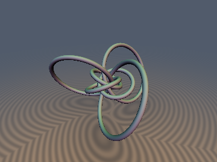
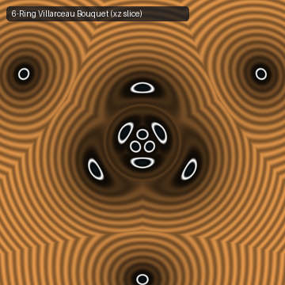
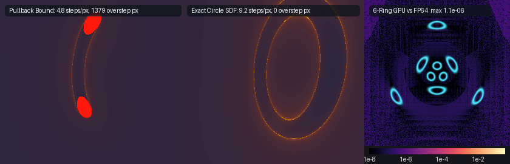

# `twHopfSubmersion` — Twistor / Hopf Riemannian Submersions, Exact 3D Circle Parameterization of Preimage Fibers & Multi-Villarceau Bouquet SDFs

Functions: `twHopfMap`, `twSubmersionScale`, `twFiberCircleCenter`, `twFiberCircleNormal`, `sdTwistorFiberCircle`, `sdgTwistorFiberCircle`, `sdTwistorPullbackBound`, `sdTwistorPolyhedralLinks3D`, `sdgTwistorPolyhedralLinks3D`

| 3D Surface (`sdTwistorPolyhedralLinks3D`, 6-ring bouquet) | 2D Cross-Section Slice ($`y = 0`$ horizontal plane) |
| :---: | :---: |
|  |  |

| Property | Value |
| :--- | :--- |
| **Author** | Discovered and verified by **Gemini 4 Argon** (`sdf-gems`, 2026) |
| **Category** | `twistor` (Experimental Research: Riemannian Submersions & Exact Preimage Fiber Geometry) |
| **GLSL File** | [`glsl/twistor/twHopfSubmersion.glsl`](../../glsl/twistor/twHopfSubmersion.glsl) |
| **Exactness** | `sdTwistorFiberCircle`, `sdgTwistorFiberCircle`: **Exact 3D Euclidean SDF & unit gradient** to any Hopf fiber $`\eta^{-1}(\mathbf{q})`$ (`max \|d - gt\| = 7.92e-7` in GPU FP32), including the degenerate south-pole $`z`$-axis limit $`q_z = -1`$ (`max \|d - gt\| = 5.01e-7`). `sdTwistorPolyhedralLinks3D`, `sdgTwistorPolyhedralLinks3D`: **Exact 3D Euclidean SDF** (interior and exterior) of mutually linked Villarceau bouquets when $`r \le d_{\min}/3`$ (`0.1356` for the 6-ring octahedron, `0.0929` for the 12-ring icosahedron). `sdTwistorPullbackBound`: first-order Riemannian submersion estimator (exact Eikonal norm on the fiber, overestimates at large $`\Vert\mathbf{p}\Vert`$). |

---

## Overview

Can we construct an **exact Euclidean Signed Distance Function** to any fiber of the stereographic Hopf fibration $`\eta: \mathbb{R}^3 \to S^2`$—and to polyhedral bouquets of mutually linked Villarceau circles—without solving a quartic torus polynomial or relying on approximate conformal pullback bounds?

Yes. Under the inverse-stereographic Hopf map $`\eta: \mathbb{R}^3 \to S^2`$, two exact geometric identities hold:

1. **Exact Euclidean Fiber Circle Theorem**: Every preimage fiber $`\eta^{-1}(\mathbf{q}) \subset \mathbb{R}^3`$ for $`\mathbf{q} = (q_x, q_y, q_z) \in S^2`$ ($`q_z > -1`$) is an **exact 3D Euclidean circle** whose center lies in the $`xy`$-plane, whose carrier plane passes through the origin, and whose power with respect to the origin is identically $`\Vert\mathbf{C}(\mathbf{q})\Vert^2 - R(\mathbf{q})^2 \equiv -1`$. Using this power-$`(-1)`$ conjugate identity together with the cancellation-free spherical identity $`1 + q_z = (q_x^2 + q_y^2)/(1 - q_z)`$ for $`q_z < 0`$, `sdTwistorFiberCircle` and `sdgTwistorFiberCircle` evaluate the **exact 3D Euclidean distance and analytical unit gradient** in closed form (`2 sqrt`, `1 div`) with $`< 8 \times 10^{-7}`$ FP32 error across the entire sphere $`S^2`$, smoothly degenerating at $`q_z = -1`$ to the exact $`z`$-axis cylinder $`\sqrt{x^2 + y^2} - r`$.
2. **Exact Riemannian Submersion Gradient Identity**: Because the Hopf map $`S^3 \to S^2`$ (with radius-$`1/2`$ target sphere) is a Riemannian submersion and inverse stereographic projection $`\mathbb{R}^3 \to S^3`$ has conformal factor $`2/(1 + \Vert\mathbf{p}\Vert^2)`$, the 3D Euclidean gradient norm of any smooth pullback $`g \circ \eta`$ satisfies:

```math
\left\Vert\nabla_{\mathbb{R}^3}(g \circ \eta)(\mathbf{p})\right\Vert \equiv \frac{4}{1 + \Vert\mathbf{p}\Vert^2}\,\left\Vert\nabla_{S^2} g(\eta(\mathbf{p}))\right\Vert.
```



*Left: Sphere-tracing the first-order Riemannian submersion estimator `sdTwistorPullbackBound` causes 1,379 overstep pixels (red) because the inverse Jacobian $`(1 + \Vert\mathbf{p}\Vert^2)/4`$ grows quadratically along rays approaching the origin. Middle: `sdTwistorFiberCircle` is an exact Euclidean SDF with 0 overstep pixels. Right: Log10 error heatmap of the 6-ring `sdTwistorPolyhedralLinks3D` on GPU (FP32) vs FP64 ground truth (`max = 1.1e-6`).*

---

## Mathematical Formulation

### 1. The Stereographic-Hopf Map $`\eta: \mathbb{R}^3 \to S^2`$

Inverse stereographic projection lifts $`\mathbf{p} = (x, y, z) \in \mathbb{R}^3`$ (with $`r^2 = \Vert\mathbf{p}\Vert^2`$) to $`(z_1, z_2) \in S^3 \subset \mathbb{C}^2`$:

```math
z_1 = \frac{2(x + i y)}{r^2 + 1}, \qquad z_2 = \frac{2 z + i(r^2 - 1)}{r^2 + 1}, \qquad \vert z_1\vert^2 + \vert z_2\vert^2 = 1.
```

Composing with the classical Hopf map $`H(z_1, z_2) = \left(2\,\mathrm{Re}(z_1\bar{z}_2),\, 2\,\mathrm{Im}(z_1\bar{z}_2),\, \vert z_1\vert^2 - \vert z_2\vert^2\right)`$ yields `twHopfMap`:

```math
\eta(\mathbf{p}) = \frac{1}{(r^2 + 1)^2} \begin{pmatrix} 4\left(2 x z + y(r^2 - 1)\right) \\ 4\left(2 y z - x(r^2 - 1)\right) \\ 4(x^2 + y^2 - z^2) - (r^2 - 1)^2 \end{pmatrix} \in S^2.
```

Since $`\mathrm{Im}(z_2) = (r^2 - 1)/(r^2 + 1) = 1 - 2/(r^2 + 1)`$, the inverse projection from $`S^3`$ back to $`\mathbb{R}^3`$ is simply:

```math
(x, y, z) = \frac{\left(\mathrm{Re}(z_1),\, \mathrm{Im}(z_1),\, \mathrm{Re}(z_2)\right)}{1 - \mathrm{Im}(z_2)}.
```

### 2. Exact 3D Circle Parameterization & Origin-Power Stabilization

For any target point $`\mathbf{q} = (q_x, q_y, q_z) \in S^2`$ with $`q_z > -1`$, let $`a = \sqrt{(1 + q_z)/2}`$ and $`b = \sqrt{(1 - q_z)/2}`$. The Hopf fiber over $`\mathbf{q}`$ in $`S^3`$ is parameterized by $`t \in [0, 2\pi)`$ as $`z_2(t) = b e^{i t}`$ and $`z_1(t) = \frac{q_x + i q_y}{2 b} e^{i t}`$. Under the inverse projection $`1 / (1 - b\sin t)`$, the extreme points at $`t = \pm\pi/2`$ both lie in the $`xy`$-plane ($`z = 0`$) with tangents purely along $`\pm\hat{\mathbf{z}}`$, so they form the **exact diameter** of the 3D Euclidean circle $`\eta^{-1}(\mathbf{q})`$:

```math
\mathbf{p}_{\pm} = \frac{(\mp q_y,\, \pm q_x,\, 0)}{2 b (1 \mp b)}
\implies
\mathbf{C}(\mathbf{q}) = \frac{\mathbf{p}_+ + \mathbf{p}_-}{2} = \frac{(-q_y,\, q_x,\, 0)}{1 + q_z},
\qquad
R(\mathbf{q}) = \frac{\Vert\mathbf{p}_+ - \mathbf{p}_-\Vert}{2} = \sqrt{\frac{2}{1 + q_z}}.
```

The carrier plane containing $`\eta^{-1}(\mathbf{q})`$ has unit normal:

```math
\mathbf{N}(\mathbf{q}) = \frac{(-q_x,\, -q_y,\, 1 + q_z)}{\sqrt{2(1 + q_z)}}, \qquad \langle \mathbf{C}(\mathbf{q}),\, \mathbf{N}(\mathbf{q}) \rangle \equiv 0.
```

Because $`\langle \mathbf{C}(\mathbf{q}), \mathbf{N}(\mathbf{q}) \rangle = 0`$, the carrier plane of **every** Hopf fiber circle passes through the origin $`\mathbf{0} \in \mathbb{R}^3`$. Moreover, the circle's power with respect to the origin is identically $`-1`$:

```math
\Vert\mathbf{C}(\mathbf{q})\Vert^2 - R(\mathbf{q})^2 = \frac{1 - q_z^2}{(1 + q_z)^2} - \frac{2}{1 + q_z} = \frac{1 - q_z - 2}{1 + q_z} \equiv -1.
```

Naively evaluating $`w = \Vert\mathbf{p}_{\parallel} - \mathbf{C}(\mathbf{q})\Vert - R(\mathbf{q})`$ suffers catastrophic FP32 cancellation as $`q_z \to -1`$ (where $`R \to \infty`$, reaching an error of `4.47e+3` at $`1 + q_z = 0`$). Defining $`s = \sqrt{(1 + q_z)/2} = 1/R(\mathbf{q}) \in [0, 1]`$, $`\mathbf{m} = (q_x, q_y)/\sqrt{2(1 + q_z)}`$, and $`\hat{\mathbf{c}} = s\,\mathbf{C}(\mathbf{q}) = (-m_y, m_x, 0)`$, the identity $`\Vert\mathbf{C}\Vert^2 - R^2 = -1`$ yields the **stabilized conjugate radial distance**:

```math
h = \langle \mathbf{p}, \mathbf{N} \rangle, \qquad \mathbf{p}_{\parallel} = \mathbf{p} - h\mathbf{N}, \qquad
w = \frac{s\left(\Vert\mathbf{p}_{\parallel}\Vert^2 - 1\right) - 2\langle \mathbf{p}_{\parallel}, \hat{\mathbf{c}} \rangle}{\left\Vert s\,\mathbf{p}_{\parallel} - \hat{\mathbf{c}}\right\Vert + 1}, \qquad
d(\mathbf{p}) = \sqrt{h^2 + w^2} - r.
```

Combining this with the cancellation-free spherical identity $`1 + q_z = (q_x^2 + q_y^2)/(1 - q_z)`$ for $`q_z < 0`$ eliminates all division by zero and subtraction of large radii: at $`q_z = -1`$ ($`s = 0`$), the formula reduces smoothly to $`h = -x`$, $`w = -y`$, and $`d(\mathbf{p}) = \sqrt{x^2 + y^2} - r`$.

---

## Numerical Verification & Findings

All diagnostics below were executed on the literal `.glsl` shader on the GPU (OpenGL 4.1, FP32) via `tools/gpu_eval.py`.

### 1. Mandatory GPU Numerical Checks ($`N = 20,000`$ random + $`3,209`$ probe points)

| Function | `NaN`/`Inf` | Max $`\vert d - d_{\text{gt}}\vert`$ | Mean $`\vert d - d_{\text{gt}}\vert`$ | Max $`\vert\Vert\mathbf{g}\Vert - 1\vert`$ | Self-Projection Max $`\vert d(\mathbf{p} - d\mathbf{g})\vert`$ | Exactness Certificate (Surf $`\vert d\vert`$ / Lipschitz) |
| :--- | :---: | :---: | :---: | :---: | :---: | :---: |
| `sdTwistorFiberCircle` / `sdg` | `0 / 92,836` | `7.92e-7` | `9.04e-8` | `2.19e-6` | `3.45e-6` | `2.10e-7` / `0.99997` |
| `sdgTwistorFiberCircle` ($`q_z = -1`$) | `0 / 80,000` | `5.01e-7` | `6.12e-8` | `1.19e-7` | `2.38e-7` | Exact $`z`$-cylinder |
| `sdTwistorPolyhedralLinks3D` (6-ring) | `0 / 92,836` | `7.93e-7` | `1.00e-7` | `1.95e-7` | `8.37e-7` | `7.27e-7` / `0.99992` |
| `sdTwistorPullbackBound` | `0 / 23,209` | `1.01e+1` | `1.72e+0` | — | — | Oversteps (`1,379` px) |

### 2. South-Pole Limit Stabilization ($`q_z \to -1`$, 10,000 random points in $`[-2, 2]^3`$)

| $`1 + q_z`$ | Circle Radius $`R(\mathbf{q})`$ | Naive $`(\mathbf{C}, R)`$ FP32 Max Error | Stabilized `sdTwistorFiberCircle` FP32 Max Error | Analytical Gradient $`\max\vert\Vert\mathbf{g}\Vert - 1\vert`$ |
| :---: | :---: | :---: | :---: | :---: |
| `1.0e+0` | `1.414` | `5.00e-7` | `4.44e-7` | `3.58e-6` |
| `1.0e-1` | `4.472` | `1.61e-6` | `5.56e-7` | `1.79e-7` |
| `1.0e-3` | `44.72` | `2.92e-4` | `5.80e-7` | `1.79e-7` |
| `1.0e-5` | `447.2` | `3.03e-1` | `5.69e-7` | `2.38e-7` |
| `1.0e-6` | `1414.2` | `9.24e+0` | `5.81e-7` | `2.38e-7` |
| `1.0e-7` | `4472.1` | `3.45e+2` | `6.06e-7` | `2.38e-7` |
| `0.0` | $`\infty`$ ($`z`$-axis) | `4.47e+3` | `2.52e-7` | `1.19e-7` |

### 3. Polyhedral Villarceau Bouquets & $`S^2`$ Voronoi Pruning Analysis

Lifting the vertices of a Platonic solid on $`S^2`$ (rotated so no vertex lies at $`q_z = -1`$) creates a bouquet of mutually linked Villarceau circles (every pair has linking number $`\pm 1`$). Because the $`M`$ fibers are disjoint in $`\mathbb{R}^3`$, let $`d_{\min} = \min_{i < j} \mathrm{dist}(\eta^{-1}(\mathbf{q}_i), \eta^{-1}(\mathbf{q}_j))`$. By the triangle inequality, for any tube radius $`r \le d_{\min}/3`$, the minimum of the individual exact circle SDFs is the **exact Euclidean SDF everywhere in $`\mathbb{R}^3`$ (both interior and exterior)**:

- **Octahedral 6-Ring Bouquet (`n = 6`)**: Aligning the $`(1, 1, 1)/\sqrt{3}`$ octahedral face axis with $`\hat{\mathbf{z}}`$ places 3 vertices at $`q_z = +1/\sqrt{3}`$ ($`R_+ = 1.126`$) and 3 at $`q_z = -1/\sqrt{3}`$ ($`R_- = 2.175`$). The minimum pairwise core separation is $`d_{\min} = 0.406862`$ (disjoint for $`r < 0.2034`$, exact interior + exterior SDF for $`r \le 0.1356`$). Deferring the outer `sqrt(h^2 + w^2)` until after taking the minimum across the 6 pre-baked circles reduces the total cost to **7 `sqrt`s and 6 divisions**.
- **Icosahedral 12-Ring Bouquet (`n = 12`)**: Maximum $`\vert q_z\vert = 0.850651 < 1`$, minimum pairwise separation $`d_{\min} = 0.278568`$ (disjoint for $`r < 0.1393`$, exact interior + exterior SDF for $`r \le 0.0929`$).
- **Does $`S^2`$ Voronoi pruning work? (Tested on $`500,000`$ points in $`[-4, 4]^3`$)**: Because the conformal stretch $`(1 + \Vert\mathbf{p}\Vert^2)/4`$ is non-uniform in $`\mathbb{R}^3`$, picking only the **top-1** geodetically nearest vertex $`\mathbf{q}_i \in S^2`$ to $`\eta(\mathbf{p})`$ misses the true 3D Euclidean nearest fiber on **17.97%** of points globally (max error `1.67`) and **0.18%** of points within `0.25` of the tubes. Checking the **top-3** nearest vertices on $`S^2`$ (the spherical triangle containing $`\eta(\mathbf{p})`$) reduces the miss rate to **0.0002%** globally (`0.0000%` near the tubes) on the octahedron and **0.0000%** on the icosahedron. However, because pre-baked circle evaluation is only 1 `length` + 1 `div` per circle, evaluating all 6 circles directly in `sdTwistorPolyhedralLinks3D` is faster than computing $`\eta(\mathbf{p})`$ + sorting, and guarantees **0% misses** everywhere.
