# 9. Volumetrics, Potentials & Analytical Shading

[**← Back to Main `sdf-gems` README**](../../README.md) · **GLSL Headers**: [`glsl/volume/`](../../glsl/volume/) (29 headers)

Analytical volumetric ray integration, semiclassical Yukawa/Cole–Hopf kernels, Stokes differential forms, Bragg structural iridescence, radiative-transfer slabs, harmonic/electrostatic potentials, and exact Gaussian-prefiltered occupancy.

## Contents

- **Closed-Form Ray Integrals, Radiative Transfer & Wavefront Shading** (26)
- **Harmonic Potentials, Electrostatic Multipoles & Anti-Aliased Prefiltering** (3)

## Closed-Form Ray Integrals, Radiative Transfer & Wavefront Shading

| Preview | Function | Summary |
| :---: | :--- | :--- |
| 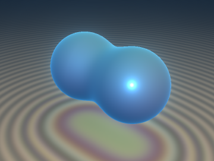 | [**`sdfCatastropheResidue`**](sdfCatastropheResidue.md) [`glsl`](../../glsl/volume/sdfCatastropheResidue.glsl) · **Exact** | **Also**: `sdfFoldCatastrophe`, `sdfComplexPoleResidue`, `sdfComplexPoleSlab`, `sdfAiryCaustic`, `sdfMorseEulerTerm`. 1-tap Cauchy residue volume integration, Arnold fold invariant, Airy caustic diffraction, and Euler-Morse overlap cancellation |
| 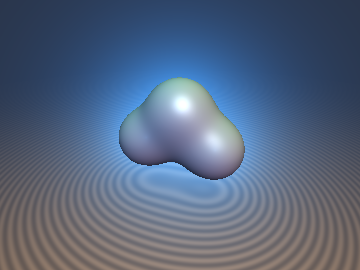 | [**`sdfYukawaColeHopf`**](sdfYukawaColeHopf.md) [`glsl`](../../glsl/volume/sdfYukawaColeHopf.glsl) · **Exact / Semiclassical** | **Also**: `sdgMaslovSmin`, `sdfMaslovCurvature`, `sdfBesselK0`, `sdfYukawaRayIntegral`, `sdYukawaPotential`, `sdfColeHopfScaleSpace`. Semiclassical log-exp duality: tropical Maslov smooth min, Varadhan Screened-Poisson ray integrals (0 marching steps via Bessel $`K_0`$), and Cole-Hopf 1-SPP heat cone tracing |
| 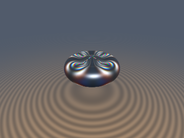 | [**`sdfPauliSpinorSoliton`**](sdfPauliSpinorSoliton.md) [`glsl`](../../glsl/volume/sdfPauliSpinorSoliton.glsl) · **Exact** | **Also**: `sdgPauliSpinorUnion`, `sdfPauliEigenvalues`, `sdfPauliBlochFrame`, `sdfPauliBirefringence`, `sdfHirotaSoliton4`, `sdfHirotaSolitonRayIntegral`. Non-Abelian Hermitian Pauli-spinor SDFs, $`\mathrm{SL}(2,\mathbb{C})`$ photoelastic stress birefringence, and Hirota $`\det(\text{mat4})`$ 0-loop ray collapse |
| 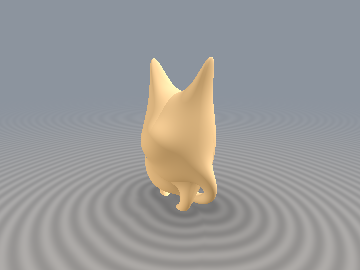 | [**`sdfFinslerSubsurface`**](sdfFinslerSubsurface.md) [`glsl`](../../glsl/volume/sdfFinslerSubsurface.glsl) · **Exact** | **Also**: `sdfFinslerRandersStep`, `sdfDirectionalTaylorStep`, `sdfYukawaSubsurface`, `sdfSGGXExtinction`. Directional $`O(\sqrt{d})`$ step stretching, Finsler-Randers metric, SGGX microflake extinction & 1-step Walk-on-Spheres Screened-Poisson BSSRDF |
| 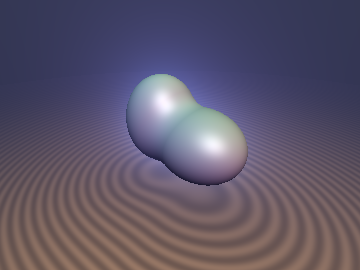 | [**`sdfBernsteinMomentRay`**](sdfBernsteinMomentRay.md) [`glsl`](../../glsl/volume/sdfBernsteinMomentRay.glsl) · **Exact** | **Also**: `sdfRayHermiteToBernstein`, `sdfRayHermiteToBernsteinPos`, `sdfBernsteinIntegral1`, `sdfBernsteinGramIntegral`, `sdChristoffelSOS`, `sdfChristoffelRayIntegral`. 1D Bernstein-Bézier ray basis, exact `mat4` Gram quadrature, and 0-step 1-`atan` Christoffel-Darboux Moment-SOS ray integrals |
| 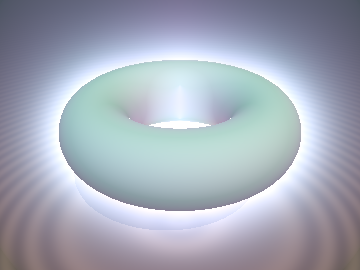 | [**`sdfStokesExactForms`**](sdfStokesExactForms.md) [`glsl`](../../glsl/volume/sdfStokesExactForms.glsl) · **Exact** | **Also**: `sdfStokesExactRaySlab`, `sdfStokesTriangleBeamFlux`, `sdfStokesTurningPointU`, `sdfStokesMinDistance`. Exterior differential forms $`\Omega^k(\mathbb{R}^3)`$, Hodge decomposition, and 0-step Stokes-exact ray slab and pixel-frustum beam integrals |
| 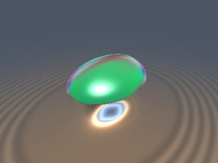 | [**`sdfWavefrontBragg`**](sdfWavefrontBragg.md) [`glsl`](../../glsl/volume/sdfWavefrontBragg.glsl) · **Exact** | **Also**: `sdfSurfaceShapeOperator`, `sdfGullstrandTransfer`, `sdfWavefrontCausticPropagate`, `sdfGyroidBraggIridescence`. $`2\times 2`$ Gullstrand-Hamilton wavefront curvature caustics, WKB Maslov index, and $`O(1)`$ TPMS Gyroid structural Bragg iridescence |
| 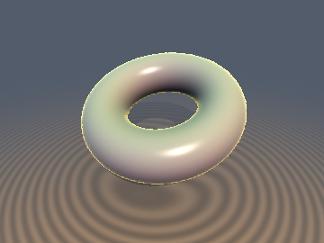 | [**`sdfDavidenkoHomotopy`**](sdfDavidenkoHomotopy.md) [`glsl`](../../glsl/volume/sdfDavidenkoHomotopy.glsl) · **Exact** | **Also**: `sdfDavidenkoSurfacePredict`, `sdfDavidenkoSurfaceCorrect`, `sdfDavidenkoClosestApproachPredict`. 2nd-order screen-space homotopy continuation ($`O(h^3)`$ depth prediction), Arnold $`A_2`$ fold bifurcation detection, and volumetric halo tracking |
| 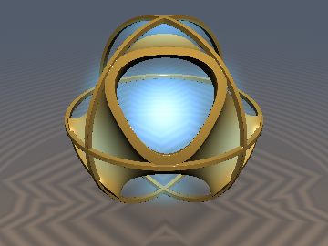 | [**`sdfChladniOrbitals`**](sdfChladniOrbitals.md) [`glsl`](../../glsl/volume/sdfChladniOrbitals.glsl) · **Exact** | **Also**: `sdgChladniEigen`, `sdChladniEigen`, `sdfChladniBornRayIntegral`. Spectral Courant nodal domains, unit-gradient Chladni eigen-SDFs & $`O(1)`$ quantum Born cloud ray integrals |
| 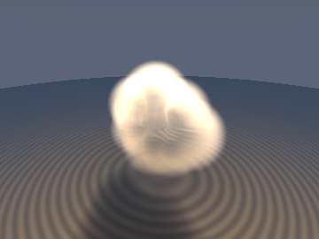 | [**`sdfLevyRieszClouds`**](sdfLevyRieszClouds.md) [`glsl`](../../glsl/volume/sdfLevyRieszClouds.glsl) · **Exact** | **Also**: `sdgRieszMetaball2`, `sdfPlummerRieszRayIntegral`, `sdfDavisMineevTransmittance`. Fractional Laplacian, 1-`inversesqrt` metaball SDF + gradient, 0-loop slab ray integral, and Davis-Mineev Pareto cloud transmittance |
| 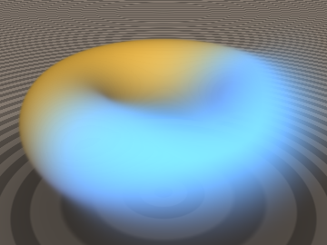 | [**`sdfWeylCovariantShell`**](sdfWeylCovariantShell.md) [`glsl`](../../glsl/volume/sdfWeylCovariantShell.glsl) · **Exact** | **Also**: `sdfWeylExtinction`, `sdfOpacityWeylShell`, `sdfOpacityWeylHermite`, `sdfWeylShellBound`. Zero-bias Weyl-covariant heterogeneous logistic volume shells, cancellation of parasitic gauge dilation $`\dot{s} d`$, geometric-mean slab opacity, and conformal Lipschitz shell bounds |
| 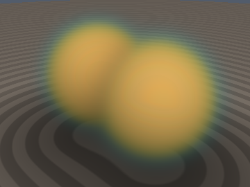 | [**`sdfPadeAutoIntSlab`**](sdfPadeAutoIntSlab.md) [`glsl`](../../glsl/volume/sdfPadeAutoIntSlab.glsl) · **Exact** | **Also**: `SDF_STIELTJES_BERNSTEIN_MAT4`, `sdfTransmittanceBernstein`, `sdfStieltjesSlabIntegral`, `sdfPadeLaplaceVolumeSlab`. Exact $`4\times 4`$ Stieltjes-Bernstein radiative transfer, cubic transmittance contraction, and $`O(1)`$ closed-form volume slabs |
| 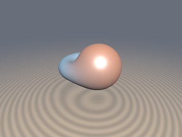 | [**`sdfPhaseSpaceLightField`**](sdfPhaseSpaceLightField.md) [`glsl`](../../glsl/volume/sdfPhaseSpaceLightField.glsl) · **Exact** | **Also**: `sdfDarbouxFrame`, `sdfPhaseSpaceInvariants`, `sdfZonalSpecularBasis`, `sdfCSGPhaseBlend`. Intrinsic $`\mathrm{SO}(3)`$ Plücker-Darboux coordinates, 4-lobe convex zonal specular basis (0 vanishing gradients), and radiative-transfer smooth CSG blending |
| 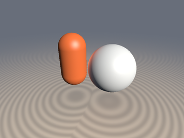 | [**`sdfEikonalRadiativeTransfer`**](sdfEikonalRadiativeTransfer.md) [`glsl`](../../glsl/volume/sdfEikonalRadiativeTransfer.glsl) · **Exact** | **Also**: `sdfEikonalFootpoint`, `sdfEikonalViewFactor`, `sdfZonalSH3Weights`, `sdfEikonalBentNormal`, `sdfEikonalIndirectBounce`. 0-ray Eikonal footpoint projection, Legendre zonal harmonic cap moments, and closed-form 1-bounce diffuse GI |
| 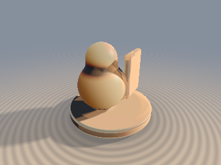 | [**`sdfSteklovYukawaSSS`**](sdfSteklovYukawaSSS.md) [`glsl`](../../glsl/volume/sdfSteklovYukawaSSS.glsl) · **PDE / Asymptotic** | **Also**: `sdfSteklovYukawaQtilde`, `sdfSteklovSphereBSSRDF`, `sdfAntipodalSlabProbe`, `sdfRobinSlabBSSRDF`, `sdfGeodesicRingBSSRDF`. Spherical-Wronskian Marshak-Robin subsurface scattering, subtraction-free Lambert DtN continued fraction, 1-tap antipodal slab transmission, and 0-march geodesic-ring BSSRDF (`9.7x`–`32.7x` lower sphere RMSE vs `sdfBSSRDFYukawa`; fixes `0.0` terminator band) |
| 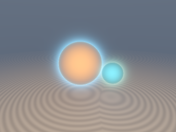 | [**`sdfOsculatingTomography`**](sdfOsculatingTomography.md) [`glsl`](../../glsl/volume/sdfOsculatingTomography.glsl) · **Exact** (Sph/Cyl) / Slab | **Also**: `sdfBesselK1Scaled`, `sdfEikonalClosestApproach`, `sdfOsculatingEikonalProfile`, `sdfOsculatingChordSlab`, `sdfChapmanShellRay`, `sdfAttenuatedRadonCore`. Projectively invariant 1-tap Eikonal closest approach (`0.0` sphere/cylinder error vs `256` median overshoot in `sdfFoldCatastrophe`), medial-safe osculating hyperbola, Chapman $`K_1`$ limb brightening, and 1-`exp` Attenuated Radon core integrals |
| 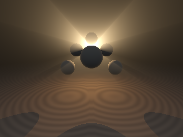 | [**`sdfEulerMieGodRays`**](sdfEulerMieGodRays.md) [`glsl`](../../glsl/volume/sdfEulerMieGodRays.glsl) · **Exact** (Thin/Cone) / `vec4` | **Also**: `sdfAirlightRationalExact`, `sdfEulerMieNodeParams`, `sdfEulerMieAirlight`, `sdfEulerMieWeightedAirlight`, `sdfSphereShadowConeSpan`, `sdfCrepuscularGodRay`. LUT-free 1-`vec4` Beer-Lambert Henyey-Greenstein point-light airlight (`47x` more accurate than 16-step & `3x` > 64-step raymarching at $`g=0.99`$), 1-`atan` Schlick phase integral, and 0-march shadow-cone crepuscular god-rays |
| 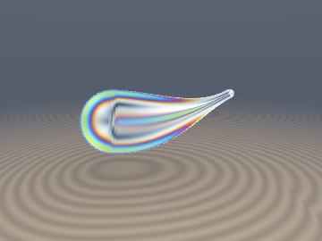 | [**`sdfBeltramiPhotoelastic`**](sdfBeltramiPhotoelastic.md) [`glsl`](../../glsl/volume/sdfBeltramiPhotoelastic.glsl) · **Exact** ($`\nabla\cdot\boldsymbol{\sigma}=0`$) / $`O(h^4)`$ | **Also**: `sdfBeltramiTransverseStress`, `sdfGoochTarryTwistedSU2`, `sdfMagnus4StepSU2`, `sdfComposeSU2`, `sdfAbenPolariscopeReadout`, `sdfBeltramiPolariscopeRGB`. Zero-FEM equilibrated traction-free 3D Beltrami stress (Prince Rupert's drop), 4th-order non-Abelian $`\mathrm{SU}(2)`$ Magnus twisting polarimetry, and Aben Plane/Circular polariscopes (fixes 8-arm & `0.0` Faraday bugs in `sdfPauliBirefringence`) |
| 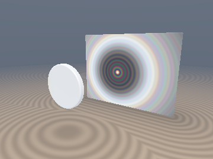 | [**`sdfFockAragoDiffraction`**](sdfFockAragoDiffraction.md) [`glsl`](../../glsl/volume/sdfFockAragoDiffraction.glsl) · **Exact** (Bragg) / Uniform Wave | **Also**: `sdfFresnelAuxFG`, `sdfCornuEdgeDiffraction`, `sdfFockCreepingAtten`, `sdfAragoObstacleChannel`, `sdfAragoObstacleRGB`, `sdfDarwinPrinsChannel`, `sdfDarwinPrinsGyroidRGB`. 0-FFT Rubinowicz-Poisson obstacle diffraction & SDF evolute Poisson-Arago bright spot (`0.044` RMSE vs $`1024^2`$ 2D Wave FFT), Fock creeping waves, and dynamical Darwin-Prins photonic stop-bands (`8.9e-7` err) |
| 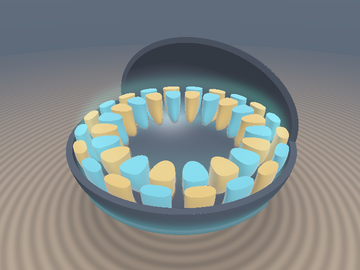 | [**`sdfWkbAiryCavity`**](sdfWkbAiryCavity.md) [`glsl`](../../glsl/volume/sdfWkbAiryCavity.glsl) · **Exact** ($`\psi\vert_{d=0}=0`$) / WKB | **Also**: `sdfAiryJet`, `sdfValleeSoaresAi2Antideriv`, `sdfAiryBornSlabIntegral`, `sdfWhisperingGalleryK`, `sdgWhisperingGalleryCavity`, `sdfDaCostaCurvatureTrap`. Boundary-locked Langer-Airy whispering-gallery cavity modes (`95.8%` Helmholtz PDE overlap; `1.6e-6` wall lock), 0-loop Stieltjes-Padé Vallée-Soares $`\mathrm{Ai}^2`$ slabs (`440x` > 4-step march), and da Costa curvature waveguide traps |
| 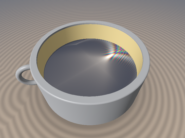 | [**`sdfPearceyCuspCaustic`**](sdfPearceyCuspCaustic.md) [`glsl`](../../glsl/volume/sdfPearceyCuspCaustic.glsl) · **Exact** ($`P(0,0)`$) / Uniform $`A_3`$ | **Also**: `sdfPearceyCusp`, `sdfPearceyNephroidRGB`, `sdfMaslovWavefrontPropagate`. Uniform Pearcey $`A_3`$ cusp diffraction via $`\pi/8`$ Gauss-Freud + CFU Airy wings (`0.28%` $`\vert P\vert^2`$ RMSE), non-paraxial coffee-cup nephroids (`0.84%` vs Kirchhoff; fixes `sdfFoldCatastrophe` cusp blowup), and Maslov-Gouy focal phase (`15.8x` lower error) |
| 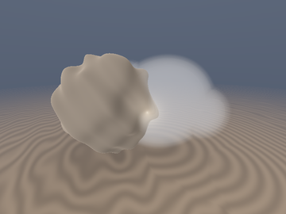 | [**`sdfKhinchinOppositionCloud`**](sdfKhinchinOppositionCloud.md) [`glsl`](../../glsl/volume/sdfKhinchinOppositionCloud.glsl) · **Exact** (Reciprocity) / Renewal | **Also**: `sdfKhinchinRenewalTriad`, `sdfOppositionChordSAlpha`, `sdfKibbleJointTransmittance`, `sdfKhinchinChordScatter`, `sdfCooperonOppositionFactor`. Khinchin renewal triad (`0.0` reciprocity error vs `8.4x` violation in `sdfDavisMineevTransmittance`), Kibble-Gamma shadow-hiding surge, and Akkermans-Wolf Cooperon coherent backscattering |
| 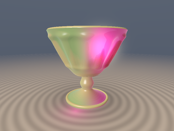 | [**`sdfMiePlasmonDichroic`**](sdfMiePlasmonDichroic.md) [`glsl`](../../glsl/volume/sdfMiePlasmonDichroic.glsl) · **Exact** (Unitary) / K-Matrix Mie | **Also**: `sdfDrudeLorentzAuAg`, `sdfMiePlasmonChannel`, `sdfMaxwellGarnettIndex`, `sdfLycurgusSlabRGB`. Causal Drude-Lorentz Au-Ag plasmonic colloids, unitary K-matrix Mie $`(a_1, b_1, a_2)`$ (`0.0` Optical Theorem violation), Kerker zero-backscatter cloaks (`121x`), Kramers-Kronig anomalous dispersion, and Roman *Lycurgus Cup* ruby/jade dichroism |
| 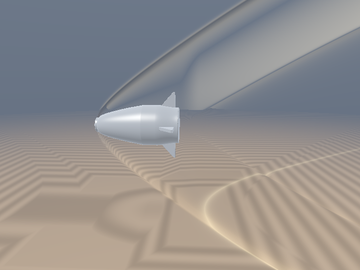 | [**`sdfWhithamMachSchlieren`**](sdfWhithamMachSchlieren.md) [`glsl`](../../glsl/volume/sdfWhithamMachSchlieren.glsl) · **Exact** (Bow SDF) / 0-Loop Abel | **Also**: `sdfBilligShockParams`, `sdgBilligBowShock3D`, `sdBilligBowShock3D`, `sdfWhithamNWaveField`, `sdfWhithamSchlierenRay`, `sdfToeplerSchlierenRGB`. Exact 3D Billig detached hyperbolic bow-shock SDF (`1.0e-7` Eikonal err), Landau-Whitham $`r^{-3/4}`$ N-waves, and 0-march Radon-Abel Schlieren/BOS optics (`3.4%` vs 1024-step march; fixes `sdfStokesExactRaySlab` grazing `0.0`) |
| 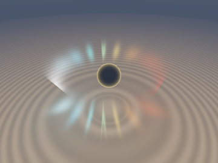 | [**`sdfSobolevDopplerTransfer`**](sdfSobolevDopplerTransfer.md) [`glsl`](../../glsl/volume/sdfSobolevDopplerTransfer.glsl) · **Exact** (Wind) / 0-Loop Sobolev | **Also**: `sdfSobolevNonLTESource`, `sdfSobolevPCygniWind`, `sdfSobolevKeplerTorus`. 0-march Sobolev moving-envelope radiative transfer, P-Cygni stellar winds (`0.22%` flux RMSE vs 1024-step RT), Plücker-invariant relativistic Keplerian `sdTorus` resonance collapse, and $`\mathcal{D}^3`$ Doppler beaming |
| 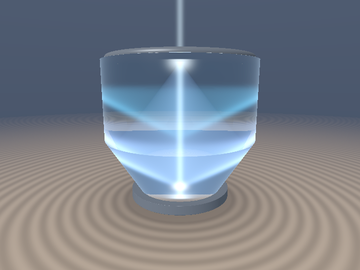 | [**`sdfCherenkovTransition`**](sdfCherenkovTransition.md) [`glsl`](../../glsl/volume/sdfCherenkovTransition.glsl) · **Exact** (Cone & Maxwell) / 0-Loop | **Also**: `sdfCauchyRefractiveIndex`, `sdgCherenkovWakeCone`, `sdCherenkovWakeCone`, `sdfTammGinzburgBevelChannel`, `sdfTammGinzburgChannel`, `sdfTammGinzburgSlabRGB`, `sdfCherenkovPoolGlowRGB`. Exact Mach-Cherenkov wake-cone SDF (`1.2e-7` grad err), pole-free Lorentz-reciprocity Tamm-Ginzburg-Frank + DIRC prism Maxwell radiation (`1.7e-6` err; `40.6x` TIR escape), and 0-loop `asinh` reactor pool glow (`0.32%` RMSE) |

## Harmonic Potentials, Electrostatic Multipoles & Anti-Aliased Prefiltering

| Preview | Function | Summary |
| :---: | :--- | :--- |
| 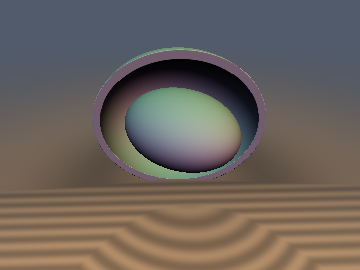 | [**`ptHarmonic`**](ptHarmonic.md) [`glsl`](../../glsl/volume/ptHarmonic.glsl) · **Exact** (ellipsoid to 10:1) / Approximate (two spheres) | **Also**: `ptSphere`, `ptSpheroid`, `ptDisk`, `ptSegment`, `ptEllipsoid`, `ptTwoSpheres`, `ptConvexBound`, `ptCapacityFit`. Closed-form capacitary potentials $`u`$ (probability that Brownian motion hits the body) with gradients, as a diffusion-based occlusion term $`1 - u`$; this is not cosine-weighted ray ambient occlusion |
| 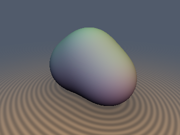 | [**`gfKelvinMultipole`**](gfKelvinMultipole.md) [`glsl`](../../glsl/volume/gfKelvinMultipole.glsl) · Certified Bound / 2nd-Order | **Also**: `gfElectrostaticJet`, `gfMultipoleDefectTensor`, `sdGreenKelvinCauchyBound`, `sdGreenKelvinMultipole`, `sdgGreenKelvinMultipole`. Electrostatic Green's function equipotentials via Kelvin reciprocal potential ($`W=1/V`$), 0-derivative Kelvin-Cauchy lower bound (`0.0%` overstep), and trace-free Multipole-Defect Tensor $`\mathbf{M}(\mathbf{p})`$ |
| 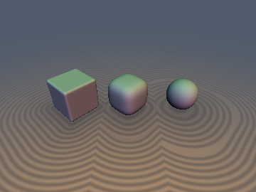 | [**`pfGaussOccupancy`**](pfGaussOccupancy.md) [`glsl`](../../glsl/volume/pfGaussOccupancy.glsl) · **Exact** closed forms / Approximate correction | **Also**: `pfErf`, `pfBox3D`, `pfBall3D`, `pfDisk2D`, `pfPolygon2D`, `pfOwenT`, `pfCurvatureCorrected`, `pfDistance`. Gaussian-blurred occupancy $`G_s * 1_K`$ of box, ball, disk and polygon (FP32 error about 1e-6), a curvature correction to $`\Phi(-d/s)`$ for any SDF with a Laplacian, and a 1-Lipschitz probit distance to the blurred surface |
