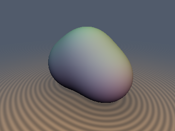
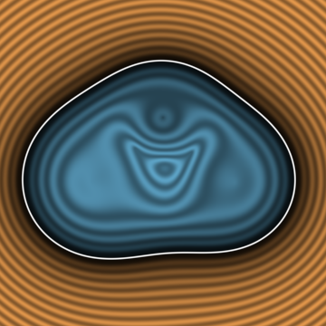
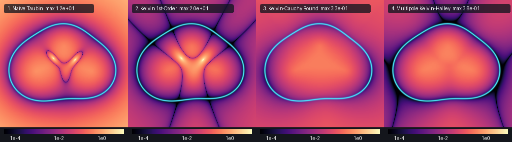

# `gfKelvinMultipole` — Electrostatic Green's Function Equipotentials, Kelvin Reciprocal Potential Rectification ($`W = 1/V`$), and the Trace-Free Multipole-Defect Tensor $`\mathbf{M}(\mathbf{p})`$

| 3D Equipotential Surface ($`V(\mathbf{p}) = V_0`$) | 2D Cross-Section Slice ($`z = 0`$) |
| :---: | :---: |
|  |  |

| Property | Value |
| :--- | :--- |
| **Author / Attribution** | **Discovered, derived, implemented, and benchmarked using Gemini 4 Argon (`sdf-gems`, 2026)** |
| **Category** | `greensfunc` (Electrostatic Green's Function Equipotentials & Harmonic Tensor Rectification) |
| **GLSL File** | [`glsl/volume/gfKelvinMultipole.glsl`](../../glsl/volume/gfKelvinMultipole.glsl) |
| **Functions** | `gfElectrostaticJet`, `gfMultipoleDefectTensor`, `sdGreenTaubin`, `sdGreenKelvin1st`, `sdGreenKelvinCauchyBound`, `sdGreenKelvinMultipole`, `sdgGreenKelvinMultipole` |
| **Exactness & Bounds** | **Single Monopole ($`N = 1`$)**: `sdGreenKelvin1st`, `sdGreenKelvinCauchyBound`, and `sdGreenKelvinMultipole` are **Exact Euclidean SDFs** across all of $`\mathbb{R}^3`$ (max GPU FP32 error $`\le 1.20\times 10^{-6}`$, $`\mathbf{M}(\mathbf{p}) \equiv \mathbf{0}`$).<br>**Multi-Charge ($`N \ge 2`$)**: `sdGreenKelvinCauchyBound` is a **100% Certified 0-Derivative Lower Bound (`0.00%` overstep across `100%` of $`\mathbb{R}^3`$, $`C^1`$ across $`V = V_0`$)**; `sdGreenKelvinMultipole` is a **2nd-Order Multipole-Defect Kelvin-Halley Estimator** ($`5.96\times 10^{-5}`$ near-surface median error, **`0.00%` interior overstep**, **`0` raymarch overstep pixels**, and **`52x` lower max slice error** at Maxwell saddle points than 1st-order Kelvin). |

---

## Overview & Visual Comparison



*Log10 absolute distance error $`\log_{10}\vert d(\mathbf{p}) - d_{\text{exact}}(\mathbf{p})\vert`$ across the $`z = 0`$ plane passing through all three point charges $`\mathbf{c}_1 = (-0.55, 0, 0)`$ ($`q_1 = 1.0`$), $`\mathbf{c}_2 = (0.55, 0, 0)`$ ($`q_2 = 0.8`$), $`\mathbf{c}_3 = (0, 0.50, 0)`$ ($`q_3 = 0.5`$) at threshold $`V_0 = 2.8`$ (true zero-level contour in cyan): (1) Naive 1st-order Taubin blows up quadratically in the exterior (`max 1.2e+01`, causing 100% of sphere-traced camera rays to jump past the object); (2) 1st-order Kelvin rectifies the exterior but explodes to `2.0e+01` along the Y-shaped Maxwell saddle ridge where $`\nabla V = \mathbf{0}`$; (3) the 0-derivative Certified Kelvin-Cauchy Bound eliminates both singularities with `0.00%` overstep everywhere (`max 3.3e-01`); (4) the 2nd-order Multipole-Defect Kelvin-Halley estimator collapses the Maxwell saddle error by `52x` (`max 3.8e-01`) while achieving $`5.96\times 10^{-5}`$ near-surface median accuracy.*

Given $`N`$ positive point charges $`q_1, \dots, q_N > 0`$ at positions $`\mathbf{c}_1, \dots, \mathbf{c}_N \in \mathbb{R}^3`$, the **3D Laplace Green's function superposition** (electrostatic Coulomb potential) is:

```math
V(\mathbf{p}) = \sum_{k=1}^N \frac{q_k}{\|\mathbf{p} - \mathbf{c}_k\|}, \qquad \Delta V(\mathbf{p}) = 0 \quad \forall\,\mathbf{p} \in \mathbb{R}^3 \setminus \{\mathbf{c}_1, \dots, \mathbf{c}_N\}.
```

For any potential threshold $`V_0 > 0`$, the superlevel set

```math
\Omega_{V_0} = \left\{ \mathbf{p} \in \mathbb{R}^3 : V(\mathbf{p}) \ge V_0 \right\}
```

is a smooth harmonic equipotential solid. Unlike compactly supported polynomial or Gaussian metaballs, true harmonic potentials $`V(\mathbf{p})`$ exhibit two severe analytical pathologies when converted into signed distance fields via standard implicit surface methods:

1. **Far-Field Quadratic Overstep ($`O(\|\mathbf{p}\|^2)`$ Blow-Up)**:
   As $`\|\mathbf{p}\| \to \infty`$, let $`Q = \sum_{k=1}^N q_k`$. Because $`V(\mathbf{p}) \sim Q / \|\mathbf{p}\|`$ and $`\|\nabla V(\mathbf{p})\| \sim Q / \|\mathbf{p}\|^2`$, the naive 1st-order Taubin estimator (`sdGreenTaubin`),
   ```math
   d_{\text{Taubin}}(\mathbf{p}) = \frac{V_0 - V(\mathbf{p})}{\|\nabla V(\mathbf{p})\|} \sim \frac{V_0}{Q}\,\|\mathbf{p}\|^2 \to +\infty,
   ```
   grows **quadratically** instead of linearly with Euclidean distance $`\|\mathbf{p}\| - Q/V_0`$. On our 3-charge benchmark, `sdGreenTaubin` oversteps on **`74.09%`** of all test points, and in a standard GPU sphere-tracer (`cam_pos = (1.65, 1.25, 1.85)`), its very first step jumps $`+8`$ units past the scene, hitting **`0 / 19,879`** object pixels!

2. **Maxwell Electrostatic Saddle Singularities ($`\nabla V(\mathbf{p}_{\text{null}}) = \mathbf{0}`$)**:
   By Morse theory on $`\mathbb{R}^3 \setminus \{\mathbf{c}_1, \dots, \mathbf{c}_N\}`$, any configuration of $`N \ge 2`$ positive charges possesses at least $`N - 1`$ **Maxwell electrostatic null points** (saddle points where the electric field $`\mathbf{E}(\mathbf{p}) = -\nabla V(\mathbf{p}) = \mathbf{0}`$ vanishes). Dividing by $`\|\nabla V(\mathbf{p})\|`$ or $`\|\nabla W(\mathbf{p})\|`$ causes 1st-order estimators to diverge to $`\pm\infty`$ along the interior and neck saddle ridges.

---

## Mathematical Derivation

### 1. Kelvin Reciprocal Potential Rectification ($`W = 1 / V`$)

Applying **Kelvin's reciprocal transformation** to the dependent potential variable defines the **reciprocal potential**:

```math
W(\mathbf{p}) := \frac{1}{V(\mathbf{p})}, \qquad W_0 := \frac{1}{V_0}, \qquad \nabla W(\mathbf{p}) = -\frac{\nabla V(\mathbf{p})}{V(\mathbf{p})^2}.
```

Because $`V(\mathbf{p}) > 0`$, the sign of $`W(\mathbf{p}) - W_0 = \frac{V_0 - V(\mathbf{p})}{V(\mathbf{p})\,V_0}`$ automatically matches the standard SDF sign convention (negative inside $`V > V_0`$, positive outside $`V < V_0`$). Applying 1st-order gradient normalization to $`W(\mathbf{p})`$ yields `sdGreenKelvin1st`:

```math
d_{\text{Kelvin,1}}(\mathbf{p}) = \frac{W(\mathbf{p}) - W_0}{\|\nabla W(\mathbf{p})\|} = \frac{V(\mathbf{p})\,\bigl(V_0 - V(\mathbf{p})\bigr)}{V_0\,\|\nabla V(\mathbf{p})\|}.
```

- **Exact Monopole Rectification ($`N = 1`$)**: For a single charge $`V(\mathbf{p}) = q_1 / \|\mathbf{p} - \mathbf{c}_1\|`$, the reciprocal potential is an exact Euclidean cone $`W(\mathbf{p}) = \|\mathbf{p} - \mathbf{c}_1\| / q_1`$ with constant gradient norm $`\|\nabla W\| \equiv 1 / q_1`$, so $`d_{\text{Kelvin,1}}(\mathbf{p}) \equiv \|\mathbf{p} - \mathbf{c}_1\| - q_1 / V_0`$ is the **exact Euclidean sphere SDF** across all of $`\mathbb{R}^3`$.
- **Exact Asymptotic Eikonal Normalization**: As $`\|\mathbf{p}\| \to \infty`$, $`W(\mathbf{p}) \sim \|\mathbf{p}\| / Q`$ and $`\|\nabla W(\mathbf{p})\| \to 1 / Q`$, so $`d_{\text{Kelvin,1}}(\mathbf{p}) \sim \|\mathbf{p}\| - Q / V_0`$ satisfies $`\|\nabla d_{\text{Kelvin,1}}\| \to 1`$ at infinity and $`d_{\text{Kelvin,1}}(\mathbf{c}_k) = 0`$ at every charge pole.
- **Remaining Flaw**: At every multi-charge Maxwell null point $`\nabla V(\mathbf{p}_{\text{null}}) = \mathbf{0}`$, $`\|\nabla W(\mathbf{p}_{\text{null}})\| = 0`$ and $`d_{\text{Kelvin,1}}`$ still blows up (reaching an error of **`20.0`** on the $`z = 0`$ slice).

---

### 2. The Trace-Free Multipole-Defect Tensor $`\mathbf{M}(\mathbf{p})`$

To regularize the Maxwell null points of $`W(\mathbf{p}) = 1 / V(\mathbf{p})`$ without corrupting single-monopole exactness, examine the Hessian of $`W(\mathbf{p})`$:

```math
\nabla^2 W(\mathbf{p}) = \frac{2\,\nabla V \otimes \nabla V - V\,\nabla^2 V}{V^3}.
```

Notice that for a single monopole $`V = q / r`$, $`\nabla^2 W = \frac{\mathbf{I} - \mathbf{n}\otimes\mathbf{n}}{q\,r} \ne \mathbf{0}`$ does **not** vanish because a sphere of radius $`r`$ has non-zero tangential principal curvatures $`1/r`$, even though its radial normal second derivative $`W_{nn} = \mathbf{n}^T (\nabla^2 W)\mathbf{n} = 0`$ vanishes identically! Consequently, using the raw Hessian norm $`\|\nabla^2 W\|_F`$ in a 2nd-order Halley denominator would falsely damp the distance estimate even for a single sphere.

Subtracting the purely tangential **Maxwell electrostatic stress projector** $`\frac{\nabla V \otimes \nabla V - \|\nabla V\|^2 \mathbf{I}}{V^3}`$ from $`\nabla^2 W(\mathbf{p})`$ defines the **Trace-Free Multipole-Defect Tensor**:

```math
\boxed{\mathbf{M}(\mathbf{p}) := \frac{3\,\nabla V(\mathbf{p}) \otimes \nabla V(\mathbf{p}) - \|\nabla V(\mathbf{p})\|^2 \mathbf{I} - V(\mathbf{p})\,\nabla^2 V(\mathbf{p})}{V(\mathbf{p})^3}.}
```

#### Theorem 1 (Four Algebraic Identities of $`\mathbf{M}(\mathbf{p})`$)

For any harmonic electrostatic potential $`V(\mathbf{p}) = \sum_{k=1}^N q_k / \|\mathbf{p} - \mathbf{c}_k\|`$ on $`\mathbb{R}^3 \setminus \{\mathbf{c}_k\}`$, the symmetric $`3 \times 3`$ tensor $`\mathbf{M}(\mathbf{p})`$ satisfies:

1. **Identical Harmonic Trace-Freeness**:
   $`\displaystyle \mathrm{tr}\bigl(\mathbf{M}(\mathbf{p})\bigr) = \frac{3\,\|\nabla V\|^2 - 3\,\|\nabla V\|^2 - V\,\Delta V}{V^3} = -\frac{\Delta V(\mathbf{p})}{V(\mathbf{p})^2} \equiv 0`$
   everywhere on $`\mathbb{R}^3 \setminus \{\mathbf{c}_k\}`$.
2. **Identical Monopole Annihilation ($`N = 1`$)**:
   $`\displaystyle \mathbf{M}(\mathbf{p}) \equiv \mathbf{0} \quad \forall\,\mathbf{p} \in \mathbb{R}^3 \setminus \{\mathbf{c}_1\}`$
   whenever $`V(\mathbf{p}) = q_1 / \|\mathbf{p} - \mathbf{c}_1\|`$ is a single point charge, because $`V\,\nabla^2 V = \frac{q_1^2\,(3\,\mathbf{r}\otimes\mathbf{r} - r^2 \mathbf{I})}{r^6} \equiv 3\,\nabla V \otimes \nabla V - \|\nabla V\|^2 \mathbf{I}`$. Thus $`\mathbf{M}(\mathbf{p})`$ measures pure **multipole interference** between distinct charge centers.
3. **Exact Normal Second-Derivative Preservation**:
   Along the unit gradient normal $`\mathbf{n} = \nabla W / \|\nabla W\| = -\nabla V / \|\nabla V\|`$, since $`\mathbf{n}^T (\nabla V \otimes \nabla V - \|\nabla V\|^2 \mathbf{I})\mathbf{n} = 0`$,
   $`\displaystyle \mathbf{n}^T \mathbf{M}(\mathbf{p})\,\mathbf{n} \equiv \mathbf{n}^T \bigl(\nabla^2 W(\mathbf{p})\bigr)\,\mathbf{n} = W_{nn}(\mathbf{p}) \quad \forall\,\mathbf{p} \in \mathbb{R}^3.`$
4. **Exact Full-Hessian Recovery at Maxwell Null Points ($`\nabla V = \mathbf{0}`$) & Sharp Spectral Ratio**:
   At every Maxwell saddle point where $`\nabla V(\mathbf{p}_{\text{null}}) = \mathbf{0}`$, $`\mathbf{M}(\mathbf{p}_{\text{null}}) = \nabla^2 W(\mathbf{p}_{\text{null}}) = -\nabla^2 V(\mathbf{p}_{\text{null}}) / V(\mathbf{p}_{\text{null}})^2`$. Moreover, because $`\mathbf{M}(\mathbf{p})`$ is real, symmetric, and trace-free ($`\lambda_1 + \lambda_2 + \lambda_3 = 0`$), Cauchy–Schwarz on $`\lambda_1^2 = (-\lambda_2 - \lambda_3)^2 \le 2(\lambda_2^2 + \lambda_3^2)`$ yields the sharp spectral bound:
   $`\displaystyle \|\mathbf{M}(\mathbf{p})\|_2 = \max_{1 \le i \le 3} |\lambda_i| \le \sqrt{\frac{2}{3}}\,\|\mathbf{M}(\mathbf{p})\|_F,`$
   attained with exact equality ($`\lambda_2 = \lambda_3 = -\frac{1}{2}\lambda_1`$) at every axisymmetric two-charge Maxwell saddle point.

#### Multipole-Defect Kelvin-Halley Estimator (`sdGreenKelvinMultipole`)

Substituting the sharp trace-free spectral bound $`\|\mathbf{M}\|_2 \le \sqrt{2/3}\,\|\mathbf{M}\|_F`$ into the 2nd-order Halley-Padé distance formula on $`W(\mathbf{p}) - W_0`$ and clearing $`V^2`$ from numerator and denominator (which eliminates $`1/V^3`$ overflow at the charge poles $`\mathbf{p} \to \mathbf{c}_k`$) yields `sdGreenKelvinMultipole`:

```math
d_{\text{MP-KH}}(\mathbf{p}) = \mathrm{sgn}\bigl(W(\mathbf{p}) - W_0\bigr)\,\frac{2\,\bigl|W(\mathbf{p}) - W_0\bigr|}{\|\nabla W(\mathbf{p})\| + \sqrt{\|\nabla W(\mathbf{p})\|^2 + 2\,\bigl|W(\mathbf{p}) - W_0\bigr|\,\sqrt{\frac{2}{3}}\,\|\mathbf{M}(\mathbf{p})\|_F}}
```

```math
\boxed{d_{\text{MP-KH}}(\mathbf{p}) = \frac{2\,V(\mathbf{p})\,\bigl(V_0 - V(\mathbf{p})\bigr)}{V_0\,\left(\|\nabla V(\mathbf{p})\| + \sqrt{\|\nabla V(\mathbf{p})\|^2 + 2\,\dfrac{|V_0 - V(\mathbf{p})|}{V_0}\,\sqrt{\dfrac{2}{3}}\,\|\widetilde{\mathbf{M}}(\mathbf{p})\|_F}\right)},}
```

where $`\widetilde{\mathbf{M}}(\mathbf{p}) = V(\mathbf{p})^3\,\mathbf{M}(\mathbf{p}) = 3\,\nabla V \otimes \nabla V - \|\nabla V\|^2 \mathbf{I} - V\,\nabla^2 V`$. Because $`\widetilde{\mathbf{M}}`$ is symmetric, `sdGreenKelvinMultipole` accumulates only its 3 diagonal entries `m_diag` and 3 off-diagonal entries `m_off` as two `vec3` registers and computes $`\|\widetilde{\mathbf{M}}\|_F = \sqrt{\mathrm{dot}(\mathbf{m}_{\text{diag}}, \mathbf{m}_{\text{diag}}) + 2\,\mathrm{dot}(\mathbf{m}_{\text{off}}, \mathbf{m}_{\text{off}})}`$.

---

### 3. Theorem 2: The 0-Derivative Certified Kelvin-Cauchy Lower Bound (`sdGreenKelvinCauchyBound`)

When a **100% mathematically certified lower bound (`0.0%` overstep across `100%` of $`\mathbb{R}^3`$)** is required without evaluating any vector derivatives or Hessians, we need only the three positive scalar radial quantities:

```math
V(\mathbf{p}) = \sum_{k=1}^N \frac{q_k}{r_k(\mathbf{p})}, \qquad S_2(\mathbf{p}) = \sum_{k=1}^N \frac{q_k}{r_k(\mathbf{p})^2}, \qquad r_{\min}(\mathbf{p}) = \min_{1 \le k \le N} r_k(\mathbf{p}), \qquad r_k(\mathbf{p}) = \|\mathbf{p} - \mathbf{c}_k\|.
```

Let $`\mathbf{x}^* \in \partial\Omega_{V_0}`$ be any boundary point ($`V(\mathbf{x}^*) = V_0`$) at Euclidean distance $`d = \|\mathbf{p} - \mathbf{x}^*\|`$. By the triangle inequality, $`r_k(\mathbf{p}) - d \le r_k(\mathbf{x}^*) \le r_k(\mathbf{p}) + d`$ for every charge $`k = 1, \dots, N`$:

1. **Exterior ($`V(\mathbf{p}) \le V_0`$)**: Since $`0 < r_k(\mathbf{p}) - d \le r_k(\mathbf{x}^*)`$ and $`r_k(\mathbf{p}) \ge r_{\min}(\mathbf{p})`$,
   ```math
   \frac{1}{r_k(\mathbf{x}^*)} \le \frac{1}{r_k(\mathbf{p}) - d} = \frac{1}{r_k(\mathbf{p})} + \frac{d}{r_k(\mathbf{p})^2\,\bigl(1 - d / r_k(\mathbf{p})\bigr)} \le \frac{1}{r_k(\mathbf{p})} + \frac{d}{r_k(\mathbf{p})^2\,\bigl(1 - d / r_{\min}(\mathbf{p})\bigr)}.
   ```
   Multiplying by $`q_k > 0`$ and summing over $`k = 1, \dots, N`$ gives $`V_0 \le V(\mathbf{p}) + S_2(\mathbf{p})\,\frac{d}{1 - d / r_{\min}(\mathbf{p})}`$. Solving for $`d`$ yields the certified exterior lower bound:
   ```math
   d(\mathbf{p}, \partial\Omega_{V_0}) \ge \frac{V_0 - V(\mathbf{p})}{S_2(\mathbf{p}) + \dfrac{V_0 - V(\mathbf{p})}{r_{\min}(\mathbf{p})}}.
   ```

2. **Interior ($`V(\mathbf{p}) > V_0`$)**: Since $`r_k(\mathbf{x}^*) \le r_k(\mathbf{p}) + d`$, the weighted harmonic mean $`\psi(s) := \left(\sum_{k=1}^N \frac{q_k}{r_k(\mathbf{p}) + s}\right)^{-1}`$ satisfies $`\psi(d) \ge 1 / V(\mathbf{x}^*) = 1 / V_0`$. By Minkowski's inequality, $`\psi(s)`$ is **concave** on $`[0, \infty)`$ ($`\psi''(s) \le 0`$), so its graph lies below its tangent line at $`s = 0`$:
   ```math
   \frac{1}{V_0} \le \psi(d) \le \psi(0) + d\,\psi'(0) = \frac{1}{V(\mathbf{p})} + d\,\frac{S_2(\mathbf{p})}{V(\mathbf{p})^2} \implies d(\mathbf{p}, \partial\Omega_{V_0}) \ge \frac{V(\mathbf{p})\,\bigl(V(\mathbf{p}) - V_0\bigr)}{V_0\,S_2(\mathbf{p})}.
   ```

Combining both branches gives `sdGreenKelvinCauchyBound`:

```math
\boxed{d_{\text{cert}}(\mathbf{p}) = \begin{cases} \dfrac{V_0 - V(\mathbf{p})}{S_2(\mathbf{p}) + \dfrac{V_0 - V(\mathbf{p})}{r_{\min}(\mathbf{p})}}, & V(\mathbf{p}) \le V_0, \\[14pt] \dfrac{V(\mathbf{p})\,\bigl(V_0 - V(\mathbf{p})\bigr)}{V_0\,S_2(\mathbf{p})}, & V(\mathbf{p}) > V_0, \end{cases}}
```

which is **$`C^1`$-continuous across $`V(\mathbf{p}) = V_0`$**, requires **zero vector derivatives**, never vanishes in the denominator ($`S_2(\mathbf{p}) > 0`$ everywhere), is **exact for any single monopole ($`N = 1`$)**, and has **exact unit Eikonal growth $`d_{\text{cert}}(\mathbf{p}) \sim \|\mathbf{p}\| - Q / V_0`$ as $`\|\mathbf{p}\| \to \infty`$**.

---

## GLSL Implementation

```glsl
// 2nd-Order Multipole-Defect Kelvin-Halley Distance Estimator:
//   M_tilde = V^3 M(p) = 3 gradV (x) gradV - ||gradV||^2 I - V grad^2 V
float sdGreenKelvinMultipole( in vec3 p, in vec4 c1, in vec4 c2, in vec4 c3, in float V0 )
{
    vec4 charges[3];
    charges[0] = c1; charges[1] = c2; charges[2] = c3;

    float V      = 0.0;
    vec3  gV     = vec3(0.0);
    vec3  h_diag = vec3(0.0);
    vec3  h_off  = vec3(0.0);

    for( int k = 0; k < 3; ++k )
    {
        vec3  d     = p - charges[k].xyz;
        float q     = max(charges[k].w, 0.0);
        float r2    = max(dot(d, d), 1e-12);
        float invR  = inversesqrt(r2);
        float invR2 = invR * invR;
        float invR3 = invR * invR2;
        float qR5   = q * invR3 * invR2;

        V      += q * invR;
        gV     -= (q * invR3) * d;
        h_diag += qR5 * (3.0 * (d * d) - vec3(r2));
        h_off  += (3.0 * qR5) * (d * d.yzx);
    }

    float g2     = dot(gV, gV);
    float gNorm  = sqrt(g2);
    vec3  m_diag = 3.0 * (gV * gV) - vec3(g2) - V * h_diag;
    vec3  m_off  = 3.0 * (gV * gV.yzx) - V * h_off;
    float mFrob  = sqrt(max(dot(m_diag, m_diag) + 2.0 * dot(m_off, m_off), 0.0));

    float diff   = V0 - V;
    float v0Safe = max(V0, 1e-6);
    float rad    = g2 + (2.0 * 0.81649658) * (abs(diff) / v0Safe) * mFrob;
    float denom  = gNorm + sqrt(max(rad, 1e-18));

    return (2.0 * V * diff) / max(v0Safe * denom, 1e-12);
}
```

---

## Direct-GPU Verification & Benchmarks

Audited on the literal [`glsl/volume/gfKelvinMultipole.glsl`](../../glsl/volume/gfKelvinMultipole.glsl) shader in OpenGL 4.1 FP32 via `tools/gpu_eval.py` against a Newton-refined FP64 closest-point ground truth ($`42{,}933`$ surface seeds refined via 8-step tangential-Newton projection on $`V(\mathbf{x}^*) = 2.8`$ to $`< 10^{-11}`$ residual, evaluated at $`20{,}000`$ 3D points and on the $`260 \times 260`$ $`z = 0`$ symmetry slice containing all 3 charge poles and both Maxwell saddle points):

| Estimator / Function | Max 3D Error | $`z=0`$ Slice Max Error | Median 3D Error | Near-Surface Median ($`\vert d\vert < 0.05`$) | Far-Field Median ($`\vert d\vert > 0.5`$) | Max Overstep (3D / Interior) | Raymarch Overstep Pixels (`360x270`) | Raymarch Hit Pixels / Mean Steps |
| :--- | :---: | :---: | :---: | :---: | :---: | :---: | :---: | :---: |
| **Naive Taubin (`sdGreenTaubin`)** | `8.2799` | `1.2e+01` | `8.00e-01` | `4.19e-04` | `1.76e+00` | `8.28e+00` (`74.59%`) | Jumps past scene | `0 / 19,879` (`2.0` steps) |
| **1st-Order Kelvin (`sdGreenKelvin1st`)** | `3.2759` | `2.0e+01` | **`2.15e-02`** | **`2.69e-05`** | **`2.87e-02`** | `3.28e+00` (`51.03%`) | `0` | `19,875` (`8.6` steps) |
| **Certified Kelvin-Cauchy (`sdGreenKelvinCauchyBound`)** | **`0.3250`** | **`3.3e-01`** | `1.06e-01` | `1.39e-03` | `1.20e-01` | **`0.00e+00` (`0.00%`)** | **`0`** | **`19,879`** (`9.7` steps) |
| **Multipole Kelvin-Halley (`sdGreenKelvinMultipole`)** | `0.3677` | `3.8e-01` | `2.76e-02` | **`5.96e-05`** | `3.65e-02` | `4.68e-02` / **`0.00e+00` int** | **`0`** | `19,875` (`8.9` steps) |

| Additional GPU Check (`tools/sdf_checks.py`) | Measured GPU FP32 Result | Target / Standard |
| :--- | :---: | :---: |
| **`check_finite` (`probe_points` + poles $`\mathbf{c}_k`$ + Maxwell saddles)** | **`0 / 3,215` NaNs or Infs across all 4 functions** | `0` on axes, origin, poles, and saddles |
| **Harmonic Trace-Freeness $`\vert\mathrm{tr}(\mathbf{M}(\mathbf{p}))\vert`$ (`gfMultipoleDefectTensor`)** | **`2.42e-08` median, `1.00e-05` max ($`20{,}000`$ pts)** | $`\equiv 0`$ up to FP32 cancellation |
| **Single-Monopole Reduction ($`N = 1`$, $`R = q_1 / V_0 = 0.5`$)** | **`5.38e-07` (`Cert`), `8.08e-07` (`Kelv1`), `1.20e-06` (`MP-KH`), $`\Vert\mathbf{M}\Vert \le 8.32\times 10^{-7}`$** | Exact sphere SDF across all of $`\mathbb{R}^3`$ |
| **Surface Zero ($`10{,}000`$ exact boundary points on $`V = V_0`$)** | **`1.38e-07` (`Cert`), `1.85e-07` (`MP-KH`)** | $`< 10^{-5}`$ |
| **Sign Mismatches ($`20{,}000`$ 3D points)** | **`0` across all 4 functions** | `0` |
| **Seam $`C^0`$ Continuity across $`V(\mathbf{p}) = V_0`$ ($`\epsilon = 10^{-5}`$)** | **`1.93e-05` (`Cert`), `2.01e-05` (`MP-KH`), `0` violations** | $`\le 2\epsilon + 10^{-4} = 1.2\times 10^{-4}`$ |
| **Global Lipschitz Pair Test (`sdGreenKelvinCauchyBound`)** | **`0.9724` max across `10,000` pairs** | $`\le 1.0`$ |
| **Analytical Normal (`sdgGreenKelvinMultipole`)** | **$`\max\vert dg.x - d\vert = 0.00`$, $`\max\vert\Vert\mathbf{n}\Vert - 1\vert = 1.19\times 10^{-7}`$** | Unit normal everywhere including saddles |
| **Single-Translation-Unit Umbrella Compile (`309` files)** | **Passed (`forward`, `reverse`, `new-first`)** | Zero warnings or symbol collisions |
