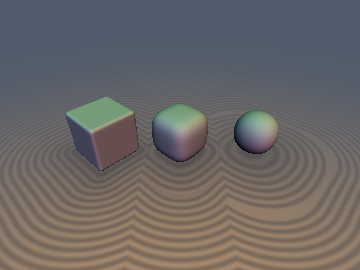
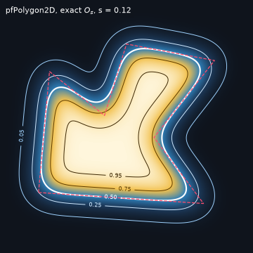
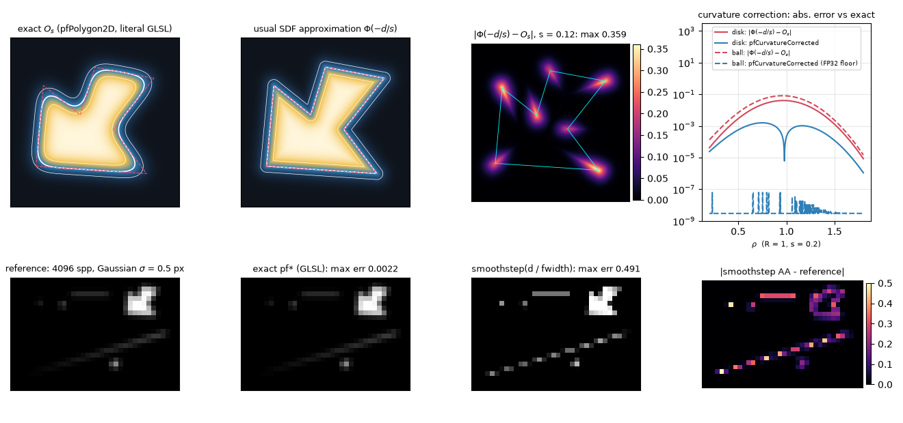

# `pfGaussOccupancy` — Gaussian-Prefiltered Occupancy of Boxes, Balls, Disks and Polygons, a Curvature Correction for Any SDF, and a 1-Lipschitz Probit Distance

| 3D: level set $`O_s = \tfrac12`$ of a blurred box, $`s = 0.02,\ 0.10,\ 0.17`$ | 2D: exact $`O_s`$ of a concave polygon |
| :---: | :---: |
|  |  |

| Property | Value |
| :--- | :--- |
| **Author** | **Claude Fable 5.2** (`sdf-gems`, 2026). Research experiment: see [Findings](#findings) for what held and what did not. |
| **Category** | `volume` |
| **GLSL File** | [`glsl/volume/pfGaussOccupancy.glsl`](../../glsl/volume/pfGaussOccupancy.glsl) |
| **Exact?** | These are occupancies, not SDFs. `pfHalfSpace`, `pfSlab`, `pfBox2D/3D`, `pfBall3D`: closed forms, verified against independent ground truth. `pfDisk2D`, `pfRightTri`, `pfOwenT`, `pfTriangle2D`, `pfPolygon2D`, `pfCappedCylinder3D`: no elementary closed form, fixed-node quadrature, verified to the FP32 errors listed below. `pfCurvatureCorrected`: **Approximate**. `pfDistance`: **Conservative bound** (1-Lipschitz), exact for a half-space. |

---

## Overview & Motivation

For a solid $`K`$ and an isotropic Gaussian $`G_s`$ of standard deviation $`s`$ per axis, the **prefiltered occupancy** is

```math
O_s(\mathbf{p}) = (G_s * \mathbf{1}_K)(\mathbf{p}) = \Pr\left[\mathbf{p} + s\mathbf{Z} \in K\right], \qquad \mathbf{Z} \sim \mathcal{N}(0, I).
```

It is the pixel coverage under a Gaussian pixel filter, the Gaussian drop shadow, the blurred mask, and the density a Gaussian LOD pyramid would store. Shaders usually approximate it from a signed distance $`d`$ ($`d > 0`$ outside) as `smoothstep(d / fwidth)` or

```math
O_s \approx \Phi(-d/s), \qquad \Phi(x) = \tfrac12 \mathrm{erfc}(-x/\sqrt2),
```

which is exact only for a half-space. This file collects the shapes for which $`O_s`$ can be evaluated directly, measures how wrong the SDF approximation is, and adds two tools that work with *any* shape: a curvature correction and a probit pseudo-distance.



*Top: exact $`O_s`$ of a concave polygon, the SDF approximation, their difference (max 0.359, at the corners), and the error of the curvature correction on a disk and a ball. Bottom: Gaussian-filter anti-aliasing of sub-pixel shapes (a 0.2 px hairline, a 0.25 px sliver, a 0.6 x 0.3 px box, a 0.4 px disk, two polygons).*

---

## Mathematical Derivation

Throughout, lengths are divided by $`s`$: $`a = \rho/s`$, $`b = R/s`$, and $`\varphi = \Phi'`$ is the normal density.

### 1. Half-space, slab, box (closed form)

A half-space with signed distance $`d`$ has $`O_s = \Phi(-d/s)`$. A slab $`\lvert x\rvert \le b`$ has $`O_s = \Phi((b-x)/s) - \Phi((-b-x)/s)`$. The Gaussian is separable, so an axis-aligned box is the product of its slabs in any dimension (the classic box-shadow formula). GLSL has no `erf`: `pfErf` / `pfErfc` use two fitted branches, $`x P_6(x^2)`$ for $`\lvert x\rvert < 1`$ and $`e^{-x^2} t P_7(t)`$, $`t = 1/(1 + \lvert x\rvert/2)`$ otherwise, so `pfErfc` keeps relative accuracy in the tail.

### 2. 3D ball (closed form)

$`\lVert \mathbf{p} + s\mathbf{Z}\rVert / s`$ is a non-central chi variable with 3 degrees of freedom, whose density $`r\,[\varphi(r-a) - \varphi(r+a)]/a`$ integrates in closed form:

```math
O_s = \tfrac12\left[\mathrm{erf}\frac{b-a}{\sqrt2} + \mathrm{erf}\frac{b+a}{\sqrt2}\right] - \frac{e^{-(b-a)^2/2} - e^{-(b+a)^2/2}}{a\sqrt{2\pi}}.
```

The second term is evaluated as $`\sqrt{2/\pi}\; b\, e^{-(b-a)^2/2}\, g(2ab)`$ with $`g(x) = (1 - e^{-x})/x`$ (series for small $`x`$), which is finite at the centre, where $`O_s = \mathrm{erf}(b/\sqrt2) - \sqrt{2/\pi}\, b\, e^{-b^2/2}`$.

### 3. 2D disk / infinite cylinder (no elementary form)

$`O_s = 1 - Q_1(a, b)`$ with the Marcum Q-function. `pfDisk2D` integrates the Rice density

```math
f(r) = r\, e^{-(r-a)^2/2}\, I_0^{e}(ar), \qquad I_0^{e}(x) = e^{-x} I_0(x),
```

a smooth bump of unit width around $`r = a`$, with 12 Gauss–Legendre nodes over the part of $`[a-6, a+6]`$ between $`r = b`$ and the nearer tail (the complement when $`b \ge a`$). The window is at most 6 wide for every $`R/s`$, so one fixed rule covers all scales (FP64 algorithm error $`2.1\times10^{-8}`$; 8 nodes give $`1.6\times10^{-5}`$, 10 nodes $`2.7\times10^{-7}`$). A capped cylinder is disk $`\times`$ slab.

### 4. Right triangle, Owen's T, polygons

For the unit Gaussian at the origin, the mass of the right triangle $`(0,0), (h,0), (h,t)`$ with $`t \le h`$, $`\alpha = t/h`$, is

```math
A(h, t) = \frac{1}{2\pi}\int_0^{\alpha} \frac{1 - e^{-h^2(1+x^2)/2}}{1+x^2}\,dx = \frac{\arctan\alpha}{2\pi} - T(h, \alpha),
```

where $`T`$ is Owen's T function. The integrand is smooth on $`[0, \alpha] \subset [0, 1]`$ (6 Gauss–Legendre nodes, FP64 error $`1.7\times10^{-9}`$). For $`t > h`$ the two triangles tile a rectangle:

```math
A(h, t) = \tfrac14\,\mathrm{erf}\frac{h}{\sqrt2}\,\mathrm{erf}\frac{t}{\sqrt2} - A(t, h).
```

An edge $`\mathbf{v}_1 \to \mathbf{v}_2`$ (relative to the query point, in units of $`s`$) with unit direction $`\mathbf{e}`$, signed line distance $`h = \mathbf{v}_1 \times \mathbf{e}`$ and abscissae $`t_i = \mathbf{v}_i \cdot \mathbf{e}`$ contributes the signed mass of the triangle $`(0, \mathbf{v}_1, \mathbf{v}_2)`$,

```math
E = \mathrm{sign}(h)\left[A(\lvert h\rvert, t_2) - A(\lvert h\rvert, t_1)\right], \qquad A(h, -t) = -A(h, t),
```

and $`O_s = \lvert\sum E\rvert`$ for any simple polygon, convex or not, in either orientation. No winding number or `atan` is needed, and $`A`$ is continuous through $`h = 0`$.

### 5. Curvature correction for any SDF (approximate)

$`O_s`$ solves the heat equation $`\partial_t O = \tfrac12\Delta O`$ with $`t = s^2`$. Inserting $`u = \Phi(-d/s)`$ with $`\lVert\nabla d\rVert = 1`$ leaves the residual $`\partial_t u - \tfrac12\Delta u = \varphi(d/s)\,\Delta d/(2s)`$, which the next term of the expansion cancels:

```math
O_s \approx \Phi(-d/s) - s\,H\,\varphi(d/s), \qquad H = \tfrac12\Delta d(\mathbf{p}).
```

$`H`$ is the mean curvature $`(\kappa_1 + \kappa_2)/2`$ of the SDF level set **through the query point** (2D: half the curvature), positive for convex bodies; it is `sdhMeanCurvature` of [`sdhJet3D.glsl`](../../glsl/gradients3d/sdhJet3D.glsl). The same term follows from seeing a paraboloid instead of a plane: $`\mathbb{E}[\Phi((-d - \tfrac12(\kappa_1 x^2 + \kappa_2 y^2))/s)]`$ with $`x, y \sim \mathcal{N}(0, s^2)`$. For a 3D ball, $`d = \rho - R`$ and $`H = 1/\rho`$ reproduce the closed form of section 2 up to $`e^{-(R+\rho)^2/2s^2}`$. `pfCurvatureCorrected` caps $`sH`$ at $`\pm1`$ because $`H`$ diverges at medial axes.

### 6. Probit pseudo-distance (conservative bound)

For **any** measurable $`K`$,

```math
D_s(\mathbf{p}) = -s\,\Phi^{-1}\left(O_s(\mathbf{p})\right)
```

is 1-Lipschitz. Proof: $`\partial_{\mathbf{e}} O_s = s^{-1}\,\mathbb{E}[\mathbf{1}_K(\mathbf{p} + s\mathbf{Z})\,(\mathbf{Z}\cdot\mathbf{e})]`$, and among all sets of Gaussian measure $`m`$ the half-space $`\{\mathbf{Z}\cdot\mathbf{e} > c\}`$ maximises this expectation, giving $`\lVert\nabla O_s\rVert \le \varphi(\Phi^{-1}(O_s))/s`$. $`D_s`$ is the exact signed distance for a half-space, its zero set is the level set $`O_s = \tfrac12`$, and $`D_s + s\,\Phi^{-1}(\ell)`$ bounds the distance to the level set $`O_s = \ell`$. The 3D preview above is sphere-traced with it.

### 7. Unions and ray footprints

- Disjoint union: $`O_s`$ is additive (exact). Overlap: $`O_s(A \cup B) = O_s(A) + O_s(B) - O_s(A \cap B)`$ (exact when the intersection has a formula, e.g. two axis-aligned boxes).
- Along a ray with constant footprint $`s`$: $`\int O_s^{3D}\,dt = (G_s^{2D} * \ell)`$, the footprint-averaged chord length $`\ell`$ (exact: the along-ray blur integrates out). The footprint-averaged coverage of an opaque object is the **2D** occupancy of its silhouette.

---

## GLSL

```glsl
#include "glsl/volume/pfGaussOccupancy.glsl"

float cov  = pfBox2D(p - c, halfSize, 0.5 * pixel);          // Gaussian-filter AA, sigma = 0.5 px
float shad = pfPolygon2D(p - offset, verts, n, blurSigma);   // drop shadow, verts[SDF_GEMS_PF_POLY_MAX]
float dens = pfBall3D(p - c, R, footprint);                  // LOD / cone-footprint density
SdfJet3D j = sdhTorus(p, vec2(0.6, 0.25));                   // any SDF with curvature
float occ  = pfCurvatureCorrected(j.dg.x, sdhMeanCurvature(j), s);
float dist = pfDistance(pfBox3D(p, b, s), s);                // sphere-trace the O_s = 1/2 surface
```

---

## Verification

All numbers are from the literal GLSL on the GPU (FP32) through `tools/gpu_eval.py`. The file compiles in the single-translation-unit check in forward, reverse and new-first order.

### 1. Closed forms and quadratures vs independent ground truth

Ground truths: `scipy` `erf`, `owens_t`, non-central chi-square CDF (ball, disk), FP64 slab products, and for polygons an independent Green's-theorem quadrature (exact antiderivative in $`y`$, composite Gauss–Legendre in $`x`$ along every edge). $`s \in \{0.01, 0.03, 0.1, 0.3, 1, 2\}`$ for shapes of size about 1; 20,000–30,000 points per case (uniform, near the surface, near corners), ground truth evaluated at the FP32-rounded inputs.

| Function | Max abs error (worst $`s`$) | Notes |
| :--- | :---: | :--- |
| `pfErf` / `pfErfc` / `pfPhi` | `1.3e-7` / `1.6e-7` / `8.5e-8` | $`x \in [-6, 6]`$; `pfErfc` tail relative error `1.5e-5` on $`[1, 9]`$ |
| `pfBox2D` (also a 0.008-thick box) / `pfBox3D` | `1.5e-7` / `1.4e-7` | |
| `pfBall3D` ($`R = 1`$ and $`0.05`$) | `2.3e-7` | `9.6e-8` at $`s/R = 10^{-4}`$, `6.2e-8` at $`s/R = 10^{3}`$ |
| `pfDisk2D` ($`R = 1`$ and $`0.05`$) | `2.4e-7` | `1.1e-7` at $`s/R = 10^{-4}`$, `9.1e-8` at $`s/R = 10^{3}`$ |
| `pfOwenT` / `pfRightTri` | `5.7e-8` / `3.9e-8` | $`\lvert h\rvert \le 8`$, $`\lvert a\rvert \le 10^4`$; absolute, not relative, accuracy |
| `pfPolygon2D` (concave 7-gon) | `7.0e-7` | at $`s = 0.01`$; `2.0e-7` for $`s \ge 0.1`$ |
| `pfTriangle2D` | `9.9e-7` | at $`s = 0.01`$; `2.0e-7` for $`s \ge 0.1`$ |
| `pfCappedCylinder3D` | `2.5e-6` | at $`s = 0.01`$ (rounding of `length(p.xz)`); `3.2e-7` for $`s \ge 0.1`$ |
| `pfProbit` | `1.4e-6` | $`u \in [10^{-6}, 1 - 10^{-6}]`$ |

- **Monte Carlo, definition-level check** ($`10^7`$ samples, 72 cases: 6 shapes, 4 points, $`s = 0.05, 0.3, 1.5`$): largest $`\lvert z\rvert`$ = `1.90` standard errors.
- **FP32 position floor**: any FP32 formula sees the query position to within about one ulp, which moves $`O_s`$ by up to $`0.4\,\mathrm{ulp}/s`$. Before the inputs were rounded to FP32 in the ground truth, most functions showed `1.6e-6` to `4.7e-6` at $`s = 0.01`$. An earlier version of `pfDisk2D` that formed $`b - a`$ after scaling by $`1/s`$ had error `3.3e-4` at $`s/R = 10^{-4}`$; subtracting first fixed it.
- **NaN/Inf**: 0 over 3,217 probe points (origin, axes, diagonals, coordinates up to $`10^6`$) for $`s \in \{0, 10^{-12}, 10^{-4}, 0.1, 5, 10^6\}`$ and degenerate parameters ($`R = 0`$, zero-size box, repeated triangle vertex). $`s`$ is clamped to $`10^{-15}`$; a clamp of $`10^{-20}`$ produced NaN at the ball centre.
- **Regressions**: rectangle as a polygon or as two triangles vs `pfBox2D`: `1.8e-7`; reversed orientation: `1.8e-7`; quadrant wedge as a triangle with vertices at $`3\times10^4 s`$ vs $`\Phi(x)\Phi(y)`$: `1.5e-7`; $`s \to 0`$ polygon equals the indicator: `1.8e-7`.

### 2. Semigroup and mass conservation

- **Semigroup** $`G_{s_2} * O_{s_1} = O_{\sqrt{s_1^2 + s_2^2}}`$ (GLSL field convolved numerically on a grid), for $`(s_1, s_2) = (0.1, 0.1), (0.2, 0.4), (0.5, 0.3)`$: box `1.7e-7`, disk `3.3e-7`, polygon `2.6e-7`, ball `2.9e-7`.
- **Mass** $`\int O_s = \mathrm{area}`$ or volume, $`s = 0.05 \ldots 2`$: box2D relative error $`\le`$ `3.6e-8`, disk $`\le`$ `4.5e-8`, polygon `6.6e-8` to `6.2e-6`, ball `4.6e-8` to `2.8e-6` (the larger values are FP32 noise summed over the large domain needed at $`s = 2`$); 3D grid at $`s = 0.3`$: box `1.232000 / 1.232000`, capped cylinder `0.791681 / 0.791681`.

### 3. How wrong is $`\Phi(-d/s)`$?

| Case | Exact | $`\Phi(-d/s)`$ | Max abs error |
| :--- | :---: | :---: | :---: |
| Box corner, $`s \ll`$ size | `0.250` | `0.500` | `0.229`–`0.248` ($`s = 0.02 \ldots 0.2`$); `0.466` at $`s = 0.8`$ |
| Thin slab centre, half-thickness $`0.1 s`$ / $`0.5 s`$ / $`1 s`$ / $`2 s`$ | `0.080` / `0.383` / `0.683` / `0.954` | `0.540` / `0.691` / `0.841` / `0.977` | `0.460` / `0.309` / `0.159` / `0.023` |
| Ball centre, $`R = 0.5 s`$ / $`1 s`$ / $`2 s`$ | `0.031` / `0.199` / `0.739` | `0.691` / `0.841` / `0.977` | `0.661` / `0.643` / `0.240` |
| Ball, $`R = 4 s`$ / $`8 s`$ / $`16 s`$ (near the surface) | | | `0.103` / `0.050` / `0.025` ($`\approx 0.4\, s/R`$) |
| Disk, $`R = 1 s`$ / $`4 s`$ / $`16 s`$ | | | `0.448` / `0.051` / `0.0125` ($`\approx 0.2\, s/R`$) |
| Concave 7-gon, reflex vertices (255° and 292°) | `0.708`, `0.810` | `0.500` | `0.35`–`0.36` at every $`s`$ |
| Concave 7-gon, convex vertices (49° and 97°) | `0.137`, `0.268` | `0.500` | |

At a vertex the exact value tends to (interior angle)$`/2\pi`$, so the corner error does not shrink with $`s`$.

### 4. Curvature correction (max abs error over $`\lvert d\rvert \le 4s`$)

| $`s\kappa`$ | Ball: plain | Ball: corrected | Disk: plain | Disk: corrected |
| :---: | :---: | :---: | :---: | :---: |
| 0.01 | `4.0e-3` | `2.3e-6` | `2.0e-3` | `4.6e-6` |
| 0.05 | `2.0e-2` | `4.7e-7` | `1.0e-2` | `8.0e-5` |
| 0.1 | `4.0e-2` | `2.3e-7` | `2.0e-2` | `3.4e-4` |
| 0.2 | `8.2e-2` | `1.3e-7` | `4.1e-2` | `1.6e-3` |
| 0.3 | `1.3e-1` | `9.2e-3` | `6.2e-2` | `4.5e-3` |
| 0.5 | `2.4e-1` | `1.8e-1` | `1.2e-1` | `5.8e-2` |
| 1.0 | `6.4e-1` | `4.0e-1` | `4.5e-1` | `2.1e-1` |

Torus (major 0.6, minor 0.25): ground truth by Monte Carlo with the literal `sdTorus` as inside test ($`10^7`$ samples per point, half-space control variate, standard error $`\le`$ `1.6e-4`), 25 points per $`s`$ (5 tube angles, $`d/s \in \{-1.5, -0.75, 0, 0.75, 1.5\}`$); corrected values from the literal `pfCurvatureCorrected` fed by `sdhTorus` / `sdhMeanCurvature`:

| $`s`$ ($`s/r_{\text{minor}}`$) | Plain $`\Phi(-d/s)`$ | `pfCurvatureCorrected` | Gain |
| :---: | :---: | :---: | :---: |
| 0.02 (0.08) | `2.07e-2` | `5.2e-4` | 40x |
| 0.05 (0.20) | `5.18e-2` | `3.6e-3` | 14x |
| 0.10 (0.40) | `1.04e-1` | `1.6e-2` | 6.5x |
| 0.15 (0.60) | `1.92e-1` | `6.2e-2` | 3.1x |
| 0.20 (0.80) | `2.95e-1` | `7.4e-2` | 4.0x |

Variants tried and rejected (same tests): the shifted form $`\Phi(-d/s - sH)`$ and the use of the curvature at the foot point were worse for $`s\kappa \le 0.4`$ (torus 1.03–2.8x, disk 1.6–2.3x, ball `1.5e-3` vs `2.3e-7` at $`s\kappa = 0.1`$); the uncapped additive form has errors of `0.46`, `27` and `242` near the centre of a ball at $`s\kappa = 0.3, 0.5, 1`$. On a 2D box (curvature $`1/r`$ only around the outside of corners) the correction leaves the max error unchanged (`0.239`–`0.249`) and lowers the RMS error by only 7–9%.

### 5. Probit distance

- FP64, central differences, points with $`10^{-6} < O_s < 1 - 10^{-6}`$, $`s \in \{0.05, 0.2, 0.6, 1.5\}`$: max $`\lVert\nabla D_s\rVert`$ = `1.000000` (box 2D/3D, concave polygon, two disjoint boxes), `0.9991` (disk), `0.9983` (ball). The bound is tight for small $`s`$ (median `0.94`–`1.00` for $`s \le 0.2`$) and loosens as $`s`$ grows (median `0.82`–`0.87` at $`s = 1.5`$).
- Literal GLSL vs the true distance to the level set $`O_s = \tfrac12`$ (contour of an FP64 grid + KD-tree), 60,000 points, $`s \in \{0.05, 0.15, 0.3\}`$: max overshoot $`\lvert D\rvert - \mathrm{dist}`$ = `1.6e-5` ($`3\times10^{-4} s`$; this includes the contour's own discretisation error), mean $`\lvert D\rvert/\mathrm{dist}`$ = `0.85`–`1.00`, pair Lipschitz ratio at separation $`0.25 s`$ $`\le`$ `1.0012`.
- With $`O`$ clamped to $`[10^{-6}, 1 - 10^{-6}]`$ the FP32 noise of $`O`$ was amplified to an overshoot of $`0.018 s`$ (pair ratio `1.08`); the shipped clamp is $`[10^{-4}, 1 - 10^{-4}]`$, so $`\lvert D\rvert \le 3.72 s`$ and far-field steps are short. The 3D check of the literal GLSL is the render above, not a numerical test.

### 6. Applications

**(a) Anti-aliasing** (Gaussian pixel filter $`\sigma = 0.5`$ px, 24 x 24 px, reference 16 x 16 = 256 samples per pixel):

| Scene | Exact `pf*`: max err | `smoothstep(d / fwidth)`: max err | $`\Phi(-d/\sigma)`$: max err | Energy ratio (exact / smoothstep / $`\Phi`$) |
| :--- | :---: | :---: | :---: | :---: |
| Box 0.6 x 0.3 px | `0.0090` | `0.468` | `0.434` | 1.01 / 3.19 / 4.99 |
| Disk r = 0.4 px | `0.0005` | `0.339` | `0.311` | 1.00 / 1.28 / 2.37 |
| Sliver triangle, 0.25 px wide | `0.0027` | `0.493` | `0.471` | 1.00 / 2.09 / 3.80 |
| Concave 7-gon, 14 px | `0.0028` | `0.377` | `0.221` | 1.00 / 1.00 / 1.01 |
| Concave 7-gon, 2.2 px | `0.0013` | `0.430` | `0.249` | 1.00 / 1.06 / 1.39 |

"Energy ratio" is $`\sum`$ coverage / true area (1 is correct for any normalised filter; the exact result deviates by up to 1.2% because a $`\sigma = 0.5`$ px Gaussian is not band-limited). The residual of the exact method is the reference's error: the supersampled image converges to the analytic one as `4.7e-2`, `8.5e-3`, `2.8e-3`, `2.2e-3`, `9.8e-4` at 16, 64, 256, 1024, 4096 samples per pixel, and the 256-sample reference itself has an energy ratio of 1.10 on the small box. The `smoothstep` comparison is partly a filter mismatch (it approximates a box-like filter); the energy ratio is filter-independent.

**(b) Drop shadow** of the concave polygon vs a brute-force blur of a $`4096^2`$ mask: exact `5.3e-4` / `1.7e-4` / `4.4e-5` at $`\sigma = 0.05 / 0.15 / 0.4`$ (limited by the raster reference); $`\Phi(-d/\sigma)`$: `0.36` at every $`\sigma`$.

**(c) 3D ray footprint**, ball $`R = 0.7`$:

- Exact: $`\int`$ `pfBall3D` $`dt`$ equals the footprint-averaged chord length to `7.5e-8` (9 cases); $`\int`$ `pfBox3D` $`dz = 2 b_z`$ `pfBox2D` (`0.430552` both).
- Not exact: opacity $`1 - e^{-\sigma_t \int O_s dt}`$ of the prefiltered density overestimates the footprint-averaged opacity (Jensen). At $`s = 0.35`$, ray offset 0.5: `0.446` vs `0.364` ($`\sigma_t = 1`$), `0.948` vs `0.582` ($`\sigma_t = 5`$), `1.000` vs `0.601` ($`\sigma_t = 50`$). The opaque limit is `pfDisk2D` of the silhouette (`0.6008`), not a 3D quantity.
- Not exact: a cone whose footprint grows along the ray, $`s(t) = \alpha t`$: relative difference from the constant-footprint integral `9.7e-5` ($`\alpha = 0.02`$), `1.0e-3` ($`\alpha = 0.05`$), `4.2e-3` ($`\alpha = 0.1`$).

### 7. Unions (two overlapping boxes, max abs error vs inclusion–exclusion)

| $`s`$ | $`1 - (1-a)(1-b)`$ | $`\max(a, b)`$ | $`\min(a + b, 1)`$ |
| :---: | :---: | :---: | :---: |
| 0.02 | `0.0000` | `0.249` | `0.219` |
| 0.05 | `0.0005` | `0.250` | `0.237` |
| 0.1 | `0.024` | `0.239` | `0.250` |
| 0.2 | `0.060` | `0.215` | `0.290` |
| 0.4 | `0.054` | `0.207` | `0.209` |
| 0.8 | `0.038` | `0.084` | `0.058` |

Inclusion–exclusion vs Monte Carlo ($`10^7`$ samples, 3 points): $`z`$ = `-0.63`, `-2.26`, `-1.14`.

---

## Findings

**What held**

- Box, ball, half-space and slab closed forms: FP32 error $`\le`$ `2.3e-7`, from $`s/R = 10^{-4}`$ to $`10^3`$ for the ball.
- Disk (12 nodes) and polygon (6 nodes per right triangle, two per edge) quadratures: `2.4e-7` and $`\le`$ `9.9e-7`. The target of $`10^{-6}`$ is met for these, and missed by `pfCappedCylinder3D` at $`s = 0.01`$ (`2.5e-6`, position rounding).
- Semigroup and mass conservation hold to FP32 accuracy for every shape tested.
- The curvature correction beats $`\Phi(-d/s)`$ by 14–40x for $`s\kappa \le 0.2`$ on the torus, by about 60x at $`s\kappa = 0.1`$ on the disk, and matches the ball's closed form to `2.3e-6` or better up to $`s\kappa = 0.2`$.
- $`D_s = -s\Phi^{-1}(O_s)`$ is 1-Lipschitz for every shape tested, including a concave polygon and a disconnected set.
- Analytic anti-aliasing matches a converged supersampled reference; SDF-based AA renders sub-pixel features 1.3–5x too bright.
- Additivity and inclusion–exclusion are exact; the product rule is good only while $`s`$ is small against the overlap (error up to `0.060`).

**What failed or is limited**

- $`\Phi(-d/s)`$ is wrong by 0.23–0.36 at every corner at every $`s`$, and by up to 0.66 for features thinner than $`s`$.
- The curvature correction does not help at sharp corners, and degrades for $`s\kappa \gtrsim 0.3`$ (torus at $`s/r = 0.6`$: still `0.062`; ball at $`s\kappa = 1`$: `0.40`). The torus test covers 25 points per $`s`$, not a dense field.
- No closed form was found for the capsule, rounded box or any shape mixing flat and round boundary; the off-centre Gaussian mass of a circular sector needs a 1D integral. Not implemented.
- 3D convex polyhedra: not implemented. The literature search (summaries only) indicates that non-centred trivariate normal probabilities reduce to 1D integrals of bivariate terms rather than to a closed form; this was not checked against the primary sources.
- Prefiltered density is not prefiltered visibility: cone-traced opacity of the blurred density errs by up to 0.4–0.8 for dense media.
- `pfDistance` saturates at $`3.72 s`$, so far-field marching is slow for small $`s`$ (the preview combines it with the box SDF, valid because the level set of a convex shape lies inside it).
- FP32 limits every method to about $`0.4\,\mathrm{ulp}(\lvert\mathbf{p}\rvert)/s`$.

**Open questions**

- A second-order curvature term (Gaussian curvature, derivatives of $`H`$) and a principled blend with a wedge formula near edges.
- Anisotropic footprints: boxes and polygons extend by an affine map, balls and disks become ellipsoids with no closed form.
- A cheaper `pfDisk2D` (uniform asymptotics of the Marcum Q-function) and a one-quadrature-per-edge polygon.
- Whether the tail of $`D_s`$ can be extended in FP32 by evaluating $`\log O_s`$ directly.
- GPU cost was not benchmarked.

---

## Novelty & Prior Art

Searches returned summaries, not inspectable sources, so the statements below about existing work rest on those summaries and on general knowledge of the cited works. Works are cited by title.

- **Box**: the erf product is the well-known box-shadow technique ("Fast Rounded Rectangle Shadows", 2014, which treats rounded rectangles with a closed form on one axis and numerical integration on the other; "Blurred rounded rectangles", 2020, gives an approximation). Not new.
- **Ball**: the CDF of the non-central chi distribution with 3 degrees of freedom is textbook. We did not find it packaged as a shader primitive; the search summary for blurred circles offered a two-`erf` formula without the exponential term, which is not the exact disk or ball result.
- **Disk**: $`1 - Q_1`$ (Marcum Q-function) is standard. The windowed 12-node rule is an implementation choice.
- **Polygon**: the bivariate normal integral over a polygon as a sum of Owen's T terms over edges is from "Computation of the Integral of the Bivariate Normal Distribution Over Convex Polygons" (SIAM J. Sci. Stat. Comput., 1980) and its follow-up for arbitrary polygons; Owen's T dates from 1956, with a standard algorithm in J. Statistical Software (2000). The formulation through the right-triangle mass $`A(h,t)`$ with the rectangle reflection is a convenient rearrangement, not new mathematics. We found no GLSL implementation. Analytic polygon anti-aliasing with box and polynomial filters is established ("Polygon Scan Conversion by Exact Convolution", 1989; "Analytic Rasterization of Curves with Polynomial Filters", 2013; "Analytic Anti-Aliasing of Linear Functions on Polytopes", 2012).
- **Curvature correction**: the expansion of a Gaussian-blurred indicator near a curved interface is the basis of threshold dynamics for mean curvature flow (the MBO scheme, 1992). Writing it as a drop-in correction for SDF-based occupancy, using the level-set curvature at the query point with a cap, and measuring it, appears to be new in the shader context; we did not find it stated.
- **Probit distance**: the bound $`\lVert\nabla O_s\rVert \le \varphi(\Phi^{-1}(O_s))/s`$ is the Gaussian isoperimetric gradient estimate from the semigroup proofs of Gaussian isoperimetry (1990s). Using it as a sphere-tracing bound for blurred shapes appears to be new; we did not find it. `pfProbit` uses published single-precision `erfinv` polynomials ("Approximating the erfinv function", GPU Computing Gems, 2012), reproduced from memory and checked against `scipy` (`1.4e-6`).
- **New here**: the collection as one verified GLSL file with measured FP32 errors, the error tables for $`\Phi(-d/s)`$, the measured curvature correction, and the probit distance as a tracing bound.
