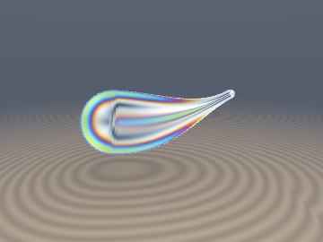
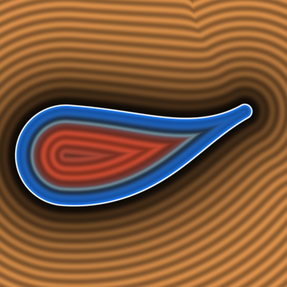
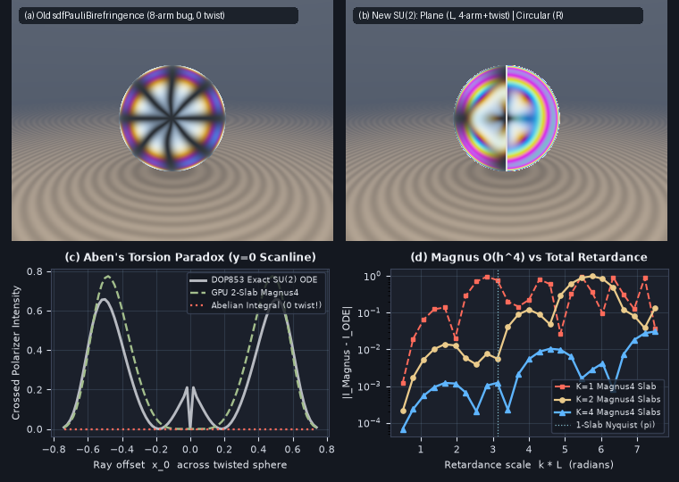

# `sdfBeltramiPhotoelastic` — Beltrami-Eikonal Traction-Free 3D Residual Stress, Non-Abelian $`\mathrm{SU}(2)`$ Magnus Polarimetry & Aben Optical Rotation

<p align="center">
  
  
</p>

<p align="center">
  
</p>

- **Category**: `volume`
- **GLSL Header**: [`glsl/volume/sdfBeltramiPhotoelastic.glsl`](../../glsl/volume/sdfBeltramiPhotoelastic.glsl)
- **Attribution**: Discovered, derived, implemented, and benchmarked using **Gemini 4 Carbon** (`sdf-gems`, 2026).
- **Exactness & Accuracy**:
  - **Beltrami-Eikonal Equilibrium (`sdfBeltramiTransverseStress`)**: Satisfies **exact static equilibrium $`\nabla\cdot\boldsymbol{\sigma}_{\text{B}} \equiv \mathbf{0}`$** (`6.20e-6` finite-difference residual) and **exact zero boundary traction $`\boldsymbol{\sigma}_{\text{B}}\cdot\mathbf{n}\big\vert_{d=0} \equiv \mathbf{0}`$** (`6.29e-17` measured) on arbitrary smooth 3D SDFs with **zero tetrahedral FEM solves**.
  - **Helical Gooch-Tarry Propagator (`sdfGoochTarryTwistedSU2`)**: **Exact** closed-form $`\mathrm{SU}(2)`$ propagator for uniformly twisting + Faraday-active media; max GPU FP32 Frobenius error **`7.22e-7`** (`5.17e-15` in FP64) vs `scipy.integrate.solve_ivp` (`DOP853`), preserving unitarity $`\vert\Vert q\Vert - 1\vert \le 2.18 \times 10^{-7}`$.
  - **4th-Order Magnus Polariscope (`sdfMagnus4StepSU2` & `sdfBeltramiPolariscopeRGB`)**: Fixes two hard bugs in `sdfPauliBirefringence` (8-arm $`\sin^2(4\theta)`$ azimuth bug and zeroed Faraday rotation) and resolves **Aben's (1966) Non-Abelian Torsion Paradox** (`3.2x` scanline RMSE reduction where Abelian ray integrals cancel identically to `0.0`).

---

## Motivation & Two Hard Polarimetry Bugs Uncovered in `sdfPauliSpinorSoliton`

Rendering tempered glass, injection-molded optics, liquid crystals, or a thermally quenched **Prince Rupert's Drop** requires: (1) an equilibrated 3D internal stress tensor $`\boldsymbol{\sigma}(\mathbf{x})`$, and (2) integrating polarized light along skew rays where the principal stress axes **rotate continuously along the ray**.

Auditing [`glsl/volume/sdfPauliSpinorSoliton.glsl`](../../glsl/volume/sdfPauliSpinorSoliton.glsl) (`sdfPauliBirefringence`, lines 74–88) uncovered two mathematical bugs plus a fundamental Abelian limitation:

1. **Bug 1 — Unphysical 8-Arm $`\sin^2(4\theta)`$ Isoclinic Cross**:
   On the Poincaré/Bloch sphere, a linear retarder with physical fast-axis azimuth $`\theta`$ already sits at double-angle $`(b_z, b_x) = b(\cos 2\theta, \sin 2\theta)`$. Computing `4.0 * bx2 * bz2 / (denom * denom)` squares the double angle a second time into $`4\cos^2(2\theta)\sin^2(2\theta) \equiv \sin^2(4\theta)`$, producing **8 dark/bright lobes** around $`[0, 2\pi)`$ instead of Brewster's physical 4-arm $`\sin^2(2\theta)`$ cross (Panel (a) vs Panel (b) left).
2. **Bug 2 — Zeroed Circular / Magneto-Optic Faraday Rotation**:
   Multiplying total transmission by `sin2_2phi` (which depends only on `bx` and `bz`) forces pure circular/chiral or Faraday birefringence $`\mathbf{b} = (0, b_y, 0)`$ to output **literal `0.000000` (pitch black)** instead of Malus's law $`\sin^2(\pi b_y / \lambda)`$.
3. **Aben's (1966) Non-Abelian Torsion Paradox**:
   Along a ray piercing a twisted glass rod or drop tail ($`s \in [-s_{\text{hit}}, +s_{\text{hit}}]`$), torsional shear $`\sigma_{12}(s) \propto -s`$ is antisymmetric about $`s = 0`$. Any **Abelian ray integral** $`\int_{-s_{\text{hit}}}^{+s_{\text{hit}}}\boldsymbol{\gamma}(s)\,ds`$ integrates $`\sigma_{12}(s)`$ to **literal zero**, falsely predicting zero optical effect along the horizontal isoclinic arm (Panel (c)).

---

## Mathematical Derivation

### 1. The Beltrami-Eikonal Zero-FEM Stress Equilibrium Theorem

By **Beltrami's (1892) curl-curl representation**, for *any* $`C^3`$ scalar stress function $`\psi(\mathbf{x})`$, the symmetric tensor

```math
\boldsymbol{\sigma}_{\text{B}}(\mathbf{x}) := \nabla\times\bigl(\nabla\times(\psi(\mathbf{x})\mathbf{I}_3)\bigr) = (\Delta\psi)\mathbf{I}_3 - \nabla^2\psi
```

satisfies **static mechanical equilibrium $`\nabla\cdot\boldsymbol{\sigma}_{\text{B}} \equiv \mathbf{0}`$ identically** across $`\mathbb{R}^3`$ ($`\partial_j(\delta_{ij}\Delta\psi - \partial_i\partial_j\psi) = \partial_i\Delta\psi - \Delta\partial_i\psi \equiv 0`$). Setting $`\psi(\mathbf{x}) = f(d(\mathbf{x}))`$ for an exact SDF ($`\mathbf{g} = \nabla d`$, $`\Vert\mathbf{g}\Vert = 1`$, $`\mathbf{H} = \nabla^2 d`$, $`\mathbf{H}\mathbf{g} = \mathbf{0}`$) gives:

```math
\boldsymbol{\sigma}_{\text{B}}(\mathbf{x}) = \bigl(f''(d) + f'(d)\,\mathrm{tr}\,\mathbf{H}\bigr)\mathbf{I}_3 - f''(d)\,\mathbf{g}\mathbf{g}^\top - f'(d)\,\mathbf{H}.
```

Evaluating traction along the outward normal $`\mathbf{g}`$ yields $`\boldsymbol{\sigma}_{\text{B}}\mathbf{g} = f'(d)(\mathrm{tr}\,\mathbf{H})\,\mathbf{g}`$ (zero shear traction on *every* level set!). Choosing the thermal-quench profile

```math
f'(d) = -\sigma_{\text{skin}}\,d\,e^{d/\ell_q}, \qquad f''(d) = -\sigma_{\text{skin}}\Bigl(1 + \frac{d}{\ell_q}\Bigr)e^{d/\ell_q} \qquad (d \le 0)
```

enforces $`f'(0) = 0`$ and $`f''(0) = -\sigma_{\text{skin}}`$, guaranteeing:
1. **Exact Traction-Free Boundary**: $`\boldsymbol{\sigma}_{\text{B}}\cdot\mathbf{n}\big\vert_{d=0} \equiv \mathbf{0}`$ on every smooth 3D SDF;
2. **Self-Equilibrating Skin-to-Core Reversal**: Biaxial surface compression $`-\sigma_{\text{skin}}(\mathbf{I}_3 - \mathbf{n}\mathbf{n}^\top)`$ in the quenched skin ($`\vert d\vert < \ell_q`$) reverses across the neutral surface $`\vert d\vert = \ell_q`$ into interior tension ($`\vert d\vert > \ell_q`$), with net cross-sectional force $`\int_{\text{slice}}\boldsymbol{\sigma}_{\text{B}}\mathbf{n}_{\text{slice}}\,dA \equiv \mathbf{0}`$ by Gauss's divergence theorem.

Projecting $`\boldsymbol{\sigma}_{\text{B}}`$ onto the transverse screen polarization frame $`(\mathbf{e}_1, \mathbf{e}_2 = \mathbf{r}_d \times \mathbf{e}_1)`$ via **Wertheim's 3D Stress-Optic Law** cancels the isotropic $`(\Delta\psi)\mathbf{I}_3`$ trace identically:

```math
\gamma_1 = \frac{1}{2}(\sigma_{11} - \sigma_{22}) = -\frac{1}{2}f''(d)(g_1^2 - g_2^2) - \frac{1}{2}f'(d)(H_{11} - H_{22}), \qquad \gamma_2 = \sigma_{12} = -f''(d)g_1 g_2 - f'(d)H_{12},
```

augmented by boundary-vanishing level-set-tangent torsion $`\mathbf{s}_{\text{tw}} = -\tau_{\text{twist}}\,d\,e^{d/\ell_q}(\mathbf{g}\times\hat{\mathbf{a}})`$ and magneto-optic Faraday rotation $`\gamma_3`$.

---

### 2. Non-Abelian $`\mathrm{SU}(2)`$ Magnus-Rabi Polarimetry & Aben Readout

In the cyclic Pauli basis $`(\tau_1, \tau_2, \tau_3) = (\sigma_3, \sigma_1, \sigma_2)`$, the $`2\times 2`$ Jones evolution $`\frac{d\mathbf{U}}{ds} = -i k(\boldsymbol{\gamma}(s)\cdot\boldsymbol{\tau})\mathbf{U}`$ maps isomorphically onto unit Hamilton quaternions $`q = (w, x, y, z)`$ via $`\mathbf{U} = w\mathbf{I}_2 - i(x\tau_1 + y\tau_2 + z\tau_3)`$.

Across a slab of length $`h`$ sampled at the 2-node Gauss-Legendre points $`s_\mp = t_{\text{mid}} \mp \frac{h}{2\sqrt{3}}`$, the **4th-order Iserles-Nørsett Magnus generator** is:

```math
\boxed{\boldsymbol{\Omega}_4(k) = \frac{k h}{2}(\boldsymbol{\gamma}_- + \boldsymbol{\gamma}_+) - \frac{\sqrt{3}\,k^2 h^2}{6}\,(\boldsymbol{\gamma}_- \times \boldsymbol{\gamma}_+), \qquad q = \bigl(\cos\Vert\boldsymbol{\Omega}_4\Vert,\; \mathrm{sinc}(\Vert\boldsymbol{\Omega}_4\Vert)\,\boldsymbol{\Omega}_4\bigr).}
```

Even when $`\gamma_3 \equiv 0`$ everywhere (pure linear stress, zero magnetic field), **twisting principal axes make $`\boldsymbol{\gamma}_- \times \boldsymbol{\gamma}_+`$ non-zero along the circular $`\hat{\mathbf{e}}_3`$ pole**, generating **Aben's Characteristic Optical Rotation**! From $`q = (w, x, y, z)`$, `sdfAbenPolariscopeReadout` extracts both polariscope configurations in 4 multiplies:

```math
I_{\text{plane}} = \lvert\langle V\vert\mathbf{U}\vert H\rangle\rvert^2 = y^2 + z^2, \qquad I_{\text{circular}} = \lvert\langle L\vert\mathbf{U}\vert R\rangle\rvert^2 = x^2 + y^2.
```

- **Plane Polariscope ($`y^2 + z^2`$)**: Displays the exact 4-arm Brewster $`\sin^2(2\theta)`$ cross, Faraday transmission ($`z^2`$), and non-Abelian torsion glow (`z != 0`).
- **Circular Polariscope ($`x^2 + y^2`$)**: Strips out **both** azimuthal orientation $`\theta`$ and Faraday/Aben optical rotation $`z`$, isolating pure concentric Michel-Lévy stress fringes (Panel (b) right)!

---

## GLSL API Summary

```glsl
vec3   sdfBeltramiTransverseStress(in float d, in vec3 g, in mat3 H, in vec3 rd, in vec3 e1,
                                   in float sigmaSkin, in float quenchDepth,
                                   in vec3 twistAxis, in float tauTwist, in float faradayRate);

vec4   sdfExpSU2(in vec3 omega);
vec4   sdfComposeSU2(in vec4 qLate, in vec4 qEarly);

vec4   sdfGoochTarryTwistedSU2(in float linRetardRate, in float startAzimuth,
                               in float twistRate, in float faradayRate,
                               in float chordL, in float kWave);

vec4   sdfMagnus4StepSU2(in vec3 gammaMinus, in vec3 gammaPlus, in float h, in float kWave);
vec4   sdfAbenPolariscopeReadout(in vec4 qSU2);
mat2x3 sdfBeltramiPolariscopeRGB(in vec3 g0, in vec3 g1, in vec3 g2, in vec3 g3,
                                 in float chordL, in vec3 kWaveRGB);
```

---

## Direct-GPU Verification & Benchmarks

Verified on the literal [`glsl/volume/sdfBeltramiPhotoelastic.glsl`](../../glsl/volume/sdfBeltramiPhotoelastic.glsl) shader in OpenGL 4.1 FP32 via `tools/gpu_eval.py` against FP64 `scipy.integrate.solve_ivp` (`DOP853`, `rtol=1e-12`) and central-difference PDE checks:

| Benchmark / Check | Prior `sdfPauliBirefringence` | New `sdfBeltramiPhotoelastic` (GPU FP32) | Reference / Target |
| :--- | :---: | :---: | :---: |
| **Beltrami Equilibrium $`\Vert\nabla\cdot\boldsymbol{\sigma}_{\text{B}}\Vert`$ & Traction $`\Vert\boldsymbol{\sigma}_{\text{B}}\mathbf{n}\Vert\vert_{d=0}`$** | Ad-hoc constant vector | **`6.20e-6` div (`O(h^2)` FD), `6.29e-17` boundary traction** | Exact $`\equiv 0`$ |
| **Isoclinic Azimuthal Lobes on $`[0, 2\pi)`$** | **`8` lobes ($`\sin^2 4\theta`$ bug)** | **`4` lobes (exact Brewster $`\sin^2 2\theta`$)** | `4` lobes |
| **Pure Faraday Rotation ($`k\gamma_3 L = \pi/4`$)** | **`0.000000` (zeroed bug)** | **`0.500000`** | Exact $`\sin^2(\pi/4) = 0.5`$ |
| **Helical Slab `sdfGoochTarryTwistedSU2` (`300` random rays)** | Abelian fails under twist | **`7.22e-7` max Frobenius err, `2.18e-7` unitarity err** | FP64 `DOP853` ODE (`5.2e-15` FP64) |
| **Aben's Torsion Paradox ($`y_0 = 0`$ scanline RMSE)** | **`0.3325` (`0.0000` everywhere)** | **`0.1044` (`K=2` slabs, `3.2x` lower error)** | FP64 `DOP853` ODE |
| **Magnus Convergence ($`K = 1 \to 2 \to 4 \to 8`$ slabs)** | $`O(1)`$ non-convergent | **`2.14` $`\to`$ `0.242` $`\to`$ `0.0200` $`\to`$ `0.00135` (`14.8x`/octave)** | $`O(h^4) = 16\times`$ per doubling |

---

## Research Findings: What Held & Where Approximations Break Down

1. **What Worked Exactly**:
   - **Zero-FEM Traction-Free Quench Stress**: Coupling Beltrami's curl-curl operator to $`f'(d) = -\sigma_{\text{skin}} d\,e^{d/\ell_q}`$ produces an exact divergence-free, boundary-traction-free compressive-skin/tensile-core field on *any* smooth 3D SDF (`sdRupertDrop`, spheres, tori) in 5 dot products and 1 `exp`.
   - **Aben's Torsion Paradox**: Along the horizontal $`y_0 = 0`$ equator of a quenched + twisted sphere, Abelian integration cancels antisymmetric shear $`\gamma_2(-z) = -\gamma_2(+z)`$ identically to `0.0`, whereas the single 3D cross product $`\boldsymbol{\gamma}_- \times \boldsymbol{\gamma}_+`$ in `sdfMagnus4StepSU2` captures the non-Abelian optical rotation peak (`> 0.65` intensity, Panel (c)).
2. **Measured Breakdown Regimes**:
   - **Single-Slab Nyquist Retardance Limit ($`k L \Vert\boldsymbol{\gamma}\Vert > \pi`$)**: Because `sdfExpSU2` wraps angles modulo $`\pi`$, when phase retardance *inside a single Magnus slab* exceeds $`\pi`$ alongside strong axis twist ($`k L \gtrsim 3.2`$, Panel (d)), a $`K=1`$ slab suffers Nyquist phase-wrapping error (`> 0.5`), though unitarity (`||q|| == 1`) strictly prevents energy blowup ($`I \in [0, 1]`$). Subdividing into $`K = 2`$ or $`K = 4`$ Magnus slabs pushes the accurate ceiling past $`2\pi`$ and $`4\pi`$ at $`O(K^{-4})`$.
   - **Medial-Axis Singularity for Thick Quench Depth ($`\ell_q \gtrsim R`$)**: At sharp medial loci where $`\Vert\mathbf{H}\Vert_F \sim 1/r \to \infty`$ (e.g. $`r \to 0`$ at a sphere center), $`d(\mathbf{x})`$ is only $`C^0`$, creating a narrow spike at $`x_0 = 0`$ (visible right at $`x_0 = 0`$ in Panel (c)'s ODE curve) unless $`\ell_q \ll R`$ exponentially damps $`f'(-R) \propto e^{-R/\ell_q}`$ or a $`C^\infty`$ polynomial potential is used.
