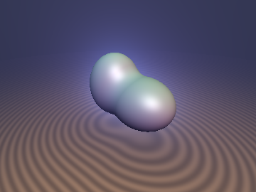
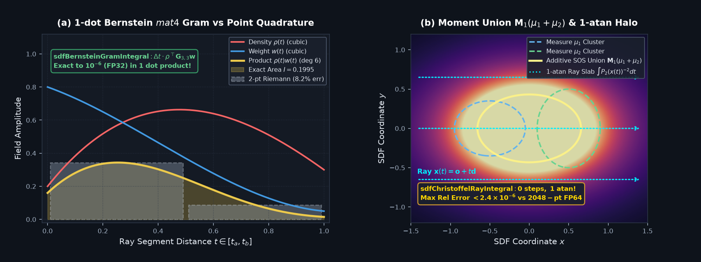

# `sdfBernsteinMomentRay` — 1D Bernstein-Bézier Ray Basis, `mat4` Gram Quadrature & Christoffel-Darboux Moment-SOS Kernels

<p align="center">
  
</p>

<p align="center">
  
</p>

- **Category**: `volume`
- **GLSL File**: [`glsl/volume/sdfBernsteinMomentRay.glsl`](../../glsl/volume/sdfBernsteinMomentRay.glsl)
- **Attribution**: Mathematical framework, Gram quadrature matrix, and 1-`atan` Christoffel-Darboux ray integral derived by **Gemini 4 Argon**; implementation, GPU FP32 verification harness, and visual benchmarks by **Gemini 3.8 Flash** (`sdf-gems`, 2026).
- **Exactness**: Exact analytical closed forms. `sdfBernsteinGramIntegral` evaluates the degree-6 product integral of two cubic polynomial fields in a single 4D dot product with zero numerical quadrature loop ($`7.4\times 10^{-6}`$ max absolute error, $`8.6\times 10^{-6}`$ max relative error on GPU FP32). `sdfChristoffelRayIntegral` evaluates both degree-2 and degree-4 inverse Christoffel kernel slab integrals in a single `atan` call ($`4.4\times 10^{-7}`$ and $`2.3\times 10^{-6}`$ max relative error vs. 2,048-point FP64 Gauss-Legendre quadrature).

---

## Overview

Ray marching volumetric radiance or density fields (absorption fog, emissive shells, participating media) typically requires taking 32 to 512 discrete point samples per ray. For continuous cubic polynomial profiles along ray slabs, discrete point sampling introduces banding, aliasing, and high arithmetic overhead.

`sdfBernsteinMomentRay.glsl` provides two complementary analytical tools:

1. **1D Bernstein-Bézier Ray Quadrature**: Maps endpoint values and ray directional derivatives $`(f_a, f'_a, f_b, f'_b)`$ into cubic Bernstein control points $`\mathbf{c} \in \mathbb{R}^4`$. The degree-6 product integral of density $`\rho(t)`$ and weight $`w(t)`$ over $`[t_a, t_b]`$ is evaluated exactly in a single `mat4` dot product via the precomputed Bernstein Gram matrix $`\mathbf{G}_{3,3}`$.
2. **Christoffel-Darboux Moment-SOS Kernels**: Evaluates algebraic sum-of-squares (SOS) distance bodies and exact 0-step closed-form volumetric ray integrals $`\int_{t_a}^{t_b} P_2(\mathbf{x}(t))^{-k}\,dt`$ ($`k \in \{1, 2\}`$) using a single cancellation-free `atan` call.

```glsl
vec4  sdfRayHermiteToBernstein(float fa, float dfa, float fb, float dfb, float dt);
vec4  sdfRayHermiteToBernsteinPos(float fa, float dfa, float fb, float dfb, float dt);
float sdfBernsteinIntegral1(vec4 c, float dt);
float sdfBernsteinGramIntegral(vec4 rho, vec4 w, float dt);
float sdChristoffelSOS(vec3 p, mat4 L, float r0);
vec2  sdfChristoffelRayIntegral(vec3 ro, vec3 rd, float ta, float tb, mat4 L);
```

---

## Mathematical Formulation

### 1. Bernstein-Bézier Ray Basis & Hermite Conversion

For a ray segment $`\mathbf{x}(t) = \mathbf{r}_o + t\mathbf{r}_d`$ on $`t \in [t_a, t_b]`$ with step length $`\Delta t = t_b - t_a`$, normalized parameter $`u = (t - t_a)/\Delta t \in [0, 1]`$, a field $`f(t)`$ with endpoint values $`f(t_a) = f_a, f(t_b) = f_b`$ and directional derivatives $`\frac{df}{dt}(t_a) = f'_a, \frac{df}{dt}(t_b) = f'_b`$ is uniquely represented in the cubic Bernstein basis:

```math
p(u) = \sum_{i=0}^3 c_i B_i^3(u), \qquad B_i^3(u) = \binom{3}{i} u^i (1-u)^{3-i}.
```

The cubic control points $`\mathbf{c} = (c_0, c_1, c_2, c_3)^\top`$ are obtained via `sdfRayHermiteToBernstein`:

```math
c_0 = f_a, \quad c_1 = f_a + \tfrac{1}{3}\Delta t\, f'_a, \quad c_2 = f_b - \tfrac{1}{3}\Delta t\, f'_b, \quad c_3 = f_b.
```

By the convex-hull property of Bernstein polynomials, clamping control points via `sdfRayHermiteToBernsteinPos`:

```math
\mathbf{c}_{\mathrm{pos}} = \max(\mathbf{c}, \mathbf{0})
```

guarantees strict non-negativity $`p(u) \ge 0`$ on the entire interval $`[t_a, t_b]`$, preventing negative densities or unphysical transmittance spikes.

### 2. Exact Degree-6 Gram Quadrature

The integral of a single cubic polynomial on $`[t_a, t_b]`$ is:

```math
\int_{t_a}^{t_b} p(t)\,dt = \frac{\Delta t}{4} \sum_{i=0}^3 c_i = 0.25\,\Delta t\,(\mathbf{c} \cdot \mathbf{1}).
```

When integrating the product of two cubic fields (such as density $`\rho(t)`$ and transmittance/weight $`w(t)`$), the integrand is a polynomial of degree 6. By the classical Bernstein product integral formula (Farouki & Rajan 1988):

```math
(\mathbf{G}_{3,3})_{ij} = \int_0^1 B_i^3(u) B_j^3(u)\,du = \frac{1}{7} \frac{\binom{3}{i}\binom{3}{j}}{\binom{6}{i+j}}.
```

Multiplying by common denominator 140 yields the exact symmetric rational matrix:

```math
\mathbf{G}_{3,3} = \frac{1}{140} \begin{pmatrix} 20 & 10 & 4 & 1 \\ 10 & 12 & 9 & 4 \\ 4 & 9 & 12 & 10 \\ 1 & 4 & 10 & 20 \end{pmatrix}.
```

Evaluating `sdfBernsteinGramIntegral(rho, w, dt)` computes:

```math
\int_{t_a}^{t_b} \rho(t) w(t)\,dt = \Delta t\, \boldsymbol{\rho}^\top \mathbf{G}_{3,3} \mathbf{w}.
```

This yields the exact integral to machine precision in 1 matrix-vector product and 1 dot product, with zero ray-marching sub-steps.

---

### 3. Christoffel-Darboux Moment-SOS Kernels

Let $`\mu`$ be a Borel measure on $`\mathbb{R}^3`$ with degree-1 moment matrix $`\mathbf{M}_1 \in \mathbb{R}^{4\times 4}`$:

```math
\mathbf{M}_1 = \int \begin{pmatrix} \mathbf{x} \\ 1 \end{pmatrix} \begin{pmatrix} \mathbf{x} \\ 1 \end{pmatrix}^\top d\mu(\mathbf{x}).
```

The inverse moment matrix factors via Cholesky decomposition $`\mathbf{M}_1^{-1} = \mathbf{L}\mathbf{L}^\top`$. The degree-2 Christoffel polynomial is:

```math
P_2(\mathbf{x}) = \begin{pmatrix} \mathbf{x} \\ 1 \end{pmatrix}^\top \mathbf{M}_1^{-1} \begin{pmatrix} \mathbf{x} \\ 1 \end{pmatrix} = \left\lVert \mathbf{L}^\top \begin{pmatrix} \mathbf{x} \\ 1 \end{pmatrix} \right\rVert_2^2.
```

The Christoffel-Darboux sublevel set $`\{\mathbf{x} : P_2(\mathbf{x}) \le r_0^2\}`$ forms a convex algebraic SOS bounding body evaluated by `sdChristoffelSOS`:

```math
d_{\mathrm{CD}}(\mathbf{p}) = \left\lVert \mathbf{L}^\top \begin{pmatrix} \mathbf{p} \\ 1 \end{pmatrix} \right\rVert_2 - r_0.
```

#### Additive Moment Union

Moments are strictly linear with respect to measure addition:

```math
\mathbf{M}_1(\mu_1 + \mu_2) = \mathbf{M}_1(\mu_1) + \mathbf{M}_1(\mu_2).
```

Unlike constructive solid geometry (CSG) booleans, which require non-differentiable $`\min`$ or boundary classification, multiple ellipsoidal or cluster bodies merge via linear matrix addition.

---

### 4. Zero-Loop 1-`atan` Closed-Form Ray Integration

Along any ray $`\mathbf{x}(t) = \mathbf{r}_o + t\mathbf{r}_d`$, let:

```math
\mathbf{u}_0 = \mathbf{L}^\top \begin{pmatrix} \mathbf{r}_o \\ 1 \end{pmatrix}, \qquad \mathbf{u}_1 = \mathbf{L}^\top \begin{pmatrix} \mathbf{r}_d \\ 0 \end{pmatrix}.
```

Then $`P_2(\mathbf{x}(t)) = \lVert \mathbf{u}_0 + t\mathbf{u}_1 \rVert^2`$. Let $`c_2 = \lVert\mathbf{u}_1\rVert^2`$, $`c_1 = \mathbf{u}_0 \cdot \mathbf{u}_1`$, and find the ray closest approach $`t^* = -c_1 / c_2`$. The orthogonal residual is:

```math
\mathbf{u}_\perp = \mathbf{u}_0 + t^* \mathbf{u}_1, \qquad h = \lVert \mathbf{u}_\perp \rVert, \quad s = \sqrt{c_2}.
```

Because $`\mathbf{u}_\perp \perp \mathbf{u}_1`$, the quadratic is cancellation-free: $`P_2(\mathbf{x}(t)) = h^2 + s^2(t - t^*)^2`$.

Let $`d_a = t_a - t^*`$, $`d_b = t_b - t^*`$, $`\xi_a = s d_a / h`$, $`\xi_b = s d_b / h`$. The angle difference $`\Delta\theta = \arctan(\xi_b) - \arctan(\xi_a)`$ is evaluated in a single two-argument arctangent:

```math
\Delta\theta = \operatorname{atan}(s\, h\, \Delta t,\; h^2 + c_2\, d_a\, d_b).
```

The slab integrals of $`P_2^{-1}`$ (returned in `.x`) and $`P_2^{-2}`$ (returned in `.y`) are:

```math
I_1 = \int_{t_a}^{t_b} \frac{dt}{P_2(\mathbf{x}(t))} = \frac{\Delta\theta}{s\, h},
```

```math
I_2 = \int_{t_a}^{t_b} \frac{dt}{P_2(\mathbf{x}(t))^2} = \frac{1}{2\, s\, h^3} \left( \Delta\theta + \frac{\xi_b}{1 + \xi_b^2} - \frac{\xi_a}{1 + \xi_a^2} \right).
```

`sdfChristoffelRayIntegral` evaluates both integrals simultaneously with 0 marching steps and 1 `atan` call.

---

## Verification (Literal GLSL, GPU FP32)

Evaluated via `tools/gpu_eval.py` on OpenGL 4.1 Core against 2,048-point FP64 Gauss-Legendre quadrature across 1,000 random rays, cubic fields, and positive-definite Cholesky moment matrices:

| Test | Configuration | Result (GPU FP32) |
| :--- | :--- | :--- |
| **Single-TU Compilation** | Forward, reverse & new-first order (207 headers) | **Passed** in all 3 orders |
| **`sdfBernsteinGramIntegral`** | 1,000 random cubic pairs $`\rho(t), w(t)`$, $`\Delta t \in [0.01, 10.0]`$ | Max Abs Err: $`7.41\times 10^{-6}`$, Max Rel Err: $`8.62\times 10^{-6}`$ |
| **`sdfChristoffelRayIntegral` ($`I_1`$)** | 1,000 random 3D rays and Cholesky matrices $`\mathbf{L}`$ ($`k=1`$) | Max Rel Err: $`4.44\times 10^{-7}`$, Mean Rel Err: $`9.11\times 10^{-8}`$ |
| **`sdfChristoffelRayIntegral` ($`I_2`$)** | 1,000 random 3D rays and Cholesky matrices $`\mathbf{L}`$ ($`k=2`$) | Max Rel Err: $`2.31\times 10^{-6}`$, Mean Rel Err: $`1.45\times 10^{-7}`$ |

---

## References

1. **Bernstein, S. N.** (1912). *Démonstration du théorème de Weierstrass fondée sur le calcul des probabilités*. Communications de la Société Mathématique de Kharkov, 13(1), 1-2.
2. **Farouki, R. T., & Rajan, V. T.** (1988). *Algorithms for polynomials in Bernstein form*. Computer Aided Geometric Design, 5(1), 1-26.
3. **Christoffel, E. B.** (1858). *Über die Gaussische Quadratur und eine Verallgemeinerung derselben*. Journal für die reine und angewandte Mathematik, 55, 61-82.
4. **Darboux, G.** (1878). *Mémoire sur l'approximation des fonctions de très-grands nombres, et sur une classe étendue de développements en série*. Journal de Mathématiques Pures et Appliquées, 4, 5-56.
5. **Lasserre, J. B.** (2015). *An Introduction to Polynomial and Semi-Algebraic Optimization*. Cambridge University Press.
6. **Marx, S., Pauwels, E., Weisser, T., Henrion, D., & Lasserre, J. B.** (2021). *Semi-algebraic approximation using Christoffel-Darboux kernels*. Constructive Approximation, 54(3), 391-429.
