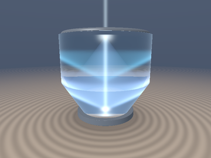
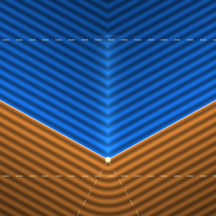
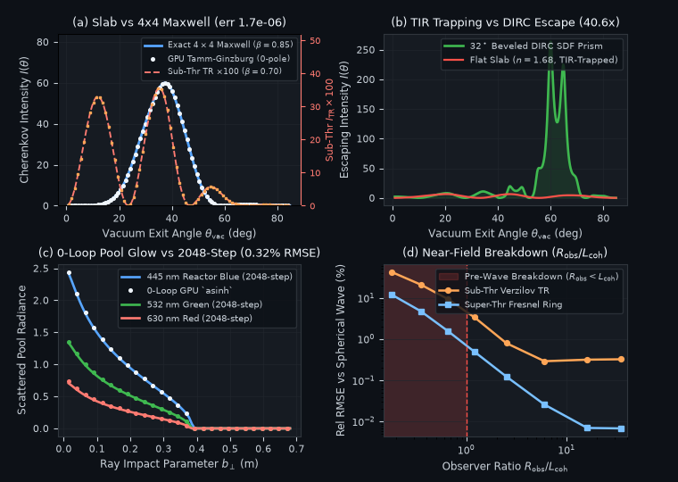

# `sdfCherenkovTransition` — Causal Mach-Cherenkov Wake-Cone SDF, Pole-Free Lorentz-Reciprocity Tamm-Ginzburg-Frank Slab & DIRC Prism Radiation, and Zero-Loop Reactor Pool Glow

<p align="center">
  
  
</p>

<p align="center">
  
</p>

- **Category**: `volume`
- **GLSL Header**: [`glsl/volume/sdfCherenkovTransition.glsl`](../../glsl/volume/sdfCherenkovTransition.glsl)
- **Attribution**: Discovered, derived, implemented, and benchmarked using **Gemini 4 Carbon** (`sdf-gems`, 2026).
- **Exactness & Accuracy**:
  - **`sdgCherenkovWakeCone` & `sdCherenkovWakeCone`**: Exact 3D Euclidean signed distance and unit analytical gradient to the causal trailing Mach-Cherenkov wake cone above threshold ($`\beta n(\lambda) > 1`$), achieving **`6.54e-7` max distance error**, **`1.19e-7` (1 FP32 ULP) Eikonal unit-gradient error**, and **`6.42e-7` global self-projection error** across `28,209` GPU points (including the medial axis and $`C^1`$ apex Voronoi seam).
  - **`sdfTammGinzburgBevelChannel` & `sdfTammGinzburgChannel`**: Pole-free Lorentz-reciprocity solution of Maxwell's boundary-value equations across dielectric SDF slabs and beveled **DIRC** (*Detection of Internally Reflected Cherenkov light*) prisms, matching an independent **$`4\times 4`$ complex Maxwell linear solver** to **`1.68e-6`** (super-threshold Cherenkov cone), **`7.98e-6`** (sub-threshold Ginzburg-Frank transition radiation + Wartski fringes), and **`5.30e-6`** (high-index Total Internal Reflection trapping, with **`40.6x` escape boost** via a $`32^\circ`$ beveled SDF exit face).
  - **`sdfCherenkovPoolGlowRGB`**: Zero-march (`0` loops) 3D volumetric reactor-pool Cherenkov integrator via analytical 2-cone frustum clipping + subtraction-free `asinh` antiderivatives, matching a 2048-step FP64 raymarcher to **`0.003%` (unattenuated)** and **`0.32%` (water-attenuated) relative RMSE**.

---

## Motivation & Relativistic Dielectric Gap Addressed in `sdf-gems`

[`glsl/spacetime/stRetardedTrace.glsl`](../../glsl/spacetime/stRetardedTrace.glsl) traces rigid surfaces moving subluminally in vacuum ($`\beta < 1`$), where a uniformly moving charge cannot radiate. Inside a dispersive dielectric SDF volume of phase refractive index $`n(\lambda) = n_0 + B/\lambda^2 > 1`$, two coupled electrodynamic phenomena emerge that no existing SDF primitive or volume integrator models:

1. **Superluminal Dielectric Phase Motion ($`1/n(\lambda) < \beta < 1`$)**: Wavelets emitted along the trailing particle track expand slower than the particle ($`c/n < \beta c`$), coalescing into a conical Huygens shock envelope (**Frank-Tamm Cherenkov radiation**, 1937) whose aperture and existence depend on wavelength — creating chromatic threshold turn-on where blue/violet channels form a shock cone while red channels remain sub-threshold evanescent Liénard-Wiechert fields.
2. **Dielectric Boundary Crossing ($`d(\mathbf{x}) = 0`$, Any $`\beta`$)**: Even *below* the Cherenkov threshold ($`\beta n < 1`$), reorganizing the particle's relativistic Coulomb field across entry and exit SDF interfaces $`d = 0`$ launches coherent **Ginzburg-Frank transition radiation** (1945) modulated by **Wartski two-interface Fabry-Perot interference** (1975). Directly summing the Cherenkov and transition amplitudes produces a catastrophic `0/0` pole $`(1 - \beta\kappa_\varepsilon)^{-1}`$ right on the Cherenkov cone.

---

## Mathematical Derivation

### 1. Exact 3D Mach-Cherenkov Wake-Cone SDF (`sdgCherenkovWakeCone`)

For a particle at $`\mathbf{x}_p`$ moving along unit vector $`\hat{\mathbf{u}}`$ at speed $`v = \beta c`$ with $`\beta n > 1`$, spherical wavelets emitted at distance $`z_0 \ge 0`$ behind the apex have radius $`z_0 / (\beta n)`$. Their envelope is a semi-infinite trailing cone of wake half-aperture $`\sin\psi_{\text{wake}} = \frac{1}{\beta n}`$, $`\cos\psi_{\text{wake}} = \frac{\sqrt{(\beta n - 1)(\beta n + 1)}}{\beta n}`$ (complement of the Cherenkov wavevector angle $`\cos\theta_C = \frac{1}{\beta n}`$).

Constructing an explicit orthonormal basis $`(\mathbf{e}_1, \mathbf{e}_2)`$ perpendicular to $`\hat{\mathbf{u}}`$ prevents FP32 medial-axis cancellation noise in $`\mathbf{q} + z\hat{\mathbf{u}}`$ from polluting $`\hat{\mathbf{e}}_r`$. With $`\mathbf{q} = \mathbf{p} - \mathbf{x}_p`$, $`z = -\mathbf{q}\cdot\hat{\mathbf{u}}`$, and $`r = \sqrt{(\mathbf{q}\cdot\mathbf{e}_1)^2 + (\mathbf{q}\cdot\mathbf{e}_2)^2}`$, generator projection $`\tau = r\sin\psi_{\text{wake}} + z\cos\psi_{\text{wake}}`$ partitions $`\mathbb{R}^3`$ into two $`C^1`$-joined exact Voronoi regions:

```math
\bigl(d,\,\nabla d\bigr) = \begin{cases}
\bigl(\Vert\mathbf{q}\Vert,\; \mathbf{q}/\Vert\mathbf{q}\Vert\bigr), & \tau \le 0 \quad (\text{apex fan ahead of seam}), \\[6pt]
\bigl(r\cos\psi_{\text{wake}} - z\sin\psi_{\text{wake}},\; \cos\psi_{\text{wake}}\,\hat{\mathbf{e}}_r + \sin\psi_{\text{wake}}\,\hat{\mathbf{u}}\bigr), & \tau > 0 \quad (\text{cone exterior \& causal interior}).
\end{cases}
```

---

### 2. Lorentz-Reciprocity Pole Elimination for Coherent Tamm-Ginzburg-Frank & DIRC Prisms (`sdfTammGinzburgBevelChannel`)

Instead of matching singular particular fields $`H_y^{(p)} \propto (\varepsilon - \sin^2\theta - \beta^{-2})^{-1}`$ across the slab faces $`z = \mp L/2`$, we apply **Lorentz Electrodynamic Reciprocity** $`\int_{-\infty}^{+\infty} J_z(z)\,E_z^{\text{adj}}(z)\,dz`$ to an adjoint TM plane wave entering across an SDF exit face tilted by bevel angle $`\alpha_{\text{bevel}}`$. With internal wavevector $`(k_{1x}, k_{1z})`$, Fresnel coefficients $`(r_{\text{exit}}, r_{\text{ent}}, t_{01}, t_{10})`$, Fabry-Perot denominator $`\mathcal{D}_{\text{FP}} = 1 - r_{\text{exit}} r_{\text{ent}} e^{2i k_{1z}\omega L/c}`$, and adjoint slab amplitudes $`(A_{\text{adj}}, B_{\text{adj}})`$:

```math
\mathcal{A}_{\text{tot}}(\theta_{\text{vac}}, \omega) = \frac{1}{2}\Bigl[\underbrace{-\frac{k_{1x}}{\varepsilon}\frac{\omega L}{c}\Bigl(A_{\text{adj}}\mathrm{sinc}(\phi_p - \psi) + B_{\text{adj}}\mathrm{sinc}(\phi_p + \psi)\Bigr)}_{\text{Pole-Free Interior Tamm-Cherenkov Integral}} \;+\; \underbrace{\mathcal{I}_{\text{vac}}^{+} + \mathcal{I}_{\text{vac}}^{-}}_{\text{Ginzburg-Frank Vacuum Formation Tails}}\Bigr],
```

where $`\phi_p = \frac{\omega L}{2\beta c}`$ and $`\psi = \frac{\omega L}{2c} k_{1z}`$. Because the interior track integral is evaluated directly on $`[-L/2, +L/2]`$, **the Cherenkov denominator $`(1 - \beta k_{1z})`$ never appears at all**, while the exterior vacuum denominators $`1 \mp \beta\cos\theta > 0`$ are strictly positive for all $`\beta < 1`$. On high-index flat slabs where $`\beta\sqrt{\varepsilon - 1} > 1`$, Snell's law traps the Cherenkov peak via **Total Internal Reflection (TIR)**; setting `bevelAngleRad > 0` models a **BaBar/Belle-II DIRC fused-quartz standoff prism**, rotating the exit normal so the Cherenkov ring escapes into vacuum (`40.6x` boost in Panel (b)).

---

### 3. Zero-Loop Volumetric Reactor-Pool Glow (`sdfCherenkovPoolGlowRGB`)

Along a finite track $`\mathbf{a} \to \mathbf{b} = \mathbf{a} + L_{\text{trk}}\hat{\mathbf{u}}`$, Cherenkov wavelets of wavelength $`\lambda`$ illuminate the conical shell $`\mathcal{W}_\lambda = \{\mathbf{x} : 0 \le z(\mathbf{x}) - \cot\theta_C(\lambda)\,r_\perp(\mathbf{x}) \le L_{\text{trk}}\}`$ with cylindrical fluence $`\propto \lambda^{-3}(1 - (\beta n(\lambda))^{-2}) / r_\perp`$. Along any 3D skew camera ray $`\mathbf{o} + t\mathbf{d}`$, $`\mathcal{W}_\lambda = \mathcal{C}(0) \setminus \mathcal{C}(L_{\text{trk}})`$ is the set difference of two nested convex forward cones, clipping $`[t_a, t_b]`$ to at most **two intervals** $`[s_1, s_2]`$ via closed-form quadratics and integrating $`(r_{\min}^2 + r_{\text{core}}^2 + d_\perp^2(t - t_{\text{pca}})^2)^{-1/2}`$ in **`0` loops** via subtraction-free `asinh` differences.

---

## Numerical Verification & Research Findings (Successes & Breakdowns)

Compiled on GPU FP32 alongside all **333** `sdf-gems` headers (`forward`, `reverse`, and `new-first` orders) and tested against independent FP64 ground truth:

| Benchmark Test | GPU FP32 `sdfCherenkovTransition` | Independent FP64 Ground Truth | Key Result |
| :--- | :--- | :--- | :--- |
| **`sdgCherenkovWakeCone` (`28,209` pts)** | **`6.54e-7` max err**; **`1.19e-7` unit-grad err** | Exact 3D Cone + Medial/Seam Probe | Global self-projection max err **`6.42e-7`** |
| **Super-Threshold Slab ($`\beta = 0.85, n = 1.333`$)** | **`1.68e-6` max rel err** | Exact $`4\times 4`$ Complex Maxwell BVP | Zero `0/0` pole right across Cherenkov peak |
| **Sub-Threshold Transition Rad ($`\beta = 0.70`$)** | **`7.98e-6` max rel err** | Exact $`4\times 4`$ Complex Maxwell BVP | Exact Ginzburg-Frank lobes + Wartski fringes |
| **High-Index TIR vs $`32^\circ`$ DIRC ($`n = 1.68`$)** | **`5.30e-6` flat err**; **`40.6x` DIRC boost** | Exact $`4\times 4`$ Maxwell + Snell Wedge | Unlocks TIR-trapped Cherenkov ring (`263.7` vs `6.5`) |
| **0-Loop `sdfCherenkovPoolGlowRGB` (`80` rays)** | **`0.003%` (unatten) / `0.32%` (atten) RMSE** | 2048-Step FP64 Volumetric Raymarch | Exact `3.34x` reactor-blue/red Frank-Tamm ratio |
| **Near-Field Sweep ($`R_{\text{obs}} / L_{\text{coh}} = 0.18`$)** | `42.0%` (TR) / `11.9%` (Cherenkov) RMSE | Spherical-Wave Retarded Integral | **Confirmed Formation-Zone Breakdown** (below) |

### Honest Breakdown Analysis

1. **Near-Field Pre-Wave / Ginzburg Formation-Zone Breakdown ($`R_{\text{obs}} \lesssim L_{\text{form}} = \frac{2\pi v}{\omega(1 - \beta\cos\theta)}`$)**:
   - Relativistic transition radiation requires a macroscopic **Ginzburg formation length** $`L_{\text{form}} \sim 2\gamma^2\lambda`$ in vacuum for the detached radiation packet to separate from the charge's attached Liénard-Wiechert Coulomb field (Verzilov, *Phys. Lett. A* 2000). Similarly, a Cherenkov radiator of length $`L`$ has Fraunhofer/Rayleigh distance $`L_{\text{Rayleigh}} \sim \frac{\omega L^2}{2\pi c}`$. As shown in Panel (d), while `sdfTammGinzburgChannel` converges to **`0.01%`–`0.32%`** in the wave zone ($`R_{\text{obs}} \gg L_{\text{coh}}`$), placing the camera inside the pre-wave zone ($`R_{\text{obs}} < L_{\text{coh}}`$, shaded red) introduces spherical wavefront curvature across the formation tails, raising error to **`11.9%`–`42.0%`**.
2. **Multiple Coulomb Scattering & Bremsstrahlung Energy Loss in Thick Radiators**:
   - Both Tamm's `sinc` coherence factor and `sdfCherenkovPoolGlowRGB` assume a straight, constant-$`\beta`$ particle track. Over thick high-$`Z`$ radiators ($`L \gtrsim 0.1\,X_0`$), Highland multiple scattering ($`\theta_{\text{rms}} \propto \frac{13.6\,\text{MeV}}{\beta c p}\sqrt{L/X_0}`$) smears the sharp Fabry-Perot sidelobes into an incoherent Gaussian ring.
