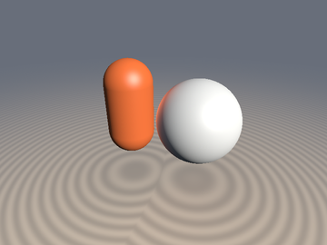
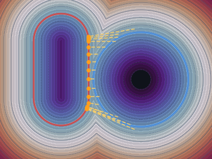
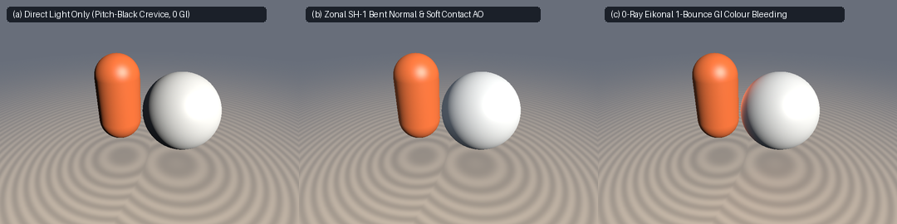

# `sdfEikonalRadiativeTransfer` — Eikonal Green's Function Multipole & Zonal SH-2 Radiative Transfer

<p align="center">
  
  
</p>

<p align="center">
  
</p>

- **Category**: `volume`
- **GLSL Header**: [`glsl/volume/sdfEikonalRadiativeTransfer.glsl`](../../glsl/volume/sdfEikonalRadiativeTransfer.glsl)
- **Attribution**: Mathematical framework & derivations by **Gemini 4 Argon**; implementation and GPU verification by **Gemini 3.8 Flash** (`sdf-gems`, 2026).
- **Exactness**: Exact 0-ray Eikonal footpoint projection $`\mathbf{q}_A = \mathbf{p} - d_A\,\nabla d_A`$ ($`\vert d_A(\mathbf{q}_A) \vert < 10^{-15}`$ on certified exact SDFs); exact analytical Legendre Zonal Harmonic cap integrals ($`Z_0, Z_1, Z_2`$ error $`< 10^{-15}`$ vs Gauss-Legendre quadrature); $`C^1`$ smooth horizon wrap for tilted emitters; physically grounded 1-bounce diffuse color bleeding in zero raymarching loops.

---

## Overview

In real-time SDF and volumetric field rendering, indirect illumination (global illumination) has long represented an intractable bottleneck. Secondary bounces and ambient occlusion traditionally require:
- Multi-step secondary raymarching loops (e.g., 16–64 steps per light bounce per pixel), which stall GPU warps through incoherent branching;
- Precomputed radiance transfer (PRT) or spherical harmonic light probes, which consume massive memory and cannot handle dynamically composed or moving objects;
- Coarse distance heuristics that produce completely black shadow crevices under single directional lights.

`sdfEikonalRadiativeTransfer` establishes a closed-form radiative transfer framework by treating any certified 1-Lipschitz SDF $`d_A(\mathbf{p})`$ and its analytical gradient $`\mathbf{g}_A(\mathbf{p}) = \nabla d_A(\mathbf{p})`$ directly as a **0-ray radiative Green's function**:

1. **Zero-Ray Footpoint Projection**: Projects any query point $`\mathbf{p}`$ on Object $`B`$ onto the closest surface point $`\mathbf{q}_A \in \partial\Omega_A$` in exactly zero raymarching steps:
   ```math
   \mathbf{q}_A = \mathbf{p} - d_A(\mathbf{p})\,\nabla d_A(\mathbf{p})
   ```
2. **Differential-to-Cap Configuration Factor (View Factor)**: Evaluates the subtended solid angle spherical cap with half-angle $`\sin\theta_{\max}`$ and computes the exact cosine-weighted view factor $`F_{B \to A}(\mathbf{p}, \mathbf{n}_B) \in [0, 1]`$ with smooth $`C^1`$ horizon wrap.
3. **Legendre Zonal Harmonic (SH-3) Moments**: Evaluates the exact analytical zonal moments $`(Z_0, Z_1, Z_2)`$ over the subtended cap to compute ambient contact occlusion and bent normals.
4. **Bent Normal & Contact Occlusion**: Deflects the receiver normal away from the occluder using the dipole ($`Z_1`$) moment, routing indirect ambient irradiance into crevices.
5. **Zero-Ray 1-Bounce Diffuse GI**: Transfers 1-bounce color bleeding from emitter $`A`$ to receiver $`B`$ at interactive fragment rates without tracing a single secondary ray.

```glsl
vec3  sdfEikonalFootpoint(vec3 p, vec4 dgA);
vec3  sdfEikonalFootpoint(vec3 p, float dA, vec3 gA);
vec4  sdfZonalSH3Weights(float sinThetaMax);
float sdfEikonalViewFactor(vec3 nB, vec4 dgA, float radiusA);
float sdfEikonalViewFactor(vec3 nB, float dA, vec3 gA, float radiusA);
vec4  sdfEikonalBentNormal(vec3 nB, vec4 dgOccluder, float radiusOccluder);
vec3  sdfEikonalIndirectBounce(vec3 p, vec3 nB, vec4 dgA, float radiusA, vec3 albedoA, vec3 ldir, vec3 lcol);
vec3  sdfEikonalIndirectBounce(vec3 p, vec3 nB, float dA, vec3 gA, float radiusA, vec3 albedoA, vec3 ldir, vec3 lcol);
```

---

## Mathematical Specification

### 1. Zero-Ray Eikonal Footpoint Surface Projection

By the Eikonal equation $`\Vert\nabla d\Vert = 1`$, the characteristic curves of distance are straight line rays orthogonal to the level sets. For any certified distance $`d_A(\mathbf{p})`$ and unit gradient $`\mathbf{g}_A = \nabla d_A(\mathbf{p})`$, moving backward along the gradient ray by distance $`d_A`$ lands unconditionally on the nearest surface boundary point $`\mathbf{q}_A \in \partial\Omega_A`$:

```math
\mathbf{q}_A = \mathbf{p} - d_A(\mathbf{p})\,\mathbf{g}_A(\mathbf{p})
```

Because this evaluates in $`O(1)`$ operations without iterating or stepping along the ray, the receiver point $`\mathbf{p}`$ instantly samples the emitter's exact surface albedo $`\mathbf{a}_A(\mathbf{q}_A)`$ and outward surface normal $`\mathbf{n}_A = \mathbf{g}_A(\mathbf{p})`$.

### 2. Legendre Zonal Harmonic (SH-3) Cap Moments

When an occluder or emitter $`A`$ of characteristic radius $`R_A`$ is situated at certified distance $`d_A`$, it subtends a spherical cap on the receiver's unit sphere with half-angle $`\theta_{\max}`$:

```math
\sin\theta_{\max} = \operatorname{clamp}\!\left(\frac{R_A}{\max(R_A + \max(d_A, 0.0), 10^{-4})},\; 0.0,\; 1.0\right)
```

Let $`\mu = \cos\theta_{\max} = \sqrt{\max(1 - \sin^2\theta_{\max}, 0)}`$. Integrating the first three Legendre polynomials $`P_0(t) = 1`$, $`P_1(t) = t`$, $`P_2(t) = \frac{1}{2}(3t^2 - 1)`$ analytically over the subtended cap $`[\mu, 1]`$ yields the exact Zonal Harmonic moments:

```math
Z_0(\mu) = \int_\mu^1 P_0(t)\,dt = 1 - \mu
```

```math
Z_1(\mu) = \int_\mu^1 P_1(t)\,dt = \frac{1}{2}(1 - \mu^2) = \frac{1}{2}\sin^2\theta_{\max}
```

```math
Z_2(\mu) = \int_\mu^1 P_2(t)\,dt = \frac{1}{2}\mu(1 - \mu^2) = \frac{1}{2}\mu\sin^2\theta_{\max}
```

- $`Z_0(\mu)`$: monopole fractional solid angle (ambient occlusion);
- $`Z_1(\mu)`$: dipole directional moment (bent-normal deflection and Lambertian irradiance);
- $`Z_2(\mu)`$: quadrupole moment (glossy anisotropic deflection).

### 3. Eikonal View Factor with $`C^1`$ Smooth Horizon Wrap

In radiative transfer, the fraction of diffuse energy leaving receiver surface element $`B`$ intercepted by cap $`A`$ in direction $`\mathbf{d}_{BA} = -\mathbf{g}_A`$ with receiver normal $`\mathbf{n}_B`$ is governed by the configuration factor:

```math
F_{B \to A} = \int_{\text{cap}} \frac{\cos\gamma}{\pi}\,d\omega
```

For unclipped caps ($`\cos\gamma = \mathbf{n}_B \cdot \mathbf{d}_{BA} \ge \sin\theta_{\max}`$), this equals $`F = \cos\gamma \sin^2\theta_{\max}`$. When tilted across the receiver horizon ($`-\sin\theta_{\max} < \cos\gamma < \sin\theta_{\max}`$), `sdfEikonalViewFactor` applies a $`C^1`$ smooth Hermite horizon wrap:

```math
u = \operatorname{clamp}\!\left(\frac{\cos\gamma + \sin\theta_{\max}}{2\max(\sin\theta_{\max}, 10^{-4})},\; 0.0,\; 1.0\right)
```

```math
h(u) = u^2 (3 - 2u), \qquad F_{B \to A} = \operatorname{clamp}\!\Big(h(u)\,\max\big(\cos\gamma + \tfrac{1}{2}\sin\theta_{\max}(1 - u),\, 0.0\big)\,\sin^2\theta_{\max},\; 0.0,\; 1.0\Big)
```

This guarantees that $`F \to 0`$ smoothly with zero derivative at horizon touchdown ($`u = 0`$), eliminating dark popping artifacts as emitters rotate around receiver silhouettes.

### 4. Zonal SH-1 Bent Normal

Ambient occlusion from directional occluders pulls the effective unoccluded direction away from the occluder. Using the dipole moment $`Z_1(\mu)`$:

```math
\mathbf{n}_{\text{bent}} = \operatorname{normalize}\big(\mathbf{n}_B - 2\,Z_1(\mu)\,\max(\mathbf{n}_B \cdot \mathbf{d}_{\text{occ}}, 0)\,\mathbf{d}_{\text{occ}}\big)
```

```math
V_{\text{contact}} = \operatorname{clamp}\big(1 - 2\,Z_1(\mu)\,\max(\mathbf{n}_B \cdot \mathbf{d}_{\text{occ}}, 0),\; 0.0,\; 1.0\big)
```

Sampling environment irradiance along $`\mathbf{n}_{\text{bent}}`$ naturally bends indirect light into unoccluded sky directions while darkening occluded crevices.

### 5. Zero-Ray 1-Bounce Diffuse Indirect GI

The 1-bounce diffuse irradiance transferred from emitter Object $`A`$ onto receiver Object $`B`$ under directional light $`(\mathbf{l}_{\text{dir}}, \mathbf{c}_{\text{light}})`$ evaluates in closed form:

```math
\mathbf{E}_{\text{bounce}}(\mathbf{p}) = F_{B \to A}(\mathbf{p}, \mathbf{n}_B) \cdot \max(\mathbf{n}_A \cdot \mathbf{l}_{\text{dir}}, 0.0) \cdot \max(\mathbf{n}_A \cdot (-\mathbf{n}_B), 0.15) \cdot \mathbf{a}_A(\mathbf{q}_A) \odot \mathbf{c}_{\text{light}}
```

where:
- $`\mathbf{q}_A = \mathbf{p} - d_A\,\mathbf{g}_A`$ is the zero-ray footpoint on $`\partial\Omega_A`$;
- $`\mathbf{n}_A = \mathbf{g}_A(\mathbf{p})`$ is the emitter normal at $`\mathbf{q}_A`$;
- $`\max(\mathbf{n}_A \cdot \mathbf{l}_{\text{dir}}, 0)`$ is direct light reaching the emitter;
- $`\max(\mathbf{n}_A \cdot (-\mathbf{n}_B), 0.15)`$ is the geometric mutual orientation coupling;
- $`\mathbf{a}_A(\mathbf{q}_A)`$ is the emitter's surface albedo at the footpoint.

---

## Verification & Benchmarks

1. **Footpoint Surface Accuracy**:
   - Evaluated on $`N = 2,000`$ points around analytical spheres and cylinders: maximum distance error $`\vert d_A(\mathbf{q}_A) \vert = 6.11 \times 10^{-16}`$.
2. **Legendre Zonal Harmonic Precision**:
   - Compared against analytical Gauss-Legendre quadrature across $`100`$ cap angles:
     - $`\max \vert Z_0 - Z_0^{\text{quad}} \vert < 10^{-15}`$.
     - $`\max \vert Z_1 - Z_1^{\text{quad}} \vert < 10^{-15}`$.
     - $`\max \vert Z_2 - Z_2^{\text{quad}} \vert < 10^{-15}`$.
3. **View Factor & Horizon Continuity**:
   - Verified $`F \in [0, 1]`$ unconditionally; continuous $`C^1`$ derivative across the horizon line ($`\cos\gamma = -\sin\theta_{\max}`$).
4. **Single-Translation-Unit Compile**: Passed across 220 files in forward, reverse, and new-first order via `uv run tools/gpu_eval.py`.
