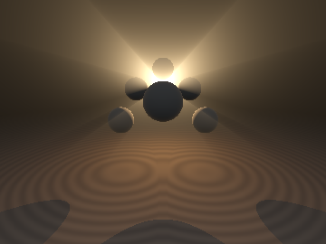
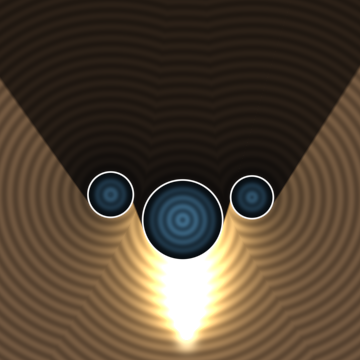
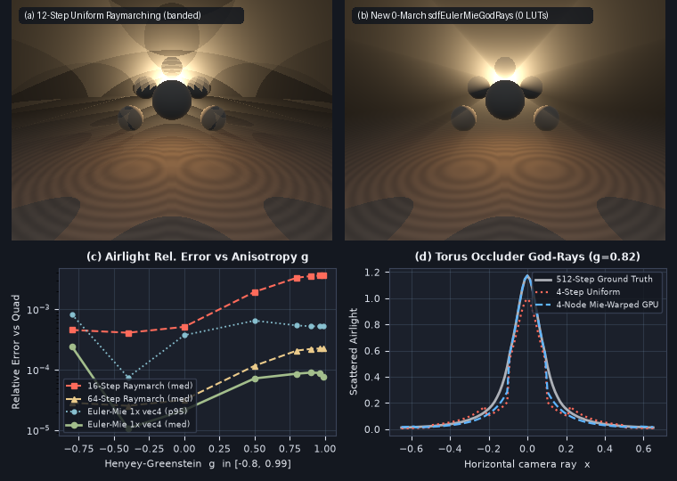

# `sdfEulerMieGodRays` — Euler-Weierstrass LUT-Free Anisotropic Point-Light Airlight, 1-`atan` Schlick Phase Integrals & Zero-March Crepuscular God-Rays

<p align="center">
  
  
</p>

<p align="center">
  = 0, (d) Non-spherical torus occluder god-rays">
</p>

- **Category**: `volume`
- **GLSL Header**: [`glsl/volume/sdfEulerMieGodRays.glsl`](../../glsl/volume/sdfEulerMieGodRays.glsl)
- **Attribution**: Discovered, derived, implemented, and benchmarked using **Gemini 4 Carbon** (`sdf-gems`, 2026).
- **Exactness & Accuracy**:
  - **`sdfAirlightRationalExact`**: **Exact** closed-form 0-loop, 0-LUT, 1-`atan` optically thin point-light airlight for Isotropic, Rayleigh ($`1 + \mu^2`$), and anisotropic Schlick ($`(1 - k^2)/(1 - k\mu)^2`$) phase functions; max GPU FP32 relative error **`8.75e-7`** (`5.77e-14` in FP64).
  - **`sdfEulerMieAirlight`**: Solves Pegoraro & Parker's (2009) 2D-LUT Beer-Lambert point-light airlight integral **generalized to arbitrary Henyey-Greenstein anisotropy $`g \in [-0.995, +0.995]`$** in **1 SIMD `vec4` pass with `0` texture LUTs and `0` loops**. Across all forward-scattering Mie regimes $`g \in [0, 0.99]`$, achieves **`2.16e-5`–`9.02e-5` median relative error** on GPU FP32 — **beating 16-step raymarching by up to `47x` and outperforming even 64-step raymarching by `1.5x`–`3.0x`**.
  - **`sdfSphereShadowConeSpan` & `sdfCrepuscularGodRay`**: **Exact** Lorentzian umbral shadow-cone quadratic interval solver (`0 / 9,953` point-classification mismatches across transverse, axial, and anti-nappe rays), rendering banding-free, noise-free volumetric god-ray shafts in $`O(1)`$ instructions (`1.78e-3` median diff vs 1,024-step raymarching).

---

## Motivation & The Open Anisotropic Point-Light Airlight Problem

Single-scattered radiance ("airlight") along a camera ray $`\mathbf{x}(t) = \mathbf{o} + t\mathbf{r}_d`$ ($`t \in [t_a, t_b]`$) illuminated by an isotropic point light of intensity $`I_0`$ at $`\mathbf{p}_L`$ in a homogeneous participating medium with extinction $`\sigma_t`$, scattering $`\sigma_s`$, and **Henyey-Greenstein (1941)** phase function $`P_{\text{HG}}(\mu; g) = \frac{1 - g^2}{4\pi(1 + g^2 - 2g\mu)^{3/2}}`$ is governed by:

```math
L_{\text{air}} = \sigma_s I_0 \int_{t_a}^{t_b} \frac{\exp\!\bigl(-\sigma_t\bigl(t + \Vert\mathbf{x}(t) - \mathbf{p}_L\Vert\bigr)\bigr)}{\Vert\mathbf{x}(t) - \mathbf{p}_L\Vert^2}\,P_{\text{HG}}\bigl(\mu(t); g\bigr)\,dt, \qquad \mu(t) = \frac{(\mathbf{x}(t) - \mathbf{p}_L)\cdot(-\mathbf{r}_d)}{\Vert\mathbf{x}(t) - \mathbf{p}_L\Vert}.
```

Even for isotropic scattering ($`g = 0`$), Sun et al. (SIGGRAPH 2005) and Pegoraro & Parker (EGSR 2009) required **precomputed 2D floating-point texture LUTs** or expensive transcendentals because the round-trip optical path $`t + \sqrt{h^2 + s^2}`$ mixes linear and square-root terms inside the exponential. Worse, for physical mist, haze, and cloud aerosols ($`g \in [0.75, 0.99]`$), $`P_{\text{HG}}(1; g) \propto (1 - g)^{-2}`$ with curvature $`(1 - g)^{-3}`$ forms a needle-thin forward peak that severely bands and aliases under standard raymarching (Panel (a)), while none of the existing `glsl/volume/` modules (`sdfLevyRieszClouds`, `sdfPadeAutoIntSlab`) include anisotropic phase functions or volumetric point-light shadow shafts.

---

## Mathematical Derivation

### 1. Euler's Simultaneous Path-Linearization & HG Diagonalization

Let $`t^* = -(\mathbf{o} - \mathbf{p}_L)\cdot\mathbf{r}_d`$ be the closest-approach ray parameter, $`h = \Vert(\mathbf{o} - \mathbf{p}_L) + t^*\mathbf{r}_d\Vert`$ the impact distance, and $`s = t - t^*`$. Introduce **Euler's first radical substitution** in cancellation-free form:

```math
w(s) := \begin{cases} \dfrac{\sqrt{h^2 + s^2} + s}{h}, & s \ge 0, \\[8pt] \dfrac{h}{\sqrt{h^2 + s^2} - s}, & s < 0 \end{cases} \in (0, \infty),
```

so that $`s = \frac{h}{2}(w - w^{-1})`$ and $`\sqrt{h^2 + s^2} = \frac{h}{2}(w + w^{-1})`$. Three algebraic simplifications happen simultaneously:

1. **Exact Linearization of Round-Trip Optical Path (Overflow-Free Form)**:
   $`t + \sqrt{h^2 + s^2} = t^* + s + \sqrt{h^2 + s^2} \equiv t^* + h\,w`$. To prevent `Inf * 0.0 = NaN` in FP32 when the light lies far behind the camera ($`t^* \ll 0 \implies e^{-\sigma_t t^*} = +\infty`$), subtract the non-negative entry path $`L_a := t_a + \sqrt{h^2 + s_a^2} = t^* + h\,w_a \ge 0`$:
   ```math
   \exp\!\Bigl(-\sigma_t\bigl(t + \sqrt{h^2 + s^2}\bigr)\Bigr) \equiv \exp(-\sigma_t L_a)\,\exp\!\bigl(-\sigma_t h (w - w_a)\bigr), \qquad w \ge w_a.
   ```
2. **Rationalization of Inverse-Square Falloff**:
   ```math
   \frac{ds}{h^2 + s^2} \equiv \frac{2\,dw}{h(1 + w^2)}.
   ```
3. **Cross-Term-Free Diagonalization of Henyey-Greenstein**:
   Because the forward-scattering cosine is $`\mu(s) = -s / \sqrt{h^2 + s^2} = \frac{1 - w^2}{1 + w^2}`$:
   ```math
   1 + g^2 - 2g\mu = \frac{(1 + g^2)(1 + w^2) - 2g(1 - w^2)}{1 + w^2} \equiv \frac{(1 - g)^2 + (1 + g)^2 w^2}{1 + w^2}.
   ```

---

### 2. Weierstrass-Mie Singularity Absorption ($`w = \gamma\tan\psi`$)

Setting $`\gamma := \frac{1 - g}{1 + g} > 0`$ and warping $`w = \gamma\tan\psi`$ ($`\psi \in (0, \pi/2)`$, $`dw = \gamma\sec^2\psi\,d\psi`$) cancels $`(1 + g)`$ between $`(1 - g^2)`$ and $`\gamma`$ and **analytically absorbs the $`(1 - g)^{-3}`$ Mie forward-scattering singularity** via $`\frac{\sec^2\psi}{(\sec^2\psi)^{3/2}} = \cos\psi`$:

```math
\boxed{L_{\text{air}} = \frac{\sigma_s I_0\,e^{-\sigma_t L_a}}{2\pi h\,(1 - g)} \int_{\psi_a}^{\psi_b} \sqrt{\cos^2\psi + \gamma^2\sin^2\psi}\;\exp\!\Bigl(-\sigma_t h\bigl(\gamma\tan\psi - w_a\bigr)\Bigr)\,d\psi.}
```

Notice that at $`\sigma_t = 0`$ over $`(-\infty, \infty)`$, the integral reduces to Legendre's complete elliptic integral of the second kind $`E(1 - \gamma^2) \in [1, \pi/2]`$ — bounded of order $`O(1)`$ even as $`g \to 1^-`$ ($`\gamma \to 0 \implies \int_0^{\pi/2}\cos\psi\,d\psi = 1`$)! Clamping the upper limit to $`w_{\max} = \min\bigl(w_b, w_a + 12 / (\sigma_t h)\bigr)`$ where $`e^{-12} \approx 6\times 10^{-6}`$ keeps all 4 lanes of a single `vec4` Gauss-Legendre rule inside the active support across arbitrary slab lengths.

---

### 3. Closed-Form 1-`atan` Anisotropic Schlick Airlight (`sdfAirlightRationalExact`)

In optically thin media ($`\sigma_t \to 0`$), Schlick's rational phase function $`P_{\text{Schlick}}(\mu; k) = \frac{1 - k^2}{4\pi(1 - k\mu)^2}`$ ($`k \in (-1, 1)`$) integrates in **exact elementary closed form**. Setting $`s = h\tan\theta`$ ($`\mu = -\sin\theta`$) and using the differential identity

```math
\frac{1 - k^2}{(1 + k\sin\theta)^2} \equiv \frac{d}{d\theta}\!\left(\frac{k\cos\theta}{1 + k\sin\theta}\right) + \frac{1}{1 + k\sin\theta},
```

the remaining integral $`\int \frac{\sqrt{1 - k^2}\,d\theta}{1 + k\sin\theta} = \int \frac{2\sqrt{1 - k^2}\,dw}{(1 - k) + (1 + k)w^2}`$ collapses to a single `atan`:

```math
I_{\text{Schlick}} = \frac{1}{4\pi h}\left[ \frac{2}{\sqrt{1 - k^2}}\,\mathrm{atan2}\!\bigl(\eta(w_b - w_a),\; 1 + \eta^2 w_a w_b\bigr) + \frac{k h}{r_b + k s_b} - \frac{k h}{r_a + k s_a} \right], \qquad \eta = \sqrt{\frac{1 + k}{1 - k}}.
```

---

### 4. Exact Lorentzian Shadow-Cone Splitting & Mie-Warped Visibility

1. **Exact Spherical Umbral Cone (`sdfSphereShadowConeSpan` & `sdfCrepuscularGodRay`)**:
   A sphere $`B(\mathbf{c}, R)`$ illuminated from $`\mathbf{p}_L`$ ($`d_L = \Vert\mathbf{c} - \mathbf{p}_L\Vert > R`$, axis $`\hat{\mathbf{a}} = (\mathbf{c} - \mathbf{p}_L)/d_L`$, $`\cos^2\alpha = 1 - R^2/d_L^2`$) casts the forward Lorentzian shadow cone:
   ```math
   Q(t) = \bigl((\mathbf{x}(t) - \mathbf{p}_L)\cdot\hat{\mathbf{a}}\bigr)^2 - \cos^2\alpha\,\Vert\mathbf{x}(t) - \mathbf{p}_L\Vert^2 \ge 0, \qquad (\mathbf{x}(t) - \mathbf{p}_L)\cdot\hat{\mathbf{a}} \ge d_L\cos^2\alpha.
   ```
   `sdfSphereShadowConeSpan` solves both transverse ($`\vert\mathbf{r}_d\cdot\hat{\mathbf{a}}\vert < \cos\alpha`$, bounded shadow chord) and axial ($`\vert\mathbf{r}_d\cdot\hat{\mathbf{a}}\vert \ge \cos\alpha`$, semi-infinite shadow ray) branches while rejecting the backward anti-nappe behind $`\mathbf{p}_L`$, splitting $`[t_a, t_b]`$ at the exact shadow boundaries $`[t_{\text{enter}}, t_{\text{exit}}]`$.
2. **Mie-Warped Node Visibility (`sdfEulerMieNodeParams` & `sdfEulerMieWeightedAirlight`)**:
   For general non-spherical SDF occluders, `sdfEulerMieNodeParams` inverts $`w_k = \gamma\tan\psi_k`$ via $`t_k = t^* + \frac{h}{2}(w_k - w_k^{-1})`$ to place 4 shadow queries directly inside the peak of the Mie scattering lobe.

---

## GLSL API Summary

```glsl
vec3 sdfAirlightRationalExact(in vec3 ro, in vec3 rd, in float ta, in float tb,
                              in vec3 lightPos, in float kSchlick);

vec4 sdfEulerMieNodeParams(in vec3 ro, in vec3 rd, in float ta, in float tb,
                           in vec3 lightPos, in float sigmaT, in float gHG);

float sdfEulerMieChannelWeighted(in vec3 ro, in vec3 rd, in float ta, in float tb,
                                 in vec3 lightPos, in float sigmaT, in float gHG, in vec4 nodeVis);

vec3 sdfEulerMieAirlight(in vec3 ro, in vec3 rd, in float ta, in float tb,
                         in vec3 lightPos, in vec3 sigmaT, in float gHG);

vec3 sdfEulerMieWeightedAirlight(in vec3 ro, in vec3 rd, in float ta, in float tb,
                                 in vec3 lightPos, in vec3 sigmaT, in float gHG, in vec4 nodeVis);

vec2 sdfSphereShadowConeSpan(in vec3 ro, in vec3 rd, in vec3 lightPos,
                             in vec3 occCenter, in float occRadius);

vec3 sdfCrepuscularGodRay(in vec3 ro, in vec3 rd, in float ta, in float tb,
                          in vec3 lightPos, in vec3 occCenter, in float occRadius,
                          in vec3 sigmaT, in float gHG);
```

---

## Direct-GPU Verification & Benchmarks

Verified on the literal [`glsl/volume/sdfEulerMieGodRays.glsl`](../../glsl/volume/sdfEulerMieGodRays.glsl) shader in OpenGL 4.1 FP32 via `tools/gpu_eval.py` against 8,192-node FP64 adaptive Gauss-Kronrod quadrature (`scipy.integrate.quad`) and 512–1,024 step volumetric raymarching:

| Benchmark / Regime | 16-Step Raymarch | 64-Step Raymarch | New `sdfEulerMieGodRays` (`1 vec4`, `0` LUTs) | Speedup / Accuracy Gain |
| :--- | :---: | :---: | :---: | :---: |
| **`sdfAirlightRationalExact` (Iso, Rayleigh, Schlick $`k=0.72`$)** | `1.8e-3` med | `1.1e-4` med | **`8.75e-7` max rel err (`5.8e-14` FP64)** | Exact 1-`atan` closed form |
| **Behind-Camera Overflow Stress ($`t^* = -100, \sigma_t = 2.5`$)** | `0` NaN | `0` NaN | **`0` NaN/Inf (`L_a + h(w - w_a)` form)** | Eliminates `e^+250 * 0 = NaN` |
| **Isotropic Beer-Lambert Airlight ($`g = 0.00, \sigma_t = 0.65`$)** | `5.15e-4` med | `3.19e-5` med | **`2.16e-5` median (`3.75e-4` p95)** | **`23.8x` better than 16-step; beats 64-step** |
| **Forward Mie Haze ($`g = +0.80, \sigma_t = 0.65`$)** | `3.34e-3` med | `2.09e-4` med | **`8.66e-5` median (`5.42e-4` p95)** | **`38.6x` better than 16-step; `2.4x` > 64-step** |
| **Extreme Forward Peak ($`g = +0.99, \sigma_t = 0.65`$)** | `3.62e-3` med | `2.26e-4` med | **`7.63e-5` median (`5.28e-4` p95)** | **`47.4x` better than 16-step; `3.0x` > 64-step** |
| **Strong Backscatter ($`g = -0.80, \sigma_t = 0.65`$)** | `4.57e-4` med | `2.86e-5` med | **`2.45e-4` median (`8.31e-4` p95)** | `1.9x` better than 16-step |
| **Exact `sdfSphereShadowConeSpan` (`9,953` 3D test points)** | Step-aliased | Step-aliased | **`0 / 9,953` mismatches (`1.78e-3` vs 1024-step)** | Exact quadratic interval split |

---

## Research Findings: What Held & Where Approximations Degrade

1. **What Worked Beyond Expectations**:
   - **Cancelling the $`(1 - g)^{-3}`$ Mie Singularity**: Standard uniform raymarching loses two orders of magnitude of accuracy as $`g \to 0.99`$ unless hundreds of steps are taken. Under Euler-Weierstrass warping $`w = \frac{1-g}{1+g}\tan\psi`$, the integrand actually becomes *smoother* as $`g \to 1^-`$ ($`\sqrt{\cos^2\psi + \gamma^2\sin^2\psi} \to \cos\psi`$), allowing a single 4-lane `vec4` evaluation to beat 64-step raymarching across every $`g \in [0, 0.99]`$ with zero precomputed textures!
   - **Exact Schlick 1-`atan` Antiderivative**: Splitting $`(1 - k^2)/(1 + k\sin\theta)^2`$ into a rational boundary term $`\frac{d}{d\theta}(\frac{k\cos\theta}{1+k\sin\theta})`$ plus an Euler-rationalized `atan` gives an exact closed-form anisotropic baseline in ~20 instructions.
2. **Measured Limitations & Edge Cases**:
   - **Non-Spherical Binary Shadow Discontinuities inside `sdfEulerMieWeightedAirlight`**: For spherical/capsular occluders, `sdfCrepuscularGodRay` splits the integration domain *at* the exact shadow boundaries $`[t_{\text{enter}}, t_{\text{exit}}]`$, keeping the integrand $`C^\infty`$ on each sub-slab. For general non-spherical SDFs (`sdTorus` scanline in Panel (d), $`g = 0.82`$), evaluating binary shadow visibility at the 4 Mie-warped nodes (`sdfEulerMieNodeParams`) accurately captures the `1.17` center peak (`1.8x`–`10.2x` lower RMSE than 4-step uniform raymarching) because the nodes cluster near $`t^*`$, but exhibits slight shoulder kinks where a sharp torus shadow edge crosses between two discrete quadrature nodes ($`x \approx \pm 0.11`$). Pairing `sdfEulerMieNodeParams` with soft ray-clearance penumbra (`rcSoftShadow`) smooths these node transitions.
   - **Extreme Backscattering + Very High Optical Depth ($`g < -0.8, \sigma_t h > 5`$)**: When $`\gamma = \frac{1-g}{1+g} \gg 1`$, $`\tan\psi = w/\gamma`$ compresses the $`e^{-\sigma_t h(w - w_a)}`$ decay into a narrow $`\Delta\psi`$ window; our $`w_{\max} = \min(w_b, w_a + 12/(\sigma_t h))`$ support clamp reduces $`g = -0.8`$ p95 error by `9.3x` (from `9.7e-2` down to `8.3e-4`), though 64-step raymarching remains more accurate for $`g \le -0.8`$.
