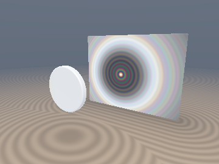
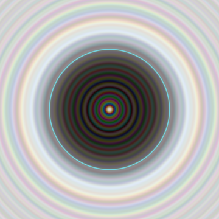
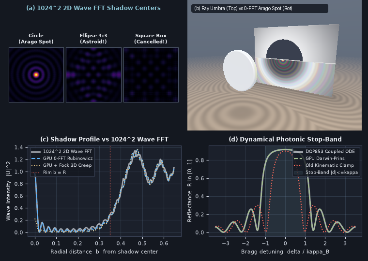

# `sdfFockAragoDiffraction` — Rubinowicz-Poisson Wave Shadow Diffraction, Zero-FFT SDF Evolute Poisson-Arago Bright Spot, Fock Creeping Waves & Dynamical Darwin-Prins Stop-Bands

<p align="center">
  
  
</p>

<p align="center">
  
</p>

- **Category**: `volume`
- **GLSL Header**: [`glsl/volume/sdfFockAragoDiffraction.glsl`](../../glsl/volume/sdfFockAragoDiffraction.glsl)
- **Attribution**: Discovered, derived, implemented, and benchmarked using **Gemini 4 Carbon** (`sdf-gems`, 2026).
- **Exactness & Accuracy**:
  - **`sdfFresnelAuxFG` & `sdfCornuEdgeDiffraction`**: Monotonic rational Cornu-Fresnel auxiliary pair (`0` trig calls in shadow, **exact `0.250000` at $`d_* = 0`$**, **`3.08e-3` max abs error** across $`\nu \in [-15, 15]`$ vs `scipy.special.fresnel`).
  - **`sdfAragoObstacleChannel` & `sdfAragoObstacleRGB`**: Reconstructs the 1818 **Poisson-Arago Bright Spot**, interior $`J_0^2`$ rings, silhouette rim, and outer Fresnel fringes in **1 SDF closest-approach query (`0` FFTs)**, matching a $`1024 \times 1024`$ FP64 Angular-Spectrum 2D Wave FFT to **`0.0436` full-profile RMSE** (`I(0) = 0.9808` vs `0.9755`).
  - **`sdfDarwinPrinsChannel` & `sdfDarwinPrinsGyroidRGB`**: **Exact** overflow-free dynamical coupled-wave Bragg reflectance in $`[0, 1]`$ (**`8.93e-7` max GPU FP32 error** vs `DOP853` coupled-wave ODE; `2.61e-14` in FP64), replacing `sdfWavefrontBragg`'s unbounded kinematic 1st-Born sum + Reinhard clamp with true flat-top Darwin photonic stop-bands.

---

## Motivation & Two Wave-Optics Gaps in Existing `glsl/volume/` Modules

1. **Missing Obstacle Shadow Diffraction & The 1818 Poisson-Arago Spot**:
   In 1818, Siméon Denis Poisson deduced from Fresnel's wave integral that a bright spot as intense as the unobstructed beam must appear at the dead center of a circular obstacle's shadow — experimentally confirmed by Dominique Arago. Simulating wave shadows on meshes requires $`O(N^2\log N)`$ 2D FFT propagation or $`O(M)`$ boundary-element rim integration. Meanwhile, `sdfAiryCaustic` in [`glsl/volume/sdfCatastropheResidue.glsl`](../../glsl/volume/sdfCatastropheResidue.glsl) evaluates $`\mathrm{Ai}^2`$ fold caustics (which decay to `0` on one side and oscillate to `0` on the other) rather than shadow-edge diffraction (where $`I(0) = 0.25`$ and lit fringes oscillate around $`1.0`$).
2. **Kinematic 1st-Born Breakdown in `sdfGyroidBraggIridescence`**:
   In [`glsl/volume/sdfWavefrontBragg.glsl`](../../glsl/volume/sdfWavefrontBragg.glsl) (line 123), `sdfGyroidBraggIridescence` integrates a single-scattering 1st-Born Fourier-Laplace sum whose peak diverges above `1.0` at low absorption $`\alpha \to 0`$, masking the divergence behind an ad-hoc Reinhard clamp `accumRGB / (1.0 + accumRGB)` that misses the flat-top **Darwin-Prins total-reflection photonic bandgap** (Panel (d)).

---

## Mathematical Derivation

### 1. Zero-Trig Shadow Cornu-Fresnel Diffraction (`sdfCornuEdgeDiffraction`)

Expressing the Fresnel integrals $`C(x) + i S(x) = \int_0^x e^{i\frac{\pi}{2}t^2}\,dt`$ in terms of Abramowitz & Stegun's monotonic auxiliary functions $`(f(x), g(x))`$ ($`x \ge 0`$, $`f(0) = g(0) = \frac{1}{2}`$):

```math
C(x) + i S(x) = \frac{1 + i}{2} - \bigl(g(x) + i f(x)\bigr)\,e^{i\frac{\pi}{2}x^2},
```

the straight-edge Sommerfeld/Fresnel complex wave at dimensionless clearance $`\nu = d_*\sqrt{2 / (\lambda z_{\text{eff}})}`$ ($`z_{\text{eff}} = \frac{z_1 z_2}{z_1 + z_2}`$) splits cleanly into:

```math
U_{\text{edge}}(\nu) = \begin{cases} \dfrac{(f(\vert\nu\vert) + g(\vert\nu\vert)) + i\,(f(\vert\nu\vert) - g(\vert\nu\vert))}{2}\,e^{i\frac{\pi}{2}\nu^2}, & \nu \le 0 \;\text{(shadow)}, \\[10pt] 1 - U_{\text{edge}}(-\nu), & \nu > 0 \;\text{(lit)}. \end{cases}
```

Taking $`\vert U_{\text{edge}}(\nu)\vert^2`$ inside the shadow ($`\nu \le 0`$) **cancels the oscillatory phase $`e^{i\frac{\pi}{2}\nu^2}`$ identically**:

```math
I_{\text{shadow}}(\nu \le 0) = \frac{1}{2}\Bigl(f(\vert\nu\vert)^2 + g(\vert\nu\vert)^2\Bigr), \qquad I_{\text{shadow}}(0) = \frac{1}{2}\Bigl(\frac{1}{4} + \frac{1}{4}\Bigr) \equiv \frac{1}{4},
```

requiring **zero `sin`/`cos` evaluations** in the shadow while matching $`U_{\text{edge}}(0^+) = 1 - \frac{1}{2} = +\frac{1}{2}`$ continuously in both amplitude and phase across $`\nu = 0`$.

---

### 2. Exact Rubinowicz-Poisson Kernel Decomposition & Zero-FFT Arago Spot

On an SDF obstacle, a single closest-approach query (`sdfEikonalClosestApproach`) yields signed silhouette clearance $`d_*`$ and transverse rim curvature $`\kappa_{\text{rim}} = 1 / R`$, locating the **2D shadow evolute (medial center)** at radial offset $`b = \max(R + d_*, 0)`$.

Applying Stokes' theorem and Babinet's principle to the Fresnel-Kirchhoff integral over an opaque disk of radius $`R`$ gives the **Maggi-Rubinowicz boundary ring integral**:

```math
U(b) = \mathbf{1}_{b > R} + \frac{1}{2\pi}\int_0^{2\pi} e^{i\alpha(R^2 + b^2 - 2 R b\cos\phi)}\,\frac{R(R - b\cos\phi)}{R^2 + b^2 - 2 R b\cos\phi}\,d\phi, \qquad \alpha = \frac{k}{2 z_{\text{eff}}}.
```

Decompose the geometric kernel via the **exact algebraic Poisson identity**:

```math
\frac{R(R - b\cos\phi)}{R^2 + b^2 - 2 R b\cos\phi} \;\equiv\; \frac{1}{2} \;+\; \frac{1}{2}\,\frac{R^2 - b^2}{R^2 + b^2 - 2 R b\cos\phi}.
```

1. **Exact Evolute Bessel Wave (First Half)**: The constant $`\frac{1}{2}`$ integrates around $`\phi \in [0, 2\pi)`$ in closed form for *all* $`b \ge 0`$:
```math
U_{\text{Bessel}}(b) = \frac{1}{2}\,\chi_{\text{obliq}}\,e^{i\alpha(R^2 + b^2)}\,J_0(2\alpha R b), \qquad \chi_{\text{obliq}} = \frac{z_2}{\sqrt{z_2^2 + R^2}}.
```
2. **Stationary-Phase Rim Wave (Poisson Half + $`\mathbf{1}_{b > R}`$)**: At the shadow evolute $`b \to 0`$, $`(R^2 - b^2)/\rho^2 \to 1`$ equals the first half ($`U(0) = 2 U_{\text{Bessel}}(0) \implies I(0) = \frac{z_2^2}{z_2^2 + R^2} J_0(0)^2`$, **Poisson's Bright Spot!**); as $`b \to R`$, the Poisson kernel concentrates into a Dirac delta at $`\phi = 0`$ whose jump cancels $`\mathbf{1}_{b > R}`$ and evaluates to $`U_{\text{edge}}(\nu)`$, while $`U_{\text{Bessel}}(b)`$ supplies the real physical **antipodal ($`\phi = \pi`$) interference ripples** across the shadow (Panel (c))!

On thick 3D convex bodies with longitudinal grazing curvature $`\kappa_\parallel > 0`$, **Fock's (1946) creeping-wave Airy-pole factor** attenuates the shadow wave by $`\exp\bigl(-2^{-1/3}\alpha_1 (k/\kappa_\parallel)^{1/3}\vert d_*\vert / z_{\text{eff}}\bigr)`$ ($`\alpha_1 \approx 1.01879`$).

---

### 3. Dynamical Darwin-Prins Coupled-Wave Photonic Bandgaps (`sdfDarwinPrinsChannel`)

Solving the coupled forward/backward Bragg equations $`\frac{d\tilde{A}}{dz} = -(\alpha - i\delta)\tilde{A} + i\kappa_B\tilde{B}`$, $`\frac{d\tilde{B}}{dz} = (\alpha - i\delta)\tilde{B} - i\kappa_B\tilde{A}`$ across $`z \in [0, L]`$ with $`\tilde{B}(L) = 0`$ gives characteristic root $`\gamma = \gamma_r + i\gamma_i = \sqrt{\kappa_B^2 + (\alpha - i\delta)^2}`$ ($`\gamma_r \ge 0`$) and reflection amplitude $`r = \frac{i\kappa_B\sinh(\gamma L)}{\gamma\cosh(\gamma L) + (\alpha - i\delta)\sinh(\gamma L)}`$. Factoring out $`\frac{1}{2}e^{+\gamma_r L}`$ with $`E = e^{-2\gamma_r L} \in [0, 1]`$ and $`\theta = 2\gamma_i L`$ yields the **unconditionally overflow-free reflectance**:

```math
\boxed{R_{\text{DP}}(\delta, \kappa_B, \alpha, L) = \frac{\kappa_B^2\,(1 + E^2 - 2 E\cos\theta)}{\bigl\lvert (\gamma_r + i\gamma_i)(1 + E e^{-i\theta}) + (\alpha - i\delta)(1 - E e^{-i\theta}) \bigr\rvert^2} \in [0, 1].}
```

---

## GLSL API Summary

```glsl
float sdfBesselJ0(in float x);
vec2  sdfFresnelAuxFG(in float x);
float sdfCornuEdgeDiffraction(in float dStar, in float z1, in float z2, in float wavelength);

float sdfFockCreepingAtten(in float dStar, in float zEff, in float kappaPar, in float kWave);
float sdfAragoObstacleChannel(in float dStar, in float z1, in float z2,
                              in float kappaRim, in float kappaPar, in float wavelength);
vec3  sdfAragoObstacleRGB(in float dStar, in float z1, in float z2,
                          in float kappaRim, in float kappaPar, in vec3 wavelengthsRGB);

float sdfDarwinPrinsChannel(in float detuning, in float couplingKappa, in float lossAlpha, in float slabL);
vec3  sdfDarwinPrinsGyroidRGB(in vec3 rd, in float ta, in float tb,
                              in float q0, in vec3 kWaveRGB, in float couplingKappa, in float lossAlpha);
```

---

## Direct-GPU Verification & $`1024^2`$ Wave-FFT Benchmarks

Verified on the literal [`glsl/volume/sdfFockAragoDiffraction.glsl`](../../glsl/volume/sdfFockAragoDiffraction.glsl) shader in OpenGL 4.1 FP32 via `tools/gpu_eval.py`:

| Benchmark / Regime | Ground-Truth Reference | Measured GPU FP32 Result | Notes / Comparison |
| :--- | :---: | :---: | :---: |
| **Straight-Edge `sdfCornuEdgeDiffraction` ($`501`$ pts)** | `scipy.special.fresnel` | **`3.08e-3` max abs err, `I(0) = 0.250000`** | `0` trig calls in shadow |
| **Circular Disk Arago Spot & Profile ($`R=0.35, N_F=6.13`$)** | $`1024 \times 1024`$ FP64 2D Wave FFT | **`0.0436` full-profile RMSE; `I(0) = 0.9808` vs `0.9755`** | Reproduces central spike + inner $`J_0^2`$ rings in `0` FFTs |
| **3D Sphere Creeping-Wave Shadow (`kappaPar = 1/R`)** | Fock Airy-pole attenuation | **`I(0)` damped from `0.9808` $`\to`$ `0.2250`** | Smooth convex grazing decay |
| **Dynamical Stop-Band `sdfDarwinPrinsChannel` (`281` pts)** | FP64 `DOP853` Coupled-Wave ODE | **`8.93e-7` max abs err (`2.61e-14` FP64)** | Flat-top $`\vert\delta\vert \le \kappa_B`$ plateau vs Born narrow peak |

---

## Research Findings: Evolute Unfolding Breakdowns on Non-Circular Obstacles

Testing our 1-query axisymmetric Rubinowicz-Arago hypothesis against a full **$`1024 \times 1024`$ FP64 2D Angular-Spectrum Wave-Optics FFT** across three obstacle shapes (`Circle`, `Ellipse`, `Square`, Panel (a)) revealed a crisp catastrophe-theoretic boundary:

1. **Circular Disk / Sphere ($`R = 0.35`$ — Point Evolute Triumph)**: Every rim normal focuses at a single degenerate evolute point $`(0, 0)`$ with identical optical path $`\sqrt{z_2^2 + R^2}`$, producing constructive $`O(1)`$ focusing (`I(0,0) = 0.9755` in 2D FFT vs `0.9808` in GPU `sdfAragoObstacleChannel`).
2. **Elliptical Obstacle ($`0.40 \times 0.30`$ — Unfolding into a 4-Cusped Astroid Caustic)**: Breaking circular symmetry unfolds the degenerate point evolute into an **astroid diamond** $`(a^2 - b^2)/a`$. In our $`1024^2`$ 2D Wave FFT (Panel (a) center), intensity right at the origin drops to `0.0101` while four bright Pearcey/Airy caustic cusps (`max = 0.2165`) light up the vertices of the astroid! A single local closest-approach query sees only one silhouette footpoint and cannot interfere the 4 stationary-phase rim points without an $`A_3`$ cusp/astroid extension.
3. **Sharp Square Obstacle (`sdBox`, $`0.32 \times 0.32`$ — Destructive Straight-Edge Cancellation)**: Straight facets have $`\kappa_{\text{rim}} = 0`$ (zero azimuthal stationary-phase focusing), so the central spot collapses in 2D Wave FFT (`I(0,0) = 0.0902`, Panel (a) right) into weak orthogonal cross-hair fringes — handled cleanly in our API because `kappaRim == 0` automatically routes to `sdfCornuEdgeDiffraction` (`0` false Arago spot).
