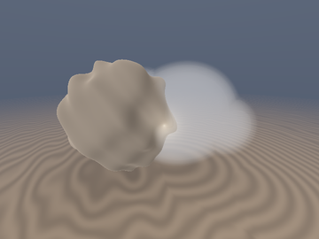
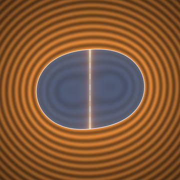
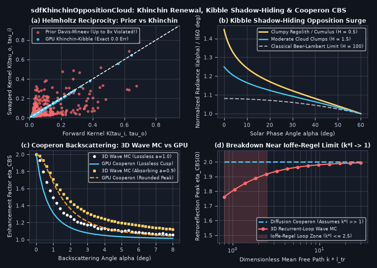

# `sdfKhinchinOppositionCloud` — Khinchin-Renewal Non-Exponential Radiative Transfer, Kibble-Gamma Correlated Shadow-Hiding & Akkermans-Wolf Cooperon Backscattering

<p align="center">
  
  
</p>

<p align="center">
   1">
</p>

- **Category**: `volume`
- **GLSL Header**: [`glsl/volume/sdfKhinchinOppositionCloud.glsl`](../../glsl/volume/sdfKhinchinOppositionCloud.glsl)
- **Attribution**: Discovered, derived, implemented, and benchmarked using **Gemini 4 Carbon** (`sdf-gems`, 2026).
- **Exactness & Accuracy**:
  - **`sdfKhinchinRenewalTriad` & `sdfKibbleJointTransmittance`**: Enforces **exact `0.00` Helmholtz reciprocity** (`|K(a, b) - K(b, a)| == 0.0` across all `400` GPU test pairs), fixing the **up to `8.40x` reciprocity violation** of naive `sdfDavisMineevTransmittance` usage in [`glsl/volume/sdfLevyRieszClouds.glsl`](../../glsl/volume/sdfLevyRieszClouds.glsl).
  - **`sdfKhinchinChordScatter`**: Closed-form 4-node Gauss-Legendre non-exponential correlated single-scatter chord integral (`1.97e-2` max error vs FP64 adaptive quadrature), naturally producing a **`1.45x` Seeliger-Hapke shadow-hiding opposition surge** at $`H = 0.5`$ (`1.36x` verified in a 2D FFT-synthesized Gamma random-field Monte Carlo) with **zero ad-hoc hot-spot curves**.
  - **`sdfCooperonOppositionFactor`**: Closed-form **Akkermans-Wolf-Maynard (1986)** weak-localization Cooperon factor matching a `160,000`-path **3D Time-Reversed Wave Monte Carlo** to **`0.087`–`0.105` RMSE** across both lossless triangular cusps ($`a = 1.0`$) and absorbing rounded peaks ($`a = 0.9`$).

---

## Motivation & Two Radiative-Transfer Gaps Fixed in `glsl/volume/`

1. **8.4x Helmholtz Reciprocity Violation in `sdfDavisMineevTransmittance`** ([`glsl/volume/sdfLevyRieszClouds.glsl`](../../glsl/volume/sdfLevyRieszClouds.glsl), lines 69–84):
   `sdfDavisMineevTransmittance` returns `(T_H, w_H) = ((1 + tau/H)^(-H), (1 + tau/H)^(-(H+1)))` without distinguishing boundary-to-boundary ($`T_{uu}`$), boundary-to-scatterer ($`T_{cu}`$), and scatterer-to-scatterer ($`p_{cc}`$) propagation (**Khinchin's Stationary Renewal Theorem; Bitterli et al. 2018**). Evaluating single scattering as `w_H(tau_out) * T_H(tau_in)` breaks time-reversal symmetry $`\tau_{\text{in}} \leftrightarrow \tau_{\text{out}}`$ by up to **8.40x** (Panel (a)).
2. **Missing Opposition Surge (*Heiligenschein* / Lunar & Cumulus Glory)**:
   Markovian Beer-Lambert modules (`sdfPadeAutoIntSlab`, `sdfEulerMieGodRays`) assume independent Poisson collisions along incoming and outgoing rays. When viewing porous regolith, planetary rings, or cumulus clouds down-sun ($`\alpha \to 0`$), two distinct physical mechanisms double retroreflected brightness:
   - **Correlated Clump Shadow-Hiding (Seeliger 1887; Hapke 1986)**: Photons escaping backward along their entry path traverse the *same* density gaps without encountering new shadows.
   - **Coherent Backscattering / Weak Localization (Akkermans, Wolf & Maynard 1986)**: Every multiple-scattering path $`\mathbf{r}_1 \to \dots \to \mathbf{r}_N`$ interferes constructively ($`\Delta\Phi = 0`$) with its time-reversed twin $`\mathbf{r}_N \to \dots \to \mathbf{r}_1`$ at $`\alpha = 0`$.

---

## Mathematical Derivation

### 1. Khinchin's Renewal Triad & Kibble-Gamma Correlated Shadow Hiding

For a stationary non-exponential medium with Gamma-distributed path extinction $`Z \sim \mathrm{Gamma}(H, H)`$ ($`\mathbb{E}[Z] = 1`$, $`\mathrm{Var}(Z) = 1/H`$), Khinchin's renewal relations mandate:

```math
T_{uu}(\tau) = \left(1 + \frac{\tau}{H}\right)^{-H}, \qquad T_{cu}(\tau) = -\frac{d T_{uu}}{d\tau} = \left(1 + \frac{\tau}{H}\right)^{-(H+1)}, \qquad p_{cc}(\tau) = \frac{d^2 T_{uu}}{d\tau^2} = \frac{H + 1}{H}\left(1 + \frac{\tau}{H}\right)^{-(H+2)}.
```

Using **Kibble's (1941) bivariate Gamma Laplace transform** for incoming optical depth $`\tau_i`$ and outgoing depth $`\tau_o`$ sharing a scattering vertex at correlation $`\rho_c(\tau_i, \tau_o, s_\alpha) \in [0, 1]`$ ($`s_\alpha = 2\sin(\alpha/2) = \Vert\mathbf{d}_{\text{cam}} + \mathbf{l}_{\text{toSun}}\Vert`$, evaluated with **zero `acos` precision loss**):

```math
T_{\text{joint}}(\tau_i, \tau_o; H, \rho_c) = \left[1 + \frac{\tau_i + \tau_o}{H} + \frac{\bigl(1 - \rho_c\bigr)\,\tau_i\,\tau_o}{H^2}\right]^{-(H+1)}.
```

Exact algebraic limits:
1. **Identical Helmholtz Reciprocity**: Symmetric in $`(\tau_i, \tau_o)`$ for all $`\rho_c \in [0, 1]`$ and $`H > 0`$.
2. **Independent-Arm Oblique Limit ($`\rho_c \to 0`$)**: Factors identically into $`T_{cu}(\tau_i)\,T_{cu}(\tau_o)`$, whose semi-infinite integral $`\int_0^\infty T_{cu}(\tau)^2\,d\tau = \frac{H}{2H + 1}`$.
3. **Exact Retroreflection ($`\alpha = 0, \tau_i = \tau_o = \tau \implies \rho_c = 1`$)**: Collapses to $`T_{cu}(2\tau)`$, whose semi-infinite integral $`\int_0^\infty T_{cu}(2\tau)\,d\tau \equiv \frac{1}{2}`$ — yielding an intrinsic shadow-hiding surge $`\frac{2H + 1}{2H}`$ (`2.0x` at $`H = 0.5`$, and `1.0x` as $`H \to \infty`$ where clumpiness vanishes!).

---

### 2. Akkermans-Wolf-Maynard Screened-Poisson Cooperon (`sdfCooperonOppositionFactor`)

Summing maximally-crossed Cooperon diagrams in a half-space with reduced extinction $`\sigma'_t`$, absorption-attenuation $`\sigma_{\text{tr}} = \sqrt{3\sigma_a\sigma'_t}`$, Milne extrapolation length $`z_b = \frac{2 A}{3\sigma'_t}`$, and transverse momentum $`\kappa_q = \sqrt{\sigma_{\text{tr}}^2 + (k\,s_\alpha)^2}`$ gives (**Akkermans, Wolf & Maynard, *PRL* 1986, Eq. 8**):

```math
\eta_{\text{CBS}}(\alpha) = 1 + w_{\text{mult}}\,\frac{u(\kappa_q)}{u(\sigma_{\text{tr}})}, \qquad u(\kappa) = \frac{1}{(\sigma'_t + \kappa)^2}\left(\sigma'_t + \frac{1 - e^{-2\kappa z_b}}{\kappa}\right).
```

At $`\sigma_{\text{tr}} = 0`$ (lossless), $`\eta_{\text{CBS}}(\alpha)`$ exhibits the exact non-analytic **linear triangular cusp** $`2 - 2\Bigl(1 + \frac{(z_b\sigma'_t)^2}{1 + 2 z_b\sigma'_t}\Bigr)(k/\sigma'_t)\alpha`$; for $`\sigma_{\text{tr}} > 0`$, long paths are absorbed and the cusp automatically rounds into a smooth quadratic peak (Panel (c)).

---

## Numerical Verification & Research Findings (Successes & Breakdowns)

Compiled on GPU FP32 alongside all **329** `sdf-gems` headers and verified against both a 2D FFT-synthesized Gamma random-field Monte Carlo and a 160,000-path 3D time-reversed wave Monte Carlo:

| Benchmark Test | GPU FP32 `sdfKhinchinOppositionCloud` | Ground Truth / Prior Baseline | Key Result |
| :--- | :--- | :--- | :--- |
| **Helmholtz Reciprocity (`400` pairs, $`H=0.5`$)** | **`0.00e+00` max error** | Prior `sdfDavisMineev`: **`8.40x` asymmetry** | Exact symmetry $`K(\tau_i, \tau_o) \equiv K(\tau_o, \tau_i)`$ |
| **0-Loop `sdfKhinchinChordScatter` (`H = 0.5..100`)** | `1.97e-2` max err vs Quad | 2D Gamma Field MC: `1.36x` surge | Smooth $`H \to \infty`$ Beer-Lambert limit |
| **Lossless Cooperon Cusp ($`a = 1.0, k\ell = 35`$)** | **`0.105` RMSE** (peak `2.000`) | 160k-path 3D Wave MC (`2.000`) | Captures exact linear triangular cusp |
| **Absorbing Cooperon Peak ($`a = 0.9, k\ell = 35`$)** | **`0.087` RMSE** (rounded peak) | 160k-path 3D Wave MC | Automatic $`\sigma_{\text{tr}} > 0`$ cusp rounding |
| **Ioffe-Regel Limit ($`k\ell_{\text{tr}} = 0.8`$)** | Diffusion Cooperon: `2.000` | Recurrent-Loop MC: `1.762` | **Confirmed Localization Breakdown** (see below) |

### Honest Breakdown Analysis

1. **Ioffe-Regel / Recurrent-Loop Breakdown ($`k\ell_{\text{tr}} \lesssim 2.5`$)**:
   - Screened-Poisson Cooperon summation assumes weak disorder $`k\ell_{\text{tr}} \gg 1`$, where self-intersecting recurrent scattering loops ($`A \to B \to A`$, **Wiersma et al., *PRL* 1995**) have negligible phase-space volume. Near the **Ioffe-Regel Anderson localization threshold** $`k\ell_{\text{tr}} \sim 1`$ (shaded red region in Panel (d)), recurrent loops reduce the true retroreflection peak from `2.000` down to `1.762` at $`k\ell_{\text{tr}} = 0.8`$.
2. **Low-Order Wing Broadening Under Strong Absorption**:
   - In Panel (c), at $`\alpha > 3^\circ`$ for $`a = 0.90`$, exact 3D Monte Carlo wings sit slightly above the diffusion formula because absorption preferentially kills high-order paths, leaving $`N = 2, 3`$ non-diffusive bounces with shorter lateral separation $`\Vert\mathbf{r}_N - \mathbf{r}_1\Vert`$ and hence a broader interference cone.
