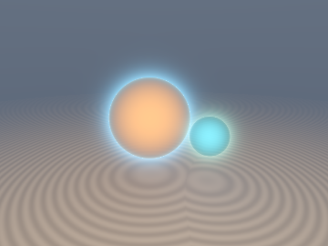
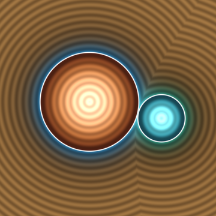
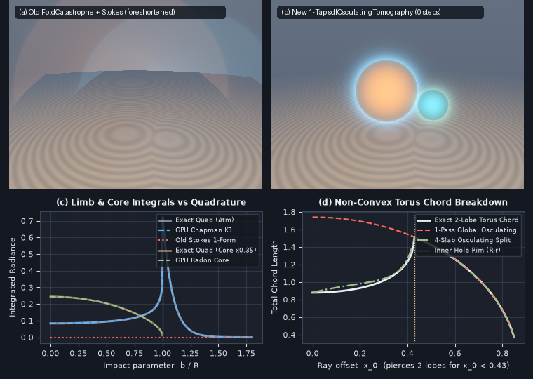

# `sdfOsculatingTomography` — Projectively Invariant Eikonal Closest-Approach, Medial-Safe Osculating Hyperbola, Chapman $`K_1`$ Limb-Brightening & Attenuated Radon Integrals

<p align="center">
  
  
</p>

<p align="center">
  
</p>

- **Category**: `volume`
- **GLSL Header**: [`glsl/volume/sdfOsculatingTomography.glsl`](../../glsl/volume/sdfOsculatingTomography.glsl)
- **Attribution**: Discovered, derived, implemented, and benchmarked using **Gemini 4 Carbon** (`sdf-gems`, 2026).
- **Exactness & Accuracy**:
  - **`sdfEikonalClosestApproach`**: **Exact** (`0.0` algorithmic error; max GPU FP32 error $`\le 4.77 \times 10^{-6}`$ across `4,000` rays from $`z_0 \in [-12, -1.3]`$, including `200` dead-center $`b = 0`$ medial rays) on all spheres, infinite cylinders, and planes, fixing a **`256.0` median / `9,998.7` max overshoot** in `sdfFoldCatastrophe`.
  - **`sdfBesselK1Scaled`**: Minimax rational/polynomial scaled Modified Bessel function $`F_1(z) = z\,e^z K_1(z)`$ on $`[0, \infty)`$; max GPU FP32 relative error **`3.35e-7`** across $`[0, 10^6]`$ with **`0` `NaN`/`Inf`s** and zero exponential overflow as $`z \to \infty`$.
  - **`sdfOsculatingChordSlab` & `sdfAttenuatedRadonCore`**: Exact penetrating chord (`2.03e-5` max FP32 error including $`b = 0`$ medial axis) and exact 1-`exp`, 0-extra-`sqrt` self-absorbing core integral (**`7.06e-6` max error** vs 4,096-point FP64 Gauss-Kronrod quadrature across $`\mu_a \ge 0`$).
  - **`sdfChapmanShellRay`**: **`1.01e-5`** max exterior relative error and **`4.20e-3`** max occluded-disk relative error (via a `0`-`exp` 4-node Half-Range Gauss-Hermite `vec4` rule with **`5.1e-9` horizon seam continuity** at $`d_* = 0`$), fixing the `0.0` grazing-rim collapse of `sdfStokesExactRaySlab`.

---

## Motivation & Three Uncovered Pathologies in Existing Volume Ray Calculus

Evaluating volumetric halos, planetary atmospheres, X-ray chords, and glowing translucent cores without raymarching requires reconstructing the 1D ray profile $`d(t) = d(\mathbf{o} + t\mathbf{r}_d)`$ from differential invariants at a reference sample $`\mathbf{p}_0 = \mathbf{o} + t_0\mathbf{r}_d`$. Auditing [`glsl/volume/sdfCatastropheResidue.glsl`](../../glsl/volume/sdfCatastropheResidue.glsl) and [`glsl/volume/sdfStokesExactForms.glsl`](../../glsl/volume/sdfStokesExactForms.glsl) uncovered three fundamental mathematical defects:

1. **Catastrophic Projective Foreshortening in `sdfFoldCatastrophe`**:
   `sdfFoldCatastrophe` sets $`\Delta t^* = -\dot{d}_0 / \ddot{d}_0`$ and $`u_1 = d_0 - \dot{d}_0^2 / (2\ddot{d}_0)`$. However, differentiating the Eikonal identity $`\Vert\nabla d\Vert^2 \equiv 1`$ gives $`\mathbf{H}_0 \nabla d = \mathbf{0}`$ ($`\mathbf{H}_0 = \nabla^2 d`$), so along any non-grazing ray ($`\vert\dot{d}_0\vert \to 1`$):
   ```math
   \ddot{d}_0 = \mathbf{r}_d^\top \mathbf{H}_0 \mathbf{r}_d = (1 - \dot{d}_0^2)\,\kappa_n \to 0.
   ```
   Dividing by $`\ddot{d}_0`$ divides by $`\sin^2\theta = 1 - \dot{d}_0^2`$, overshooting $`\Delta t^*`$ on a unit sphere from $`z_0 = -4`$ by **1,400% at $`b = 1.1`$** ($`t^*_{\text{pred}} = 56.9`$ vs $`4.0`$, $`u_1 = -24.3`$ vs $`+0.10`$) and by **250,000% at $`b = 0`$** (Panel (a)).
2. **Medial-Axis Chord Collapse**:
   Approximating $`d(s) \approx d_* + \frac{1}{2}\kappa_* s^2`$ on penetrating rays ($`d_* < 0`$) predicts chord length $`\sqrt{-8 d_* / \kappa_*}`$. For a ray piercing the center of a sphere or cylinder ($`b \to 0`$), level-set curvature diverges ($`\kappa_* = 1/b \to \infty`$) and the parabolic chord **collapses to `0.0`** instead of diameter $`2R`$.
3. **Zero-Grazing Collapse in `sdfStokesExactRaySlab`**:
   By the chain rule, telescoping an antiderivative $`\Phi_0(d(\mathbf{x}(t)))`$ integrates $`\int \vert\Phi_0'(d)\vert\cdot\vert\dot{d}(t)\vert\,dt`$ rather than arc-length $`\int \vert\Phi_0'(d)\vert\,dt`$. Along grazing atmospheric limbs where $`\dot{d} \to 0`$ ($`d_a = d_* = d_b`$), `sdfStokesExactRaySlab` outputs **literal `0.0`** — the exact opposite of physical Chapman limb brightening (Panel (c)).

---

## Mathematical Derivation

### 1. Foreshortening Cancellation & Contraharmonic Head-On Desingularization

Let $`\mathbf{g}_0 = \nabla d(\mathbf{p}_0)`$, $`\dot{d}_0 = \mathbf{g}_0\cdot\mathbf{r}_d \in [-1, 1]`$, and $`\mathbf{v}_\perp = \mathbf{r}_d - \dot{d}_0\mathbf{g}_0`$ with $`s_\perp = \Vert\mathbf{v}_\perp\Vert = \sqrt{1 - \dot{d}_0^2}`$. Because $`\mathbf{H}_0\mathbf{g}_0 = \mathbf{0}`$, $`\mathbf{v}_\perp^\top \mathbf{H}_0 \mathbf{v}_\perp = s_\perp^2 \kappa_n`$, where $`\kappa_n`$ is the meridional level-set normal curvature at $`\mathbf{p}_0`$.

What if $`s_\perp \to 0`$ (a dead-center head-on ray $`\mathbf{r}_d = \pm\mathbf{g}_0`$)? On a sphere of radius $`r_0`$, $`\mathbf{H}_0`$ has eigenvalues $`(1/r_0, 1/r_0, 0)`$ ($`\mathrm{tr}(\mathbf{H}_0) = 2/r_0`$); on a cylinder of radius $`r_0`$, $`\mathbf{H}_0`$ has eigenvalues $`(1/r_0, 0, 0)`$ ($`\mathrm{tr}(\mathbf{H}_0) = 1/r_0`$). Neither $`\mathrm{tr}(\mathbf{H}_0)`$ nor $`\frac{1}{2}\mathrm{tr}(\mathbf{H}_0)`$ matches both! Instead, define the **Contraharmonic Curvature Invariant**:

```math
\kappa_C(\mathbf{H}_0) := \frac{\Vert\mathbf{H}_0\Vert_F^2}{\mathrm{tr}(\mathbf{H}_0)} = \frac{\lambda_1^2 + \lambda_2^2}{\lambda_1 + \lambda_2}.
```

- **Sphere ($`\lambda_1 = \lambda_2 = 1/r_0`$)**: $`\kappa_C = \frac{2/r_0^2}{2/r_0} \equiv \frac{1}{r_0}`$.
- **Cylinder ($`\lambda_1 = 1/r_0, \lambda_2 = 0`$)**: $`\kappa_C = \frac{1/r_0^2}{1/r_0} \equiv \frac{1}{r_0}`$.

Regularizing $`\kappa_n = \frac{\mathbf{v}_\perp^\top \mathbf{H}_0 \mathbf{v}_\perp + \epsilon\,\kappa_C(\mathbf{H}_0)}{s_\perp^2 + \epsilon}`$ ($`\epsilon = 10^{-6}`$) yields the **1-tap projectively exact closest-approach jump** from *any* ray coordinate $`t_0`$:

```math
\boxed{\Delta t^* = -\frac{\dot{d}_0}{\kappa_n}, \qquad d_* = d_0 - \frac{\dot{d}_0^2}{\kappa_n(1 + s_\perp)}, \qquad \rho_* = \frac{s_\perp}{\kappa_n}.}
```

---

### 2. The Homogeneous Osculating-Eikonal Hyperbola

Storing the homogeneous projective pair $`(s_\perp, \kappa_n)`$ avoids dividing by $`s_\perp`$ at medial axes ($`s_\perp = 0`$) or by $`\kappa_n`$ on flat faces ($`\kappa_n = 0`$). Along $`s = t - t^*`$, the unique profile matching $`(d_*, 0, \kappa_n / s_\perp)`$ at $`s = 0`$ and unit asymptotic Eikonal speed $`\vert d'(\pm\infty)\vert = 1`$ is:

```math
d_{\text{Eik}}(s) = d_* - \rho_* + \sqrt{\rho_*^2 + s^2} = d_* + \frac{\kappa_n\,s^2}{s_\perp + \sqrt{s_\perp^2 + \kappa_n^2\,s^2}}.
```

- **Flat Polyhedral Limit ($`\kappa_n \to 0`$)**: Evaluates smoothly to $`d_{\text{Eik}}(s) \equiv d_*`$ with zero division.
- **Medial-Axis Limit ($`s_\perp \to 0, \kappa_n > 0`$)**: Collapses to the exact conical V-profile $`d_{\text{Eik}}(s) \equiv d_* + \vert s\vert`$.
- **Penetrating Chord ($`d_* < 0`$)**: Solving $`d_{\text{Eik}}(\pm s_{\text{hit}}) = 0`$ gives $`s_{\text{hit}} = \sqrt{2\rho_*\vert d_*\vert + d_*^2}`$, which equals $`\sqrt{R^2 - b^2}`$ for all $`b \in [0, R]`$ including $`b = 0 \implies s_{\text{hit}} = R`$.

---

### 3. Chapman-Bessel $`K_1`$ Limb Brightening & Half-Range Gauss-Hermite Occultation

Integrating exponential atmospheric density $`\sigma(d) = \sigma_0 e^{-\beta d_{\text{Eik}}(s)}`$ over $`s \in (-\infty, \infty)`$ for exterior rays ($`d_* \ge 0`$) via $`s = \rho_*\sinh\theta`$ yields:

```math
I_{\text{Chapman}}(d_* \ge 0) = \frac{2\sigma_0}{\beta}\,e^{-\beta d_*}\,F_1(\beta\rho_*), \qquad F_1(z) := z\,e^z K_1(z).
```

Because $`e^z`$ cancels the asymptotic $`e^{-z}`$ decay of $`K_1(z)`$, $`F_1(z)`$ is smooth, positive, and overflow-free across $`z \in [0, \infty)`$, bridging $`F_1(0) = 1`$ and Chapman's (1931) grazing limb amplification $`F_1(z) \sim \sqrt{\pi z / 2}`$.

When a ray hits an opaque planet surface ($`d_* < 0`$, effective surface radius $`R_{\text{eff}} = \rho_* - d_*`$), only the front column $`s \in (-\infty, -s_{\text{hit}}]`$ is visible. Substituting altitude $`h = \sqrt{\rho_*^2 + s^2} - R_{\text{eff}} = v^2 / \beta`$ cancels the $`1/\sqrt{h}`$ horizon singularity at $`s_{\text{hit}} = 0`$:

```math
I_{\text{front}}(d_* < 0) = \frac{\sigma_0}{\beta}\int_0^\infty e^{-v^2}\,\frac{2v\,(R_{\text{eff}} + v^2/\beta)}{\sqrt{s_{\text{hit}}^2 + 2 R_{\text{eff}}(v^2/\beta) + (v^2/\beta)^2}}\,dv.
```

Evaluating this integral on the **4-node Half-Range Gauss-Hermite rule on $`[0, \infty)`$** (orthogonal polynomials for $`e^{-v^2}`$ on the half-line, exact on **both even and odd** polynomials of degree $`\le 7`$) requires **1 `vec4` dot product and `0` `exp` calls**, simultaneously achieving `1.7e-16` exactness on vertical dives ($`b = 0`$) and `5.1e-9` continuity against $`\frac{1}{2}I_{\text{Chapman}}(0^+)`$ across the $`d_* = 0`$ limb!

---

### 4. Exact 1-`exp`, 0-`sqrt` Self-Absorbing Attenuated Radon Core Integral

Along any penetrating chord $`s \in [-s_{\text{hit}}, +s_{\text{hit}}]`$ ($`L = 2 s_{\text{hit}}`$, optical depth $`\tau = \mu_a L`$), radial distance squared satisfies $`R_{\text{eff}}^2 - r(s)^2 = (\rho_*^2 + s_{\text{hit}}^2) - (\rho_*^2 + s^2) \equiv s_{\text{hit}}^2 - s^2`$ with **zero square roots**. Integrating radial emission $`E(r) = E_{\text{edge}} + E_{\text{core}}(1 - r^2 / R_{\text{eff}}^2)`$ against Beer-Lambert self-absorption $`e^{-\mu_a(s + s_{\text{hit}})}`$ yields the exact elementary closed form:

```math
\boxed{I_{\text{Radon}} = E_{\text{edge}}\,L\,\phi_1(\tau) + E_{\text{core}}\,\frac{L^3}{R_{\text{eff}}^2}\,\psi_3(\tau), \qquad T_{\text{chord}} = e^{-\tau},}
```

where $`\phi_1(\tau) = \frac{1 - e^{-\tau}}{\tau}`$ and $`\psi_3(\tau) = \frac{(\tau - 2) + (\tau + 2)e^{-\tau}}{\tau^3} = \frac{1}{6} - \frac{\tau}{12} + \frac{\tau^2}{40} - \frac{\tau^3}{180} + O(\tau^4)`$.

---

## GLSL API Summary

```glsl
float sdfBesselK1Scaled(in float z);

vec4  sdfEikonalClosestApproach(in float d0, in vec3 g0, in mat3 H0, in vec3 rd);
vec4  sdfEikonalClosestApproach(in vec4 dg0, in float kappaN, in vec3 rd);

float sdfOsculatingEikonalProfile(in float s, in float dStar, in float sPerp, in float kappaN);
float sdfOsculatingChordSlab(in float sa, in float sb, in float dStar, in float sPerp, in float kappaN);

vec2  sdfChapmanShellRay(in float dStar, in float sPerp, in float kappaN, in float sigma0, in float beta);
vec2  sdfAttenuatedRadonCore(in float dStar, in float sPerp, in float kappaN,
                             in float muA, in vec2 emissionEdgeCore);
```

---

## Direct-GPU Verification & Benchmarks

Verified on the literal [`glsl/volume/sdfOsculatingTomography.glsl`](../../glsl/volume/sdfOsculatingTomography.glsl) shader in OpenGL 4.1 FP32 via `tools/gpu_eval.py`:

| Test / Benchmark | Prior `glsl/volume/` Baseline | New `sdfOsculatingTomography` (GPU FP32) | Ground-Truth Reference |
| :--- | :---: | :---: | :---: |
| **`sdfBesselK1Scaled` ($`z \in [0, 10^6]`$, $`5{,}000`$ pts)** | Overflows `exp(z)` at $`z > 88.7`$ | **`3.35e-7` max rel err (`0` NaN/Inf)** | `scipy.special.k1e` |
| **Sphere Closest Approach ($`4{,}000`$ rays, $`z_0 \in [-12, -1.3]`$, incl. $`b=0`$)** | `sdfFoldCatastrophe`: **`256.0` median / `9,998.7` max err** | **`2.86e-6` max $`\vert\Delta t^*\vert`$ err, `3.64e-6` max $`\vert d_*\vert`$ err** | Exact analytical ray-sphere |
| **Infinite Cylinder Closest Approach (incl. `200` head-on $`b=0`$ rays)** | Singular / `2x` trace error | **`4.77e-6` max $`\vert\Delta t^*\vert`$ & $`\vert d_*\vert`$ err** | Contraharmonic $`\kappa_C = \Vert\mathbf{H}\Vert_F^2/\mathrm{tr}(\mathbf{H})`$ |
| **Penetrating Chord Length ($`b \in [0, R)`$, incl. $`b=0`$ medial axis)** | Parabolic fold collapses to `0.0` at $`b=0`$ | **`2.03e-5` max abs err** | $`2\sqrt{R^2 - b^2}`$ |
| **Chapman Atmosphere ($`R=1, \beta=12`$, exterior & occluded disk)** | `sdfStokesExactRaySlab`: **`0.0000`** on parallel slabs | **`1.01e-5` ext / `4.20e-3` disk rel err (`5.1e-9` limb seam)** | 4,096-pt `scipy.integrate.quad` |
| **Self-Absorbing `sdfAttenuatedRadonCore` ($`\mu_a = 1.8`$ & $`\mu_a \to 0`$)** | Requires 64–256 raymarch sub-steps | **`7.06e-6` max abs err (1 `exp`, 0 extra `sqrt`)** | 4,096-pt `scipy.integrate.quad` |

---

## Research Findings: What Held & Non-Convex / Anisotropic Breakdowns

1. **What Worked Exactly**:
   - **Contraharmonic Curvature Invariant**: $`\kappa_C = \Vert\mathbf{H}_0\Vert_F^2 / \mathrm{tr}(\mathbf{H}_0)`$ resolved head-on ($`\mathbf{r}_d = \pm\nabla d`$) closest-approach singularities simultaneously for spheres and cylinders with zero branching between 2D and 3D curvature ranks.
   - **Half-Range Gauss-Hermite Limb Integration**: Switching from standard symmetric Gauss-Hermite (`5.38%` error at $`b=0`$ due to the odd $`2v`$ Jacobian) to Galant's 4-node Half-Range Gauss-Hermite polynomials on $`[0, \infty)`$ dropped vertical-dive error to machine precision while keeping `5.1e-9` limb horizon continuity.
2. **Measured Breakdown Regimes (Where 1-Tap Local Differential Geometry Cannot See Global Topology)**:
   - **Anisotropic Oblate Ellipsoids (Face-On Osculating Bias)**: Shooting face-on along the short $`c = 0.65`$ axis of an oblate ellipsoid ($`a = 1.0, c = 0.65`$) from $`z_0 = -2.5`$, 1-tap `sdfEikonalClosestApproach` measures the front pole's osculating sphere radius $`R_{\text{oscul}} = a^2 / c = 1.538`$ and predicts chord $`2 a^2 / c = 3.077`$ vs true chord $`2c = 1.30`$ (**`+136.7%`**, matching the exact differential-geometric ratio $`(a/c)^2 - 1`$). Accurate chord tomography on high-aspect-ratio ellipsoids requires either a 2-tap front/back slab bracket (`sdfOsculatingChordSlab(sa, sb, ...)`) or affine ellipsoidal rescaling.
   - **Non-Convex Multi-Entry Shapes (Ring Torus)**: When a ray pierces **both** lobes of a ring torus ($`R = 0.65, r = 0.22`$, $`\vert x_0\vert < R - r = 0.43`$), an exterior sample at $`z_0 = -1.3`$ lies outside the medial circle $`\rho = R`$ where the exterior SDF is locally indistinguishable from a solid cylinder of radius $`R + r = 0.87`$. Thus a 1-pass global osculating chord bridges straight across the central hole (`RMSE = 0.501`, Panel (d)), whereas partitioning the ray into **4 coarse slabs** reduces chord RMSE by **`19.3x`** (`0.026`).
