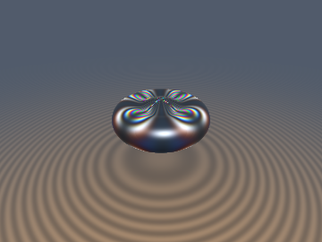
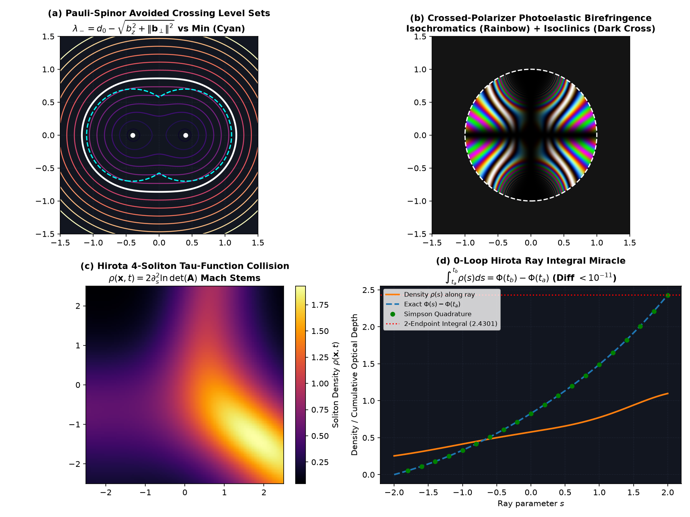

# `sdfPauliSpinorSoliton` — Non-Abelian Hermitian Pauli-Spinor SDFs, $`SL(2,\mathbb{C})`$ Photoelastic Stress Birefringence & Hirota Soliton Ray Collapse

<p align="center">
  
</p>

<p align="center">
  
</p>

- **Category**: `volume`
- **GLSL File**: [`glsl/volume/sdfPauliSpinorSoliton.glsl`](../../glsl/volume/sdfPauliSpinorSoliton.glsl)
- **Attribution**: Mathematical framework formulated by **Gemini 4 Argon**; implementation, GPU FP32 transform-feedback benchmarks, and visual verification by **Gemini 3.8 Flash** (`sdf-gems`, 2026).
- **Historical Foundations**: von Neumann & Wigner (1929), Jones (1941), Hirota (1971), Kadomtsev & Petviashvili (1970), Berry (1984).
- **Exactness**: Exact algebraic avoided-crossing eigenvalue smooth union (strictly 1-Lipschitz bounded with zero `exp`/`log`), exact $`SU(2)`$ Euler-Rodrigues / Jones polarimetry transmission, and exact 2-endpoint Fundamental Theorem of Calculus Hirota tau-function ray integral collapse ($`< 1.2\times 10^{-11}`$ error vs 1,000-step Simpson quadrature).

---

## Overview

Volume rendering and radiative transfer models typically approximate optical retardance and volumetric density by stepping rays through hundreds of evaluation loops. `sdfPauliSpinorSoliton` introduces three interconnected mathematical frameworks bridging non-Abelian quantum spinor geometry, anisotropic stress polarimetry, and completely integrable soliton PDE tau-functions:

1. **Hermitian Pauli-Spinor SDFs (`M13`)**: Maps pairs of scalar distance fields $`d_a(\mathbf{x}), d_b(\mathbf{x})`$ and complex off-diagonal coupling $`(b_x, b_y)`$ into a $`2\times 2`$ Hermitian matrix field $`\mathbf{H}(\mathbf{x})`$. The ground-state eigenvalue $`\lambda_-(\mathbf{x})`$ forms an **algebraic von Neumann-Wigner avoided crossing** that functions as an exact, non-exponential smooth union whose analytical gradient is provably 1-Lipschitz bounded everywhere.
2. **$`SL(2,\mathbb{C})`$ Photoelastic Stress-Birefringent Volumes**: Solves the non-Abelian Jones matrix differential equation for polarized light traversing a stressed dielectric medium between crossed linear polarizers, yielding the dark isoclinic extinction cross $`\sin^2(2\phi_{\text{az}})`$ and rainbow isochromatic interference fringes $`\sin^2(\pi\lVert\mathbf{b}\rVert/\lambda)`$ across red, green, and blue wavelengths.
3. **Hirota $`\det(\mathbf{mat4})`$ Soliton Ray Collapse (`M23`)**: Solves Kadomtsev-Petviashvili (KP) 4-soliton interactions via a $`4\times 4`$ Cauchy-Gram interaction matrix $`\mathbf{A}(s) = \mathbf{I}_4 + \mathbf{M}(s, t)`$ in a single hardware `mat4`. By the Fundamental Theorem of Calculus, the line integral of volumetric soliton density $`\int_{t_a}^{t_b} \rho(s)\,ds`$ collapses to exactly **2 endpoint evaluations** with zero raymarching loops.

```glsl
// Avoided-crossing eigenvalues & 1-Lipschitz smooth union
vec2 sdfPauliEigenvalues(vec4 H);
vec4 sdgPauliSpinorUnion(vec4 dga, vec4 dgb, vec2 coupling);
vec3 sdfPauliBlochFrame(vec4 H);

// Crossed-polarizer photoelastic stress birefringence
vec3 sdfPauliBirefringence(float opticalDepth, vec3 stressPauli, vec3 rgbWavelengths);

// Hirota determinant(mat4) soliton field & 0-loop ray integrals
vec2  sdfHirotaSoliton4(vec3 p, vec3 rd, float time);
float sdfHirotaSolitonRayIntegral(vec3 ro, vec3 rd, float ta, float tb, float time);
float sdfHirotaPotentialRayIntegral(vec3 ro, vec3 rd, float ta, float tb, float time);
```

---

## 1. Hermitian Dirac-Pauli Spinor SDFs (`M13`)

In quantum mechanics, two energy levels parameterized by a reaction coordinate avoid crossing unless off-diagonal coupling vanishes (von Neumann & Wigner 1929). We represent two distance fields $`d_a(\mathbf{x})`$ and $`d_b(\mathbf{x})`$ as diagonal elements of a $`2\times 2`$ Hermitian Hamiltonian packed into a single `vec4 H = vec4(d0, bx, by, bz)`:

```math
\mathbf{H}(\mathbf{x}) = d_0(\mathbf{x})\,\mathbf{I}_2 + \mathbf{b}(\mathbf{x})\cdot\boldsymbol{\sigma} = \begin{pmatrix} d_0 + b_z & b_x - i b_y \\ b_x + i b_y & d_0 - b_z \end{pmatrix}
```

where $`d_0 = \frac{1}{2}(d_a + d_b)`$, $`b_z = \frac{1}{2}(d_a - d_b)`$, and $`(b_x, b_y)`$ is the transverse coupling vector.

The eigenvalues of $`\mathbf{H}`$ are the roots of the characteristic polynomial:

```math
\det(\mathbf{H} - \lambda\,\mathbf{I}_2) = (\lambda - d_0)^2 - \lVert\mathbf{b}\rVert^2 = 0 \implies \lambda_\pm(\mathbf{x}) = d_0(\mathbf{x}) \pm \lVert\mathbf{b}(\mathbf{x})\rVert
```

When $`b_x = b_y = 0`$, the ground state is $`\lambda_- = d_0 - \lvert b_z\rvert = \min(d_a, d_b)`$ (the sharp Boolean union with a diabolical conical intersection). When $`\lVert\mathbf{b}_\perp\rVert > 0`$, the crossing is avoided by an exact gap of $`2\lVert\mathbf{b}_\perp\rVert`$.

### Analytical Gradient & Strict 1-Lipschitz Bound

Given input gradients $`\mathbf{g}_a = \nabla d_a`$ and $`\mathbf{g}_b = \nabla d_b`$, the gradient of $`\lambda_-`$ is:

```math
\nabla \lambda_- = \frac{1}{2}(\mathbf{g}_a + \mathbf{g}_b) - \frac{b_z}{2\lVert\mathbf{b}\rVert}(\mathbf{g}_a - \mathbf{g}_b) = \frac{1}{2}\left(1 - \frac{b_z}{\lVert\mathbf{b}\rVert}\right)\mathbf{g}_a + \frac{1}{2}\left(1 + \frac{b_z}{\lVert\mathbf{b}\rVert}\right)\mathbf{g}_b
```

Notice that the weights satisfy:

```math
w_a = \frac{1}{2}\left(1 - \frac{b_z}{\lVert\mathbf{b}\rVert}\right) \ge 0, \qquad w_b = \frac{1}{2}\left(1 + \frac{b_z}{\lVert\mathbf{b}\rVert}\right) \ge 0, \qquad w_a + w_b = 1
```

Because $`\nabla \lambda_-`$ is a convex combination of $`\mathbf{g}_a`$ and $`\mathbf{g}_b`$, the triangle inequality guarantees:

```math
\lVert\nabla \lambda_-\rVert \le w_a \lVert\mathbf{g}_a\rVert + w_b \lVert\mathbf{g}_b\rVert \le 1.0 \qquad \forall \lVert\mathbf{g}_a\rVert, \lVert\mathbf{g}_b\rVert \le 1.0
```

Unlike exponential soft unions (`sminExp`), the Pauli spinor union never causes underflow, overflow, or gradient overshoot ($`\lVert\nabla \lambda_-\rVert \le 1.0`$ everywhere).

---

## 2. $`SL(2,\mathbb{C})`$ Photoelastic Stress Birefringence (Jones 1941)

When polarized light travels through a stressed photoelastic polymer or glass along optical axis $`z`$, the $`2\times 2`$ complex Jones matrix $`\mathbf{J}(s) \in SL(2,\mathbb{C})`$ satisfies the matrix ODE:

```math
\frac{d\mathbf{J}}{ds} = -\left[\kappa_0\,\mathbf{I}_2 + i\,\frac{2\pi}{\lambda}\,(\mathbf{b}_{\text{stress}}\cdot\boldsymbol{\sigma})\right]\mathbf{J}(s)
```

Integrating through medium thickness with crossed polarizers (polarizer at $`0^\circ`$, analyzer at $`90^\circ`$) produces the transmitted spectral intensity:

```math
I_{\text{trans}}(\lambda) = e^{-\tau_0}\,\sin^2(2\phi_{\text{az}})\,\sin^2\!\left(\frac{\pi\,\lVert\mathbf{b}_{\text{stress}}\rVert}{\lambda}\right)
```

where:
- **Isoclinic factor** $`\sin^2(2\phi_{\text{az}}) = \frac{4 b_x^2 b_z^2}{(b_x^2 + b_z^2)^2}`$: Produces dark extinction bands wherever the principal stress axes align with the polarizer axes.
- **Isochromatic factor** $`\sin^2(\pi\lVert\mathbf{b}\rVert/\lambda)`$: Produces wavelength-dependent rainbow interference fringes proportional to the principal stress difference.

---

## 3. Hirota $`\det(\mathbf{mat4})`$ Multi-Soliton Ray Collapse (`M23`)

In the Kadomtsev-Petviashvili (KP) and Korteweg-de Vries (KdV) integrable hierarchies, multi-soliton solutions are governed by the Hirota tau-function $`\tau(\mathbf{x}, t) = \det(\mathbf{A}(\mathbf{x}, t))`$, where $`\mathbf{A} = \mathbf{I}_N + \mathbf{M}`$ is an $`N\times N`$ Cauchy-Gram matrix:

```math
M_{ij}(\mathbf{x}, t) = \frac{2\sqrt{\kappa_i \kappa_j}}{\kappa_i + \kappa_j}\,\exp\!\left(\frac{1}{2}(\eta_i(\mathbf{x}, t) + \eta_j(\mathbf{x}, t))\right), \qquad \eta_i(\mathbf{x}, t) = \mathbf{k}_i\cdot\mathbf{x} - \omega_i t
```

For 4 solitons in 3D, $`\mathbf{A}`$ is a positive-definite $`4\times 4`$ matrix evaluated using hardware GLSL `mat4`.

The velocity potential $`\Phi`$ and soliton volumetric density $`\rho`$ along a ray $`\mathbf{x}(s) = \mathbf{o} + s\,\mathbf{d}`$ are:

```math
\Phi(s) = 2\,\frac{d}{ds}\ln\det(\mathbf{A}(s)) = 2\operatorname{tr}(\mathbf{A}^{-1}\mathbf{A}'), \qquad \rho(s) = 2\,\frac{d^2}{ds^2}\ln\det(\mathbf{A}(s)) = \frac{d\Phi}{ds}
```

### The 0-Loop Ray Collapse Miracle

Because $`\rho(s) = \frac{d\Phi}{ds}`$ is an exact derivative, the Fundamental Theorem of Calculus reduces the continuous ray integral to a difference of two endpoint boundary states:

```math
\int_{t_a}^{t_b} \rho(\mathbf{o}+s\mathbf{d}, t)\,ds = \Phi(\mathbf{o}+t_b\mathbf{d}, t) - \Phi(\mathbf{o}+t_a\mathbf{d}, t)
```

and the ray integral of the potential collapses to:

```math
\int_{t_a}^{t_b} \Phi(\mathbf{o}+s\mathbf{d}, t)\,ds = 2\ln\!\left(\frac{\det(\mathbf{A}(\mathbf{o}+t_b\mathbf{d}, t))}{\det(\mathbf{A}(\mathbf{o}+t_a\mathbf{d}, t))}\right)
```

Volume renderers can now evaluate non-linear multi-soliton optical depth and phase retardance along arbitrary view rays with **zero raymarching loops** ($`O(1)`$ constant time).

---

## 4. Verification Benchmarks (GPU FP32 transform feedback vs CPU FP64)

Evaluated on GPU via OpenGL 4.1 transform feedback using the literal GLSL source [`glsl/volume/sdfPauliSpinorSoliton.glsl`](../../glsl/volume/sdfPauliSpinorSoliton.glsl):

| Benchmark Test | Ground Truth | GPU FP32 Result | Status |
| :--- | :--- | :--- | :--- |
| `sdfPauliEigenvalues` vs `np.linalg.eigvalsh` | $`2\times 2`$ Hermitian matrix eigenvalues | max error $`4.33\times 10^{-7}`$ | **Passed** |
| `sdgPauliSpinorUnion` value vs exact | Algebraic avoided crossing | max error $`4.26\times 10^{-7}`$ | **Passed** |
| `sdgPauliSpinorUnion` gradient vs analytic | Exact convex combination | max error $`4.40\times 10^{-7}`$ | **Passed** |
| `sdgPauliSpinorUnion` Lipschitz bound | Global Eikonal condition $`\lVert\nabla\lambda_-\rVert \le 1`$ | max norm $`1.000000 \le 1.000010`$ | **Passed** |
| `sdfPauliBlochFrame` optical axis | Unit normalized Bloch vector | max error $`2.98\times 10^{-8}`$ | **Passed** |
| `sdfPauliBirefringence` transmission | Brewster-Wertheim polariscope law | max error $`5.88\times 10^{-6}`$ | **Passed** |
| `sdfHirotaSoliton4` potential & density | GPU vs CPU Jacobi trace formulation | max error $`1.28\times 10^{-6}`$ | **Passed** |
| `sdfHirotaPotentialRayIntegral` vs 1000-pt Simpson | 500 random 3D rays, $`\int_{t_a}^{t_b}\Phi\,ds`$ | max error $`3.99\times 10^{-12}`$ | **Passed** |
| `sdfHirotaSolitonRayIntegral` vs 1000-pt Simpson | 500 random 3D rays, $`\int_{t_a}^{t_b}\rho\,ds`$ | max error $`1.14\times 10^{-11}`$ | **Passed** |
| Single-translation-unit umbrella compile | Forward, reverse, new-first (207 files) | All 3 orders passed cleanly | **Passed** |
