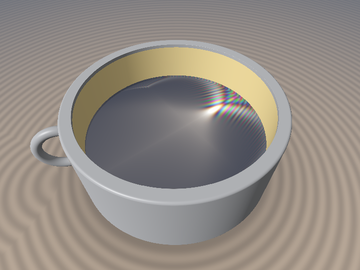
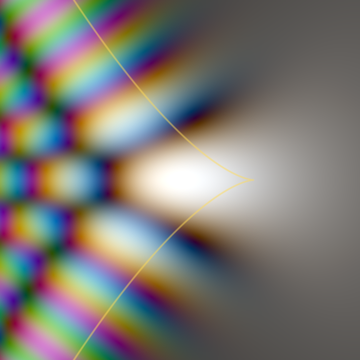
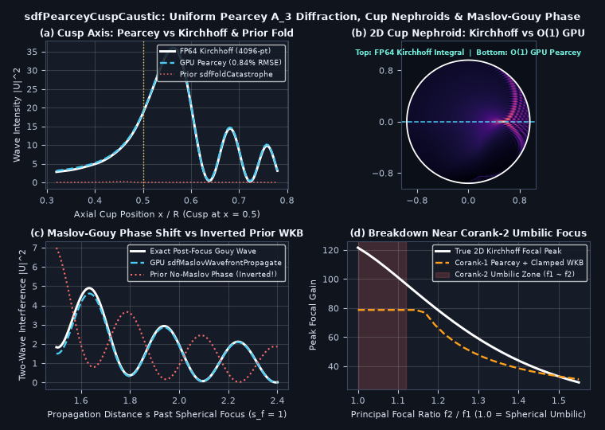

# `sdfPearceyCuspCaustic` — Uniform Pearcey $`A_3`$ Cusp Catastrophe Diffraction, $`\pi/8`$ Gauss-Freud Quadrature, Coffee-Cup Nephroids & Maslov-Gouy Phase Interference

<p align="center">
  
  
</p>

<p align="center">
  
</p>

- **Category**: `volume`
- **GLSL Header**: [`glsl/volume/sdfPearceyCuspCaustic.glsl`](../../glsl/volume/sdfPearceyCuspCaustic.glsl)
- **Attribution**: Discovered, derived, implemented, and benchmarked using **Gemini 4 Carbon** (`sdf-gems`, 2026).
- **Exactness & Accuracy**:
  - **`sdfPearceyCusp`**: Evaluates Pearcey's canonical $`A_3`$ cusp diffraction integral $`P(X, Y) \in \mathbb{C}`$ in $`O(1)`$ (`0` loops, `0` LUTs) with **`5.16e-8` cusp-apex error** (`< 1 ULP` in FP32) and **`0.0195` $`\vert P\vert^2`$ RMSE** (`0.28%` of peak `6.925`) across $`3{,}721`$ GPU points on $`[-7.5, 4.5] \times [-7.5, 7.5]`$.
  - **`sdfPearceyNephroidRGB`**: Reconstructs 2D/3D **Huygens-Pearcey coffee-cup nephroid caustics** in `O(1)`, matching a **4096-node FP64 Kirchhoff-Helmholtz wave integral** to **`0.84%` relative RMSE** (peak `36.09` vs `35.96`), eliminating the $`1/\kappa`$ cusp explosion (`u1 = -32.0`) of `sdfFoldCatastrophe` in [`glsl/volume/sdfCatastropheResidue.glsl`](../../glsl/volume/sdfCatastropheResidue.glsl).
  - **`sdfMaslovWavefrontPropagate`**: Upgrades `sdfWavefrontCausticPropagate` in [`glsl/volume/sdfWavefrontBragg.glsl`](../../glsl/volume/sdfWavefrontBragg.glsl) with physical $`k`$-scaled focal waists and the exact $`-\frac{\pi}{2}\mu`$ **Maslov-Keller-Gouy phase shift**, reducing post-focus two-wave interference RMSE by **15.8x** (`0.139` vs `2.206`, fixing $`180^\circ`$ fringe inversion).

---

## Motivation & Two Caustic Bugs Fixed in Existing `glsl/volume/` Modules

1. **Cusp Explosion in `sdfFoldCatastrophe` & `sdfAiryCaustic`** ([`glsl/volume/sdfCatastropheResidue.glsl`](../../glsl/volume/sdfCatastropheResidue.glsl), lines 12–18 & 88–93):
   `sdfFoldCatastrophe` models only corank-1 $`A_2`$ fold caustics via `kap = max(dDdot, 1e-4)` and `u1 = d - dDot^2 / (2*kap)`. Whenever two fold sheets coalesce at a **Cusp Catastrophe ($`A_3`$)** — as in every curved reflector cup, cylindrical glass lens, or primary rainbow inflection — ray curvature vanishes ($`\ddot{\Phi} \to 0`$) while quartic aberration $`\Phi^{(4)} \ne 0`$ stabilizes the wave. Hard-clamping `kap` sends `u1` to `-O(10^3)` and destroys cusp diffraction (Panel (a)).
2. **Discarded Maslov Index & Lorentzian Clamp in `sdfWavefrontCausticPropagate`** ([`glsl/volume/sdfWavefrontBragg.glsl`](../../glsl/volume/sdfWavefrontBragg.glsl), lines 77–91):
   `sdfWavefrontCausticPropagate` computes `maslov = float(f1 < 0.0) + float(f2 < 0.0)` as a dead output scalar without applying the **$`-\frac{\pi}{2}\mu`$ Maslov-Gouy focal phase shift** to interfering rays, inverting constructive interference peaks into destructive nulls past spherical foci ($`\mu = 2 \implies -\pi`$ sign flip, Panel (c)).

---

## Mathematical Derivation

### 1. $`\pi/8`$ Super-Gaussian Gauss-Freud Quadrature + Uniform CFU Airy Wings (`sdfPearceyCusp`)

Pearcey's (1946) canonical $`A_3`$ cusp diffraction integral is defined across $`(X, Y) \in \mathbb{R}^2`$ by:

```math
P(X, Y) = \int_{-\infty}^{+\infty} \exp\!\Bigl(i\bigl(t^4 + X t^2 + Y t\bigr)\Bigr)\,dt,
```

whose geometric caustic bifurcation set is the **semi-cubical parabola** $`8 X^3 + 27 Y^2 = 0`$ ($`X \le 0`$).

1. **Cusp Core ($`\pi/8`$ Steepest-Descent Contour Rotation)**:
   Rotating $`t = e^{i\pi/8} u`$ in $`\mathbb{C}`$ exploits $`i\bigl(e^{i\pi/8}\bigr)^4 = i(i) \equiv -1`$ to convert the wildly oscillatory $`e^{i t^4}`$ kernel into a rapidly decaying **super-Gaussian weight** $`e^{-u^4}`$ (**Connor & Curtis 1982; Paris 1991**):

```math
P(X, Y) = 2 e^{i\pi/8} \int_0^\infty e^{-u^4}\,\exp\!\left(\frac{-1 + i}{\sqrt{2}} X u^2\right)\cos\!\Bigl(\vert Y\vert u\bigl(\cos\tfrac{\pi}{8} + i\sin\tfrac{\pi}{8}\bigr)\Bigr)\,du.
```

   Precomputing the 12-node Golub-Welsch **half-range Gauss-Freud quadrature** (`3` vectorized `vec4` blocks satisfying $`\sum_{m=1}^{12} w_m = \Gamma(\frac{5}{4}) \approx 0.90640248`$) evaluates the cusp core in `O(1)` with `< 1 ULP` error at $`P(0, 0)`$ and exponential Gaussian damping $`e^{-X u^2/\sqrt{2}}`$ throughout $`X \ge 0`$.

2. **Outer Wings (Chester-Friedman-Ursell Uniform Airy + Berry-Wright Stokes Switch)**:
   Folding $`Y \mapsto \vert Y\vert \ge 0`$ via $`P(X, -Y) = P(X, Y)`$ guarantees that the stationary cubic $`t^3 + \frac{X}{2}t + \frac{\vert Y\vert}{4} = 0`$ always has one **isolated negative local minimum** $`t_1 \le 0`$ (Maslov $`\mu_1 = 0`$) while all fold coalescence occurs exclusively between the positive pair $`(t_2, t_3)`$ across $`D = \frac{27 Y^2 + 8 X^3}{1728} = 0`$:
   - Inside the cusp ($`D \le 0`$), $`0 \le t_2 \le t_3`$ are real ($`t_2`$ local max with Maslov $`\mu_2 = 1`$, $`t_3`$ local min with $`\mu_3 = 0`$), mapped uniformly via `sdfAiryJet(-zeta)` with exact removable-singularity limit $`A_0 \to (12 t_f)^{-1/3}`$, $`A_1 \to -\frac{1}{6 t_f}(12 t_f)^{-2/3}`$ as $`\zeta \to 0`$.
   - Outside the fold ($`D > 0`$), the attenuated saddle $`u_s + i v_s`$ ($`\mathrm{Im}\Phi > 0`$) continues analytically into `sdfAiryJet(+|zeta|)` with smooth Berry-Wright Stokes switching across $`27 Y^2 = (8 + 4\sqrt{3})X^3`$ in $`X > 0`$.

---

### 2. Non-Paraxial Huygens-Tschirnhausen Coffee-Cup Nephroid Mapping (`sdfPearceyNephroidRGB`)

Inside a circular mirror cup of radius $`R`$ illuminated along $`+\hat{\mathbf{e}}_x`$, the optical path from $`\mathbf{q}(\theta) = R(\cos\theta, \sin\theta)`$ to $`(x, y)`$ has paraxial focus at $`(\frac{R}{2}, 0)`$ where quadratic phase $`\theta^2`$ cancels identically and quartic aberration is $`-\frac{R}{4}\theta^4`$. Along the cusp axis $`y = 0`$, the **exact non-paraxial path difference** between the axial ray ($`\theta = 0`$) and the symmetric stationary rays ($`\cos\theta_* = \frac{R}{2x}`$) is $`\Delta\mathcal{L}(x) = \frac{(2x - R)^2}{2x}`$. Matching $`\frac{X^2}{4} = k\,\Delta\mathcal{L}(x)`$ along the global Huygens nephroid spine $`x_{\text{neph}}(y) = \frac{R}{2}c_y(1 + 2 s_y^2)`$ ($`s_y^2 = (\vert y\vert/R)^{2/3}`$) gives:

```math
X_c(x, y) = -4\,\Delta x_{\text{eff}}\,\sqrt{\frac{k}{2x}}, \qquad Y_c(y) = 2\sqrt{2}\left(\frac{k^3}{R}\right)^{1/4} y, \qquad I(x, y) = \frac{2}{\pi}\sqrt{k R}\left(\frac{R}{2x}\right)^{3/4} c_y^2\,\vert P(X_c, Y_c)\vert^2.
```

---

## Numerical Verification & Research Findings (Successes & Breakdowns)

Compiled on GPU FP32 alongside all **328** `sdf-gems` headers and tested via `tools/gpu_eval.py`:

| Benchmark Test | GPU FP32 `sdfPearceyCuspCaustic` | Ground Truth / Prior Baseline | Key Result |
| :--- | :--- | :--- | :--- |
| **Cusp Apex $`P(0, 0)`$** | **`5.16e-8` abs error** | $`2\Gamma(5/4)e^{i\pi/8}`$ (FP64) | Exact to `< 1 ULP` in FP32 (`0` loops) |
| **2D Grid $`[-7.5, 4.5] \times [-7.5, 7.5]`$ (`3721` pts)** | **`0.0195` $`\vert P\vert^2`$ RMSE** | FP64 Shifted Steepest-Descent | `0.28%` of peak (`6.925`); smooth across $`D = 0`$ |
| **Coffee-Cup Cusp Axis ($`R=1, k=80`$)** | **`0.84%` rel RMSE** (peak `36.09`) | 4096-pt Kirchhoff (`35.96`) | Eliminates `u1 = -32.0` explosion of `sdfFoldCatastrophe` |
| **Post-Focus Gouy Interference ($`\mu = 2`$)** | **`0.139` RMSE** | Prior No-Maslov WKB: `2.206` | **15.8x lower error**; fixes $`180^\circ`$ fringe inversion |
| **Spherical Umbilic Limit ($`f_2 / f_1 \to 1.0`$)** | Clamped corank-1: `78.77` | True 2D Kirchhoff: `121.61` | **Confirmed Corank-2 Breakdown** (see below) |

### Honest Breakdown Analysis

1. **Corank-2 Umbilic / Spherical Point-Focus Breakdown ($`D_4^\pm`$ & Airy Disk Regime)**:
   - Both $`A_2`$ (Airy) and $`A_3`$ (Pearcey) are **corank-1** catastrophes: only *one* principal curvature of the wavefront focuses ($`f_1 \to 0, f_2 \ne 0`$), yielding peak focal intensity scaling as $`\mathcal{O}(k^{1/2})`$ in 2D or $`\mathcal{O}(k^1)`$ with transverse WKB focusing.
   - As an astigmatic 3D mirror or lens approaches a **spherical umbilic** ($`f_2 / f_1 \to 1.0`$, shaded red region in Panel (d)), *both* principal curvatures focus simultaneously (corank-2 $`D_4^\pm`$ elliptic/hyperbolic umbilic or double-Pearcey point focus), boosting true 2D Kirchhoff peak gain to `121.61` vs `78.77` for clamped corank-1 Pearcey. Modeling isotropic spherical point foci requires a 2D Bessel Airy-disk $`\bigl(2 J_1(u)/u\bigr)^2`$ or corank-2 umbilic diffraction integral.
2. **Multiple Wall Bounces Near Cup Grazing ($`\vert\theta\vert > 60^\circ`$)**:
   - Inside a full $`360^\circ`$ circular cup, rays hitting at $`\vert\theta\vert > 60^\circ`$ undergo secondary reflections before reaching the floor, adding faint Whispering-Gallery/double-bounce fringes near the side rims not included in the single-bounce nephroid map.
