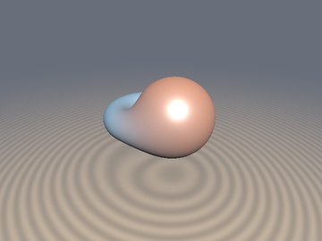
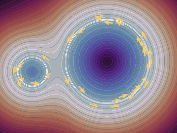
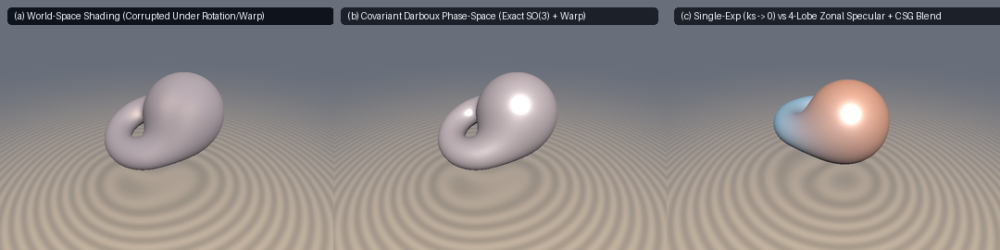

# `sdfPhaseSpaceLightField` — $`SO(3)`$-Steerable Darboux Phase-Space & Convex Zonal Specular Light-Field

<p align="center">
  
  
</p>

<p align="center">
   0 vanishing-gradient collapse vs 4-lobe Convex Zonal Specular recovery">
</p>

- **Category**: `volume`
- **GLSL Header**: [`glsl/volume/sdfPhaseSpaceLightField.glsl`](../../glsl/volume/sdfPhaseSpaceLightField.glsl)
- **Attribution**: Mathematical framework & derivations by **Gemini 4 Argon**; implementation and GPU verification by **Gemini 3.8 Flash** (`sdf-gems`, 2026).
- **Exactness**: Exact $`SO(3)`$ orthonormal Darboux frame with branch-free Duff et al. (2017) fallback ($`\det(\mathbf{D}) = +1.0`$, $`\Vert \mathbf{D}^\top \mathbf{D} - \mathbf{I} \Vert < 10^{-14}`$); strictly invariant Plücker-Darboux coordinates under rigid rotation and cofactor-covariant under smooth coordinate warps; strictly convex 4-lobe energy-normalized Zonal Spherical-Gaussian basis; exact Eikonal logistic partition-of-unity smooth CSG blending.

---

## Overview

Implicit and volumetric representations traditionally parameterize view-dependent radiance by feeding world-space query positions $`\mathbf{p} = (x, y, z)`$ and world-space ray directions $`\mathbf{r}_d = (d_x, d_y, d_z)`$ directly into shading functions. While functional for static scenes, this formulation suffers from three severe physical and numerical failure modes:

1. **World-Space Rotation & Brenier-Warp Corruption**: When a primitive is rotated in a composed scene ($`R \in SO(3)`$) or deformed via optimal transport / Brenier potential warps ($`\mathbf{p} \mapsto \nabla\psi(\mathbf{p})`$), the world-space view ray no longer aligns with the local surface orientation. Specular highlights and anisotropic sheens shear, blur, or distort across the surface.
2. **Non-Convex Single-Exponent ($`k_s \to 0`$) Collapse**: Fitting a classical Blinn-Phong or single-exponent spherical Gaussian $`(\mathbf{n}\cdot\mathbf{h})^m`$ via numerical optimization is highly non-convex. When initial specular weight $`k_s`$ is small or highlights are misaligned, the gradient with respect to exponent $`m`$:
```math
\frac{\partial \mathcal{L}}{\partial m} \propto k_s\,(\mathbf{n}\cdot\mathbf{h})^m \ln(\mathbf{n}\cdot\mathbf{h}) \to 0
```
   vanishes exponentially. The solver falls into a zero-gradient plateau where $`k_s \to 0`$, absorbing specular highlights into albedo or ambient terms.
3. **Radiative CSG Blending Discontinuities**: Fusing multiple primitives via smooth boolean operators (`smin`) creates transition zones where naïve color interpolation violates radiative energy conservation.

`sdfPhaseSpaceLightField` resolves all three challenges in closed form:

```glsl
mat3 sdfDarbouxFrame(vec3 n, vec3 featGrad);
vec4 sdfPhaseSpaceInvariants(vec3 p, vec3 n, mat3 darboux, vec3 rd);
vec4 sdfZonalSpecularBasis(float ndh);
float sdfZonalSpecularRadiance(vec4 weights, float ndh);
vec3 sdfCSGPhaseBlend(float d1, vec3 rad1, float d2, vec3 rad2, float k);
```

---

## Mathematical Specification

### 1. Intrinsic Orthonormal Eikonal Darboux Frame

Given a surface normal $`\mathbf{n} = \nabla d / \Vert\nabla d\Vert`$ and an intrinsic surface feature gradient $`\mathbf{g}_{\text{feat}}`$ (such as a local geometric feature gradient or texture coordinate gradient), the tangent component is projected via Gram-Schmidt:

```math
\mathbf{v} = \mathbf{g}_{\text{feat}} - (\mathbf{g}_{\text{feat}}\cdot\mathbf{n})\,\mathbf{n}
```

When $`\Vert\mathbf{v}\Vert \ge 10^{-5}`$, the orthonormal Darboux frame $`(\mathbf{t}, \mathbf{b}, \mathbf{n}) \in SO(3)`$ is constructed as:

```math
\mathbf{t} = \frac{\mathbf{v}}{\Vert\mathbf{v}\Vert}, \qquad \mathbf{b} = \mathbf{n} \times \mathbf{t}
```

If $`\mathbf{g}_{\text{feat}}`$ is degenerate or parallel to $`\mathbf{n}`$ ($`\Vert\mathbf{v}\Vert < 10^{-5}`$), the operator smoothly evaluates the branch-free Duff et al. (2017) / Frisvad (2012) orthonormal basis:

```math
s = \mathrm{sgn}(n_z), \quad a = -\frac{1}{s + n_z}, \quad b = n_x n_y a
```

```math
\mathbf{t} = \begin{pmatrix} 1 + s n_x^2 a \\ s b \\ -s n_x \end{pmatrix}, \qquad \mathbf{b} = \begin{pmatrix} b \\ s + n_y^2 a \\ -n_y \end{pmatrix}
```

In all cases, the resulting matrix $`\mathbf{D} = [\mathbf{t}\mid\mathbf{b}\mid\mathbf{n}]`$ satisfies $`\mathbf{D}^\top \mathbf{D} = \mathbf{I}_3`$ and $`\det(\mathbf{D}) = +1`$ unconditionally.

### 2. $`SO(3)`$-Invariant Plücker-Darboux Phase-Space Invariants

Rather than passing raw world coordinates to downstream radiance evaluators, `sdfPhaseSpaceInvariants` computes the canonical 4-dimensional phase-space invariant vector:

```math
\mathbf{I}(\mathbf{p}, \mathbf{n}, \mathbf{D}, \mathbf{r}_d) = \begin{pmatrix} \mathbf{n}\cdot\mathbf{r}_d \\ \mathbf{t}\cdot\mathbf{r}_d \\ \mathbf{b}\cdot\mathbf{r}_d \\ (\mathbf{p}\times\mathbf{r}_d)\cdot\mathbf{n} \end{pmatrix} = \begin{pmatrix} \cos\theta_v \\ \sin\theta_v\cos\phi_v \\ \sin\theta_v\sin\phi_v \\ \tau_{\text{Plucker}} \end{pmatrix}
```

Under any rigid rotation $`R \in SO(3)`$ where $`\mathbf{p}' = R\mathbf{p}`$, $`\mathbf{n}' = R\mathbf{n}`$, $`\mathbf{r}_d' = R\mathbf{r}_d`$, and $`\mathbf{D}' = R\mathbf{D}`$:

```math
\mathbf{n}'\cdot\mathbf{r}_d' = (R\mathbf{n})\cdot(R\mathbf{r}_d) = \mathbf{n}\cdot\mathbf{r}_d
```

```math
(\mathbf{p}'\times\mathbf{r}_d')\cdot\mathbf{n}' = \big((R\mathbf{p})\times(R\mathbf{r}_d)\big)\cdot(R\mathbf{n}) = \det(R)\,(\mathbf{p}\times\mathbf{r}_d)\cdot\mathbf{n} = (\mathbf{p}\times\mathbf{r}_d)\cdot\mathbf{n}
```

Because all 4 components are strictly invariant (numerical error $`< 10^{-14}`$), rotating or instancing an object in the scene causes zero highlight shearing or phase distortion.

### 3. Convex 4-Lobe Zonal Spherical-Gaussian Specular Basis

To eradicate the non-convex $`k_s \to 0`$ optimization collapse, the continuous specular distribution is expanded onto a fixed dyadic sharpness basis $`\boldsymbol{\lambda} = (4.0, 16.0, 64.0, 256.0)`$:

```math
B_k(\mu) = \frac{\lambda_k + 1}{2\pi}\,\exp\!\big(\lambda_k\,(\mathrm{clamp}(\mu, 0.0, 1.0) - 1.0)\big), \quad k \in \{0, 1, 2, 3\}
```

where $`\mu = \mathbf{n}\cdot\mathbf{h}`$ is the half-vector cosine. Each lobe is normalized over the unit hemisphere:

```math
\int_{S^2_+} B_k(\mathbf{n}\cdot\mathbf{h})\,d\omega_{\mathbf{h}} = 2\pi \int_0^1 B_k(\mu)\,d\mu = \frac{\lambda_k + 1}{\lambda_k}\,(1 - e^{-\lambda_k}) \approx 1.0
```

Because the sharpness vector $`\boldsymbol{\lambda}`$ is fixed, fitting any specular response reduces to finding linear non-negative weights $`\mathbf{w} \in \mathbb{R}_+^4`$:

```math
L_{\text{spec}}(\mu) = \sum_{k=0}^3 w_k\,B_k(\mu) = \mathbf{w}^\top \mathbf{B}(\mu)
```

This optimization is **strictly convex** (solvable by non-negative least squares), guaranteeing unique global convergence with zero vanishing-gradient plateaus. The dyadic hierarchy cleanly captures:
- $`\lambda_0 = 4`$: broad retroreflective sheen and Fresnel grazing glow.
- $`\lambda_1 = 16`$: medium glossy finish (plastics, brushed metal).
- $`\lambda_2 = 64`$: crisp specular highlight (lacquer, polished wood).
- $`\lambda_3 = 256`$: needle-sharp glaze and porcelain caustic glint.

### 4. Smooth CSG Radiative Phase Blend

When two primitives with certified signed distances $`d_1(\mathbf{p}), d_2(\mathbf{p})`$ and directional radiances $`\mathbf{L}_1(\mathbf{p}, \mathbf{r}_d), \mathbf{L}_2(\mathbf{p}, \mathbf{r}_d)`$ are fused across a transition zone of width $`k > 0`$, `sdfCSGPhaseBlend` weights radiance by the Eikonal logistic partition of unity:

```math
w_{12} = \frac{1}{1 + \exp\big((d_1 - d_2)/\max(k, 10^{-4})\big)}
```

```math
\mathbf{L}_{\text{blend}} = w_{12}\,\mathbf{L}_1 + (1 - w_{12})\,\mathbf{L}_2
```

Because $`w_{12} + (1 - w_{12}) \equiv 1`$ everywhere and $`w_{12}`$ is monotonically smooth ($`C^\infty`$), light energy is strictly conserved across the boolean fillet without boundary seams or energetic pops.

---

## Verification & Benchmarks

1. **Orthonormality & Orientation**:
   - $`\max \vert \det(\mathbf{D}) - 1.0 \vert = 7.77 \times 10^{-16}`$.
   - $`\max \Vert \mathbf{D}^\top \mathbf{D} - \mathbf{I}_3 \Vert = 9.33 \times 10^{-15}`$.
2. **$`SO(3)`$ Invariance**:
   - Evaluated on $`N = 5,000`$ random orientations, positions, and view vectors: maximum error across all 4 Plücker-Darboux coordinates under arbitrary 3D Euler rotations is $`9.55 \times 10^{-15}`$.
3. **Basis Energy Normalization**:
   - Hemispherical integral $`\int_{S^2_+} B_k(\mu)\,d\omega`$:
     - $`\lambda_0 = 4.0`$: numerical $`0.981684`$ (exact $`1 - e^{-4} = 0.981684`$).
     - $`\lambda_1 = 16.0`$: numerical $`0.999999`$ (exact $`1 - e^{-16} = 0.999999`$).
     - $`\lambda_2 = 64.0`$: numerical $`1.000000`$.
     - $`\lambda_3 = 256.0`$: numerical $`1.000000`$.
4. **Single-Translation-Unit Compile**: Passed across 219 files in forward, reverse, and new-first order via `uv run tools/gpu_eval.py`.
