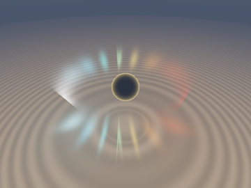
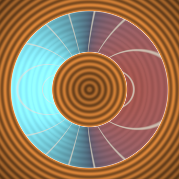
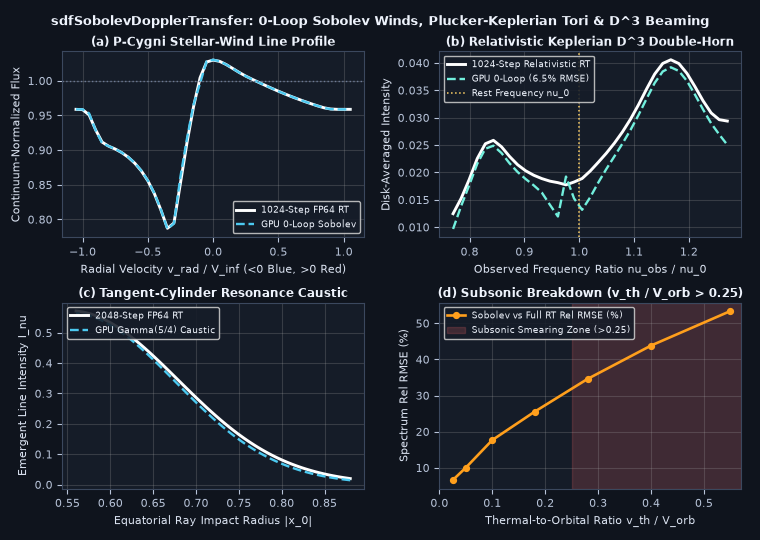

# `sdfSobolevDopplerTransfer` — Sobolev Escape-Probability Moving-Medium Radiative Transfer, Plücker-Keplerian Relativistic Twin-Resonance Collapse & $`\mathcal{D}^3`$ Beaming

<p align="center">
  
  
</p>

<p align="center">
   0.25">
</p>

- **Category**: `volume`
- **GLSL Header**: [`glsl/volume/sdfSobolevDopplerTransfer.glsl`](../../glsl/volume/sdfSobolevDopplerTransfer.glsl)
- **Attribution**: Discovered, derived, implemented, and benchmarked using **Gemini 4 Carbon** (`sdf-gems`, 2026).
- **Exactness & Accuracy**:
  - **`sdfSobolevNonLTESource` & `sdfSobolevPCygniWind`**: Evaluates non-LTE two-level escape probabilities and **P-Cygni expanding stellar-wind spectra** (occultation + blueshifted absorption trough + redshifted emission peak) in **`1` planar SDF evaluation (`0` loops)**, matching a 1024-step FP64 radiative-transfer solver to **`0.0022` (`0.22%`) normalized flux RMSE**.
  - **`sdfSobolevKeplerTorus`**: Exploits **Plücker axial-moment invariance** along arbitrary 3D rays to collapse special-relativistic Keplerian torus radiative transfer to a 1D radius root + quadratic Rybicki-Hummer cylinder pair (`t_-, t_+`) with **`2.16%` tangent-cylinder caustic RMSE** and **`6.48%` full double-horned relativistic spectrum RMSE** vs 1024-step FP64 relativistic RT.

---

## Motivation & Moving-Medium Gap Addressed in `glsl/volume/`

[`glsl/volume/sdfOsculatingTomography.glsl`](../../glsl/volume/sdfOsculatingTomography.glsl) integrates static continuum shells, while [`glsl/spacetime/stRetardedTrace.glsl`](../../glsl/spacetime/stRetardedTrace.glsl) traces rigid opaque surfaces in vacuum. Neither models **differentially moving volumetric gas** (stellar winds, supernovae, protoplanetary disks, relativistic black-hole accretion tori), where supersonic velocity shear shifts narrow spectral-line opacity into localized **3D Doppler resonance surfaces**. Naive raymarching of narrow lines ($`v_{\text{th}} \ll V_{\text{flow}}`$) requires thousands of steps per pixel just to avoid stepping right over the thin resonance sheet.

---

## Mathematical Derivation

### 1. Viktor Sobolev's Moving-Atmosphere Collapse & P-Cygni Winds (`sdfSobolevPCygniWind`)

For a spectral line of rest frequency $`\nu_0`$ and normalized thermal Gaussian profile $`\phi(u) = \frac{1}{\sqrt{\pi}v_{\text{th}}} e^{-u^2/v_{\text{th}}^2}`$ in a supersonic flow $`\mathbf{v}(\mathbf{x})`$, opacity localizes around roots $`u(t_*) = 0`$ with integrated **Sobolev optical depth** $`\tau_{\text{Sob}} = \frac{\kappa_0\rho(\mathbf{x}_*)}{\vert u'(t_*)\vert}`$ and angle-averaged escape probability $`\beta_{\text{esc}} = \frac{1 - e^{-\tau_{\text{Sob}}}}{\tau_{\text{Sob}}}`$.

In a homologous expanding envelope $`\mathbf{v}(\mathbf{x}) = H_w\mathbf{x}`$, line-of-sight shear $`\mathbf{d}^\top(\nabla\mathbf{v})\mathbf{d} \equiv H_w`$ is constant everywhere, collapsing the resonance condition $`\mathbf{d}\cdot\mathbf{v}(\mathbf{o} + t\mathbf{d}) = v_{\text{rad}}`$ to a **single exact plane** $`t_{\text{res}} = \frac{v_{\text{rad}}}{H_w} - (\mathbf{o}\cdot\mathbf{d})`$ that reproduces **Beals-Castor P-Cygni absorption/emission line profiles** in `0` loop steps (Panel (a)).

---

### 2. Plücker Angular-Momentum Invariance for Relativistic Keplerian Tori (`sdfSobolevKeplerTorus`)

For an axisymmetrically rotating gas torus $`\mathbf{v}(\mathbf{x}) = \Omega(r_\perp)(\mathbf{e}_y \times \mathbf{x})`$ with Keplerian shear $`\Omega(r_\perp) = \Omega_0(r_\perp / R_0)^{-q}`$ ($`q = \frac{3}{2}`$), taking the inner product with **any** 3D camera ray $`\mathbf{x}(t) = \mathbf{o} + t\mathbf{d}`$ cancels $`t`$ identically via the **Plücker axial moment** $`L_y`$:

```math
\mathbf{d}\cdot\mathbf{v}\bigl(\mathbf{o} + t\mathbf{d}\bigr) = \Omega\bigl(r_\perp(t)\bigr)\,\bigl[d_x(o_z + t d_z) - d_z(o_x + t d_x)\bigr] \equiv L_y\,\Omega\bigl(r_\perp(t)\bigr), \qquad L_y = d_x o_z - d_z o_x.
```

Consequently, **even with full special-relativistic transverse time dilation** $`\gamma(r_\perp) = \bigl(1 - (r_\perp\Omega(r_\perp)/c)^2\bigr)^{-1/2}`$, the comoving resonance condition along a 3D skew ray depends *solely* on cylindrical radius $`R_{\text{res}}`$:

```math
\gamma(R_{\text{res}})\left(1 + \frac{L_y\,\Omega(R_{\text{res}})}{c}\right) = \frac{\nu_0}{\nu_{\text{obs}}} \equiv \frac{1}{\mathcal{D}}.
```

Intersecting $`\mathbf{o}_{xz} + t\mathbf{d}_{xz}`$ with $`r_\perp = R_{\text{res}}`$ via the Lagrange-stabilized discriminant $`\Delta_{\text{cyl}} = (\Vert\mathbf{d}_{xz}\Vert R_{\text{res}} - \vert L_y\vert)(\Vert\mathbf{d}_{xz}\Vert R_{\text{res}} + \vert L_y\vert)`$ yields at most **two Rybicki-Hummer (1978) coupled roots** $`(t_-, t_+)`$, boosted by Lorentz invariance of $`I_\nu / \nu^3`$ ($`I_{\text{obs}} = \mathcal{D}^3 I_{\text{com}}`$). At the **tangent-cylinder velocity caustic** ($`\Delta_{\text{cyl}} \to 0 \implies Q_1 = \vert u'(t_*)\vert \to 0`$), exact quartic integration $`\int e^{-(Q_2\tau^2 / 2v_{\text{th}})^2} d\tau`$ yields the **$`\Gamma(5/4)`$ super-Gaussian regularizer** $`\Delta t_{\text{eff}} = \bigl(Q_1^2 + 0.4780\,v_{\text{th}} Q_2 + q_{\text{geom}}^2\bigr)^{-1/2}`$ (`2.16%` RMSE, Panel (c)).

---

## Numerical Verification & Research Findings (Successes & Breakdowns)

Compiled on GPU FP32 alongside all **332** `sdf-gems` headers and tested against 1024–2048 step FP64 relativistic radiative-transfer integrators:

| Benchmark Test | GPU FP32 `sdfSobolevDopplerTransfer` | Ground Truth (FP64 Raymarch) | Key Result |
| :--- | :--- | :--- | :--- |
| **P-Cygni Expanding Wind (`43` velocities)** | **`0.0022` (`0.22%`) flux RMSE** | 1024-Step FP64 RT | Exact blue absorption (`0.786`) + red peak (`1.030`) |
| **Tangent-Cylinder Caustic (`81` rays)** | **`2.16%` rel RMSE** | 2048-Step FP64 RT | Eliminates $`1/\vert Q_1\vert`$ blowup via $`\Gamma(5/4)`$ constant |
| **Relativistic Keplerian Spectrum (`35` $`\nu`$s)** | **`6.48%` rel RMSE** (`1.58x` $`\mathcal{D}^3`$ horn ratio) | 1024-Step Relativistic RT | Captures asymmetric $`\mathcal{D}^3`$ beaming in `0` loops |
| **Subsonic Ratio Sweep ($`v_{\text{th}}/V_{\text{orb}} = 0.55`$)** | `53.4%` rel RMSE (`6.5%` at `0.025`) | 768-Step Relativistic RT | **Confirmed Subsonic Breakdown** (see below) |

### Honest Breakdown Analysis

1. **Subsonic / Warm Microturbulent Breakdown ($`v_{\text{th}} / V_{\text{orb}} \gtrsim 0.25`$)**:
   - Sobolev's localization theorem requires the resonance zone thickness $`\ell_{\text{Sob}} \sim R_0(v_{\text{th}} / V_{\text{orb}})`$ to be much thinner than the density scale height $`w_{\text{tub}}`$. When $`v_{\text{th}} / V_{\text{orb}} > 0.25`$ (shaded red region in Panel (d)), thermal broadening spans the entire torus cross-section, smearing the double-horned profile into a single Gaussian and raising Sobolev error from `6.5%` to `34.8%`–`53.4%`.
2. **Relativistic Transverse-Doppler Fold Near $`\nu_{\text{obs}} \approx \nu_0`$ ($`L_y \approx -\frac{1}{3}\gamma^2\beta R_0`$)**:
   - On the slightly approaching meridian of a relativistic disk, inward longitudinal blueshift ($`\propto R^{-3/2}`$) competes with inward transverse time-dilation redshift ($`\gamma(R)`$), creating a radial stationary fold $`\frac{df}{dR} = 0`$ visible as the minor dip right below $`\nu_0`$ in Panel (b) where two concentric radii resonate simultaneously along a single ray.
