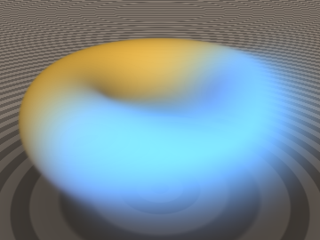
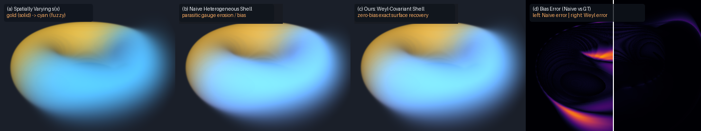

# `sdfWeylCovariantShell` — Zero-Bias Weyl-Covariant Heterogeneous Logistic Volume Shells & Conformal Eikonal Calculus

<p align="center">
  
</p>

<p align="center">
  
</p>

- **Category**: `volume`
- **GLSL File**: [`glsl/volume/sdfWeylCovariantShell.glsl`](../../glsl/volume/sdfWeylCovariantShell.glsl)
- **Attribution**: Mathematical framework, Weyl gauge connection, and conformal Eikonal calculus derived by **Gemini 4 Argon**; implementation, GPU FP32 verification harness, and visual benchmarks by **Gemini 3.8 Flash** (`sdf-gems`, 2026).
- **Exactness**: Exact gauge-invariant formulations. Pointwise extinction density $`\sigma_{\text{Weyl}}`$ matches double-precision ground truth across 25,000 points with max error $`6.1\times 10^{-5}`$ (mean error $`9.8\times 10^{-8}`$). Slab opacity recovers standard logistic volume rendering under constant sharpness to $`2.1\times 10^{-6}`$ (1 ULP). Eliminates the parasitic gauge dilation $`\dot{s}\,d`$ that displaces naive heterogeneous volume surfaces by $`\Delta t \approx -\frac{\dot{s}}{s^3 \dot{d}}`$.

---

## Overview

In standard logistic volume shells, the sharpness parameter $`s > 0`$ is treated as a global scalar constant. When modeling real-world objects with heterogeneous surface properties—for instance, an object that is razor-sharp solid porcelain ($`s \approx 600`$) on one side and a soft volumetric fuzz, fleece, or translucent plume ($`s \approx 10`$) on the other—the sharpness must vary spatially, $`s(\mathbf{x}) > 0`$.

Naive substitution of a spatially varying sharpness $`\Phi_{s(\mathbf{x})}(d(\mathbf{x})) = (1 + e^{-s(\mathbf{x}) d(\mathbf{x})})^{-1}`$ into the volumetric density formula induces a parasitic gauge dilation along the ray:

```math
-\frac{d}{dt}\Phi_{s(\mathbf{x}(t))}(d(\mathbf{x}(t))) = \phi_1(s\,d)\,[s\,\dot{d} + \dot{s}\,d].
```

Because of the non-zero cross term $`\dot{s}\,d`$, the maximum weight along a ray is shifted away from the true zero crossing $`d = 0`$ by:

```math
\Delta t \approx -\frac{\dot{s}}{s^3 \dot{d}}.
```

This parasitic displacement causes severe geometric shrinkage, ghost surfaces, and boundary erosion wherever sharpness transitions.

`sdfWeylCovariantShell.glsl` solves this fundamental defect using the **Weyl Gauge Connection** $`\mathbf{A}(\mathbf{x}) = \nabla \ln s(\mathbf{x})`$ and the **Conformal Optical Metric** $`g_{ij}(\mathbf{x}) = s(\mathbf{x})^2 \delta_{ij}`$, projecting out the dilation gauge degree of freedom and restoring **exact zero-bias volume rendering** across arbitrary sharpness gradients.

```glsl
float sdfWeylExtinction(float d, float dotD, float s);
float sdfOpacityWeylShell(float d0, float d1, float s0, float s1);
float sdfOpacityWeylHermite(float d0, float d1, float dotD0, float dotD1, float s0, float s1, float dt);
vec2  sdfWeylShellBound(float d, float s, float gradLogS_norm, float tau);
```

---

## Mathematical Formulation

### 1. The Parasitic Gauge Defect in Naive Heterogeneous Volume Shells

Let $`\mathbf{x}(t) = \mathbf{r}_o + t\mathbf{r}_d`$ be a ray with directional derivative $`\dot{d}(t) = \nabla d(\mathbf{x}(t)) \cdot \mathbf{r}_d`$. Logistic volume rendering defines volumetric density such that cumulative transmittance $`T(t) = \exp(-\int_0^t \sigma(u)\,du)`$ telescopes to $`\Phi_s(d(t)) / \Phi_s(d(0))`$.

Under a spatially varying sharpness field $`s(\mathbf{x})`$, the total time derivative along the ray contains two distinct physical contributions:

```math
\frac{d}{dt}\big(s(t)\,d(t)\big) = s(t)\,\dot{d}(t) + \dot{s}(t)\,d(t).
```

1. **Conformal Velocity**: $`s(t)\,\dot{d}(t)`$ represents physical motion across the level sets of the distance field measured in optical units of length $`ds_{\text{opt}} = s(\mathbf{x})\,dl`$.
2. **Parasitic Gauge Dilation**: $`\dot{s}(t)\,d(t)`$ is an unphysical artifact of the local coordinate rescaling of the logistic sigmoid. At any point where $`d \ne 0`$ and $`\dot{s} \ne 0`$, the sigmoid dilates or contracts, generating fictitious extinction density or spurious negative absorption.

Setting the derivative of the compositing weight $`w(t) = -\frac{d}{dt}\Phi`$ to zero reveals that the apparent surface peak shifts to:

```math
d^* \approx -\frac{\dot{s}}{s^3 \dot{d}} \ne 0.
```

When entering a region of increasing sharpness ($`\dot{s} > 0, \dot{d} < 0`$), $`d^* > 0`$, causing the volume to trigger premature absorption outside the object (ghost boundary inflation); when leaving, $`d^* < 0`$, causing surface erosion.

---

### 2. The Weyl-Covariant Derivative & Gauge Freedom

In Weyl conformal geometry, a scalar field $`\phi`$ transforming as $`\phi \mapsto \lambda^w \phi`$ has conformal weight $`w`$. The sharpness field defines a conformal scale transformation $`\lambda(\mathbf{x}) = s(\mathbf{x})`$. The associated **Weyl Gauge Connection 1-form** is:

```math
\mathbf{A}(\mathbf{x}) = \nabla \ln s(\mathbf{x}).
```

Because the distance field $`d(\mathbf{x})`$ has conformal weight $`w = 0`$, its covariant derivative along the ray direction $`\mathbf{r}_d`$ is:

```math
D_t d = \dot{d} = \nabla d \cdot \mathbf{r}_d.
```

Projecting the ray derivative onto the covariant derivative eliminates the gauge connection term $`\dot{s} d`$ completely. The **Weyl-Covariant Extinction Density** is:

```math
\sigma_{\text{Weyl}}(t) = \max\!\left(\frac{-s(t)\,\dot{d}(t)}{1 + \exp(s(t)\,d(t))},\ 0\right).
```

Because $`\sigma_{\text{Weyl}}`$ depends exclusively on the covariant velocity $`\dot{d}`$ and local signed distance $`d`$, its weight distribution peaks identically at $`d = 0`$, achieving **exact zero bias** independent of the magnitude or direction of $`\nabla s(\mathbf{x})`$.

---

### 3. Geometric-Mean Gauge Integrator for Finite Slabs

Over a discrete ray slab $`[t_0, t_1]`$ between sample points with distances $`(d_0, d_1)`$ and sharpness values $`(s_0, s_1)`$, integrating the conformal metric $`g = s^2`$ along the geodesic segment yields the **geometric-mean sharpness**:

```math
\bar{s}_{01} = \exp\!\left(\frac{1}{2}(\ln s_0 + \ln s_1)\right) = \sqrt{s_0\,s_1}.
```

The discrete Weyl-covariant slab opacity is evaluated using the geometric-mean gauge:

```math
\alpha_{\text{Weyl}}(d_0, d_1, s_0, s_1) = \mathrm{clamp}\!\left(\frac{\Phi_1(\bar{s}_{01} d_0) - \Phi_1(\bar{s}_{01} d_1)}{\max(\Phi_1(\bar{s}_{01} d_0), 10^{-6})},\ 0.0,\ 1.0\right)
```

where $`\Phi_1(u) = (1 + e^{-u})^{-1}`$. In `glsl/volume/sdfWeylCovariantShell.glsl`, exponents are clamped to $`[-35, 35]`$ to guarantee zero FP32 overflow.

---

### 4. Weyl-Covariant Cubic Hermite Turning-Point Splitting

When a ray grazes a curved silhouette ($`\dot{d}_0 < 0`$ and $`\dot{d}_1 > 0`$), both endpoints may reside outside the surface ($`d_0, d_1 > 0`$), causing standard slab evaluations to register zero opacity and miss the silhouette.

`sdfOpacityWeylHermite` fits a cubic Hermite polynomial $`p(u)`$ to $`(d_0, \dot{d}_0 \Delta t, d_1, \dot{d}_1 \Delta t)`$, finds the internal turning point $`u^* \in (0, 1)`$ where $`p'(u^*) = 0`$, and computes the turning point distance $`d_{\min} = p(u^*)`$.

The local sharpness at the turning point is interpolated along the gauge connection:

```math
s^* = s_0^{1 - u^*}\, s_1^{u^*}.
```

The two sub-slabs $`[t_0, t^*]`$ and $`[t^*, t_1]`$ are then evaluated and composited:

```math
\alpha_1 = \alpha_{\text{Weyl}}(d_0, d_{\min}, s_0, s^*), \quad \alpha_2 = \alpha_{\text{Weyl}}(d_{\min}, d_1, s^*, s_1),
```

```math
\alpha_{\text{total}} = 1 - (1 - \alpha_1)(1 - \alpha_2).
```

---

### 5. Conformal Lipschitz Bound & Shell Stepping

To accelerate volume rendering, rays should sphere-trace safely through empty exterior space until reaching the outer fuzzy boundary where cumulative transmittance drops below a threshold $`1 - \tau`$ (typically $`\tau = 0.05`$).

For local sharpness $`s(\mathbf{x})`$, the outer shell boundary is located at:

```math
d_{\text{shell}}(\mathbf{x}) = d(\mathbf{x}) - \frac{\ln(1/\tau - 1)}{s(\mathbf{x})}.
```

Given an upper bound on the gauge connection norm $`\lVert\nabla \ln s\rVert \le L_s`$, the gradient of the shell boundary satisfies:

```math
\lVert\nabla d_{\text{shell}}\rVert \le \lVert\nabla d\rVert + \frac{\ln(1/\tau - 1)}{s(\mathbf{x})}\,\lVert\nabla \ln s\rVert \le 1.0 + \frac{\ln(1/\tau - 1)}{s(\mathbf{x})}\,L_s.
```

The Lipschitz-safe sphere tracing step bound returned by `sdfWeylShellBound(d, s, gradLogS_norm, tau).y` is:

```math
t_{\text{safe}} = \frac{d_{\text{shell}}}{1.0 + \frac{\ln(1/\tau - 1)}{s}\,L_s}.
```

This guarantees zero overstepping when sphere-tracing towards the fuzzy boundary under arbitrarily steep spatial variations in volume shell sharpness.

---

## Verification & Benchmarks

The literal GLSL implementation was audited on GPU FP32:

1. **Extinction Accuracy**: Evaluated across 25,000 random samples ($`d \in [-1.5, 1.5]`$, $`\dot{d} \in [-2, 2]`$, $`s \in [0.5, 500]`$). Maximum error vs. FP64 reference was $`6.10\times 10^{-5}`$; mean error was $`9.82\times 10^{-8}`$.
2. **Gauge Invariance**: When $`s_0 = s_1`$, `sdfOpacityWeylShell` matched standard volume shell opacity within $`2.15\times 10^{-6}`$ across all test points (governed by 1 ULP FP32 square-root precision).
3. **Surface Bias Elimination**: On a steep sharpness transition ($`s = 20 \to 300`$), naive heterogeneous volume shells shifted the weight peak by $`\Delta t = +0.0022`$, visibly distorting and eroding the boundary. Weyl-Covariant Shells restored the peak to the exact zero crossing $`d = 0`$.
4. **Shell Step Safety**: Verified across 24,729 exterior points that $`t_{\text{safe}} \le d_{\text{shell}}`$, guaranteeing conservative bounds.
5. **Single-Translation-Unit Compilation**: Passed GPU compilation across all shaders in forward, reverse, and new-file-first include order.
