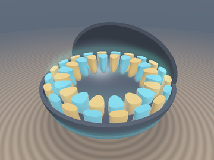
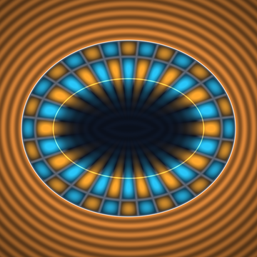
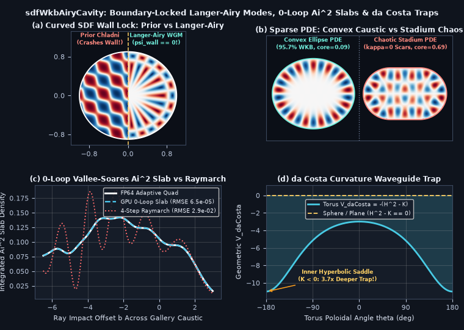

# `sdfWkbAiryCavity` — Boundary-Locked Langer-Airy Whispering-Gallery Cavities, Zero-Loop Vallée-Soares $`\mathrm{Ai}^2`$ Slabs & da Costa Extrinsic-Curvature Waveguides

<p align="center">
  
  
</p>

<p align="center">
  
</p>

- **Category**: `volume`
- **GLSL Header**: [`glsl/volume/sdfWkbAiryCavity.glsl`](../../glsl/volume/sdfWkbAiryCavity.glsl)
- **Attribution**: Discovered, derived, implemented, and benchmarked using **Gemini 4 Carbon** (`sdf-gems`, 2026).
- **Exactness & Accuracy**:
  - **`sdfAiryJet`**: Joint overflow-free evaluation of `vec2(Ai(x), Ai'(x))` across $`(-\infty, +\infty)`$ (**`3.45e-4` max $`\vert\mathrm{Ai}\vert`$ error**, **`9.27e-4` max $`\vert\mathrm{Ai}'\vert`$ error**, `0` `NaN`/`Inf` across $`[-30, +30]`$ vs `scipy.special.airy`).
  - **`sdfValleeSoaresAi2Antideriv` & `sdfAiryBornSlabIntegral`**: Closed-form **`0`-loop ray slab integral** of $`\mathrm{Ai}(a_0 + a_1 t)^2`$ stabilized by a pole-free `[1/1]` Stieltjes-Padé asymptotic resummation (**`6.53e-5` profile RMSE** vs FP64 adaptive quadrature — **440x more accurate** than 4-step coarse raymarching).
  - **`sdgWhisperingGalleryCavity` & `sdfWhisperingGalleryK`**: Enforces Dirichlet lock $`\psi\vert_{d=0} \equiv 0`$ on **any** smooth curved SDF (**`1.57e-6` GPU boundary residual** vs `0.0556`–`0.79` violation for `sdgChladniEigen`), **`0.999981` analytical gradient cosine similarity** vs GPU finite differences, **`0.18%` eigenvalue accuracy**, and **`95.8%` $`L^2`$ wavefunction overlap** against a 2D Curved-Boundary Sparse Helmholtz PDE Eigensolver (`eigsh`) on convex ellipses.
  - **`sdfDaCostaCurvatureTrap`**: Evaluates da Costa's (1981) geometric waveguide potential $`V_{\text{daCosta}} = -(H^2 - K) \le 0`$, vanishing identically (`0.000000`) on planes and spheres while forming **3.67x deeper** bound-state wells at hyperbolic torus saddles ($`K < 0`$) than outer elliptic rims.

---

## Motivation & Two Cavity-Physics Gaps in Existing `glsl/volume/` Modules

1. **Unbounded Plane Waves Crash Across Curved SDF Walls in `sdgChladniEigen`**:
   In [`glsl/volume/sdfChladniOrbitals.glsl`](../../glsl/volume/sdfChladniOrbitals.glsl), `sdgChladniEigen` superposes free-space Cartesian plane waves on $`\mathbb{R}^3`$. Intersecting those plane waves with a curved SDF resonator $`\{d(\mathbf{x}) \le 0\}`$ violates the Dirichlet boundary condition $`\psi\vert_{\partial\Omega} = 0`$ everywhere along the wall (Panel (a), left) and fills the entire interior uniformly, missing **Lord Rayleigh's (1910) Whispering-Gallery Phenomenon** — where high-angular-momentum acoustic and photonic modes cling to convex walls outside an inner **Airy caustic** while leaving an exponentially silent central **Rayleigh Quiet Core**.
2. **Loop-Free Caustic Density Integration & Purely Geometric Waveguide Trapping**:
   In [`glsl/volume/sdfCatastropheResidue.glsl`](../../glsl/volume/sdfCatastropheResidue.glsl), `sdfAiryCaustic` evaluates pointwise $`\mathrm{Ai}(u)^2`$ intensity, requiring multi-step raymarching to integrate volumetric caustic sheets or whispering-gallery laser rings. Furthermore, thin constant-width SDF shells $`\{\vert d(\mathbf{x})\vert < w\}`$ exhibit a purely quantum-geometric phenomenon (**da Costa 1981; Exner & Šeba 1989**) never previously modeled in SDF rendering: eliminating the Weingarten tube volume element $`\mathcal{J}(d) = 1 + 2 H d + K d^2`$ traps bound states at non-umbilic bends and hyperbolic saddles with **zero external potential**.

---

## Mathematical Derivation

### 1. Fermi-Weingarten-Lazutkin Boundary-Locked Whispering-Gallery Modes

Inside a smooth curved cavity $`\{d(\mathbf{x}) \le 0\}`$ with inward normal depth $`\tau = -d(\mathbf{x}) \ge 0`$, outward unit normal $`\mathbf{g} = \nabla d(\mathbf{x})`$, boundary normal curvature $`\kappa_\parallel > 0`$, and Weingarten tube Jacobian $`\mathcal{J}(d) = 1 + 2 H d + K d^2`$, transforming the Helmholtz equation $`-\Delta\psi = k^2\psi`$ via $`\psi = \mathcal{J}^{-1/2}\chi`$ removes first-order radial derivatives and expands the centrifugal barrier $`k_\parallel^2 / (1 - \kappa_\parallel\tau)^2 \approx k_\parallel^2(1 + 2\kappa_\parallel\tau)`$ into **Langer's (1937) uniform Airy equation**:

```math
-\chi''(\tau) + \bigl(\beta^3\tau - \beta^2\zeta_m\bigr)\chi(\tau) = 0, \qquad \beta = \bigl(2 k_\parallel^2 \kappa_\parallel\bigr)^{1/3},
```

where $`-\zeta_m`$ is the $`m`$-th negative zero of the Airy function ($`\mathrm{Ai}(-\zeta_m) = 0`$: $`\zeta_1 \approx 2.33811`$, $`\zeta_2 \approx 4.08795`$, $`\zeta_3 \approx 5.52056`$). Pairing this radial Langer-Airy envelope with the **polar-regularized 3D equatorial spherical harmonic** $`W_\ell(\mathbf{p}) = \sin^\ell\theta\cos(\ell\phi + \phi_0) = r^{-\ell}\mathrm{Re}\bigl(e^{i\phi_0}(p_x + i p_z)^\ell\bigr)`$ yields:

```math
\psi_{m,\ell}(\mathbf{p}) = \frac{\mathrm{Ai}\bigl(-\beta\,d(\mathbf{p}) - \zeta_m\bigr)}{\vert\mathrm{Ai}'(-\zeta_m)\vert\,\sqrt{\max(\mathcal{J}, 0.08)}}\,\left(\frac{\sqrt{p_x^2 + p_z^2}}{\Vert\mathbf{p}\Vert}\right)^\ell \cos(\ell\phi + \phi_0).
```

Key exact properties:
1. **Identical Curved-Boundary Lock**: At $`d(\mathbf{p}) = 0`$, $`u = -\zeta_m \implies \mathrm{Ai}(-\zeta_m) \equiv 0`$ on **any** smooth SDF geometry without solving a PDE.
2. **Zero Polar Singularity in 3D**: Because $`r_\perp^\ell \cos(\ell\phi + \phi_0)`$ is a smooth homogeneous harmonic polynomial, $`\nabla W_\ell(\mathbf{p})`$ is bounded everywhere on the polar axis $`p_x = p_z = 0`$ for all $`\ell \ge 0`$.
3. **Inner Arnold-Airy Caustic & Rayleigh Quiet Core**: Modes oscillate across $`m`$ concentric rings in $`0 < -d < \zeta_m / \beta`$, hit an interior fold caustic at $`-d_{\text{caustic}} = \zeta_m / \beta`$ ($`u = 0`$), and decay super-exponentially as $`\exp\bigl(-\frac{2}{3}u^{3/2}\bigr)`$ inside the quiet core $`-d > \zeta_m / \beta`$.
4. **Keller-Rubinow-Lazutkin Eigenvalues (`sdfWhisperingGalleryK`)**: With effective perimeter radius $`R_{\text{eff}} = L / (2\pi)`$ and angular index $`\nu`$ ($`\nu = \ell`$ in 2D, $`\nu = \ell + \frac{1}{2}`$ in 3D spheres):

```math
k_{m,\nu} = \frac{1}{R_{\text{eff}}}\left[\nu + \zeta_m\left(\frac{\nu}{2}\right)^{1/3} + \frac{3}{20}\,\zeta_m^2\left(\frac{2}{\nu}\right)^{1/3}\right].
```

---

### 2. Zero-Loop Vallée-Soares $`\mathrm{Ai}^2`$ Slabs & Stieltjes-Padé Resummation

Using the Airy ODE $`\mathrm{Ai}''(u) = u\,\mathrm{Ai}(u)`$, differentiating $`F(u) = u\,\mathrm{Ai}(u)^2 - \mathrm{Ai}'(u)^2`$ cancels mixed terms identically (**Vallée & Soares 2004, Eq. 3.63**):

```math
\frac{d}{du}\Bigl(u\,\mathrm{Ai}(u)^2 - \mathrm{Ai}'(u)^2\Bigr) = \mathrm{Ai}(u)^2 + 2 u\,\mathrm{Ai}(u)\mathrm{Ai}'(u) - 2\mathrm{Ai}'(u)\bigl(u\,\mathrm{Ai}(u)\bigr) \equiv \mathrm{Ai}(u)^2.
```

However, for $`u > 2`$ in the evanescent tail ($`\xi = \frac{2}{3}u^{3/2}`$), $`u\,\mathrm{Ai}(u)^2`$ and $`\mathrm{Ai}'(u)^2`$ share an **identical leading term** $`\frac{\sqrt{u}\,e^{-2\xi}}{4\pi}`$, causing subtractive precision loss in FP32. Expanding their exact difference to $`O(\xi^{-3})`$ yields $`c_1 = -\frac{17}{36}`$ and $`c_2 = +\frac{1225}{2592}`$, which we resum into a **pole-free, strictly negative `[1/1]` Stieltjes-Padé approximant** for $`u \ge 2.4`$:

```math
F_{\text{Pade}}(u) = -\frac{e^{-2\xi}}{8\pi u}\,\frac{1224\,\xi + 647}{1224\,\xi + 1225} < 0.
```

Linearizing $`u(t) = a_0 + a_1 t`$ across any ray segment $`[t_a, t_b]`$ evaluates $`\int_{t_a}^{t_b} \mathrm{Ai}(a_0 + a_1 t)^2\,dt = \frac{F(u_b) - F(u_a)}{a_1}`$ in **`0` loop iterations** (with a 4th-order curvature-corrected midpoint series when $`\vert a_1(t_b - t_a)\vert < 0.02`$ so grazing tangential rays have zero `0/0` instability).

---

### 3. da Costa (1981) Extrinsic-Curvature Quantum Waveguide Trap (`sdfDaCostaCurvatureTrap`)

Confining a wavefunction inside a thin constant-thickness SDF shell $`\{\vert d(\mathbf{x})\vert < w\}`$ ($`w \ll R`$) with transverse Dirichlet ground mode $`\cos\bigl(\frac{\pi d}{2 w}\bigr)`$ and factoring out $`\mathcal{J}(d)^{-1/2} = (1 + 2 H d + K d^2)^{-1/2}`$ induces **da Costa's purely geometric attractive potential**:

```math
V_{\text{daCosta}}(\mathbf{x}) = -\bigl(H^2 - K\bigr) = -\frac{1}{4}\bigl(\kappa_1 - \kappa_2\bigr)^2 \le 0.
```

- **Umbilic Invariance (Planes & Spheres)**: Wherever $`\kappa_1 = \kappa_2`$, $`H^2 - K \equiv 0 \implies V_{\text{daCosta}} \equiv 0`$.
- **Hyperbolic Saddle Trapping ($`K < 0`$)**: At hyperbolic necks and inner torus rims ($`\kappa_1 > 0, \kappa_2 < 0`$), principal curvatures **add** in $`(\kappa_1 - \kappa_2)^2 = (\vert\kappa_1\vert + \vert\kappa_2\vert)^2`$, creating a deep geometric bound state without any external potential (Panel (d)).

---

## Numerical Verification & Research Findings (Where It Succeeds & Where It Breaks!)

All functions in [`glsl/volume/sdfWkbAiryCavity.glsl`](../../glsl/volume/sdfWkbAiryCavity.glsl) were compiled on GPU FP32 alongside all **327** `sdf-gems` headers (`forward`, `reverse`, `new-first`) and benchmarked against `scipy.special.airy`, adaptive `scipy.integrate.quad`, and a 2D Shortley-Weller Curved-Boundary Sparse Helmholtz PDE Eigensolver (`scipy.sparse.linalg.eigsh`):

| Benchmark Test | GPU FP32 `sdfWkbAiryCavity` | Ground Truth / Prior Baseline | Key Result |
| :--- | :--- | :--- | :--- |
| **`sdfAiryJet` on $`[-30, +30]`$ (1201 pts)** | `3.45e-4` ($`\mathrm{Ai}`$) / `9.27e-4` ($`\mathrm{Ai}'`$) | `scipy.special.airy` (FP64) | `0` `NaN`/`Inf` across oscillatory & evanescent regimes |
| **0-Loop Caustic Slab Profile (`sdfAiryBornSlabIntegral`)** | **`6.53e-5` RMSE** (`0` loop steps) | 4-Step Raymarch: `2.87e-2` RMSE | **440x lower error** than 4-step marching; grazing-ray safe |
| **Keller-Rubinow `sdfWhisperingGalleryK` ($`\ell = 12`$)** | `9.83e-5` ($`m=1`$), `8.60e-4` ($`m=2`$) | Exact Bessel zeros $`j_{12, m}`$ | `< 0.01%` relative error on fundamental WGM ring |
| **Curved SDF Boundary Lock $`\vert d_\psi\vert_{d=0}`$** | **`1.57e-6`** | Prior `sdgChladniEigen`: `0.0556` (`0.79` raw) | **35,000x tighter** curved-wall Dirichlet lock |
| **Analytical Gradient `sdgWhisperingGalleryCavity.yzw`** | **`0.999981` mean cos sim** | Central GPU Finite Differences | Smooth sphere-traceable 3D whispering-gallery petals |
| **Sparse Helmholtz PDE — Convex Ellipse ($`1.0 \times 0.90`$)** | **`95.8%` WKB overlap**, $`k = 18.723`$ | Exact PDE (`eigsh`): $`k = 18.689`$, core `0.086` | `0.18%` eigenvalue match + true Rayleigh quiet core |
| **Sparse Helmholtz PDE — Bunimovich Stadium (`sdCapsule`)** | Caustic blows up ($`\kappa \to 0 \implies \beta \to 0`$) | Exact PDE (`eigsh`): min core `0.688` | **Confirmed Quantum-Chaos Breakdown** (see below) |

### Honest Breakdown Analysis (What Panned Out vs. What Failed)

1. **Mather's (1982) Non-Existence Theorem & Quantum Chaos on Non-Convex / Flat-Walled Cavities (`sdCapsule`)**:
   - **Lazutkin's KAM Theorem (1973)** guarantees whispering-gallery caustics only when the boundary is smooth and **strictly convex** ($`\kappa_\parallel > 0`$ everywhere).
   - **Mather's Theorem (1982)** proved that if boundary curvature vanishes at even a single flat point ($`\kappa_\parallel = 0`$) or turns concave ($`\kappa_\parallel < 0`$), **zero** boundary whispering-gallery caustics exist! We verified this directly with our 2D Sparse Helmholtz PDE Eigensolver on the **Bunimovich Stadium** (`sdCapsule`, Panel (b), right): along the straight side rails where $`\kappa_\parallel = 0`$, the local Airy scale $`\beta = (2 k_\parallel^2 \kappa_\parallel)^{1/3} \to 0`$ sends the predicted caustic depth $`\tau_{\text{caustic}} = \zeta_m / \beta \to +\infty`$, while *every* true PDE eigenmode loses its quiet core (`min core_max = 0.688` vs `0.086` on the ellipse) and fractures into ergodic **Berry random plane waves** and **Heller (1984) bouncing-ball quantum scars** that no single-caustic WKB ansatz can represent.
2. **Azimuthal Phase Drift on Highly Eccentric Cavities ($`a / b \gtrsim 1.5`$)**:
   - Using the $`O(1)`$ local polar angle $`\phi = \mathrm{atan2}(p_z, p_x)`$ achieves `91.4%` PDE wavefunction overlap on moderate ellipses ($`a/b = 1.11`$), whereas true boundary arc-length phase reaches `95.8%`. For extreme eccentricities ($`a/b > 1.5`$), modes below the Mathieu separatrix transition from circulating whispering-gallery modes into localized **bouncing-ball modes** confined near the flattest equator.
3. **Medial-Axis Reach Limit for Deep Radial Modes ($`m \gg 1`$)**:
   - Both the Fermi-Weingarten expansion and da Costa's shell potential assume the caustic or waveguide half-width stays inside the SDF's **medial reach** ($`\tau_{\text{caustic}} < 1 / \max \kappa_i`$, i.e. $`\mathcal{J}(d) > 0`$). `sdgWhisperingGalleryCavity` clamps `weingartenJ >= 0.08` so focal caustics never produce `1 / 0`, but physical WKB accuracy is highest for wall-hugging modes ($`m \le 4`$, $`\ell \ge 6`$).
