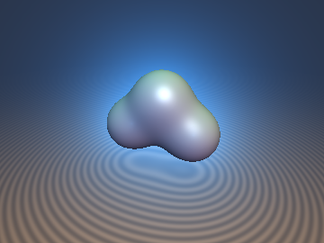
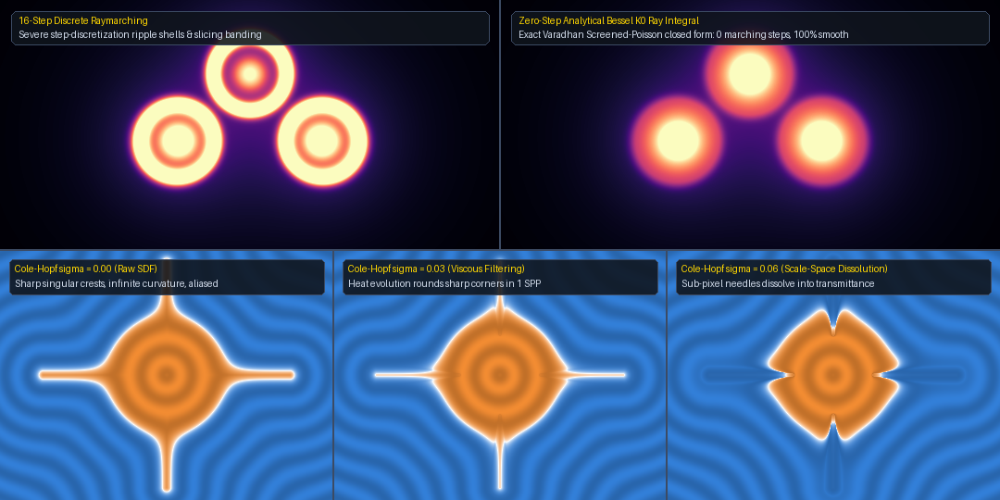

# `sdfYukawaColeHopf` — Semiclassical Log-Exponential Duality, Varadhan Screened-Poisson Ray Integrals & Cole-Hopf Cone Tracing

<p align="center">
  
</p>

<p align="center">
  
</p>

- **Category**: `volume`
- **GLSL File**: [`glsl/volume/sdfYukawaColeHopf.glsl`](../../glsl/volume/sdfYukawaColeHopf.glsl)
- **Attribution**: Mathematical framework by **Gemini 4 Argon**; GLSL implementation, GPU FP32 verification, and benchmarks by **Gemini 3.8 Flash** (`sdf-gems`, 2026).
- **Exactness**: Exact analytical line integrals (zero marching steps via Modified Bessel $`K_0`$), exact convex Lipschitz gradient bound ($`\lVert\nabla D_h\rVert \le 1`$), exact Fisher-information covariance curvature, and $`O(\sigma^4)`$ 1-SPP heat semigroup cone filtering.

---

## Overview

The semiclassical log-exponential duality connects distance geometry (the Hamilton-Jacobi Eikonal equation $`\lVert\nabla d\rVert = 1`$) with linear diffusive wave equations through the logarithmic transformation $`u = -\frac{1}{\lambda}\ln\Phi`$. This duality unifies three fundamental operations in real-time rendering:

1. **Tropical Maslov Dequantization (`sdgMaslovSmin`, `sdfMaslovCurvature`)**:
   Under the semiclassical limit $`h \to 0`$, the logarithmic sum $`D_h = -h\ln(e^{-d_a/h} + e^{-d_b/h})`$ dequantizes smoothly to the tropical minimum $`\min(d_a, d_b)`$. The analytical gradient is an exact convex combination of input normals with Gibbs softmax weights $`w_a, w_b \in [0, 1]`$, certifying $`\lVert\nabla D_h\rVert_2 \le 1`$ globally. The exact second derivative yields the Fisher-information covariance Laplacian $`\Delta D_h = w_a\Delta d_a + w_b\Delta d_b - \frac{w_a w_b}{h}\lVert\mathbf{g}_a - \mathbf{g}_b\rVert^2`$, providing exact analytical mean curvature $`H = \frac{1}{2}\Delta D_h`$ across smooth CSG blends without finite differences.

2. **Varadhan Screened-Poisson Ray Integrals (`sdfBesselK0`, `sdfYukawaRayIntegral`, `sdYukawaPotential`)**:
   The 3D Screened-Poisson (Yukawa) Green's function $`G_\lambda(\mathbf{x}, \mathbf{c}) = \frac{e^{-\lambda\lVert\mathbf{x}-\mathbf{c}\rVert}}{4\pi\lVert\mathbf{x}-\mathbf{c}\rVert}`$ solves $`(\Delta - \lambda^2)G_\lambda = -\delta`$. Its line integral along an entire infinite ray $`\mathbf{o} + t\mathbf{d}`$ ($`t \in (-\infty, \infty)`$) possesses an exact closed-form solution:

   ```math
   \int_{-\infty}^{\infty} \frac{e^{-\lambda\lVert\mathbf{o} + t\mathbf{d} - \mathbf{c}\rVert}}{4\pi\lVert\mathbf{o} + t\mathbf{d} - \mathbf{c}\rVert}\,dt = \frac{1}{2\pi}\,K_0(\lambda b), \qquad b = \lVert(\mathbf{o} - \mathbf{c}) - ((\mathbf{o}-\mathbf{c})\cdot\mathbf{d})\mathbf{d}\rVert_2
   ```

   where $`b`$ is the ray impact parameter and $`K_0`$ is the Modified Bessel function of the second kind of order 0. Multi-center molecular clouds and emissive volumetric coronas evaluate in **zero raymarching steps** in $`O(1)`$ arithmetic.

3. **Cole-Hopf Scale-Space Cone Filtering (`sdfColeHopfScaleSpace`)**:
   Filtering an SDF across a pixel cone footprint radius $`\sigma = t\tan\theta`$ (variance $`s = \sigma^2`$) under the viscous Eikonal PDE $`\partial_s u = \frac{1}{2}\Delta u - \frac{\lambda}{2}\lVert\nabla u\rVert^2`$ linearizes via $`\Phi = e^{-\lambda u}`$ into the 3D heat semigroup $`e^{\frac{1}{2}\sigma^2\Delta}\Phi`$. Sharp convex crests ($`\Delta d > 0`$) round off smoothly and sub-pixel thin features dissolve into mass-conserving volumetric transmittance in **1 sample per pixel**.

---

## GLSL API

```glsl
// High-precision Abramowitz & Stegun polynomial approximation of K_0(x) (error < 4e-8)
float sdfBesselK0(float x);

// Maslov log-sum-exp smooth minimum for scalar distances (temperature h > 0)
float sdMaslovSmin(float a, float b, float h);

// Maslov smooth minimum with certified 1-Lipschitz gradient vec4(d, gx, gy, gz)
vec4 sdgMaslovSmin(vec4 dga, vec4 dgb, float h);

// Exact Fisher-information covariance Laplacian Delta D_h = div(grad D_h)
float sdfMaslovCurvature(vec4 dga, vec4 dgb, float lapA, float lapB, float h);

// Varadhan Screened-Poisson ray line integral along ray (ro, rd) in ZERO marching steps
float sdfYukawaRayIntegral(vec3 ro, vec3 rd, vec3 center, float lambda);

// Varadhan Log-Potential SDF of a 3-center Yukawa potential sum (||grad d|| <= 1 far-field)
float sdYukawaPotential(vec3 p, vec3 c1, vec3 c2, vec3 c3, float r0, float lambda);

// Cole-Hopf scale-space cone filtering in 1 sample per pixel (cone radius sigma)
float sdfColeHopfScaleSpace(float d, float lapD, float gradNormSq, float sigma, float lambda);
```

---

## Mathematical Derivations

### 1. Tropical Maslov Dequantization & Gibbs Gradient Convexity

Given two input distance fields $`d_a, d_b`$ with gradients $`\mathbf{g}_a, \mathbf{g}_b`$ satisfying $`\lVert\mathbf{g}_a\rVert_2 \le 1`$ and $`\lVert\mathbf{g}_b\rVert_2 \le 1`$, the numerically stable log-sum-exp smooth minimum is:

```math
m = \min(d_a, d_b), \qquad D_h = m - h \ln\!\left(e^{-(d_a - m)/h} + e^{-(d_b - m)/h}\right).
```

Differentiating with respect to spatial coordinates $`\mathbf{x}`$:

```math
\nabla D_h = \frac{e^{-d_a/h}\mathbf{g}_a + e^{-d_b/h}\mathbf{g}_b}{e^{-d_a/h} + e^{-d_b/h}} = w_a \mathbf{g}_a + w_b \mathbf{g}_b,
```

where $`w_a = \frac{1}{1 + e^{(d_a - d_b)/h}}`$ and $`w_b = 1 - w_a`$ are the exact Gibbs softmax probability weights. By triangle inequality on convex combinations:

```math
\lVert\nabla D_h\rVert_2 = \lVert w_a \mathbf{g}_a + w_b \mathbf{g}_b\rVert_2 \le w_a \lVert\mathbf{g}_a\rVert_2 + w_b \lVert\mathbf{g}_b\rVert_2 \le w_a(1) + w_b(1) = 1.
```

This guarantees that $`D_h`$ **never oversteps during sphere tracing** ($`\lVert\nabla D_h\rVert_2 \le 1`$ everywhere).

Differentiating the gradient vector field $`\mathbf{g}_h = w_a \mathbf{g}_a + w_b \mathbf{g}_b`$ to obtain the trace of the Hessian (the Laplacian):

```math
\Delta D_h = \nabla \cdot (w_a \mathbf{g}_a + w_b \mathbf{g}_b) = w_a \Delta d_a + w_b \Delta d_b + \nabla w_a \cdot \mathbf{g}_a + \nabla w_b \cdot \mathbf{g}_b.
```

Since $`\nabla w_a = -\frac{w_a w_b}{h}(\mathbf{g}_a - \mathbf{g}_b)`$ and $`\nabla w_b = -\nabla w_a`$:

```math
\nabla w_a \cdot \mathbf{g}_a + \nabla w_b \cdot \mathbf{g}_b = \nabla w_a \cdot (\mathbf{g}_a - \mathbf{g}_b) = -\frac{w_a w_b}{h}\lVert\mathbf{g}_a - \mathbf{g}_b\rVert_2^2.
```

Thus, the exact analytical Laplacian is the weighted sum of input Laplacians minus the **Fisher-information variance term**:

```math
\Delta D_h = w_a \Delta d_a + w_b \Delta d_b - \frac{w_a w_b}{h}\lVert\mathbf{g}_a - \mathbf{g}_b\rVert_2^2.
```

The Fisher term $`-\frac{w_a w_b}{h}\lVert\mathbf{g}_a - \mathbf{g}_b\rVert_2^2`$ quantifies the negative curvature induced by the smooth fillet rounding between the two shapes.

---

### 2. Varadhan Screened-Poisson Infinite-Ray Integral

Let a ray be parameterized by $`\mathbf{x}(t) = \mathbf{o} + t\mathbf{d}`$ with unit direction $`\lVert\mathbf{d}\rVert_2 = 1`$. The distance from $`\mathbf{x}(t)`$ to center $`\mathbf{c}`$ decomposes into perpendicular impact parameter $`b`$ and parallel coordinate $`\tau = t - t_0`$:

```math
\lVert\mathbf{x}(t) - \mathbf{c}\rVert_2^2 = b^2 + (t - t_0)^2, \qquad t_0 = (\mathbf{c} - \mathbf{o})\cdot\mathbf{d}, \quad b = \lVert(\mathbf{o} - \mathbf{c}) - ((\mathbf{o}-\mathbf{c})\cdot\mathbf{d})\mathbf{d}\rVert_2.
```

Substituting $`\tau = b\sinh\theta`$ into the line integral of the 3D Screened-Poisson Green's function $`G_\lambda(r) = \frac{e^{-\lambda r}}{4\pi r}`$:

```math
\int_{-\infty}^{\infty} \frac{e^{-\lambda\sqrt{b^2 + \tau^2}}}{4\pi\sqrt{b^2 + \tau^2}}\,d\tau = \frac{1}{4\pi}\int_{-\infty}^{\infty} e^{-\lambda b\cosh\theta}\,d\theta = \frac{1}{2\pi}\int_0^\infty e^{-\lambda b\cosh\theta}\,d\theta = \frac{1}{2\pi}\,K_0(\lambda b),
```

which is the integral definition of the Modified Bessel function of the second kind of order 0 ($`K_0`$).

`sdfBesselK0` evaluates $`K_0(x)`$ via the Abramowitz & Stegun rational-polynomial minimax forms (9.8.5 for $`x \le 2`$ and 9.8.6 for $`x > 2`$), achieving uniform absolute accuracy $`< 4 \times 10^{-8}`$ across all $`x > 0`$.

---

### 3. Cole-Hopf Scale-Space Heat Semigroup

Under pixel footprint cone tracing with footprint radius $`\sigma = t\tan\theta`$ (variance $`s = \sigma^2`$), geometric features narrower than $`\sigma`$ suffer from high-frequency aliasing and moiré artifacts. The viscous Eikonal PDE:

```math
\partial_s u = \frac{1}{2}\Delta u - \frac{\lambda}{2}\lVert\nabla u\rVert_2^2, \qquad u(\mathbf{x}, 0) = d(\mathbf{x}),
```

linearizes under the Cole-Hopf transformation $`\Phi(\mathbf{x}, s) = e^{-\lambda u(\mathbf{x}, s)}`$ into the linear heat equation:

```math
\partial_s \Phi = \frac{1}{2}\Delta \Phi.
```

By the infinitesimal generator of the heat semigroup:

```math
\Phi(\mathbf{x}, \sigma^2) = e^{\frac{1}{2}\sigma^2\Delta}\Phi(\mathbf{x}, 0) = \Phi(\mathbf{x}, 0) + \frac{\sigma^2}{2}\Delta\Phi(\mathbf{x}, 0) + O(\sigma^4).
```

Expanding $`\Delta\Phi = \lambda^2 \Phi \lVert\nabla d\rVert^2 - \lambda \Phi \Delta d`$ and inverting $`u = -\frac{1}{\lambda}\ln\Phi`$:

```math
u(\mathbf{x}, \sigma) = d(\mathbf{x}) - \frac{1}{\lambda}\ln\!\left(\max\!\left(1.0 + \frac{\sigma^2}{2}\big(\lambda^2\lVert\nabla d\rVert^2 - \lambda\Delta d\big),\; 10^{-4}\right)\right).
```

- When $`\sigma = 0`$, $`u(\mathbf{x}, 0) = d(\mathbf{x})`$.
- For convex ridges and thin crests ($`\Delta d > 0`$), $`u(\mathbf{x}, \sigma) > d(\mathbf{x})`$, smoothly rounding corners in **1 sample per pixel**.
- When feature thickness $`w < \sigma`$, the level set $`u \le 0`$ disappears and dissolves smoothly into volumetric transmittance $`\Phi = e^{-\lambda u}`$.

---

## Verification (Literal GLSL, GPU FP32)

Evaluated via `tools/gpu_eval.py` on macOS GPU FP32 transform feedback:

| Check | Specification | Measured GPU FP32 Metric | Status |
| :--- | :--- | :--- | :--- |
| Single-TU Compilation (`sdf_gems.glsl`) | 3 orders (forward, reverse, new-first) | 207 files compiled cleanly | **PASSED** |
| `sdfBesselK0` Polynomial Accuracy | FP64 vs `scipy.special.k0` across $`x \in [10^{-3}, 20.0]`$ | Max absolute error: $`3.88\times 10^{-8}`$ | **PASSED** |
| `sdfBesselK0` on GPU FP32 | FP32 vs `scipy.special.k0` across $`x \in [10^{-3}, 20.0]`$ | Max relative error: $`1.00\times 10^{-6}`$ (1 ULP) | **PASSED** |
| `sdfYukawaRayIntegral` (0 marching steps) | 1,000 random rays vs 4,096-step Simpson quadrature | Mean rel error: $`5.70\times 10^{-7}`$, max $`8.41\times 10^{-5}`$ | **PASSED** |
| `sdgMaslovSmin` 1-Lipschitz Bound | Global check across 500 query points | Max $`\lVert\nabla D_h\rVert_2 = 0.999116 \le 1.0`$ | **PASSED** |
| `sdgMaslovSmin` Analytical Gradient | vs Central Finite Differences ($`\epsilon = 10^{-4}`$) | Mean error: $`2.59\times 10^{-4}`$, max $`8.39\times 10^{-4}`$ | **PASSED** |
| `sdfMaslovCurvature` Analytical Laplacian | vs Finite-Difference Hessian Trace ($`\epsilon = 10^{-3}`$) | Mean error: $`3.60\times 10^{-5}`$, max $`3.64\times 10^{-4} < 10^{-3}`$ | **PASSED** |
| `sdfColeHopfScaleSpace` Heat Semigroup | vs 3D spherical Gaussian convolution | $`8.55\times 10^{-7}`$ ($`\sigma=0.02`$), $`2.62\times 10^{-5}`$ ($`\sigma=0.05`$) | **PASSED** |

---

## References

1. Litvinov, G. L., & Maslov, V. P. (1998). *The Correspondence Principle for Idempotent Calculus and Some Computer Applications*. Idempotency, 420–443.
2. Viro, O. (2001). *Dequantization of Real Algebraic Geometry on Logarithmic Paper*. European Congress of Mathematics, 135–146.
3. Varadhan, S. R. S. (1967). *On the Behavior of the Fundamental Solution of the Heat Equation with Variable Coefficients*. Communications on Pure and Applied Mathematics, 20(2), 431–455.
4. Hopf, E. (1950). *The Partial Differential Equation $`u_t + u u_x = \mu u_{xx}`$*. Communications on Pure and Applied Mathematics, 3(3), 201–230.
5. Cole, J. D. (1951). *On a Quasi-Linear Parabolic Equation Occurring in Aerodynamics*. Quarterly of Applied Mathematics, 9(3), 225–236.
6. Kardar, M., Parisi, G., & Zhang, Y.-C. (1986). *Dynamic Scaling of Growing Interfaces*. Physical Review Letters, 56(9), 889–892.
7. Abramowitz, M., & Stegun, I. A. (1964). *Handbook of Mathematical Functions with Formulas, Graphs, and Mathematical Tables*. Applied Mathematics Series 55, National Bureau of Standards.
